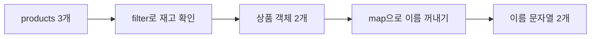

# 7장. 배열과 불변성

**학습목표**

- 원본을 유지하며 새 값을 만들고, `===`로 참조를 비교할 수 있습니다.
- `forEach`, `map`, `filter`, `find`를 필요한 결과에 맞게 고를 수 있습니다.
- `map`과 `join`으로 목록을 문자열로 만들 수 있습니다.
- `slice`와 전개 연산자로 원본을 바꾸지 않고 배열 일부를 꺼내거나 요소를 추가할 수 있습니다.

## 7-1 불변성

6장에서는 전개 연산자로 객체와 배열을 복사했습니다.
이 장에서는 그 복사 방법을 바탕으로 원본을 지키며 목록을 다룹니다.
5장에서 배운 콜백 함수를 배열 메서드에 넘겨 반복과 변환도 해 봅니다.

이 장의 예제는 모두 `js-course/chapter07` 폴더에 만들고 node로 실행합니다.
VS Code에서 `js-course` 안에 `chapter07` 폴더를 만들고, 새 터미널을 열어 `cd chapter07`을 입력해 둡니다.

### 불변성

**불변성**(immutability)은 이미 있는 값을 직접 바꾸지 않고, 변경된 내용을 새 값으로 만드는 원칙입니다.
쉽게 말해 이전 목록은 그대로 두고 바뀐 목록을 따로 만듭니다.
여기서는 객체와 배열을 다룰 때 이 원칙을 지킵니다.

### 불변성은 왜 필요할까?

변경 전의 값을 남겨 두고 새 값과 비교하기 위해 필요합니다.

회원 `member`의 등급을 바꾸기 전에 `previousMember`에 저장해 둔다고 생각해 봅시다.
6장에서 배운 것처럼 객체를 대입하면 두 변수는 같은 객체를 가리킵니다.
그 객체의 등급을 직접 바꾸면 `previousMember`로 읽은 등급도 함께 바뀝니다.
이전 등급이 남아 있지 않아 변경 전후를 비교할 수 없습니다.

`{ ...member, grade: "골드" }`로 새 객체를 만들면 기존 객체의 등급은 그대로입니다.
`member`에는 새 객체를 할당하고, `previousMember`는 이전 객체를 계속 가리키게 합니다.
그러면 두 등급을 읽어 비교할 수 있고, `===`로 서로 다른 객체인지도 확인할 수 있습니다.

**특징**

- 변경할 때 원본 객체의 속성이나 원본 배열의 요소를 직접 바꾸지 않습니다.
- 바뀐 내용을 담을 객체나 배열을 새로 만듭니다.
- 새 값을 현재 값으로 쓸 때는 `let` 변수에 재할당할 수 있습니다.
- `const`로 선언하는 것만으로 객체나 배열의 내용이 불변이 되지는 않습니다.

6장의 이름표 비유로 보면, 원본 상자를 열어 바꾸는 대신 새 상자를 만듭니다.
이전 이름표는 원본 상자에 남겨 두고 현재 이름표만 새 상자를 가리키게 합니다.

**시각자료 — 이전 객체와 새 객체를 따로 가리키기**


`previousMember`와 `member`가 가리키는 상자가 서로 다릅니다.
원본의 `grade`는 `"실버"`이고 새 객체의 `grade`는 `"골드"`입니다.

**기본 문법**

```javascript
const 이전객체 = 객체명;
객체명 = { ...객체명, 속성: 새값 };
```

**예제 7-1** `immutable.js`

```javascript
let member = {
  name: "김코딩",
  grade: "실버"
};
const previousMember = member;

console.log("변경 전 같은 객체:", previousMember === member);

member = { ...member, grade: "골드" };

console.log("이전 등급:", previousMember.grade);
console.log("현재 등급:", member.grade);
console.log("변경 후 같은 객체:", previousMember === member);
```

**실행 결과**

```text
변경 전 같은 객체: true
이전 등급: 실버
현재 등급: 골드
변경 후 같은 객체: false
```

- `const previousMember = member;`는 복사가 아닙니다. 처음에는 두 변수가 같은 객체를 가리키므로 `===`의 결과는 `true`입니다.
- `member = { ...member, grade: "골드" };`는 새 객체를 만든 뒤 `member`에 재할당합니다. 원본 속성을 먼저 옮기고 `grade`만 새 값으로 넣습니다.
- `previousMember`는 원본을 계속 가리키므로 이전 등급 `실버`가 남습니다.
- 객체를 비교하는 `===`는 내용이 같은지가 아니라 같은 객체를 가리키는지 확인합니다. 변경 뒤에는 서로 다른 객체이므로 `false`입니다.

배열도 같은 방식으로 참조를 비교합니다.
다만 새 배열을 만들었다는 사실이 내용까지 달라졌다는 뜻은 아닙니다.
6장에서 배운 `[...배열명]`처럼 같은 내용만 복사해도 서로 다른 배열이므로 `===`는 `false`입니다.
원본을 지키고 변경할 때 새 배열을 만든다는 규칙을 함께 지켜야 참조 비교를 변경 판단에 쓸 수 있습니다.

## 7-2 forEach

4장에서는 `for...of`로 배열을 돌며 요소마다 출력했습니다.
같은 일을 콜백 함수를 넘기는 배열 메서드로도 할 수 있습니다.

**forEach**는 배열의 요소마다 콜백 함수를 한 번씩 호출하는 메서드입니다.
쉽게 말해 각 요소에 대해 할 일을 함수로 넘기면 배열을 차례로 돌며 실행합니다.
5장의 고차 함수 `printProducts`가 반복하며 콜백을 호출했던 것과 같은 방식입니다.

**특징**

- 콜백 함수의 첫 번째 매개변수에는 현재 요소가 담깁니다.
- 두 번째 매개변수에는 현재 요소의 인덱스가 담깁니다.
- 인덱스가 필요하지 않으면 두 번째 매개변수는 쓰지 않습니다.
- `forEach`의 반환값은 `undefined`이며, 요소를 모은 새 배열을 돌려주지 않습니다.

**기본 문법**

```javascript
배열명.forEach((요소, index) => {
  요소마다 실행할 코드;
});
```

**예제 7-2** `for-each.js`

```javascript
const cart = ["무선 마우스", "기계식 키보드", "모니터"];

const result = cart.forEach((item, index) => {
  console.log(`${index + 1}. ${item}`);
});

console.log("forEach 반환값:", result);
console.log("원본:", cart);
```

**실행 결과**

```text
1. 무선 마우스
2. 기계식 키보드
3. 모니터
forEach 반환값: undefined
원본: [ '무선 마우스', '기계식 키보드', '모니터' ]
```

- `cart.forEach(...)`의 괄호 안에 화살표 함수를 넘겼습니다. `forEach`가 이 함수를 요소 수만큼 호출합니다.
- `item`에는 상품 이름이, `index`에는 `0`, `1`, `2`가 차례로 담깁니다. 출력 번호는 `index + 1`로 만듭니다.
- 콜백은 출력만 합니다. `result`에는 출력한 글자나 배열이 아니라 `forEach`의 반환값 `undefined`가 담깁니다.
- 콜백에서 배열을 바꾸는 코드를 쓰지 않았으므로 `cart`의 내용은 그대로입니다.

`forEach`는 원본을 바꾸라고 지시하지 않지만, 콜백 안에서 원본을 직접 바꾸면 원본이 바뀝니다.
불변성을 지키려면 메서드 이름뿐 아니라 콜백이 하는 일도 확인해야 합니다.

## 7-3 map

`forEach`는 요소마다 일을 실행하지만 새 배열을 돌려주지 않습니다.
상품 가격 목록에서 할인가 목록처럼 각 요소를 바꾼 결과가 필요할 때는 `map`을 씁니다.

### map으로 새 배열 만들기

**map**은 각 요소를 콜백 함수로 변환하고, 그 반환값을 모아 같은 길이의 새 배열을 만드는 메서드입니다.
쉽게 말해 원본 요소 하나마다 결과 하나를 만들어 같은 순서의 칸에 넣습니다.

**특징**

- 콜백 함수의 첫 번째 매개변수에 현재 요소가 담깁니다.
- 콜백이 돌려준 값이 새 배열의 요소가 됩니다.
- 새 배열의 길이와 요소 순서는 원본에 대응합니다.
- 콜백에서 원본을 직접 바꾸지 않으면 원본은 그대로입니다.

**비교 — forEach와 map**

| 비교 항목 | forEach | map |
|---|---|---|
| 하는 일 | 요소마다 콜백 실행 | 요소마다 변환한 값 모으기 |
| 메서드의 반환값 | `undefined` | 새 배열 |
| 콜백의 반환값 | 모으지 않는다 | 새 배열에 담는다 |
| 쓰는 곳 | 요소마다 콘솔 출력 | 할인가 배열, 이름 배열 만들기 |

**기본 문법**

```javascript
const 새배열 = 배열명.map((요소) => 변환한값);
```

**예제 7-3** `map.js`

```javascript
const prices = [12000, 5000, 18000];
const discountPrices = prices.map((price) => price * 0.9);

console.log("원본 가격:", prices);
console.log("10퍼센트 할인가:", discountPrices);
console.log("길이:", prices.length, discountPrices.length);
console.log("같은 배열:", prices === discountPrices);
```

**실행 결과**

```text
원본 가격: [ 12000, 5000, 18000 ]
10퍼센트 할인가: [ 10800, 4500, 16200 ]
길이: 3 3
같은 배열: false
```

- `(price) => price * 0.9`는 가격 하나를 받아 10퍼센트 할인한 가격 하나를 돌려줍니다.
- `map`이 돌려받은 `10800`, `4500`, `16200`을 순서대로 새 배열에 담습니다.
- 두 배열의 길이는 모두 `3`이지만 `===`는 `false`입니다. 새 배열을 만들었기 때문입니다.

**시각자료 — 원본 칸 하나마다 결과 칸 하나**

```text
prices          [12000,  5000, 18000]
                   |      |      |
                 * 0.9  * 0.9  * 0.9
                   |      |      |
discountPrices  [10800,  4500, 16200]
```

세 요소가 각각 변환되어 새 배열의 세 칸에 들어갑니다.
값을 거르는 작업이 아니므로 요소 개수는 줄지 않습니다.

예제 7-3의 `const discountPrices = prices.map((price) => price * 0.9);` 줄을 블록 모양으로 쓰면 다음과 같습니다.

```javascript
const discountPrices = prices.map((price) => {
  return price * 0.9;
});
```

실행 결과는 같습니다.
5장에서 배운 것처럼 화살표 함수에 블록을 쓰면 반환할 값 앞에 `return`을 씁니다.

### join으로 문자열 잇기

`map`의 결과가 문자열 배열이면 하나의 문자열로 이을 수 있습니다.
**join**은 배열 요소를 문자열로 이어서 돌려주는 메서드입니다.
괄호 안에는 요소 사이에 넣을 **구분자**(separator)를 씁니다.

**특징**

- 반환값은 배열이 아니라 문자열입니다.
- 구분자는 요소 사이에만 들어갑니다.
- `""`를 구분자로 넣으면 요소 사이에 아무 글자도 넣지 않습니다.
- 원본 배열은 바꾸지 않습니다.

**기본 문법**

```javascript
const 문자열 = 배열명.join("구분자");
```

**예제 7-4** `join.js`

```javascript
const names = ["무선 마우스", "마우스 패드", "USB 허브"];

console.log(names.join(", "));
console.log(names.join(""));
console.log("원본:", names);
```

**실행 결과**

```text
무선 마우스, 마우스 패드, USB 허브
무선 마우스마우스 패드USB 허브
원본: [ '무선 마우스', '마우스 패드', 'USB 허브' ]
```

- `join(", ")`은 이름 사이마다 쉼표와 빈칸을 넣습니다. 처음과 끝에는 넣지 않습니다.
- `join("")`은 빈 문자열을 구분자로 써서 이름을 바로 붙입니다.

이제 `map`으로 이름마다 `<li>` 태그 문자열을 만들고 `join("")`으로 이어 봅니다.
여기서는 HTML 태그가 담긴 문자열을 콘솔에 출력합니다.

**예제 7-5** `map-tags.js`

```javascript
const names = ["무선 마우스", "마우스 패드"];
const tags = names.map((name) => `<li>${name}</li>`);
const listHtml = tags.join("");

console.log(tags);
console.log(listHtml);
console.log(typeof listHtml);
```

**실행 결과**

```text
[ '<li>무선 마우스</li>', '<li>마우스 패드</li>' ]
<li>무선 마우스</li><li>마우스 패드</li>
string
```

- `map`의 콜백은 이름 하나를 태그 문자열 하나로 바꿉니다. `tags`는 문자열 두 개를 담은 배열입니다.
- `tags.join("")`은 두 태그 사이에 쉼표를 넣지 않고 문자열 하나로 잇습니다.
- `listHtml`의 자료형은 `string`입니다. 태그 모양의 글자도 따옴표나 백틱 안에 있으면 문자열입니다.

## 7-4 filter

`map`은 요소를 변환하며 개수를 유지합니다.
재고가 있는 상품만 고르는 것처럼 조건에 맞는 요소만 남길 때는 `filter`를 씁니다.

### filter로 조건에 맞는 요소 남기기

**filter**는 콜백이 참으로 판단한 요소만 모아 새 배열을 만드는 메서드입니다.
쉽게 말해 요소마다 조건을 확인하고 조건에 맞는 것만 남깁니다.

**특징**

- 콜백 함수에는 남길 조건을 씁니다.
- 남기는 요소의 순서는 원본 순서를 따릅니다.
- 조건에 맞는 요소가 없으면 빈 배열 `[]`을 돌려줍니다.
- 모든 요소가 조건에 맞아도 원본과 다른 새 배열을 돌려줍니다.

**기본 문법**

```javascript
const 새배열 = 배열명.filter((요소) => 조건);
```

**예제 7-6** `filter.js`

```javascript
const products = [
  { name: "무선 마우스", price: 12000, stock: 5 },
  { name: "기계식 키보드", price: 89000, stock: 0 },
  { name: "모니터", price: 230000, stock: 2 }
];

const availableProducts = products.filter((product) => product.stock > 0);

console.log("원본 개수:", products.length);
console.log("판매 가능 개수:", availableProducts.length);
console.log("첫 상품:", availableProducts[0].name);
console.log("두 번째 상품:", availableProducts[1].name);
console.log("같은 배열:", products === availableProducts);
console.log("첫 객체는 같음:", products[0] === availableProducts[0]);
```

**실행 결과**

```text
원본 개수: 3
판매 가능 개수: 2
첫 상품: 무선 마우스
두 번째 상품: 모니터
같은 배열: false
첫 객체는 같음: true
```

- `product.stock > 0`은 재고가 있는 상품에서만 `true`입니다. 재고가 0인 기계식 키보드는 결과 배열에 들어가지 않습니다.
- `filter`는 조건에 맞는 객체를 순서대로 새 배열에 담습니다. 원본 상품 세 개는 그대로입니다.
- 배열은 새로 만들지만 상품 객체까지 복사하지는 않습니다. `products[0]`과 `availableProducts[0]`은 같은 객체를 가리킵니다.
- 따라서 `availableProducts[0].stock`을 직접 바꾸면 원본에서 읽은 재고도 바뀝니다. 여기서는 속성을 읽기만 합니다.

### 메서드 체이닝

`filter`로 고른 상품에서 이름만 꺼내려면 그 결과에 `map`을 호출합니다.
이처럼 메서드의 반환값에 다음 메서드를 이어 호출하는 것을 **메서드 체이닝**(method chaining)이라고 합니다.
중간 결과를 변수에 담지 않고 이어 쓰는 방법입니다.

**기본 문법**

```javascript
const 새배열 = 배열명
  .filter((요소) => 조건)
  .map((요소) => 변환한값);
```

**예제 7-7** `filter-map.js`

```javascript
const products = [
  { name: "무선 마우스", price: 12000, stock: 5 },
  { name: "기계식 키보드", price: 89000, stock: 0 },
  { name: "모니터", price: 230000, stock: 2 }
];

const availableNames = products
  .filter((product) => product.stock > 0)
  .map((product) => product.name);

console.log(availableNames);
console.log("원본 개수:", products.length);
```

**실행 결과**

```text
[ '무선 마우스', '모니터' ]
원본 개수: 3
```

- `.filter(...)`가 먼저 상품 객체 두 개를 담은 새 배열을 만듭니다.
- 다음 `.map(...)`은 그 배열을 대상으로 실행합니다. 원본 세 개가 아니라 고른 상품 두 개에서 이름을 꺼냅니다.
- 줄바꿈해도 점으로 연결된 호출은 하나로 이어집니다. 마지막 `.map(...)` 뒤에서 세미콜론으로 문장을 끝냅니다.

**시각자료 — 상품을 고른 뒤 이름으로 바꾸기**



`filter`는 어떤 요소를 남길지 정하고 `map`은 남은 요소를 어떤 값으로 바꿀지 정합니다.
두 메서드의 콜백 모두 원본 속성을 읽기만 합니다.

## 7-5 find

`filter`는 조건에 맞는 요소를 모두 배열로 돌려줍니다.
특정 상품 하나를 읽고 싶을 때는 `find`로 찾습니다.

**find**는 조건에 맞는 첫 번째 요소 하나를 돌려주는 메서드입니다.
쉽게 말해 앞에서부터 확인하다가 처음 찾은 요소에서 멈춥니다.

**특징**

- 조건에 처음 맞는 요소 하나를 돌려줍니다.
- 조건에 맞는 요소가 없으면 `undefined`를 돌려줍니다.
- 결과를 배열로 감싸거나 찾은 객체를 복사하지 않습니다.

**비교 — filter와 find**

| 비교 항목 | filter | find |
|---|---|---|
| 찾는 수 | 조건에 맞는 요소 모두 | 첫 번째 요소 하나 |
| 반환값 | 새 배열 | 요소 하나 |
| 못 찾았을 때 | `[]` | `undefined` |
| 쓰는 곳 | 재고가 있는 상품 목록 | 특정 id의 상품 |

**기본 문법**

```javascript
const 찾은요소 = 배열명.find((요소) => 조건);
```

**예제 7-8** `find.js`

```javascript
const products = [
  { id: 1, name: "무선 마우스", price: 12000 },
  { id: 2, name: "기계식 키보드", price: 89000 },
  { id: 3, name: "모니터", price: 230000 }
];

const selectedProduct = products.find((product) => product.id === 2);
const missingProduct = products.find((product) => product.id === 9);

console.log(selectedProduct);
console.log("원본의 두 번째 객체:", selectedProduct === products[1]);
console.log(missingProduct);
console.log("선택 상품:", selectedProduct?.name ?? "상품 없음");
console.log("없는 상품:", missingProduct?.name ?? "상품 없음");
```

**실행 결과**

```text
{ id: 2, name: '기계식 키보드', price: 89000 }
원본의 두 번째 객체: true
undefined
선택 상품: 기계식 키보드
없는 상품: 상품 없음
```

- `product.id === 2`가 `true`인 객체가 `selectedProduct`에 담깁니다. 배열이 아니라 객체 하나입니다.
- 찾은 객체는 원본의 두 번째 객체와 같습니다. 속성을 직접 바꾸면 원본에서도 바뀌므로 여기서는 읽기만 합니다.
- id가 9인 상품은 없으므로 `missingProduct`는 `undefined`입니다.
- 3장에서 배운 `?.`와 `??`를 이어 씁니다. 찾았으면 이름을 읽고, 못 찾았으면 기본값 `상품 없음`을 출력합니다.

## 따라하기 실습 — 상품 목록 골라 출력하기

**실습 목표**

- `filter`와 `map`으로 재고가 있는 상품의 안내 문장을 만듭니다.
- `forEach`로 문장을 출력하고 `join`으로 한 줄 목록도 만듭니다.
- `find`로 선택한 상품 하나를 찾고, 찾지 못한 경우의 기본값을 정합니다.

**준비**

1. `chapter07` 폴더 안에 `product-list.js` 파일을 만듭니다.
2. 터미널의 현재 위치가 `chapter07`인지 확인합니다.

**실습 코드**

`chapter07/product-list.js`

```javascript
const products = [
  { id: 1, name: "무선 마우스", price: 12000, stock: 5 },
  { id: 2, name: "기계식 키보드", price: 89000, stock: 0 },
  { id: 3, name: "모니터", price: 230000, stock: 2 }
];
const selectedId = 2;

const productLines = products
  .filter((product) => product.stock > 0)
  .map((product) => `${product.name}: ${product.price}원`);

console.log("[판매 가능 상품]");
productLines.forEach((line) => {
  console.log(line);
});

const selectedProduct = products.find((product) => product.id === selectedId);

console.log("한 줄 목록:", productLines.join(" / "));
console.log("선택 상품:", selectedProduct?.name ?? "상품 없음");
console.log("원본 상품 수:", products.length);
console.log("키보드 재고:", products[1].stock);
```

**실행 방법**

1. 코드를 입력하고 저장합니다.
2. 터미널에서 다음 명령을 입력합니다.
   ```bash
   node product-list.js
   ```

**실행 결과**

```text
[판매 가능 상품]
무선 마우스: 12000원
모니터: 230000원
한 줄 목록: 무선 마우스: 12000원 / 모니터: 230000원
선택 상품: 기계식 키보드
원본 상품 수: 3
키보드 재고: 0
```

**코드 설명**

- `filter`로 재고가 있는 상품을 고르고 `map`으로 출력할 문자열을 만듭니다. `productLines`에는 상품 객체가 아니라 문자열이 담깁니다.
- `productLines.forEach(...)`는 만들어 둔 문장을 한 줄씩 출력합니다.
- `productLines.join(" / ")`은 같은 문장들을 구분자로 이어 문자열 하나를 만듭니다.
- `find`는 원본 `products`에서 찾습니다. 판매 가능 목록에 없는 키보드도 원본에는 있으므로 선택 상품으로 찾을 수 있습니다.
- 원본을 지웠거나 재고를 바꾼 것이 아니므로 상품 수 `3`과 키보드 재고 `0`이 유지됩니다.

**바꿔 보기 1**

재고가 있으면서 가격도 50000원 이하인 상품만 골라 봅니다.
`const productLines = products`부터 `` .map((product) => `${product.name}: ${product.price}원`); ``까지를 다음처럼 바꿉니다.

```javascript
const productLines = products
  .filter((product) => product.stock > 0 && product.price <= 50000)
  .map((product) => `${product.name}: ${product.price}원`);
```

판매 가능 상품에는 `무선 마우스: 12000원` 한 줄만 출력됩니다.
한 줄 목록도 `무선 마우스: 12000원`으로 바뀌며, 선택 상품과 원본 정보는 그대로입니다.

**바꿔 보기 2**

바꿔 보기 1의 조건을 원래대로 되돌리고 없는 상품을 선택해 봅니다.
`const selectedId = 2;` 줄을 다음처럼 바꿉니다.

```javascript
const selectedId = 9;
```

`선택 상품: 상품 없음`이 출력됩니다.
판매 가능 상품 두 줄과 원본 정보는 그대로입니다.

## 7-6 slice

조건으로 고르는 대신 순서상 앞의 몇 개나 끝의 몇 개만 꺼낼 때도 있습니다.
이럴 때는 인덱스 범위를 정하는 `slice`를 씁니다.

### slice로 일부 꺼내기

**slice**는 지정한 인덱스 범위의 요소를 새 배열에 담아 돌려주는 메서드입니다.
쉽게 말해 원본에서 일부를 꺼내 별도 목록으로 만들며 원본은 그대로 둡니다.

### slice는 왜 필요할까?

목록의 일부만 보여 줄 때 반복문 없이 범위를 정해 꺼내기 위해 필요합니다.

상품 목록이 100개인데 첫 화면에는 앞의 10개만 보여 준다고 생각해 봅시다.
원본에서 상품을 지우면 전체 목록을 다시 쓸 수 없습니다.
반복문으로 앞의 10개를 새 배열에 옮기면 인덱스와 반복 조건을 따로 써야 합니다.

`products.slice(0, 10)`은 앞의 10개를 새 배열에 담습니다.
작은 예제에서는 상품 네 개 가운데 앞의 두 개를 `slice(0, 2)`로 꺼내 봅니다.
같은 원본에서 끝의 두 개나 두 번째 상품부터의 목록도 만들 수 있습니다.

**특징**

- 시작 인덱스의 요소는 포함하고 끝 인덱스의 요소는 포함하지 않습니다.
- 끝 인덱스를 생략하면 시작 인덱스부터 배열 끝까지 꺼냅니다.
- 음수 인덱스는 배열 끝을 기준으로 셉니다.
- 범위에 요소가 없으면 빈 배열을 돌려줍니다.
- 원본을 바꾸지 않고 새 배열을 만들며, 요소가 객체이면 객체의 참조를 그대로 담습니다.

**시각자료 — slice의 시작은 포함하고 끝은 제외하기**


`slice(0, 2)`는 인덱스 0과 1을 새 배열에 담습니다.
인덱스 2인 모니터는 범위에 들어가지 않고 원본에는 그대로 남습니다.

**기본 문법**

```javascript
const 새배열 = 배열명.slice(시작인덱스, 끝인덱스);
const 새배열 = 배열명.slice(시작인덱스);
```

**예제 7-9** `slice.js`

```javascript
const products = ["무선 마우스", "기계식 키보드", "모니터", "마우스 패드"];

const firstProducts = products.slice(0, 2);
const remainingProducts = products.slice(1);
const lastProducts = products.slice(-2);
const emptyProducts = products.slice(2, 2);

console.log("앞의 두 개:", firstProducts);
console.log("두 번째부터:", remainingProducts);
console.log("끝의 두 개:", lastProducts);
console.log("빈 범위:", emptyProducts);
console.log("원본:", products);
console.log("같은 배열:", products === firstProducts);
```

**실행 결과**

```text
앞의 두 개: [ '무선 마우스', '기계식 키보드' ]
두 번째부터: [ '기계식 키보드', '모니터', '마우스 패드' ]
끝의 두 개: [ '모니터', '마우스 패드' ]
빈 범위: []
원본: [ '무선 마우스', '기계식 키보드', '모니터', '마우스 패드' ]
같은 배열: false
```

- `slice(0, 2)`는 인덱스 0과 1을 꺼냅니다. 끝 인덱스 2인 모니터는 들어가지 않습니다.
- `slice(1)`은 인덱스 1부터 끝까지 꺼냅니다. 끝 인덱스를 쓰지 않았습니다.
- `slice(-2)`의 `-2`는 끝에서 두 번째 칸을 뜻합니다. 그 칸부터 끝까지 두 개를 꺼냅니다.
- `slice(2, 2)`는 시작과 끝이 같아 꺼낼 요소가 없습니다.
- 원본 네 개는 그대로이고, `firstProducts`는 별도 배열이므로 참조 비교는 `false`입니다.

### slice와 전개 연산자로 중간에 넣기

배열 중간에 새 요소를 넣으려면 넣을 위치 앞쪽과 뒤쪽을 `slice`로 나눕니다.
그 두 배열을 전개하면서 사이에 새 요소를 넣으면 됩니다.

**기본 문법**

```javascript
const 새배열 = [
  ...배열명.slice(0, 넣을인덱스),
  새요소,
  ...배열명.slice(넣을인덱스)
];
```

**예제 7-10** `slice-insert.js`

```javascript
const cart = ["무선 마우스", "모니터"];
const insertIndex = 1;
const newItem = "기계식 키보드";

const nextCart = [
  ...cart.slice(0, insertIndex),
  newItem,
  ...cart.slice(insertIndex)
];

console.log("원본:", cart);
console.log("추가 후:", nextCart);
console.log("같은 배열:", cart === nextCart);
```

**실행 결과**

```text
원본: [ '무선 마우스', '모니터' ]
추가 후: [ '무선 마우스', '기계식 키보드', '모니터' ]
같은 배열: false
```

- `cart.slice(0, insertIndex)`는 넣을 위치 앞의 무선 마우스만 담습니다.
- `cart.slice(insertIndex)`는 그 위치부터 끝까지인 모니터를 담습니다. 앞쪽에서 제외한 인덱스 1을 뒤쪽에서 포함하므로 빠지는 요소가 없습니다.
- 두 배열을 `...`으로 펼치고 사이에 `newItem`을 넣습니다. 원본을 수정하지 않고 세 요소를 가진 `nextCart`를 만듭니다.

## 7-7 push와 전개 연산자

7-6에서는 원본을 지키며 중간에 요소를 넣었습니다.
배열 끝에 요소를 넣을 때는 4장에서 배운 `push`와 6장의 전개 연산자를 비교할 수 있습니다.
두 방법 모두 끝에 요소를 넣지만 원본을 바꾸는지가 다릅니다.

**비교 — push와 전개 연산자**

| 비교 항목 | push | 전개 연산자로 새 배열 만들기 |
|---|---|---|
| 모양 | `cart.push(newItem)` | `[...cart, newItem]` |
| 원본 | 끝에 요소가 추가된다 | 그대로 남는다 |
| 결과로 얻는 값 | 추가 후 배열 길이 | 새 배열 |
| 이전 배열 보존 | 같은 참조로는 보존할 수 없다 | 이전 참조를 남겨 둘 수 있다 |

먼저 `push`로 추가하면서 반환값과 원본을 함께 확인합니다.

**기본 문법**

```javascript
const 새길이 = 배열명.push(새요소);
```

**예제 7-11** `push.js`

```javascript
const cart = ["무선 마우스", "모니터"];
const previousCart = cart;
const newLength = cart.push("마우스 패드");

console.log("push 반환값:", newLength);
console.log("현재 목록:", cart);
console.log("이전 이름으로 읽은 목록:", previousCart);
console.log("같은 배열:", previousCart === cart);
```

**실행 결과**

```text
push 반환값: 3
현재 목록: [ '무선 마우스', '모니터', '마우스 패드' ]
이전 이름으로 읽은 목록: [ '무선 마우스', '모니터', '마우스 패드' ]
같은 배열: true
```

- `previousCart`는 원본을 복사한 것이 아니라 같은 배열을 가리키는 다른 이름입니다.
- `push`는 그 배열 자체를 바꿉니다. 어느 이름으로 읽어도 마우스 패드가 추가되어 있습니다.
- 내용은 바뀌었지만 참조는 그대로라 `===`는 `true`입니다.
- `newLength`에 담기는 것은 배열이 아니라 숫자 `3`입니다.

이번에는 전개 연산자로 새 배열을 만들고 현재 변수에 재할당합니다.

**기본 문법**

```javascript
배열명 = [...배열명, 새요소];
```

**예제 7-12** `spread-add.js`

```javascript
let cart = ["무선 마우스", "모니터"];
const previousCart = cart;

cart = [...cart, "마우스 패드"];

console.log("이전 목록:", previousCart);
console.log("현재 목록:", cart);
console.log("같은 배열:", previousCart === cart);
```

**실행 결과**

```text
이전 목록: [ '무선 마우스', '모니터' ]
현재 목록: [ '무선 마우스', '모니터', '마우스 패드' ]
같은 배열: false
```

- `[...cart, "마우스 패드"]`는 기존 두 요소와 새 요소를 담은 새 배열을 만듭니다.
- `cart`는 새 배열을 가리키고 `previousCart`는 이전 배열을 계속 가리킵니다.
- 원본 두 요소는 남아 있고 현재 목록만 세 요소가 됩니다. 참조 비교 결과도 `false`로 바뀝니다.

새 배열이라는 사실만으로 안쪽 객체까지 새로 만들어지는 것은 아닙니다.
6장의 얕은 복사와 마찬가지로 배열 안의 객체는 그대로 가리킬 수 있습니다.
`map`도 콜백에서 기존 객체를 그대로 돌려주면 그 객체의 참조가 새 배열에 담깁니다.
불변성을 지키려면 새 배열을 만든 뒤에도 공유하는 객체의 속성을 직접 바꾸지 않습니다.

## 따라하기 실습 — 두 방식으로 할 일 추가하고 원본 비교

**실습 목표**

- 같은 초기 목록에서 `push` 방식과 새 배열 방식의 결과를 비교합니다.
- `map`과 `join`으로 변경 전후의 할 일을 읽기 쉽게 출력합니다.
- `slice`와 전개 연산자로 추가 위치도 바꿔 봅니다.

할 일 객체는 id(`id`), 제목(`title`), 완료 여부(`isDone`)를 담습니다.
두 방식의 시작 목록은 `baseTodos`를 각각 전개해 따로 준비합니다.
따라서 한 방식의 추가가 다른 방식의 시작 목록을 바꾸지 않습니다.

**준비**

1. `chapter07` 폴더 안에 `todo-add.js` 파일을 만듭니다.
2. 터미널의 현재 위치가 `chapter07`인지 확인합니다.

**실습 코드**

`chapter07/todo-add.js`

```javascript
const baseTodos = [
  { id: 1, title: "교재 읽기", isDone: true },
  { id: 2, title: "예제 실행하기", isDone: false }
];
const newTodo = { id: 3, title: "연습문제 풀기", isDone: false };

function printTodos(label, items) {
  const titles = items.map((todo) => todo.title);
  console.log(`${label}: ${titles.join(" / ")}`);
}

const pushedTodos = [...baseTodos];
const previousPushedTodos = pushedTodos;

pushedTodos.push(newTodo);

console.log("[push]");
printTodos("이전 이름", previousPushedTodos);
printTodos("현재 목록", pushedTodos);
console.log("같은 배열:", previousPushedTodos === pushedTodos);

let todos = [...baseTodos];
const previousTodos = todos;

todos = [...todos, newTodo];

console.log("[전개 연산자]");
printTodos("이전 목록", previousTodos);
printTodos("현재 목록", todos);
console.log("같은 배열:", previousTodos === todos);
printTodos("공통 시작 목록", baseTodos);
```

**실행 방법**

1. 코드를 입력하고 저장합니다.
2. 터미널에서 다음 명령을 입력합니다.
   ```bash
   node todo-add.js
   ```

**실행 결과**

```text
[push]
이전 이름: 교재 읽기 / 예제 실행하기 / 연습문제 풀기
현재 목록: 교재 읽기 / 예제 실행하기 / 연습문제 풀기
같은 배열: true
[전개 연산자]
이전 목록: 교재 읽기 / 예제 실행하기
현재 목록: 교재 읽기 / 예제 실행하기 / 연습문제 풀기
같은 배열: false
공통 시작 목록: 교재 읽기 / 예제 실행하기
```

**코드 설명**

- `printTodos`는 이름 있는 함수이므로 함수 선언문으로 씁니다. 안쪽 `map`의 콜백은 화살표 함수로 씁니다.
- `pushedTodos`와 `todos`는 각각 `baseTodos`와 다른 배열입니다. 할 일 객체는 공유하지만 이 실습에서는 객체 속성을 바꾸지 않습니다.
- `previousPushedTodos`와 `pushedTodos`는 같은 배열을 가리킵니다. `push` 뒤에는 두 이름으로 읽은 목록이 모두 세 개입니다.
- `previousTodos`에는 변경 전의 배열을 남겼습니다. `todos`만 새 배열로 재할당하므로 이전 목록 두 개와 현재 목록 세 개를 비교할 수 있습니다.
- 공통 시작 목록은 끝까지 두 개입니다. 두 방식 모두 그 배열 자체에 추가하지 않았습니다.

**바꿔 보기 1**

새 배열 방식에서 할 일을 두 항목 사이에 넣어 봅니다.
`todos = [...todos, newTodo];` 줄을 다음처럼 바꿉니다.

```javascript
todos = [...todos.slice(0, 1), newTodo, ...todos.slice(1)];
```

`[전개 연산자]`의 현재 목록이 `교재 읽기 / 연습문제 풀기 / 예제 실행하기`로 바뀝니다.
이전 목록은 여전히 두 개이고 `같은 배열: false`도 유지됩니다.
`push` 결과와 공통 시작 목록은 그대로입니다.

**바꿔 보기 2**

바꿔 보기 1의 줄을 원래대로 되돌리고 현재 목록의 앞 두 개만 출력해 봅니다.
파일 맨 아래 `printTodos("공통 시작 목록", baseTodos);` 줄 아래에 다음 줄을 추가합니다.

```javascript
printTodos("현재 목록의 앞 두 개", todos.slice(0, 2));
```

마지막에 `현재 목록의 앞 두 개: 교재 읽기 / 예제 실행하기`가 더 출력됩니다.
`slice`로 꺼낸 결과만 출력하므로 `todos`에 담긴 할 일 세 개는 그대로입니다.

## 연습문제

### 연습문제 1 — 학생 목록에서 합격자 이름 배열 만들기

**요구사항**

1. `chapter07` 폴더에 `passed-students.js` 파일을 만듭니다.
2. 이름(`name`)과 점수(`score`)를 가진 객체 네 개를 `students` 배열에 담습니다. 데이터는 아래 표를 따릅니다.
3. 점수가 80점 이상인 학생만 골라 이름 배열 `passedNames`를 만듭니다. `filter`와 `map`을 이어 씁니다.
4. 이름 배열 전체를 출력하고 `join(", ")`으로 이은 합격자 안내를 출력합니다. 예: `합격자: 김코딩, 박스크립트`
5. 원본 학생 수와 두 번째 학생의 점수를 출력해 원본이 유지되었는지 확인합니다.

| 이름 | 점수 |
|---|---|
| 김코딩 | 92 |
| 이자바 | 75 |
| 박스크립트 | 80 |
| 최배열 | 68 |

**완료 조건**

- `passedNames`에는 `김코딩`, `박스크립트` 두 이름이 순서대로 담깁니다.
- 점수가 경계값인 80점인 학생도 포함됩니다.
- `합격자: 김코딩, 박스크립트`, `원본 학생 수: 4`, `이자바 점수: 75`가 출력됩니다.
- 원본 `students`를 수정하는 코드가 없습니다.

### 연습문제 2 — 원본을 바꾸지 않고 장바구니에 상품 추가

**요구사항**

1. `chapter07` 폴더에 `cart-add.js` 파일을 만듭니다.
2. 4장 따라하기의 `cartItems`와 같은 데이터로 시작합니다. 무선 마우스는 가격 12000원·수량 1개이고 마우스 패드는 가격 5000원·수량 2개입니다.
3. 새 상품 `newItem`은 이름이 `USB 허브`, 가격이 18000원, 수량이 1개인 객체입니다.
4. 전개 연산자로 새 상품을 끝에 더한 `nextCartItems`를 만듭니다.
5. 각 목록에서 이름만 꺼내 `원본 상품: 무선 마우스 / 마우스 패드` 형태로 출력합니다.
6. 원본과 추가 후 목록의 개수, `===`로 참조를 비교한 결과를 출력합니다.

**완료 조건**

- 원본에는 상품 두 종류가 있고 추가 후 목록에는 상품 세 종류가 있습니다.
- 원본 이름에는 USB 허브가 없고 추가 후 이름에는 USB 허브가 맨 끝에 있습니다.
- 두 배열의 참조 비교 결과는 `false`입니다.
- 원본 배열이나 상품 객체의 속성을 직접 바꾸지 않습니다.

## 정답과 해설

### 연습문제 1 — 학생 목록에서 합격자 이름 배열 만들기

`passed-students.js`

```javascript
const students = [
  { name: "김코딩", score: 92 },
  { name: "이자바", score: 75 },
  { name: "박스크립트", score: 80 },
  { name: "최배열", score: 68 }
];

const passedNames = students
  .filter((student) => student.score >= 80)
  .map((student) => student.name);

console.log(passedNames);
console.log("합격자:", passedNames.join(", "));
console.log("원본 학생 수:", students.length);
console.log("이자바 점수:", students[1].score);
```

**실행 결과**

```text
[ '김코딩', '박스크립트' ]
합격자: 김코딩, 박스크립트
원본 학생 수: 4
이자바 점수: 75
```

**해설**

- `student.score >= 80`은 80점도 포함합니다. 합격자 두 명의 객체가 `filter` 결과에 남습니다.
- 이어지는 `map`은 그 두 객체에서 `name`을 꺼내므로 `passedNames`는 문자열 배열입니다.
- `join(", ")`이 이름 사이에 쉼표와 빈칸을 넣어 안내 문장을 만듭니다.
- 두 콜백은 값을 읽기만 하므로 학생 수와 원본 점수는 그대로입니다.
- `filter` 결과를 별도 변수에 담은 뒤 `map`을 호출해도 같은 결과가 나옵니다.

### 연습문제 2 — 원본을 바꾸지 않고 장바구니에 상품 추가

`cart-add.js`

```javascript
const cartItems = [
  { name: "무선 마우스", price: 12000, quantity: 1 },
  { name: "마우스 패드", price: 5000, quantity: 2 }
];
const newItem = { name: "USB 허브", price: 18000, quantity: 1 };

const nextCartItems = [...cartItems, newItem];
const originalNames = cartItems.map((item) => item.name);
const nextNames = nextCartItems.map((item) => item.name);

console.log("원본 상품:", originalNames.join(" / "));
console.log("추가 후 상품:", nextNames.join(" / "));
console.log("원본 개수:", cartItems.length);
console.log("추가 후 개수:", nextCartItems.length);
console.log("같은 배열:", cartItems === nextCartItems);
```

**실행 결과**

```text
원본 상품: 무선 마우스 / 마우스 패드
추가 후 상품: 무선 마우스 / 마우스 패드 / USB 허브
원본 개수: 2
추가 후 개수: 3
같은 배열: false
```

**해설**

- `[...cartItems, newItem]`은 원본의 두 요소를 펼치고 USB 허브를 끝에 넣은 새 배열입니다.
- 원본 `cartItems`는 두 개 그대로 남아 있고 `nextCartItems`만 세 개입니다.
- 두 이름 배열은 각 목록에서 `map`으로 만듭니다. `join`을 붙여 출력하므로 추가 위치를 확인하기 쉽습니다.
- 기존 상품 객체는 공유하지만 속성을 바꾸지 않았으므로 원본의 상품 정보도 유지됩니다.
- 두 배열의 내용이 일부 같아도 서로 다른 배열이라 참조 비교는 `false`입니다.
