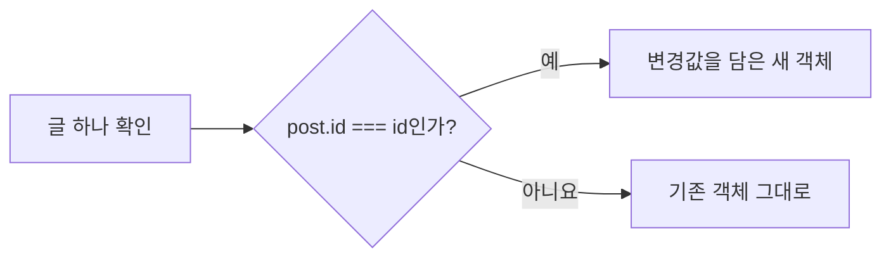

# 8장. 불변 업데이트로 하는 CRUD

**학습목표**

- 원본 배열을 바꾸지 않고 게시글을 추가·수정·삭제하는 함수를 만들 수 있습니다.
- `id`로 항목을 구분하고 함수가 반환한 새 배열을 현재 목록에 할당할 수 있습니다.
- 중첩 객체의 안쪽과 바깥쪽을 각각 복사해 속성 하나를 바꿀 수 있습니다.
- 연락처 조회와 게시글 좋아요 변경을 불변 업데이트로 구현할 수 있습니다.

## 8-1 배열에 추가하기

7장에서는 전개 연산자, `map()`, `filter()`로 원본을 유지하며 새 배열을 만들었습니다.
이 장에서는 그 코드를 함수로 묶어 목록을 관리합니다.
예제는 `js-course/chapter08` 폴더에 만들고, 실행 방법은 1-3을 따릅니다.

### CRUD와 게시글 데이터

**CRUD**는 데이터를 생성(Create), 조회(Read), 수정(Update), 삭제(Delete)하는 네 가지 작업을 묶은 이름입니다.
게시글을 등록하고, 찾아 읽고, 제목을 바꾸고, 지우는 일이 각각 여기에 해당합니다.

이 장의 게시글은 `id`, `title`, `likes` 속성을 가진 객체입니다.
`id`는 게시글을 구분하는 번호이고, `title`은 제목, `likes`는 좋아요 수입니다.
이런 객체들을 `posts` 배열에 담습니다.

| 작업 | 게시글에서 하는 일 | 사용하는 문법 |
|---|---|---|
| 생성 | 새 글을 목록 끝에 넣는다 | 배열 전개 연산자 |
| 조회 | 번호가 같은 글을 찾는다 | `find()` |
| 수정 | 번호가 같은 글의 속성을 바꾼다 | `map()`, 객체 전개 연산자 |
| 삭제 | 번호가 같은 글을 제외한다 | `filter()` |

목록이 바뀌면 배열의 인덱스도 달라질 수 있습니다.
첫 글을 지우면 두 번째 글이 인덱스 0으로 옮겨 오지만, 그 글의 `id`는 그대로입니다.
그래서 수정·삭제할 글은 인덱스 대신 서로 겹치지 않는 `id`로 고릅니다.

### 추가 함수와 반환값

`addPost(posts, newPost)`는 받은 배열의 끝에 새 게시글을 넣은 새 배열을 반환합니다.
7장에서 배운 `[...posts, newPost]`를 함수의 `return` 뒤에 쓰면 됩니다.

**특징**

- 함수는 인수로 받은 배열에 직접 요소를 넣지 않습니다.
- 반환한 배열에는 기존 게시글 뒤에 새 게시글이 들어 있습니다.
- 호출한 쪽에서 반환값을 할당해야 현재 목록이 새 배열로 바뀝니다.

**시각자료 — 새 배열을 현재 목록으로 정하는 순서**


함수는 새 배열을 만들고, 호출한 쪽은 그 배열을 현재 목록으로 정합니다.
`posts`에 재할당해도 기존 배열 자체가 바뀌는 것은 아닙니다.

**기본 문법**

```javascript
function 추가함수(목록, 새항목) {
  return [...목록, 새항목];
}

목록변수 = 추가함수(목록변수, 새항목);
```

**예제 8-1** `add-post.js`

```javascript
let posts = [
  { id: 1, title: "첫 번째 글", likes: 0 },
  { id: 2, title: "배열 공부", likes: 2 }
];
let nextId = 3;

function addPost(posts, newPost) {
  return [...posts, newPost];
}

const beforePosts = posts;
const newPost = { id: nextId, title: "함수 공부", likes: 0 };

posts = addPost(posts, newPost);
nextId++;

console.log(`이전 목록: ${beforePosts.length}개`);
console.log(`현재 목록: ${posts.length}개`);
console.log(`새 글: ${posts[2].id}번 ${posts[2].title}`);
console.log(`다음 번호: ${nextId}`);
console.log("같은 배열인가:", beforePosts === posts);
```

**실행 결과**

```text
이전 목록: 2개
현재 목록: 3개
새 글: 3번 함수 공부
다음 번호: 4
같은 배열인가: false
```

- `const beforePosts = posts;`는 기존 배열을 가리키는 이름을 하나 더 만듭니다. 복사한 배열은 아니지만, 기존 배열을 수정하지 않으므로 추가 전 목록으로 남습니다.
- `nextId`는 새 글에 붙일 번호입니다. 기존 번호가 1과 2라서 3에서 시작합니다.
- `newPost`를 만든 뒤 `nextId++`를 실행하므로 이번 글은 3번, 다음 글은 4번이 됩니다.
- `addPost()` 안의 `posts`는 인수로 받은 배열을 가리키는 매개변수입니다. 함수 밖의 `posts`와 이름은 같지만 서로 다른 변수입니다.
- `posts = addPost(posts, newPost);`는 오른쪽 함수 호출이 끝난 뒤 반환한 배열을 왼쪽 `posts`에 할당합니다. 재할당하므로 함수 밖의 `posts`는 `let`으로 선언했습니다.
- `beforePosts === posts`가 `false`이므로 두 이름은 서로 다른 배열을 가리킵니다.

번호는 목록의 개수와 따로 관리합니다.
글을 삭제해도 `nextId`를 줄이지 않아야 다음 등록에서 이미 있는 번호와 겹치지 않습니다.
이 예제의 `nextId`는 파일을 실행할 때마다 3에서 다시 시작합니다.

## 8-2 배열 항목 수정하기

추가는 새 글을 끝에 붙였지만, 수정은 기존 글 가운데 하나를 골라 바꿉니다.
`map()`의 콜백에서 `id`가 같은 글이면 새 객체를 반환하고, 나머지는 받은 객체를 그대로 반환합니다.
그러면 길이와 순서를 유지한 새 배열이 만들어집니다.

### 바꿀 속성을 묶어 받기

`updatePost(posts, id, changes)`의 `changes`는 바꿀 속성과 새 값을 묶은 객체입니다.
`{ title: "바뀐 제목" }`을 넘기면 제목만, `{ title: "바뀐 제목", likes: 5 }`를 넘기면 두 속성을 함께 바꿉니다.
6장에서 배운 `{ ...post, ...changes }`로 기존 속성을 옮기고 변경할 값을 덮어씁니다.

**특징**

- `map()`은 모든 글에 대해 콜백을 실행해 같은 길이의 새 배열을 만듭니다.
- `post.id === id`인 글만 객체 전개 연산자로 새 객체를 만듭니다.
- 같은 이름의 속성은 뒤에 전개한 `changes`의 값이 들어갑니다.
- 수정하지 않는 글은 기존 객체를 그대로 반환합니다.

**시각자료 — 글 하나에 대한 수정 판단**



그림은 `map()`이 글 하나를 처리하는 판단입니다.
이 판단을 모든 글에 적용하고, 각각 반환한 객체를 새 배열에 담습니다.

**기본 문법**

```javascript
function 수정함수(목록, 번호, 변경값) {
  return 목록.map((항목) =>
    항목.id === 번호 ? { ...항목, ...변경값 } : 항목
  );
}
```

**예제 8-2** `update-post.js`

```javascript
let posts = [
  { id: 1, title: "첫 번째 글", likes: 0 },
  { id: 2, title: "배열 공부", likes: 2 }
];

function updatePost(posts, id, changes) {
  return posts.map((post) =>
    post.id === id ? { ...post, ...changes } : post
  );
}

const beforePosts = posts;
posts = updatePost(posts, 2, { title: "불변 배열 공부", likes: 5 });

console.log(`이전 글: ${beforePosts[1].title} / 좋아요 ${beforePosts[1].likes}`);
console.log(`현재 글: ${posts[1].title} / 좋아요 ${posts[1].likes}`);
console.log("같은 배열인가:", beforePosts === posts);
console.log("1번은 같은 객체인가:", beforePosts[0] === posts[0]);
console.log("2번은 같은 객체인가:", beforePosts[1] === posts[1]);
```

**실행 결과**

```text
이전 글: 배열 공부 / 좋아요 2
현재 글: 불변 배열 공부 / 좋아요 5
같은 배열인가: false
1번은 같은 객체인가: true
2번은 같은 객체인가: false
```

- `(post) =>` 뒤의 삼항 연산자 결과가 콜백의 반환값입니다. 블록을 쓰지 않았으므로 `return` 없이 두 줄로 나눠 적었습니다.
- `post.id === id`가 `true`인 2번 글만 `{ ...post, ...changes }`로 복사합니다. 제목과 좋아요 수가 바뀌고 `id`는 유지됩니다.
- 1번 글은 `: post`에서 그대로 반환하므로 두 배열이 같은 객체를 함께 가리킵니다. 이 객체를 직접 수정하지 않으면 이전 목록도 그대로 유지됩니다.
- `map()`은 배열을 새로 만들지만 객체까지 자동으로 복사하지는 않습니다. 바꿀 객체를 복사하는 일은 `{ ...post, ...changes }`가 합니다.

`changes`에는 바꿀 `title`이나 `likes`만 넣습니다.
이 함수는 넘긴 속성을 그대로 반영하므로 `id`를 넣으면 번호도 바뀝니다.
글을 구분하는 번호는 유지하고 내용만 바꾼다는 규칙으로 사용합니다.

## 8-3 배열 항목 삭제하기

삭제는 지울 글을 제외한 나머지 글만 새 배열에 담는 작업입니다.
7장에서 배운 `filter()`는 조건이 `true`인 요소만 남깁니다.
따라서 삭제할 번호와 **다른** 글을 남기는 조건 `post.id !== id`를 씁니다.

**특징**

- `filter()`는 원본 배열을 줄이지 않고 새 배열을 만듭니다.
- 삭제할 번호가 목록에 있으면 그 글이 결과에서 빠집니다.
- 남은 글의 순서와 객체는 그대로 유지됩니다.

**비교 — 수정과 삭제**

| 비교 항목 | 수정 | 삭제 |
|---|---|---|
| 메서드 | `map()` | `filter()` |
| 조건의 뜻 | 같은 번호인 글을 바꾼다 | 다른 번호인 글을 남긴다 |
| 결과의 길이 | 원본과 같다 | 해당 글이 있으면 줄어든다 |
| 글 객체 | 바꿀 글만 새로 만든다 | 남길 글을 그대로 쓴다 |

**기본 문법**

```javascript
function 삭제함수(목록, 번호) {
  return 목록.filter((항목) => 항목.id !== 번호);
}

목록변수 = 삭제함수(목록변수, 번호);
```

**예제 8-3** `delete-post.js`

```javascript
let posts = [
  { id: 1, title: "첫 번째 글", likes: 0 },
  { id: 2, title: "배열 공부", likes: 2 },
  { id: 3, title: "함수 공부", likes: 0 }
];

function deletePost(posts, id) {
  return posts.filter((post) => post.id !== id);
}

const beforePosts = posts;
posts = deletePost(posts, 2);

console.log("이전 번호:", beforePosts.map((post) => post.id).join(", "));
console.log("현재 번호:", posts.map((post) => post.id).join(", "));
console.log("같은 배열인가:", beforePosts === posts);
console.log("남은 3번은 같은 객체인가:", beforePosts[2] === posts[1]);
```

**실행 결과**

```text
이전 번호: 1, 2, 3
현재 번호: 1, 3
같은 배열인가: false
남은 3번은 같은 객체인가: true
```

- `post.id !== 2`는 1번과 3번에서 `true`이므로 두 글만 남습니다. `===`를 쓰면 오히려 2번 글만 남으므로 조건의 뜻을 읽어 봅니다.
- `map((post) => post.id).join(", ")`은 번호 배열을 만든 뒤 쉼표와 빈칸으로 이은 문자열을 만듭니다.
- 3번 글의 인덱스는 2에서 1로 바뀌었지만 `id`와 객체는 그대로입니다.
- 없는 번호로 삭제하면 모든 글이 남습니다. 그래도 `filter()`의 결과는 새 배열입니다.

## 따라하기 실습 — 게시글 목록 추가·수정·삭제하기

**실습 목표**

- 추가·수정·삭제 함수를 한 목록에 순서대로 적용합니다.
- `find()`로 글 하나를 조회하고 `id`로 수정·삭제할 대상을 고릅니다.
- 작업 전 배열을 남겨 두고 원본이 유지되는지 확인합니다.

**준비**

1. `chapter08` 폴더 안에 `post-crud.js` 파일을 만듭니다.
2. 터미널의 현재 위치가 `chapter08`인지 확인합니다.

**실습 코드**

`chapter08/post-crud.js`

```javascript
let posts = [
  { id: 1, title: "첫 번째 글", likes: 0 },
  { id: 2, title: "배열 공부", likes: 2 }
];
let nextId = 3;

function addPost(posts, newPost) {
  return [...posts, newPost];
}

function updatePost(posts, id, changes) {
  return posts.map((post) =>
    post.id === id ? { ...post, ...changes } : post
  );
}

function deletePost(posts, id) {
  return posts.filter((post) => post.id !== id);
}

function printPosts(posts) {
  posts.forEach((post) => {
    console.log(`${post.id}번 ${post.title} / 좋아요 ${post.likes}`);
  });
}

const beforePosts = posts;

posts = addPost(posts, { id: nextId, title: "함수 공부", likes: 0 });
nextId++;
posts = updatePost(posts, 2, { title: "불변 배열 공부" });
posts = deletePost(posts, 1);

const selectedPost = posts.find((post) => post.id === 2);
console.log(`조회: ${selectedPost?.title ?? "글 없음"}`);

console.log("[현재 목록]");
printPosts(posts);
console.log("[이전 목록]");
printPosts(beforePosts);
console.log(`다음 번호: ${nextId}`);
```

**실행 방법**

1. 코드를 입력하고 저장합니다.
2. 터미널에서 다음 명령을 입력합니다.
   ```bash
   node post-crud.js
   ```

**실행 결과**

```text
조회: 불변 배열 공부
[현재 목록]
2번 불변 배열 공부 / 좋아요 2
3번 함수 공부 / 좋아요 0
[이전 목록]
1번 첫 번째 글 / 좋아요 0
2번 배열 공부 / 좋아요 2
다음 번호: 4
```

**코드 설명**

- `addPost()`, `updatePost()`, `deletePost()`는 앞의 예제와 같은 함수입니다. 호출한 쪽에서 매번 반환값을 `posts`에 할당합니다.
- 3번 글을 추가하고 2번 글의 제목을 바꾼 뒤 1번 글을 삭제했습니다. 번호로 찾으므로 삭제 뒤 인덱스가 바뀌어도 대상을 구분할 수 있습니다.
- `find()`는 2번 글 객체를 돌려줍니다. 글을 찾지 못할 때는 3장의 `?.`와 `??`로 `글 없음`을 출력합니다.
- `printPosts()`는 출력만 하므로 `forEach()`를 씁니다. 글을 바꾸는 세 함수와 출력하는 함수를 따로 두었습니다.
- `beforePosts`가 가리키는 배열과 그 안의 객체를 직접 수정하지 않았으므로 처음 목록을 다시 출력할 수 있습니다.

**바꿔 보기 1**

한 번 더 등록해 번호가 이어지는지 확인합니다.
`const selectedPost = posts.find((post) => post.id === 2);` 줄 위에 다음 두 줄을 추가합니다.

```javascript
posts = addPost(posts, { id: nextId, title: "삭제 연습", likes: 0 });
nextId++;
```

현재 목록 끝에 `4번 삭제 연습 / 좋아요 0`이 추가되고 마지막 줄은 `다음 번호: 5`가 됩니다.
1번 글을 삭제했어도 3번을 다시 쓰지 않습니다.

**바꿔 보기 2**

원래 실습 코드에서 조회할 번호만 바꿔 봅니다.
`const selectedPost = posts.find((post) => post.id === 2);` 줄을 다음처럼 바꿉니다.

```javascript
const selectedPost = posts.find((post) => post.id === 1);
```

첫 줄이 `조회: 글 없음`으로 바뀌고 목록 출력은 같습니다.
1번 글은 삭제되었으므로 `find()`가 `undefined`를 반환합니다.

## 8-4 중첩 객체 업데이트

지금까지 게시글의 `title`, `likes`처럼 바깥쪽 속성을 바꿨습니다.
이번에는 3장에서 읽었던 `member.address.city`처럼 안쪽 객체의 속성을 바꿉니다.
6장에서 확인했듯이 `{ ...member }`만으로는 안쪽의 `address`까지 새로 만들어지지 않습니다.

### 바뀌는 값까지 각각 복사하기

도시만 바꾸려면 `address`의 속성을 옮겨 담고 `city`를 덮어쓴 새 주소 객체가 필요합니다.
그 주소를 `address` 속성에 넣은 새 회원 객체도 만듭니다.
원본을 유지하며 중첩된 값을 바꾸는 것을 **중첩 객체 업데이트**(nested object update)라고 합니다.

**특징**

- 바꿀 속성을 담은 안쪽 객체를 새로 만듭니다.
- 새 안쪽 객체를 담을 바깥 객체도 새로 만듭니다.
- 바꾸지 않는 속성은 전개 연산자로 그대로 옮깁니다.

상자 비유로 보면 회원 상자 안에 주소 상자가 하나 더 들어 있습니다.
회원 상자만 새로 만들어 같은 주소 상자를 넣으면, 두 회원이 그 주소 상자를 함께 씁니다.
도시를 바꾸면서 원본을 지키려면 주소 상자도 새로 만들어 새 회원 상자에 넣습니다.

**시각자료 — 회원과 주소를 각각 새로 만들기**


원본 `member`의 주소에는 `서울`이 남고, `updatedMember`의 새 주소에는 `부산`이 들어갑니다.
`name`과 `zipCode`는 기존 값을 옮깁니다.

**기본 문법**

```javascript
const 새객체 = {
  ...원본,
  중첩속성: {
    ...원본.중첩속성,
    바꿀속성: 새값
  }
};
```

**예제 8-4** `nested-update.js`

```javascript
const member = {
  name: "김코딩",
  address: {
    city: "서울",
    zipCode: "04524"
  }
};

const updatedMember = {
  ...member,
  address: {
    ...member.address,
    city: "부산"
  }
};

console.log(`원본 도시: ${member.address.city}`);
console.log(`변경 도시: ${updatedMember.address.city}`);
console.log(`유지한 우편번호: ${updatedMember.address.zipCode}`);
console.log("같은 회원 객체인가:", member === updatedMember);
console.log("같은 주소 객체인가:", member.address === updatedMember.address);
```

**실행 결과**

```text
원본 도시: 서울
변경 도시: 부산
유지한 우편번호: 04524
같은 회원 객체인가: false
같은 주소 객체인가: false
```

- 바깥의 `...member`는 `name`과 `address`를 옮깁니다. 그 뒤의 `address: { ... }`가 기존 주소 대신 새 주소 객체를 넣습니다.
- 안쪽의 `...member.address`는 `city`와 `zipCode`를 옮깁니다. 그 뒤의 `city: "부산"`이 도시만 덮어씁니다.
- 회원 객체와 주소 객체를 모두 새로 만들었으므로 두 참조 비교가 모두 `false`입니다. 원본 도시도 `서울` 그대로입니다.
- 이 예제는 도시 속성 하나만 바꾸는 연습이므로 우편번호를 유지합니다. 실제 이사 정보를 처리한다면 도시와 우편번호를 함께 바꿀 수 있습니다.

## 따라하기 실습 — 회원 주소만 바꾸기

**실습 목표**

- 회원과 새 도시를 받아 새 회원 객체를 돌려주는 함수를 만듭니다.
- 이름과 우편번호를 유지하면서 도시만 바꿉니다.
- 반환값을 현재 회원에 할당한 뒤 원본 주소와 비교합니다.

**준비**

1. `chapter08` 폴더 안에 `member-address.js` 파일을 만듭니다.
2. 터미널의 현재 위치가 `chapter08`인지 확인합니다.

**실습 코드**

`chapter08/member-address.js`

```javascript
let member = {
  id: "coding01",
  name: "김코딩",
  address: {
    city: "서울",
    zipCode: "04524"
  }
};

function updateCity(member, city) {
  return {
    ...member,
    address: {
      ...member.address,
      city
    }
  };
}

const beforeMember = member;
member = updateCity(member, "부산");

console.log(`이전 주소: ${beforeMember.address.city} (${beforeMember.address.zipCode})`);
console.log(`현재 주소: ${member.address.city} (${member.address.zipCode})`);
console.log(`회원: ${member.name} (${member.id})`);
console.log("같은 회원 객체인가:", beforeMember === member);
console.log("같은 주소 객체인가:", beforeMember.address === member.address);
```

**실행 방법**

1. 코드를 입력하고 저장합니다.
2. 터미널에서 다음 명령을 입력합니다.
   ```bash
   node member-address.js
   ```

**실행 결과**

```text
이전 주소: 서울 (04524)
현재 주소: 부산 (04524)
회원: 김코딩 (coding01)
같은 회원 객체인가: false
같은 주소 객체인가: false
```

**코드 설명**

- `updateCity()`는 예제 8-4의 복사 코드를 함수로 묶었습니다. 새 도시는 매개변수 `city`로 받습니다.
- 안쪽의 `city`는 6장에서 배운 `city: city`의 단축 표기입니다. 앞에서 전개한 기존 `city`를 매개변수의 값으로 덮어씁니다.
- `member = updateCity(member, "부산");`으로 반환값을 할당해야 현재 회원이 새 객체로 바뀝니다.
- `beforeMember`는 변경 전 회원 객체를 계속 가리킵니다. 안쪽 주소까지 복사했으므로 변경 전 주소도 유지됩니다.

**바꿔 보기 1**

원래 실습 코드에서 바꿀 도시를 바꿔 봅니다.
`member = updateCity(member, "부산");` 줄을 다음처럼 바꿉니다.

```javascript
member = updateCity(member, "대전");
```

현재 주소 줄이 `현재 주소: 대전 (04524)`로 바뀝니다.
이전 주소는 `서울 (04524)` 그대로입니다.

**바꿔 보기 2**

원래 실습 코드에서 도시와 우편번호를 함께 바꾸는 함수로 넓혀 봅니다.
`function updateCity(member, city) { ... }` 전체를 다음 함수로 바꾸고, 호출도 함께 바꿉니다.

```javascript
function updateAddress(member, city, zipCode) {
  return {
    ...member,
    address: {
      ...member.address,
      city,
      zipCode
    }
  };
}
```

`member = updateCity(member, "부산");` 줄은 다음처럼 바꿉니다.

```javascript
member = updateAddress(member, "부산", "48058");
```

현재 주소는 `부산 (48058)`, 이전 주소는 `서울 (04524)`로 출력됩니다.
회원 이름과 아이디, 두 참조 비교 결과는 원래 실습과 같습니다.

## 연습문제

### 연습문제 1 — 연락처 배열 CRUD 함수 네 개 만들기

**요구사항**

1. `chapter08` 폴더에 `contact-crud.js` 파일을 만듭니다.
2. `contacts`에 `{ id: 1, name: "김코딩", phone: "010-1111-2222" }`와 `{ id: 2, name: "이자바", phone: "010-3333-4444" }`를 담고, `nextId`를 3으로 둡니다.
3. 다음 함수 네 개를 함수 선언문으로 만듭니다. 번호는 서로 겹치지 않는 숫자로 사용하고, 수정할 때 `id`는 유지합니다.
   - `addContact(contacts, newContact)`: 새 연락처를 끝에 넣은 새 배열을 반환합니다.
   - `findContact(contacts, id)`: 해당 연락처 하나를 반환하고, 없으면 `undefined`를 반환합니다.
   - `updateContact(contacts, id, changes)`: 같은 번호의 연락처에 변경값을 반영한 새 배열을 반환합니다.
   - `deleteContact(contacts, id)`: 해당 번호를 제외한 새 배열을 반환합니다.
4. 변경 전 목록을 `beforeContacts`에 남겨 두고, 박함수(`010-5555-6666`)를 등록합니다. 번호는 `nextId`를 쓰고 등록 뒤 `nextId++`를 실행합니다.
5. 2번 연락처의 전화번호를 `010-7777-8888`로 수정하고 1번 연락처를 삭제합니다. 배열을 반환하는 함수는 호출한 쪽에서 결과를 `contacts`에 할당합니다.
6. `findContact()`로 2번 연락처를 찾아 `조회: 이자바 / 010-7777-8888` 형태로 출력합니다. 연락처가 없으면 `조회: 연락처 없음`을 출력합니다.
7. 현재 목록과 변경 전 목록을 각각 `번호번 이름 / 전화번호` 형태로 출력합니다. 예: `3번 박함수 / 010-5555-6666`

**완료 조건**

- 현재 목록에는 2번과 3번이 있고 2번의 전화번호가 바뀌었습니다.
- 변경 전 목록에는 1번과 2번이 있고 2번의 전화번호는 원래 값입니다.
- 없는 번호를 조회하면 `undefined`를 반환하고 안내 출력까지 실행됩니다.
- 수정·삭제할 번호가 없으면 글자나 개수 변화 없이 같은 내용의 새 배열을 반환합니다.

### 연습문제 2 — 게시글 좋아요 수 올리기

**요구사항**

1. `chapter08` 폴더에 `like-post.js` 파일을 만듭니다.
2. `posts`에 `{ id: 1, title: "첫 번째 글", likes: 0 }`과 `{ id: 2, title: "배열 공부", likes: 2 }`를 담습니다.
3. `likePost(posts, id)` 함수를 함수 선언문으로 만듭니다. 같은 번호의 글만 좋아요 수를 1 늘린 새 객체로 바꾸고 새 배열을 반환합니다.
4. `beforePosts`에 변경 전 목록을 남긴 뒤, 2번 글의 좋아요를 두 번 올립니다. 반환값은 매번 `posts`에 할당합니다.
5. 이전과 현재 좋아요 수, 1번과 2번 객체가 각각 같은지 출력합니다. 예: `현재 좋아요: 4`

**완료 조건**

- 2번 글의 현재 좋아요 수는 4이고 변경 전 좋아요 수는 2입니다.
- 1번 글은 같은 객체, 2번 글은 서로 다른 객체입니다.
- 없는 번호를 넣으면 모든 글의 내용이 그대로인 새 배열을 반환합니다.
- 원본 객체의 `likes`를 직접 수정하지 않습니다.

## 정답과 해설

### 연습문제 1 — 연락처 배열 CRUD 함수 네 개 만들기

`contact-crud.js`

```javascript
let contacts = [
  { id: 1, name: "김코딩", phone: "010-1111-2222" },
  { id: 2, name: "이자바", phone: "010-3333-4444" }
];
let nextId = 3;

function addContact(contacts, newContact) {
  return [...contacts, newContact];
}

function findContact(contacts, id) {
  return contacts.find((contact) => contact.id === id);
}

function updateContact(contacts, id, changes) {
  return contacts.map((contact) =>
    contact.id === id ? { ...contact, ...changes } : contact
  );
}

function deleteContact(contacts, id) {
  return contacts.filter((contact) => contact.id !== id);
}

const beforeContacts = contacts;
contacts = addContact(contacts, { id: nextId, name: "박함수", phone: "010-5555-6666" });
nextId++;
contacts = updateContact(contacts, 2, { phone: "010-7777-8888" });
contacts = deleteContact(contacts, 1);

const selectedContact = findContact(contacts, 2);
const missingContact = findContact(contacts, 99);
const selectedText = selectedContact ? `${selectedContact.name} / ${selectedContact.phone}` : "연락처 없음";
const missingText = missingContact ? `${missingContact.name} / ${missingContact.phone}` : "연락처 없음";

console.log(`조회: ${selectedText}`);
console.log(`조회: ${missingText}`);
console.log("[현재 목록]");
contacts.forEach((contact) => {
  console.log(`${contact.id}번 ${contact.name} / ${contact.phone}`);
});
console.log("[이전 목록]");
beforeContacts.forEach((contact) => {
  console.log(`${contact.id}번 ${contact.name} / ${contact.phone}`);
});
console.log(`다음 번호: ${nextId}`);
```

**실행 결과**

```text
조회: 이자바 / 010-7777-8888
조회: 연락처 없음
[현재 목록]
2번 이자바 / 010-7777-8888
3번 박함수 / 010-5555-6666
[이전 목록]
1번 김코딩 / 010-1111-2222
2번 이자바 / 010-3333-4444
다음 번호: 4
```

**해설**

- `findContact()`는 조회만 하므로 배열이 아니라 찾은 객체 하나를 반환합니다. 반환한 객체도 원본 배열 안의 객체이므로 속성을 직접 바꾸지 않습니다.
- 나머지 세 함수는 새 배열을 반환하므로 호출한 곳에서 `contacts`에 재할당합니다.
- `updateContact()`는 전화번호를 바꿀 연락처만 새 객체로 만듭니다. 그래서 `beforeContacts`에 남아 있는 2번 연락처의 전화번호는 유지됩니다.
- `missingContact`는 `undefined`라서 falsy입니다. 삼항 연산자가 `연락처 없음`을 고르고, 없는 객체의 속성은 읽지 않습니다.
- `nextId`는 등록 뒤에만 늘립니다. 삭제해도 줄이지 않으므로 다음 등록에 쓸 번호는 4입니다.
- 존재하지 않는 번호를 수정하거나 삭제하면 모든 연락처가 그대로 남습니다. `map()`과 `filter()`는 이 경우에도 새 배열을 반환합니다.

조회 안내는 `if`·`else`로 나눠 출력해도 같은 결과가 나옵니다.

### 연습문제 2 — 게시글 좋아요 수 올리기

`like-post.js`

```javascript
let posts = [
  { id: 1, title: "첫 번째 글", likes: 0 },
  { id: 2, title: "배열 공부", likes: 2 }
];

function likePost(posts, id) {
  return posts.map((post) =>
    post.id === id ? { ...post, likes: post.likes + 1 } : post
  );
}

const beforePosts = posts;
posts = likePost(posts, 2);
posts = likePost(posts, 2);

console.log(`이전 좋아요: ${beforePosts[1].likes}`);
console.log(`현재 좋아요: ${posts[1].likes}`);
console.log("1번은 같은 객체인가:", beforePosts[0] === posts[0]);
console.log("2번은 같은 객체인가:", beforePosts[1] === posts[1]);
```

**실행 결과**

```text
이전 좋아요: 2
현재 좋아요: 4
1번은 같은 객체인가: true
2번은 같은 객체인가: false
```

**해설**

- `post.likes + 1`로 읽은 값에 1을 더하고 새 객체의 `likes`에 넣습니다. 원본 속성에 `++`를 쓰지 않으므로 원본이 바뀌지 않습니다.
- 두 번째 호출에는 첫 번째 호출의 결과 배열을 넘깁니다. 따라서 좋아요 수가 2 → 3 → 4로 이어집니다.
- 1번 글은 두 번 모두 `post` 그대로 반환하므로 같은 객체입니다. 2번 글은 호출할 때마다 새 객체를 만듭니다.
- 없는 번호를 넣으면 삼항 연산자가 모든 글을 그대로 반환합니다. 결과 배열은 새 배열이지만 글의 내용은 바뀌지 않습니다.

콜백을 블록 모양으로 쓰고 `if`·`return`으로 두 경우를 나눠도 같은 결과가 나옵니다.
