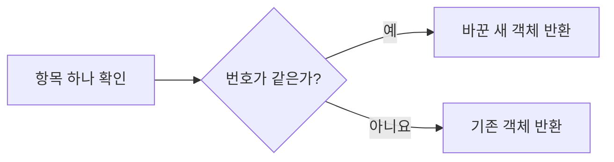
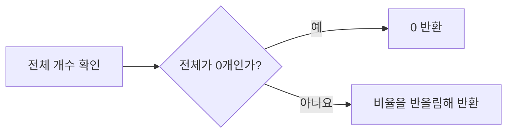

# 9장. [미니프로젝트] 콘솔 할 일 관리

**학습목표**

- 할 일을 객체 배열로 설계하고 `id`로 항목을 구분할 수 있습니다.
- 원본을 바꾸지 않는 등록·수정·삭제·완료 토글 함수를 만들 수 있습니다.
- 전체·완료·미완료 목록을 콘솔에 출력할 수 있습니다.
- 완료한 할 일의 비율을 정수 퍼센트로 계산할 수 있습니다.

**사용하는 장**

2~8장

**이 장에서 만드는 것**

할 일을 배열에 담고 함수 호출로 등록·수정·삭제·완료 상태 변경을 하는 프로그램을 만듭니다.
입력할 값과 실행할 순서는 코드에 직접 적고, 결과는 터미널에서 확인합니다.
목록을 바꾸는 함수와 출력하는 함수를 나누어 작성합니다.

완성하면 다음과 같이 출력됩니다.

```text
[전체]
[x] 1. JavaScript 문제 풀기
[ ] 3. 산책하기
[미완료]
[ ] 3. 산책하기
[완료]
[x] 1. JavaScript 문제 풀기
진행률: 50%
빈 목록 진행률: 0%
```

**요구사항**

| 번호 | 기능 | 사용하는 문법 |
|---|---|---|
| 1 | 할 일의 번호·제목·완료 여부 저장 | 객체 배열, `let`, `++` |
| 2 | 등록·수정·삭제·완료 상태 변경 | 함수, 전개 연산자, `map()`, `filter()` |
| 3 | 전체·완료·미완료 목록 출력 | 삼항 연산자, 템플릿 리터럴, `join()` |
| 4 | 완료 비율을 정수 퍼센트로 출력 | 나눗셈, 삼항 연산자, `Math.round()` |

**준비**

1. `js-course` 안에 `chapter09` 폴더를 만듭니다.
2. 그 안에 `todo-1.js`, `todo-2.js`, `todo-3.js`, `todo-4.js`를 만듭니다.

단계마다 이전 단계의 기능을 담은 전체 코드를 별도 파일에 저장합니다.
각 파일은 다른 파일을 불러오지 않고 혼자 실행됩니다.
파일을 실행하는 방법은 1-3에서 사용한 방법을 따릅니다.

## 9-1 할 일 데이터 설계

**목표**

할 일 하나를 객체 하나로 만들고 여러 할 일을 `todos` 배열에 담습니다.
새 할 일에 쓸 번호는 `nextId`에 따로 보관합니다.

### 할 일 객체의 속성

3장에서 배운 객체 배열로 할 일 목록을 만듭니다.
한 항목에 다음 세 속성을 넣습니다.

속성 이름은 7장의 `todo-add.js`에서 사용한 `id`, `title`, `isDone`을 이어 씁니다.
이번에는 두 방식의 추가를 비교하는 대신 `todos` 하나를 함수로 관리합니다.

| 속성 | 자료형 | 담는 값 |
|---|---|---|
| `id` | `number` | 할 일을 구분하는 고유 번호 |
| `title` | `string` | 할 일의 제목 |
| `isDone` | `boolean` | 완료하면 `true`, 미완료면 `false` |

`id`는 배열의 인덱스와 다릅니다.
인덱스는 현재 배열에서의 위치이고, `id`는 그 할 일에 붙인 번호입니다.
앞의 항목을 삭제하면 뒤 항목의 인덱스는 바뀌지만 `id`는 그대로 둡니다.
그래야 수정하거나 삭제할 대상을 같은 번호로 찾을 수 있습니다.

**시각자료 — todos에 담긴 할 일 두 개**


인덱스 0의 객체는 `id: 1`, 인덱스 1의 객체는 `id: 2`입니다.
새로 등록할 항목은 `nextId`에 담긴 번호 `3`을 받습니다.

### 목록과 다음 번호

`todos`는 목록을 바꿀 때마다 새 배열을 재할당하므로 `let`으로 선언합니다.
`nextId`도 등록한 뒤 `++`로 늘려야 하므로 `let`으로 선언합니다.
처음에 번호 1과 2가 있으므로 다음 번호는 3에서 시작합니다.

**힌트**

- `title`은 문자열이고 `isDone`은 따옴표 없는 `true`나 `false`입니다.
- 새 항목에는 현재 `nextId`를 주고, 등록한 뒤 `nextId++;`로 1 늘립니다.
- 항목을 삭제해도 `nextId`를 줄이지 않습니다.

**시작 코드**

`chapter09/todo-1.js`

```javascript
let todos = [
  { id: 1, title: "JavaScript 복습", isDone: false },
  { id: 2, title: "개발 환경 확인", isDone: true }
];
let nextId = 3;

console.log(`할 일: ${todos.length}개`);
console.log(`첫 할 일: ${todos[0].id} / ${todos[0].title} / 완료: ${todos[0].isDone}`);
console.log(`다음 번호: ${nextId}`);
```

**확인 방법**

`todo-1.js`를 저장하고 `node todo-1.js`로 실행합니다.
객체 두 개가 있고, 첫 할 일은 미완료이며, 다음 번호가 3인지 확인합니다.

**실행 결과**

```text
할 일: 2개
첫 할 일: 1 / JavaScript 복습 / 완료: false
다음 번호: 3
```

**코드 설명**

- `todos[0].id`는 첫 객체에서 번호를 읽습니다. 인덱스 `0`과 번호 `1`은 서로 다른 값입니다.
- `nextId`는 배열의 길이가 아니라 새 할 일에 줄 번호입니다. 삭제로 길이가 줄어도 이미 쓴 번호를 다시 주지 않습니다.

## 9-2 등록·수정·삭제·완료 토글 함수

**목표**

할 일 목록을 받아 변경한 새 배열을 돌려주는 함수를 네 개 만듭니다.
8장의 불변 업데이트 패턴을 사용하고, 반환값을 받는 쪽에서 `todos`를 재할당합니다.

### 함수 이름과 인수

다음 이름과 인수 순서로 함수를 정합니다.
함수는 모두 `function` 선언문으로 만들고, 안에서 사용하는 `map()`과 `filter()`의 콜백은 화살표 함수로 씁니다.

| 함수 | 받는 값 | 돌려주는 값 |
|---|---|---|
| `addTodo(todos, id, title)` | 목록, 새 번호, 제목 | 새 항목을 끝에 붙인 배열 |
| `updateTodo(todos, id, changes)` | 목록, 대상 번호, 바꿀 속성 객체 | 대상만 수정한 배열 |
| `deleteTodo(todos, id)` | 목록, 대상 번호 | 대상을 제외한 배열 |
| `toggleTodo(todos, id)` | 목록, 대상 번호 | 대상의 완료 여부를 뒤집은 배열 |

`addTodo()`는 새 항목의 `isDone`을 `false`로 정합니다.
`updateTodo()`의 `changes`에는 `{ title: "새 제목" }`처럼 바꿀 속성을 담습니다.
이 프로젝트에서 `changes`로 바꾸는 속성은 `title`과 `isDone`이며, `id`는 그대로 유지합니다.
완료 여부만 뒤집을 때는 `toggleTodo()`를 호출합니다.

함수 네 개는 매개변수로 받은 값만 사용해 새 배열을 만듭니다.
함수 안에서는 바깥의 `todos`를 재할당하거나 `nextId`를 늘리지 않습니다.
출력도 함수 밖에서 합니다.
이렇게 하면 같은 함수를 다른 할 일 배열에도 그대로 쓸 수 있습니다.

### 수정할 항목 고르기

수정과 완료 상태 변경에는 `map()`을 사용합니다.
번호가 같은 항목은 객체 전개로 복사해 바꾸고, 나머지 항목은 그대로 돌려줍니다.
배열만 새로 만드는 것이 아니라 수정할 객체도 새로 만들어야 이전 객체의 속성이 보존됩니다.

**시각자료 — map이 항목 하나를 처리하는 두 갈래**



조건은 `todo.id === id`입니다.
`map()`은 모든 항목에 이 판단을 적용하고, 반환한 항목들로 새 배열을 만듭니다.

### 완료 토글

**토글**(toggle)은 두 상태 사이를 번갈아 바꾸는 동작입니다.
여기서는 미완료를 완료로, 완료를 미완료로 바꿉니다.
3장에서 배운 `!`로 현재 `isDone`을 뒤집습니다.

| 현재 `isDone` | `!todo.isDone` | 바꾼 뒤 상태 |
|---|---|---|
| `false` | `true` | 완료 |
| `true` | `false` | 미완료 |

**힌트**

- 등록은 `[...todos, 새 객체]`, 삭제는 번호가 다른 항목을 남기는 `filter()`를 사용합니다.
- 수정은 `{ ...todo, ...changes }`로 씁니다. 뒤에 펼친 `changes`의 속성이 앞의 값을 덮습니다.
- 토글은 `{ ...todo, isDone: !todo.isDone }`으로 씁니다.
- 함수의 반환값은 `todos = 함수명(todos, ...);` 형태로 받습니다.

**실습 코드**

`todo-1.js`의 데이터를 그대로 두고 함수 네 개와 호출을 더한 전체 파일입니다.
`todo-2.js`에 다음 코드를 저장합니다.

`chapter09/todo-2.js`

```javascript
let todos = [
  { id: 1, title: "JavaScript 복습", isDone: false },
  { id: 2, title: "개발 환경 확인", isDone: true }
];
let nextId = 3;

function addTodo(todos, id, title) {
  return [...todos, { id, title, isDone: false }];
}

function updateTodo(todos, id, changes) {
  return todos.map((todo) => todo.id === id ? { ...todo, ...changes } : todo);
}

function deleteTodo(todos, id) {
  return todos.filter((todo) => todo.id !== id);
}

function toggleTodo(todos, id) {
  return todos.map((todo) => todo.id === id ? { ...todo, isDone: !todo.isDone } : todo);
}

const previousTodos = todos;

todos = addTodo(todos, nextId, "산책하기");
nextId++;
todos = updateTodo(todos, 1, { title: "JavaScript 문제 풀기" });
todos = deleteTodo(todos, 2);
todos = toggleTodo(todos, 1);

console.log(`원본: ${previousTodos.length}개`);
console.log(`원본 첫 제목: ${previousTodos[0].title}`);
console.log(`원본 첫 완료: ${previousTodos[0].isDone}`);
console.log(`현재: ${todos.length}개`);
console.log(`현재 첫 제목: ${todos[0].title}`);
console.log(`현재 첫 완료: ${todos[0].isDone}`);
console.log(`같은 배열인가: ${previousTodos === todos}`);
console.log(`다음 번호: ${nextId}`);
```

**확인 방법**

`node todo-2.js`를 실행하고, 원본의 제목과 완료 여부가 그대로인지 확인합니다.
현재 목록에는 1번과 새로 등록한 3번이 남습니다.
등록으로 다음 번호는 4가 되고, 2번을 삭제해도 그 번호를 줄이지 않습니다.

**실행 결과**

```text
원본: 2개
원본 첫 제목: JavaScript 복습
원본 첫 완료: false
현재: 2개
현재 첫 제목: JavaScript 문제 풀기
현재 첫 완료: true
같은 배열인가: false
다음 번호: 4
```

**코드 설명**

- `{ id, title, isDone: false }`의 `id`와 `title`은 6장에서 배운 단축 속성입니다. 매개변수에 받은 값을 같은 이름의 속성에 넣습니다.
- `addTodo(todos, nextId, "산책하기")`는 번호 3의 새 항목을 붙입니다. 등록한 다음 줄에서 `nextId++`를 실행합니다.
- `updateTodo()`는 1번의 제목만 바꾸므로 완료 여부는 `false`로 유지됩니다. 이후 `toggleTodo()`가 그 값을 `true`로 바꿉니다.
- `deleteTodo()`는 `todo.id !== id`가 `true`인 항목만 남깁니다. 삭제한 뒤 3번 항목의 인덱스는 1이 되지만 번호는 3입니다.
- `previousTodos`에는 처음 배열이 그대로 남아 있습니다. 변경 함수가 새 배열을 돌려주므로 `previousTodos === todos`는 `false`입니다.
- 변경하지 않은 객체는 새 배열에서도 공유합니다. 그 객체의 속성을 직접 바꾸지 않고 계속 불변 업데이트 함수를 사용합니다.

완료 상태를 양쪽으로 바꿀 수 있는지도 확인합니다.
`todo-2.js`의 마지막 출력 줄 아래에 다음 코드를 추가해 실행한 뒤 지웁니다.

```javascript
const twiceToggled = toggleTodo(toggleTodo(todos, 1), 1);
console.log(twiceToggled[0].isDone);
```

마지막에 `true`가 한 줄 더 출력됩니다.
현재 완료인 1번을 두 번 토글하면 `true` → `false` → `true`가 되며, `todos` 자체는 바뀌지 않습니다.

## 9-3 목록 출력과 필터

**목표**

할 일을 `[x] 1. 제목` 또는 `[ ] 3. 제목` 모양의 문자열로 바꿔 출력합니다.
전체·미완료·완료 목록을 같은 출력 함수로 확인합니다.

### 목록을 문자열로 만들기

`formatTodoList(todos)`는 목록을 여러 줄 문자열로 바꿔 돌려줍니다.
`map()`으로 항목마다 문자열을 만들고 `join("\n")`으로 줄 사이를 연결합니다.
`"\n"`은 줄바꿈을 나타내는 문자열입니다.
7장에서 문자열 배열을 `join("")`으로 붙인 것과 달리, 이번에는 항목 사이에 줄바꿈을 넣습니다.

**시각자료 — 목록이 콘솔 출력으로 바뀌는 순서**


`map()`은 객체를 문자열로 바꾸고, `join()`은 그 문자열들을 하나로 합칩니다.
`printTodos(label, items)`는 제목과 목록 문자열을 콘솔에 출력합니다.

7장의 `printTodos(label, items)`와 같은 인수 순서를 사용합니다.
첫 번째 인수는 출력할 제목이고, 두 번째 인수는 목록입니다.
이번에는 제목과 목록을 줄로 나누고 각 할 일의 완료 여부도 함께 출력합니다.

### 완료 여부로 목록 고르기

`getFilteredTodos(todos, filter = "all")`는 어떤 목록을 볼지 받아 해당 항목을 돌려줍니다.
목록을 고르는 동작은 7장의 `filter()`를 사용합니다.

| `filter` 값 | 보여 줄 목록 | 남길 조건 |
|---|---|---|
| `"all"` | 전체 | 전달받은 배열 그대로 |
| `"active"` | 미완료 | `!todo.isDone` |
| `"done"` | 완료 | `todo.isDone` |

인수를 생략하면 기본값 `"all"`을 사용합니다.
`"active"`와 `"done"`이 아닌 값도 전달받은 배열을 그대로 돌려줍니다.
필터는 표시할 항목만 고르며, 원래 `todos`에서 항목을 삭제하지 않습니다.

**힌트**

- `todo.isDone ? "[x]" : "[ ]"`로 표시할 기호를 고릅니다.
- `map()`이 돌려줄 문자열에 기호, `id`, `title`을 함께 넣습니다.
- 빈 배열에 `map()`과 `join()`을 적용한 결과는 빈 문자열입니다.
- `printTodos()`에서는 빈 문자열 대신 `"할 일이 없습니다."`를 출력하도록 `||`를 사용합니다.

**실습 코드**

`todo-2.js`의 변경 함수와 호출 순서를 유지하고 목록을 고르고 출력하는 함수 세 개를 더합니다.
원본 비교용 `previousTodos`와 출력 줄은 목록 출력으로 바꿉니다.
다음 전체 코드를 `todo-3.js`에 저장합니다.

`chapter09/todo-3.js`

```javascript
let todos = [
  { id: 1, title: "JavaScript 복습", isDone: false },
  { id: 2, title: "개발 환경 확인", isDone: true }
];
let nextId = 3;

function addTodo(todos, id, title) {
  return [...todos, { id, title, isDone: false }];
}

function updateTodo(todos, id, changes) {
  return todos.map((todo) => todo.id === id ? { ...todo, ...changes } : todo);
}

function deleteTodo(todos, id) {
  return todos.filter((todo) => todo.id !== id);
}

function toggleTodo(todos, id) {
  return todos.map((todo) => todo.id === id ? { ...todo, isDone: !todo.isDone } : todo);
}

function formatTodoList(todos) {
  return todos.map((todo) => `${todo.isDone ? "[x]" : "[ ]"} ${todo.id}. ${todo.title}`).join("\n");
}

function printTodos(label, items) {
  console.log(label);
  console.log(formatTodoList(items) || "할 일이 없습니다.");
}

function getFilteredTodos(todos, filter = "all") {
  if (filter === "active") {
    return todos.filter((todo) => !todo.isDone);
  }

  if (filter === "done") {
    return todos.filter((todo) => todo.isDone);
  }

  return todos;
}

todos = addTodo(todos, nextId, "산책하기");
nextId++;
todos = updateTodo(todos, 1, { title: "JavaScript 문제 풀기" });
todos = deleteTodo(todos, 2);
todos = toggleTodo(todos, 1);

printTodos("[전체]", getFilteredTodos(todos));
printTodos("[미완료]", getFilteredTodos(todos, "active"));
printTodos("[완료]", getFilteredTodos(todos, "done"));
```

**확인 방법**

`node todo-3.js`를 실행합니다.
전체에는 두 항목이 나오고, 미완료에는 3번, 완료에는 1번만 나오는지 확인합니다.
출력의 번호는 현재 배열의 순서 번호가 아니라 `id`이므로 1 다음에 3이 나옵니다.

**실행 결과**

```text
[전체]
[x] 1. JavaScript 문제 풀기
[ ] 3. 산책하기
[미완료]
[ ] 3. 산책하기
[완료]
[x] 1. JavaScript 문제 풀기
```

**코드 설명**

- `formatTodoList()`의 콜백은 할 일 객체 하나를 문자열 하나로 바꿉니다. 삼항 연산자는 `isDone`에 따라 `[x]`와 `[ ]` 가운데 하나를 고릅니다.
- `.join("\n")`은 앞의 `map()`이 만든 문자열 배열에 적용됩니다. 각 문자열 사이에 줄바꿈이 들어갑니다.
- `printTodos()`는 문자열을 돌려주는 함수와 달리 출력만 합니다. 목록이 비어 있으면 `||` 오른쪽의 안내문을 출력합니다.
- `getFilteredTodos(todos, "active")`는 `isDone`이 `false`인 항목만 남깁니다. `"done"`은 `true`인 항목만 남깁니다.
- `printTodos("[완료]", getFilteredTodos(todos, "done"))`는 안쪽 함수가 고른 배열을 바깥 출력 함수의 두 번째 인수로 넘깁니다. 세 목록을 출력해도 `todos`에는 두 항목이 그대로 있습니다.

## 9-4 진행률 계산

**목표**

완료한 항목 수를 전체 항목 수로 나눠 정수 퍼센트를 돌려주는 `getProgress(todos)`를 만듭니다.
할 일이 하나도 없으면 `0`을 돌려줍니다.

### 완료 비율과 반올림

진행률은 `완료한 항목 수 / 전체 항목 수 * 100`으로 계산합니다.
항목이 두 개이고 그중 하나가 완료되었다면 `1 / 2 * 100`이므로 진행률은 `50`입니다.
항목이 세 개라면 나눈 결과에 소수가 남을 수 있으므로 반올림합니다.

`Math.round()`는 인수로 받은 숫자를 가장 가까운 정수로 반올림해 돌려주는 내장 함수입니다.
이 프로젝트의 0 이상인 값에서는 소수 부분이 `0.5` 이상이면 올리고, 그보다 작으면 내립니다.
`Math`에 딸린 `round()`를 호출하므로 `Math.round(값)`으로 씁니다.

**특징**

- 인수로 숫자를 받고, 반환값도 숫자입니다.
- 퍼센트 기호 `%`는 붙이지 않습니다.
- 반올림할 계산식 전체를 괄호 안에 넣습니다.

**기본 문법**

```javascript
Math.round(숫자);
```

| 완료 수 | 전체 수 | 반올림 전 비율 | `Math.round()` 결과 |
|---|---|---|---|
| 1 | 2 | `50` | `50` |
| 1 | 3 | 약 `33.333` | `33` |
| 2 | 3 | 약 `66.667` | `67` |

### 빈 목록일 때의 계산

전체 항목 수가 0이면 비율 계산을 건너뛰고 `0`을 반환합니다.
삼항 연산자로 `todos.length === 0`을 먼저 확인하면 나눗셈을 하지 않고 값을 정할 수 있습니다.

**시각자료 — 목록 개수에 따라 진행률 정하기**



조건이 참이면 `0`만 반환합니다.
항목이 있을 때만 완료 수를 전체 수로 나눈 값을 반올림합니다.

**힌트**

- `todos.filter((todo) => todo.isDone).length`로 완료한 개수를 셉니다.
- 삼항 연산자의 `:` 뒤에 `Math.round(completedCount / todos.length * 100)`을 씁니다.
- `getProgress()`는 숫자만 반환하고, 출력할 때 템플릿 리터럴로 `%`를 붙입니다.
- 진행률은 필터로 고른 목록이 아닌 전체 `todos`로 계산합니다.

### 완성 코드와 해설

`todo-3.js` 전체 코드에 `getProgress()`와 진행률 출력 두 줄을 더한 완성 파일입니다.
다음 코드를 `todo-4.js`에 저장합니다.

**완성 코드**

`chapter09/todo-4.js`

```javascript
let todos = [
  { id: 1, title: "JavaScript 복습", isDone: false },
  { id: 2, title: "개발 환경 확인", isDone: true }
];
let nextId = 3;

function addTodo(todos, id, title) {
  return [...todos, { id, title, isDone: false }];
}

function updateTodo(todos, id, changes) {
  return todos.map((todo) => todo.id === id ? { ...todo, ...changes } : todo);
}

function deleteTodo(todos, id) {
  return todos.filter((todo) => todo.id !== id);
}

function toggleTodo(todos, id) {
  return todos.map((todo) => todo.id === id ? { ...todo, isDone: !todo.isDone } : todo);
}

function formatTodoList(todos) {
  return todos.map((todo) => `${todo.isDone ? "[x]" : "[ ]"} ${todo.id}. ${todo.title}`).join("\n");
}

function printTodos(label, items) {
  console.log(label);
  console.log(formatTodoList(items) || "할 일이 없습니다.");
}

function getFilteredTodos(todos, filter = "all") {
  if (filter === "active") {
    return todos.filter((todo) => !todo.isDone);
  }

  if (filter === "done") {
    return todos.filter((todo) => todo.isDone);
  }

  return todos;
}

function getProgress(todos) {
  const completedCount = todos.filter((todo) => todo.isDone).length;
  return todos.length === 0 ? 0 : Math.round(completedCount / todos.length * 100);
}

todos = addTodo(todos, nextId, "산책하기");
nextId++;
todos = updateTodo(todos, 1, { title: "JavaScript 문제 풀기" });
todos = deleteTodo(todos, 2);
todos = toggleTodo(todos, 1);

printTodos("[전체]", getFilteredTodos(todos));
printTodos("[미완료]", getFilteredTodos(todos, "active"));
printTodos("[완료]", getFilteredTodos(todos, "done"));
console.log(`진행률: ${getProgress(todos)}%`);
console.log(`빈 목록 진행률: ${getProgress([])}%`);
```

**확인 방법**

`node todo-4.js`를 실행합니다.
전체 두 항목 가운데 한 항목이 완료되었으므로 진행률이 `50%`인지 확인합니다.
빈 배열 `[]`를 넘긴 결과는 `0%`여야 합니다.

**실행 결과**

```text
[전체]
[x] 1. JavaScript 문제 풀기
[ ] 3. 산책하기
[미완료]
[ ] 3. 산책하기
[완료]
[x] 1. JavaScript 문제 풀기
진행률: 50%
빈 목록 진행률: 0%
```

**해설**

- `getProgress()`는 완료한 항목만 고른 배열의 길이를 `completedCount`에 담습니다. 지금은 1번만 완료되었으므로 `1`입니다.
- `todos.length`는 `2`이므로 `Math.round(1 / 2 * 100)`은 `50`을 반환합니다.
- `getProgress([])`는 삼항 연산자에서 `0`을 고릅니다. `:` 뒤의 나눗셈과 `Math.round()`는 실행하지 않습니다.
- `${getProgress(todos)}%`에서 `%`는 출력할 문자입니다. 3장에서 배운 나머지 연산자 `%`를 사용한 계산이 아닙니다.
- 전체 배열로 진행률을 계산하므로, 완료 목록이나 미완료 목록을 출력해도 진행률의 기준은 같습니다.

**바꿔 보기 1**

항목을 하나 더 등록해 소수 비율이 반올림되는지 확인합니다.
`todo-4.js`의 `todos = toggleTodo(todos, 1);` 줄 아래에 다음 두 줄을 추가합니다.

```javascript
todos = addTodo(todos, nextId, "책 읽기");
nextId++;
```

전체와 미완료 목록에 `[ ] 4. 책 읽기`가 한 줄씩 추가됩니다.
세 항목 중 하나가 완료되었으므로 진행률은 `33%`로 바뀝니다.
새 번호 4를 사용했으므로 `nextId`는 5가 됩니다.

**바꿔 보기 2**

바꿔 보기 1에서 추가한 두 줄을 지우고, 목록이 비어 있는 결과를 확인합니다.
`todo-4.js`의 `printTodos("[전체]", getFilteredTodos(todos));` 바로 위에 다음 줄을 추가합니다.

```javascript
todos = [];
```

전체·미완료·완료 제목 아래에 각각 `할 일이 없습니다.`가 출력됩니다.
`진행률: 0%`와 `빈 목록 진행률: 0%`가 나오고 실행이 끝납니다.

**완료 조건**

- 원본 목록을 보관하면 수정 전 제목과 완료 여부가 그대로 남습니다.
- 새 할 일은 다음 번호를 받고, 삭제해도 남은 항목의 `id`는 바뀌지 않습니다.
- 토글을 한 번 하면 완료 여부가 뒤집히고, 두 번 하면 원래 상태로 돌아옵니다.
- 전체·완료·미완료 목록이 각각 해당 항목만 출력합니다.
- 진행률은 정수 퍼센트이고, 빈 목록은 `0%`로 출력합니다.
