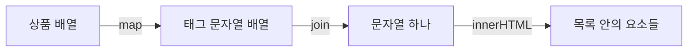

# 11장. DOM 요소 조작

**학습목표**

- `createElement()`로 새 요소를 만들고 내용·클래스·속성을 붙일 수 있습니다.
- `append()`, `prepend()`, `before()`, `after()`로 넣을 위치를 정할 수 있습니다.
- 요소 하나를 지우는 것과 목록 안을 통째로 비우는 것을 구분할 수 있습니다.
- 상품 배열을 HTML 문자열로 바꾸어 카드 목록에 표시할 수 있습니다.

## 11-1 요소 만들기

10장에서는 HTML에 이미 있는 요소를 찾아 내용과 모양을 바꿨습니다.
이번에는 HTML에 없던 요소를 JavaScript로 만들고 문서에 넣습니다.
새 공지나 상품 카드처럼 화면에 표시할 항목이 늘어날 때 쓰는 방법입니다.

이 장의 파일은 `js-course/chapter11` 폴더에 만듭니다.
공통 CSS 연결과 Live Server 실행 방법은 1-3을 따릅니다.

모든 예제의 `<script>`는 `</body>` 바로 앞에 둡니다.
브라우저가 화면의 HTML을 먼저 읽고 JavaScript를 실행하므로, 그 위에 있는 요소를 바로 찾아 조작할 수 있습니다.

### createElement

`document.createElement()`는 지정한 태그 이름으로 새 DOM 요소를 만드는 메서드입니다.
쉽게 말해 `<p>`나 `<article>` 하나를 JavaScript에서 만들어 변수에 담습니다.
괄호 안에는 `"p"`처럼 태그 이름만 쓰고 `<`와 `>`는 쓰지 않습니다.

**특징**

- 호출할 때마다 새 요소 하나를 만들어 돌려줍니다.
- 만들어진 요소에는 처음에 내용이 없습니다.
- 요소를 만들기만 해서는 문서에 들어가지 않아 화면에 보이지 않습니다.
- `const` 변수에 담아도 그 요소의 내용과 속성을 바꿀 수 있습니다.

### 내용·클래스·속성 붙이기

새 요소에도 10장에서 배운 `textContent`와 `classList.add()`를 씁니다.
`textContent`로 글자를 넣고, `classList.add()`로 공통 CSS의 클래스 이름을 붙입니다.
여기서는 태그 없이 글자만 넣으므로 `textContent`를 씁니다.

`setAttribute()`는 요소의 **HTML 속성**(attribute)을 지정하는 메서드입니다.
첫 번째 인수는 속성 이름이고 두 번째 인수는 속성 값입니다.
예를 들어 `setAttribute("id", "notice")`는 HTML의 `id="notice"`와 같은 설정입니다.

**특징**

- 속성 이름과 값을 문자열로 넣습니다.
- 같은 이름의 속성이 이미 있으면 그 값을 바꿉니다.
- 속성만 붙여도 문서에 요소가 삽입되지는 않습니다.

**기본 문법**

```javascript
const 요소명 = document.createElement("태그이름");
요소명.textContent = "글자";
요소명.classList.add("클래스이름");
요소명.setAttribute("속성이름", "속성값");
```

다음 예제는 공지 요소를 만들고 준비한 내용만 콘솔에서 확인합니다.
아직 문서에는 넣지 않습니다.

**예제 11-1** `create-element.html`

```html
<!DOCTYPE html>
<html lang="ko">
<head>
  <meta charset="UTF-8">
  <title>새 요소 만들기</title>
  <link rel="stylesheet" href="../css/common.css">
</head>
<body>
  <main class="page">
    <p class="label">요소 생성 / CREATE</p>
    <h1>새 요소 만들기</h1>
    <p class="muted">Console 탭에서 만든 요소의 글자를 확인합니다.</p>
  </main>

  <script>
    const notice = document.createElement("p");
    notice.textContent = "오늘은 무료 배송입니다.";
    notice.classList.add("card");
    notice.setAttribute("id", "notice");
    notice.setAttribute("title", "배송 안내");

    console.log("새 요소의 글자:", notice.textContent);
    console.log("문서에서 찾은 공지:", document.querySelector("#notice"));
  </script>
</body>
</html>
```

**실행 결과**


개발자 도구의 Console 탭에는 다음이 출력됩니다.

```text
새 요소의 글자: 오늘은 무료 배송입니다.
문서에서 찾은 공지: null
```

- `createElement("p")`가 반환한 새 요소를 `notice`에 담았습니다.
- `notice.textContent`에는 글자가 있지만 이 요소는 문서에 아직 들어가지 않았습니다. 그래서 `querySelector("#notice")`로는 찾지 못합니다.
- `classList.add("card")`는 클래스 이름만 붙입니다. 문서에 넣으면 공통 CSS의 카드 모양이 적용됩니다.
- `title` 속성은 요소 위에 마우스를 올렸을 때 보여 줄 설명입니다. 이 예제에서는 속성만 준비해 둡니다.

## 11-2 넣기

만들어 둔 요소를 화면에 보이게 하려면 문서 안에 넣어야 합니다.
넣는 위치는 기준 요소의 안쪽인지 바깥쪽인지에 따라 달라집니다.
HTML에서 요소를 감싸는 쪽을 부모, 그 안의 요소를 자식, 같은 부모 안에 나란히 있는 요소를 형제라고 합니다.
여기서는 이 관계로 삽입 위치만 구분합니다.

### append와 prepend

`append()`는 대상 요소 안의 맨 끝에 요소를 넣는 메서드입니다.
`prepend()`는 대상 요소 안의 맨 앞에 요소를 넣는 메서드입니다.
목록에 항목을 넣을 때는 목록을 감싸는 요소를 대상으로 호출합니다.

**특징**

- 새 요소는 대상 요소의 자식으로 들어갑니다.
- 기존 자식 요소를 지우지 않고 앞이나 뒤에 더합니다.
- 문서에 이미 들어 있는 요소를 넣으면 그 요소가 새 위치로 이동합니다.
- 같은 요소 하나를 두 곳에 넣어도 복사본이 생기지는 않습니다.

**비교 — append와 prepend**

| 비교 항목 | append | prepend |
|---|---|---|
| 넣는 위치 | 대상 안의 맨 끝 | 대상 안의 맨 앞 |
| 호출 대상 | 항목을 담을 목록 | 항목을 담을 목록 |
| 기존 항목 | 새 항목보다 앞에 남는다 | 새 항목보다 뒤에 남는다 |

**기본 문법**

```javascript
목록요소.append(새요소);
목록요소.prepend(새요소);
```

**예제 11-2** `insert-ends.html`

```html
<!DOCTYPE html>
<html lang="ko">
<head>
  <meta charset="UTF-8">
  <title>목록 처음과 끝에 넣기</title>
  <link rel="stylesheet" href="../css/common.css">
</head>
<body>
  <main class="page">
    <p class="label">목록 안 / INSIDE</p>
    <h1>메뉴 목록</h1>
    <ul id="menu" class="card">
      <li>상품 보기</li>
    </ul>
  </main>

  <script>
    const menu = document.querySelector("#menu");
    const firstItem = document.createElement("li");
    const lastItem = document.createElement("li");

    firstItem.textContent = "행사 안내";
    lastItem.textContent = "고객 상담";

    menu.prepend(firstItem);
    menu.append(lastItem);
  </script>
</body>
</html>
```

**실행 결과**


- `menu.prepend(firstItem)`은 기존 상품 보기 앞에 행사 안내를 넣습니다.
- `menu.append(lastItem)`은 기존 상품 보기 뒤에 고객 상담을 넣습니다.
- 둘 다 `menu`를 대상으로 호출했으므로 새 `<li>`는 `<ul>` 안에 들어갑니다.

예제 11-2에서 `menu.append(lastItem);` 아래에 다음 줄을 추가해 봅니다.

```javascript
menu.append(firstItem);
```

행사 안내가 맨 앞에서 맨 끝으로 이동합니다.
순서는 상품 보기 → 고객 상담 → 행사 안내가 되고, 항목 수는 세 개 그대로입니다.


### before와 after

`before()`는 기준 요소 바로 앞에 요소를 넣는 메서드입니다.
`after()`는 기준 요소 바로 뒤에 요소를 넣는 메서드입니다.
새 요소는 기준 요소의 자식이 아니라 형제로 들어갑니다.

**특징**

- 넣을 위치의 기준이 되는 요소를 대상으로 호출합니다.
- 대상 요소의 안쪽이 아니라 바깥쪽 앞뒤에 넣습니다.
- 기준 요소와 같은 부모 안에 들어갑니다.

**비교 — 안쪽에 넣기와 바깥쪽에 넣기**

| 비교 항목 | append·prepend | before·after |
|---|---|---|
| 기준 요소와의 관계 | 새 자식 | 새 형제 |
| 목록 안에 항목을 넣을 때 | 목록 요소에 호출 | 기존 항목에 호출 |
| 목록 요소에 호출하면 | 목록 안에 들어간다 | 목록 밖에 들어간다 |

아래 그림은 카드 하나를 기준으로 문단을 넣는 위치입니다.
카드 상자 안에 넣을지, 카드 상자 앞뒤에 둘지를 먼저 고릅니다.

**시각자료 — 기준 요소의 안쪽과 바깥쪽 삽입 위치**


`prepend()`와 `append()`는 카드 안에 넣습니다.
`before()`와 `after()`는 카드를 감싸는 같은 부모 안에서 카드 앞뒤에 넣습니다.

**기본 문법**

```javascript
기준요소.before(새요소);
기준요소.after(새요소);
```

**예제 11-3** `insert-around.html`

```html
<!DOCTYPE html>
<html lang="ko">
<head>
  <meta charset="UTF-8">
  <title>기준 항목 앞뒤에 넣기</title>
  <link rel="stylesheet" href="../css/common.css">
</head>
<body>
  <main class="page">
    <p class="label">기준 항목 앞뒤 / AROUND</p>
    <h1>메뉴 목록</h1>
    <ul id="menu" class="card">
      <li>홈</li>
      <li id="productsMenu">상품 보기</li>
      <li>회원 정보</li>
    </ul>
  </main>

  <script>
    const productsMenu = document.querySelector("#productsMenu");
    const firstItem = document.createElement("li");
    const lastItem = document.createElement("li");

    firstItem.textContent = "행사 안내";
    lastItem.textContent = "고객 상담";

    productsMenu.before(firstItem);
    productsMenu.after(lastItem);
  </script>
</body>
</html>
```

**실행 결과**


- 이번에는 `<ul>`이 아니라 기존 `<li>`인 `productsMenu`를 선택했습니다.
- `productsMenu.before(firstItem)`은 홈과 상품 보기 사이에 행사 안내를 넣습니다.
- `productsMenu.after(lastItem)`은 상품 보기와 회원 정보 사이에 고객 상담을 넣습니다.
- 새 항목은 상품 보기의 안쪽에 들어가지 않습니다. 다섯 항목 모두 같은 `<ul>` 안에 나란히 있습니다.

## 11-3 지우기

항목을 더하는 것과 반대로, 문서에서 필요 없는 요소를 없앨 수도 있습니다.
요소 하나만 없앨 때와 목록 전체를 비울 때 사용하는 코드를 구분합니다.

### remove

`remove()`는 대상 요소를 문서에서 떼어 내는 메서드입니다.
쉽게 말해 선택한 카드나 공지 하나를 화면에서 없앱니다.

**특징**

- 지울 요소 자체를 대상으로 호출합니다.
- 괄호 안에는 인수를 넣지 않습니다.
- 대상 요소 안의 내용도 함께 문서에서 빠집니다.
- 같은 목록의 다른 요소는 그대로 남습니다.

**기본 문법**

```javascript
지울요소.remove();
```

**예제 11-4** `remove-element.html`

```html
<!DOCTYPE html>
<html lang="ko">
<head>
  <meta charset="UTF-8">
  <title>카드 하나 지우기</title>
  <link rel="stylesheet" href="../css/common.css">
</head>
<body>
  <main class="page">
    <p class="label">요소 삭제 / REMOVE</p>
    <h1>상품 목록</h1>
    <section id="productList" class="card-list">
      <article id="oldCard" class="card">
        <h2>지난 행사 상품</h2>
        <p>판매가 끝났습니다.</p>
      </article>
      <article class="card">
        <h2>무선 마우스</h2>
        <p>12000원</p>
      </article>
    </section>
  </main>

  <script>
    const oldCard = document.querySelector("#oldCard");
    oldCard.remove();

    console.log("남은 카드:", document.querySelectorAll("#productList .card").length);
  </script>
</body>
</html>
```

**실행 결과**


Console 탭에는 다음이 출력됩니다.

```text
남은 카드: 1
```

- `oldCard.remove()`는 지난 행사 상품 카드 전체를 문서에서 없앱니다.
- 다른 카드와 목록 상자 `productList`는 그대로입니다.
- `"#productList .card"`는 목록 안에 있는 카드들을 찾는 CSS 선택자입니다. 그 결과의 `length`로 남은 카드 수를 확인합니다.

### innerHTML로 목록 비우기

10장에서 배운 `innerHTML`에 빈 문자열 `""`을 넣으면 대상 요소 안의 내용이 모두 지워집니다.
여러 항목을 한꺼번에 없애면서 목록을 담을 상자는 남길 때 씁니다.

**특징**

- 대상 요소 안의 글자와 자식 요소를 모두 없앱니다.
- 대상 요소 자체와 그 요소의 `id`, 클래스는 그대로 남습니다.
- 대상 안에 새 내용을 다시 넣을 수 있습니다.

**비교 — remove와 innerHTML로 비우기**

| 비교 항목 | remove | innerHTML = "" |
|---|---|---|
| 대상 요소 자체 | 문서에서 없어진다 | 문서에 남는다 |
| 대상 안의 내용 | 대상과 함께 문서에서 빠진다 | 모두 지워진다 |
| 쓰는 곳 | 카드 하나 삭제 | 목록 전체 비우기 |

**기본 문법**

```javascript
목록요소.innerHTML = "";
```

**예제 11-5** `clear-list.html`

```html
<!DOCTYPE html>
<html lang="ko">
<head>
  <meta charset="UTF-8">
  <title>목록 전체 비우기</title>
  <link rel="stylesheet" href="../css/common.css">
</head>
<body>
  <main class="page">
    <p class="label">목록 비우기 / CLEAR</p>
    <h1>상품 목록</h1>
    <section id="productList" class="card-list">
      <article class="card">
        <h2>무선 마우스</h2>
        <p>12000원</p>
      </article>
      <article class="card">
        <h2>마우스 패드</h2>
        <p>5000원</p>
      </article>
    </section>
    <p class="muted">목록 상자가 남았는지는 Console 탭에서 확인합니다.</p>
  </main>

  <script>
    const productList = document.querySelector("#productList");
    productList.innerHTML = "";

    console.log("남은 카드:", document.querySelectorAll("#productList .card").length);
    console.log("목록 상자는 그대로:", document.querySelector("#productList") === productList);
  </script>
</body>
</html>
```

**실행 결과**


Console 탭에는 다음이 출력됩니다.

```text
남은 카드: 0
목록 상자는 그대로: true
```

- `productList.innerHTML = "";`는 카드 두 개를 모두 지웁니다.
- `querySelector("#productList") === productList`가 `true`이므로 같은 목록 요소가 문서에 남아 있습니다.
- `productList.remove()`를 썼다면 목록 상자까지 문서에서 없어집니다. 목록을 다시 채울 예정이면 상자를 남기는 쪽을 씁니다.

## 11-4 배열로 목록 그리기

7장에서는 `map()`으로 태그 문자열 배열을 만들고 `join("")`으로 이어서 콘솔에 출력했습니다.
이번에는 그 문자열을 기존 목록 요소의 `innerHTML`에 넣어 화면에 표시합니다.
데이터를 바탕으로 화면에 표시할 내용을 만드는 일을 **렌더링**(rendering)이라고 합니다.
여기서는 상품 객체 하나를 목록 항목 하나로 그립니다.

### map·join·innerHTML로 채우기

목록을 담을 요소가 HTML에 있으면 그 요소를 찾아 안쪽을 채웁니다.
`map()`은 상품마다 태그 문자열 하나를 만들고, `join("")`은 그 문자열들을 하나로 잇습니다.
`innerHTML`은 이 문자열을 HTML로 읽어 실제 요소로 표시합니다.

**특징**

- `map()`의 결과는 DOM 요소가 아니라 문자열 배열입니다.
- `join("")`을 거치면 태그 사이에 쉼표가 들어가지 않습니다.
- `innerHTML`에 할당하면 기존 안쪽 내용을 새 내용으로 교체합니다.
- 상품 배열이 비어 있으면 합친 문자열도 `""`이 되어 목록 안이 비워집니다.

**시각자료 — 상품 배열이 화면 목록이 되는 순서**



`map()`과 `join()`까지는 문자열을 만드는 단계입니다.
`innerHTML`에 넣을 때 기존 목록 상자 안에 실제 요소들이 만들어집니다.

**기본 문법**

```javascript
const 태그배열 = 배열명.map((항목) => `태그 문자열 ${항목.속성}`);
목록요소.innerHTML = 태그배열.join("");
```

**예제 11-6** `array-list.html`

```html
<!DOCTYPE html>
<html lang="ko">
<head>
  <meta charset="UTF-8">
  <title>상품 배열로 목록 그리기</title>
  <link rel="stylesheet" href="../css/common.css">
</head>
<body>
  <main class="page">
    <p class="label">배열로 그리기 / RENDER</p>
    <h1>상품 목록</h1>
    <ul id="productList" class="card">
      <li>상품을 준비하고 있습니다.</li>
    </ul>
  </main>

  <script>
    const products = [
      { name: "무선 마우스", price: 12000 },
      { name: "마우스 패드", price: 5000 }
    ];
    const productList = document.querySelector("#productList");
    const tags = products.map((product) => `<li>${product.name}: ${product.price}원</li>`);

    productList.innerHTML = tags.join("");
    console.log("배열의 상품 수:", products.length);
    console.log("화면의 항목 수:", document.querySelectorAll("#productList li").length);
  </script>
</body>
</html>
```

**실행 결과**


Console 탭에는 다음이 출력됩니다.

```text
배열의 상품 수: 2
화면의 항목 수: 2
```

- `tags`에는 `<li>무선 마우스: 12000원</li>`와 `<li>마우스 패드: 5000원</li>` 두 문자열이 담깁니다.
- `tags.join("")`은 두 문자열을 쉼표 없이 잇습니다. `productList.innerHTML`에 넣으므로 상품을 준비한다는 기존 항목은 새 항목 두 개로 바뀝니다.
- HTML의 `class="card"`는 목록 요소 자체에 붙어 있으므로 내용을 바꾼 뒤에도 남습니다.
- 화면에 요소를 그려도 `products`의 객체나 배열을 바꾸지는 않습니다.

### 기존 목록 채우기와 새 요소 붙이기

기존 목록 안을 배열 내용으로 채울 때는 `map()`·`join()`·`innerHTML`을 씁니다.
공지 하나처럼 새 요소를 만들어 특정 위치에 더할 때는 `createElement()`와 삽입 메서드를 씁니다.
목록 전체를 교체할지, 기존 요소들을 남겨 두고 하나를 더할지가 선택 기준입니다.

**비교 — 기존 목록 채우기와 새 요소 붙이기**

| 비교 항목 | map·join·innerHTML | createElement·삽입 메서드 |
|---|---|---|
| 준비하는 값 | HTML 문자열 | 새 DOM 요소 |
| 기존 내용 | 안쪽을 교체한다 | 남겨 두고 더한다 |
| 위치 정하기 | 목록 요소 안을 채운다 | 처음·끝·기준 요소 앞뒤를 고른다 |
| 쓰는 곳 | 상품 배열 전체 표시 | 공지 하나 추가 |

## 따라하기 실습 — 상품 배열로 카드 목록 그리기

**실습 목표**

- 상품 배열을 카드 태그 문자열로 바꾸어 목록에 그립니다.
- 새 공지 카드를 만들어 목록의 처음과 끝에 넣습니다.
- 지난 공지 하나를 지우고, 배열에서 표시할 상품을 골라 카드 목록이 달라지는지 확인합니다.

**준비**

1. `js-course` 안에 `chapter11` 폴더를 만듭니다. 이미 만들었다면 그 폴더를 씁니다.
2. 그 안에 `product-cards.html` 파일을 만듭니다.

**실습 코드**

`chapter11/product-cards.html`

```html
<!DOCTYPE html>
<html lang="ko">
<head>
  <meta charset="UTF-8">
  <title>상품 카드 목록</title>
  <link rel="stylesheet" href="../css/common.css">
</head>
<body>
  <main class="page">
    <p class="label">상품 안내 / PRODUCTS</p>
    <h1>상품 카드 목록</h1>
    <p id="oldNotice" class="muted">지난 행사 안내입니다.</p>
    <section id="productList" class="card-list"></section>
  </main>

  <script>
    const products = [
      { id: 1, name: "무선 마우스", price: 12000, stock: 5 },
      { id: 2, name: "기계식 키보드", price: 89000, stock: 0 },
      { id: 3, name: "모니터", price: 230000, stock: 2 }
    ];
    const productList = document.querySelector("#productList");
    const oldNotice = document.querySelector("#oldNotice");

    function renderProducts() {
      productList.innerHTML = products.map((product) => `
        <article class="card">
          <span class="badge">${product.stock > 0 ? "판매 중" : "품절"}</span>
          <h2>${product.name}</h2>
          <p>${product.price}원</p>
        </article>
      `).join("");
    }

    function createNotice(text) {
      const notice = document.createElement("article");
      notice.textContent = text;
      notice.classList.add("card");
      notice.setAttribute("title", "상품 안내");
      return notice;
    }

    renderProducts();
    oldNotice.remove();

    const firstNotice = createNotice("공지: 새 상품이 입고되었습니다.");
    const lastNotice = createNotice("공지: 배송비는 3000원입니다.");
    productList.prepend(firstNotice);
    productList.append(lastNotice);
  </script>
</body>
</html>
```

**실행 방법**

1. 전체 코드를 입력하고 저장합니다.
2. `product-cards.html`을 Live Server로 엽니다.
3. 상품 배열의 순서와 카드의 순서가 같은지 확인합니다.
4. 공지 카드 위에 마우스를 올려 `title` 속성의 상품 안내가 뜨는지 확인합니다.

**실행 결과**


**코드 설명**

- `products`는 7장의 상품 정보와 같은 `id`, `name`, `price`, `stock`을 씁니다. 화면을 그릴 때는 이름·가격·재고만 읽습니다.
- `renderProducts()`는 기존 `productList`의 안쪽을 상품 카드들로 채웁니다. 이름이 있는 함수는 `function` 선언문으로, `map()`의 콜백은 화살표 함수로 씁니다.
- 콜백의 백틱 안에는 카드 하나의 전체 HTML을 넣습니다. `${product.name}`과 `${product.price}` 자리에 현재 상품의 값이 들어갑니다.
- `${product.stock > 0 ? "판매 중" : "품절"}`은 재고가 0인 키보드만 품절로 표시합니다.
- `createNotice()`는 호출할 때마다 새 공지 요소를 만듭니다. 서로 다른 요소 두 개를 만들어 처음과 끝에 하나씩 넣습니다.
- `oldNotice.remove()`는 지난 행사 안내만 지웁니다. 제목과 상품 목록은 그대로입니다.
- `prepend()`와 `append()`의 공지도 목록 안의 카드입니다. 전체 다섯 카드가 공지 → 마우스 → 키보드 → 모니터 → 배송 공지 순서로 배치됩니다.

이 코드의 공지 두 개는 상품 카드를 그린 뒤에 넣습니다.
그 뒤 `renderProducts()`를 다시 부르면 `innerHTML`이 목록 안을 교체하므로 공지 카드도 함께 없어집니다.
상품 카드만 다시 그리고 공지도 보여 주려면 다시 그린 뒤 공지를 넣는 순서로 실행합니다.

**바꿔 보기 1**

원래 실습 코드에서 재고가 있는 상품만 그려 봅니다.
`function renderProducts() { ... }` 전체를 다음 코드로 바꿉니다.

```javascript
function renderProducts() {
  const availableProducts = products.filter((product) => product.stock > 0);
  productList.innerHTML = availableProducts.map((product) => `
    <article class="card">
      <span class="badge">판매 중</span>
      <h2>${product.name}</h2>
      <p>${product.price}원</p>
    </article>
  `).join("");
}
```

키보드 카드가 빠지고 상품 카드는 마우스와 모니터 두 개만 남습니다.
상품 배열 자체를 지운 것이 아니므로 `products`의 상품 세 개는 그대로입니다.
앞뒤 공지를 합친 화면의 카드 수는 네 개입니다.


**바꿔 보기 2**

`renderProducts()`를 원래 코드로 되돌리고 첫 공지만 지워 봅니다.
`productList.append(lastNotice);` 줄 아래에 다음 줄을 추가합니다.

```javascript
firstNotice.remove();
```

첫 공지가 사라져서 마우스 카드가 목록의 맨 앞에 옵니다.
상품 카드 세 개와 배송 공지 한 개는 그대로 남습니다.


## 연습문제

### 연습문제 1 — 메뉴 배열로 내비게이션 만들기

**요구사항**

1. `chapter11` 안에 `navigation.html` 파일을 만들고 공통 CSS를 연결합니다.
2. 메뉴 배열 `menus`에 아래 표의 이름(`name`)과 이동 주소(`href`)를 담습니다.
3. HTML에 비어 있는 `<nav id="navigation" class="button-group"></nav>`를 둡니다.
4. `map()`과 `join("")`으로 메뉴마다 `<a class="btn">` 태그 문자열을 만들고 기존 내비게이션 안을 채웁니다.
5. 각 링크의 글자는 메뉴 이름이고 `href`는 표의 이동 주소입니다.

| 이름 | 이동 주소 |
|---|---|
| 상품 | `#products` |
| 행사 | `#events` |
| 문의 | `#contact` |

**완료 조건**

- 상품, 행사, 문의 링크 세 개가 배열 순서대로 표시됩니다.
- 링크를 누르면 주소 끝에 각각 `#products`, `#events`, `#contact`가 붙습니다.
- 화면에 링크 사이의 쉼표가 보이지 않습니다.
- 같은 그리기 코드를 두 번 실행해도 링크는 세 개입니다.

### 연습문제 2 — 카드 맨 앞과 맨 뒤에 공지 넣기

**요구사항**

1. `chapter11` 안에 `card-notices.html` 파일을 만들고 공통 CSS를 연결합니다.
2. HTML의 `#productList`에 공통 CSS의 카드 두 개를 둡니다. 상품은 무선 마우스 12000원, 마우스 패드 5000원입니다.
3. `createNotice(text)`를 함수 선언문으로 만듭니다. 새 `<article>`에 받은 글자를 넣고 `card` 클래스를 붙여 돌려줍니다.
4. 공지 요소에는 `setAttribute()`로 `title="구매 안내"`를 붙입니다.
5. 목록 안 맨 앞에는 `공지: 회원은 10퍼센트 할인합니다.`, 맨 뒤에는 `공지: 교환은 7일 이내에 가능합니다.`를 넣습니다.
6. 기존 상품 카드 두 개는 그대로 남깁니다.

**완료 조건**

- 할인 공지 → 무선 마우스 → 마우스 패드 → 교환 공지 순서입니다.
- 네 카드 모두 `#productList` 안에 있습니다.
- 앞뒤 공지는 서로 다른 요소이며 마우스를 올리면 구매 안내가 뜹니다.
- 기존 목록을 `innerHTML`로 교체하지 않았습니다.

## 정답과 해설

### 연습문제 1 — 메뉴 배열로 내비게이션 만들기

`navigation.html`

```html
<!DOCTYPE html>
<html lang="ko">
<head>
  <meta charset="UTF-8">
  <title>메뉴 내비게이션</title>
  <link rel="stylesheet" href="../css/common.css">
</head>
<body>
  <main class="page">
    <p class="label">메뉴 / NAVIGATION</p>
    <h1>쇼핑몰 내비게이션</h1>
    <nav id="navigation" class="button-group"></nav>
  </main>

  <script>
    const menus = [
      { name: "상품", href: "#products" },
      { name: "행사", href: "#events" },
      { name: "문의", href: "#contact" }
    ];
    const navigation = document.querySelector("#navigation");

    function renderNavigation() {
      navigation.innerHTML = menus.map((menu) => `<a class="btn" href="${menu.href}">${menu.name}</a>`).join("");
    }

    renderNavigation();
    renderNavigation();
  </script>
</body>
</html>
```

**실행 결과**


**해설**

- `menu.href`는 링크의 이동 주소이고 `menu.name`은 링크 안에 표시할 글자입니다.
- `join("")`으로 태그를 이어 메뉴 사이에 쉼표가 들어가지 않습니다.
- `renderNavigation()`을 두 번 불렀지만 두 번째 호출이 목록 안을 교체하므로 링크는 세 개입니다.
- 기존 `navigation`을 찾아 채우는 상황이라 `map()`·`join()`·`innerHTML`을 사용했습니다.

### 연습문제 2 — 카드 맨 앞과 맨 뒤에 공지 넣기

`card-notices.html`

```html
<!DOCTYPE html>
<html lang="ko">
<head>
  <meta charset="UTF-8">
  <title>앞뒤 공지 카드</title>
  <link rel="stylesheet" href="../css/common.css">
</head>
<body>
  <main class="page">
    <p class="label">구매 안내 / NOTICE</p>
    <h1>상품과 공지</h1>
    <section id="productList" class="card-list">
      <article class="card">
        <h2>무선 마우스</h2>
        <p>12000원</p>
      </article>
      <article class="card">
        <h2>마우스 패드</h2>
        <p>5000원</p>
      </article>
    </section>
  </main>

  <script>
    const productList = document.querySelector("#productList");

    function createNotice(text) {
      const notice = document.createElement("article");
      notice.textContent = text;
      notice.classList.add("card");
      notice.setAttribute("title", "구매 안내");
      return notice;
    }

    const firstNotice = createNotice("공지: 회원은 10퍼센트 할인합니다.");
    const lastNotice = createNotice("공지: 교환은 7일 이내에 가능합니다.");
    productList.prepend(firstNotice);
    productList.append(lastNotice);
  </script>
</body>
</html>
```

**실행 결과**


**해설**

- `createNotice()`를 두 번 호출하므로 공지 요소가 두 개 만들어집니다. 요소 하나를 앞뒤에 두 번 넣으면 이동만 하므로 두 공지를 표시할 수 없습니다.
- 목록 요소에 `prepend()`와 `append()`를 호출해 공지를 그 목록의 자식으로 넣습니다.
- `productList.before()`와 `productList.after()`를 썼다면 공지가 목록 밖에 들어갑니다. 요구사항은 목록 안의 처음과 끝이므로 사용하지 않습니다.
- `classList.add("card")`로 공통 카드 모양을 붙이고 `setAttribute()`로 구매 안내를 설정했습니다.
- 기존 카드들을 교체하지 않고 새 카드만 넣었으므로 무선 마우스와 마우스 패드가 그대로 남습니다.
