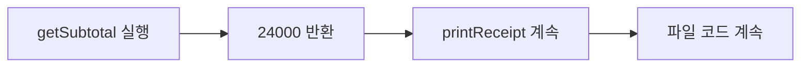
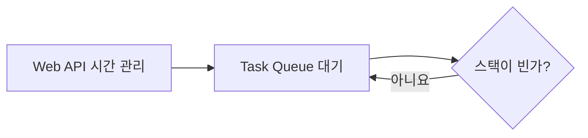
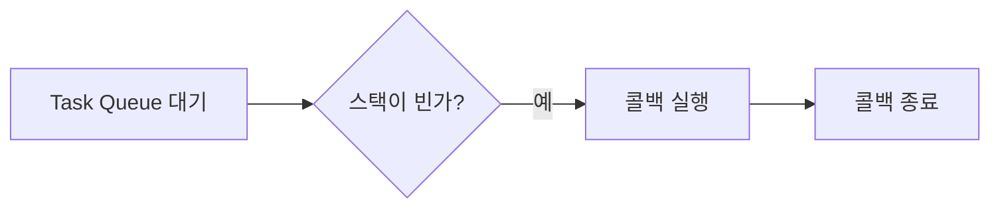
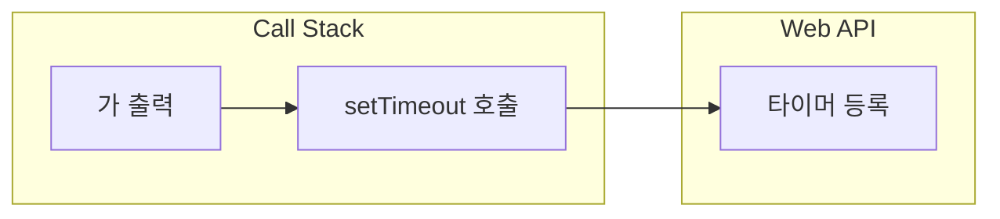
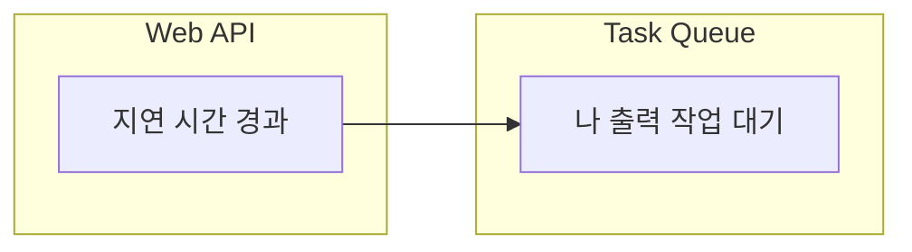
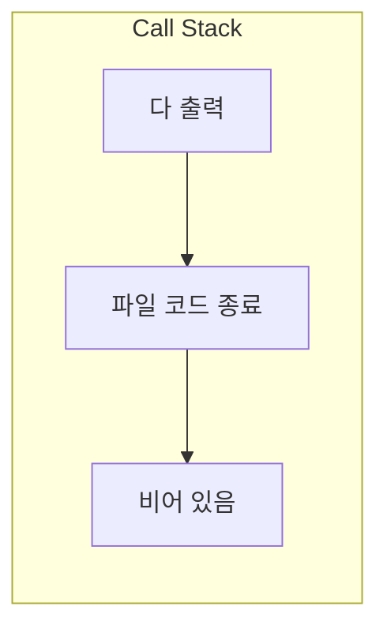
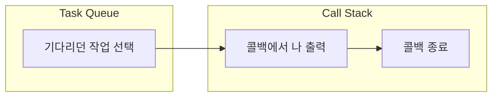
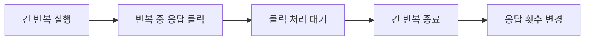

# 16장. 이벤트 루프

**학습목표**

- 콜 스택에 함수 호출이 쌓이고 빠지는 순서를 설명할 수 있습니다.
- 타이머의 대기와 콜백 실행이 서로 다른 일임을 구분할 수 있습니다.
- `setTimeout()`이 들어 있는 코드의 출력 순서를 예측할 수 있습니다.
- 긴 반복이 버튼 클릭 처리와 화면 갱신을 늦추는 이유를 설명할 수 있습니다.

## 16-1 싱글 스레드와 Call Stack

5장에서는 함수가 끝나면 호출한 자리로 돌아와 다음 줄을 실행한다고 했습니다.
이번에는 JavaScript가 그 돌아갈 자리를 어떻게 기억하는지 봅니다.
예제 파일은 `js-course/chapter16` 폴더에 만들며, 화면을 다루는 16-4의 파일만 HTML로 만듭니다.

### 싱글 스레드

**스레드**(thread)는 코드를 실행하는 하나의 흐름입니다.
이 장에서 다루는 JavaScript 실행 흐름은 **싱글 스레드**(single thread)이므로 한 순간에 코드 한 부분을 실행합니다.
함수 안에서 다른 함수를 호출하면 원래 함수의 진행을 잠시 멈추고 호출한 함수를 실행합니다.
두 함수의 코드가 동시에 실행되는 것은 아닙니다.

여기서 하나라는 것은 JavaScript 코드를 실행하는 흐름입니다.
브라우저 전체가 일을 하나씩만 한다는 뜻은 아닙니다.
브라우저는 JavaScript 실행과 별개로 시간의 경과나 사용자의 입력을 관리할 수 있습니다.

### 콜 스택

**콜 스택**(Call Stack)은 현재 실행 중인 코드와 함수 호출의 정보를 차곡차곡 쌓아 두는 구조입니다.
쉽게 말해 함수가 끝났을 때 어디로 돌아가야 하는지 기억하는 호출 기록입니다.
**스택**(stack)은 가장 나중에 넣은 것을 가장 먼저 꺼내는 구조입니다.
함수가 끝나면 맨 위의 호출 정보가 빠지고 그 아래의 코드를 이어서 실행합니다.

**특징**

- 함수를 호출하면 그 호출의 정보가 콜 스택 위에 쌓입니다.
- 현재 실행하는 코드는 콜 스택의 맨 위에 있습니다.
- 함수가 끝나면 해당 호출 정보가 콜 스택에서 빠집니다.
- 함수를 부른 코드도 끝나야 콜 스택이 비워집니다.

호출 정보를 위로 쌓는 상자를 떠올리면 됩니다.
`printReceipt()`가 `getSubtotal()`을 부르면 `getSubtotal()`의 정보가 더 위에 놓입니다.
위쪽의 계산이 끝나야 아래쪽의 영수증 출력을 이어 갑니다.

**시각자료 — getSubtotal을 실행하는 순간의 콜 스택**


그림의 맨 아래 `파일 코드`는 함수 밖에서 실행하는 코드를 뜻합니다.
`console.log()`처럼 짧은 호출은 생략하고 두 함수의 관계만 표시했습니다.

**기본 문법**

```javascript
function 바깥함수명() {
  안쪽함수명();
  이어서 실행할 코드;
}

바깥함수명();
```

**예제 16-1** `call-stack.js`

```javascript
function getSubtotal(price, quantity) {
  console.log("상품 금액 계산");
  return price * quantity;
}

function printReceipt() {
  console.log("영수증 시작");
  const totalPrice = getSubtotal(12000, 2);
  console.log(`상품 금액: ${totalPrice}원`);
  console.log("영수증 끝");
}

console.log("파일 시작");
printReceipt();
console.log("파일 끝");
```

**실행 결과**

```text
파일 시작
영수증 시작
상품 금액 계산
상품 금액: 24000원
영수증 끝
파일 끝
```

- `printReceipt();`를 호출하면 파일 코드 위에 `printReceipt()`의 호출 정보가 쌓입니다.
- `getSubtotal(12000, 2)`를 호출하면 그 위에 `getSubtotal()`의 호출 정보가 쌓입니다. `printReceipt()`는 계산이 끝날 때까지 이어서 실행하지 않습니다.
- `return price * quantity;`가 `24000`을 돌려주면 `getSubtotal()`이 끝나고 `printReceipt()`로 돌아옵니다.
- `printReceipt()`가 끝나야 파일 코드로 돌아와 `파일 끝`을 출력합니다.

**시각자료 — 두 함수가 끝나는 순서**



나중에 호출한 `getSubtotal()`이 먼저 끝납니다.
돌아갈 자리는 콜 스택이 기억하므로 직접 따로 저장할 필요가 없습니다.

## 16-2 Web API와 Task Queue

함수가 끝나야 다음 코드를 실행한다면, 1초 뒤에 안내를 출력할 때도 그동안 모든 코드를 멈춰야 할까요?
타이머를 쓰면 기다리는 일을 실행 환경에 맡기고 다음 코드를 실행할 수 있습니다.

### Web API

**Web API**는 브라우저가 JavaScript에서 사용할 수 있도록 제공하는 기능입니다.
타이머, DOM, 이벤트를 다루는 기능이 여기에 속합니다.
이 장에서는 그중 타이머가 시간의 경과를 관리하는 역할을 봅니다.

`setTimeout()`은 지정한 시간이 지난 뒤 콜백 함수를 실행하도록 예약하는 기능입니다.
브라우저는 타이머의 시간을 관리하고, JavaScript는 등록 뒤의 코드를 계속 실행합니다.
콜백 함수를 다른 곳에서 동시에 실행하는 것이 아니라, 나중에 실행할 준비를 하는 것입니다.

**기본 문법**

```javascript
setTimeout(() => {
  나중에 실행할 코드;
}, 지연시간);
```

두 번째 인수인 지연 시간은 **밀리초**(millisecond) 단위입니다.
`1000`밀리초가 1초이므로 `1000`을 넣으면 약 1초 뒤에 실행하도록 예약합니다.
첫 번째 인수는 5장에서 배운 콜백 함수이며, 여기서는 안쪽에 화살표 함수로 씁니다.

**예제 16-2** `timer-wait.js`

```javascript
console.log("알림 예약 시작");

setTimeout(() => {
  console.log("예약한 알림");
}, 1000);

console.log("다음 코드 실행");
```

**실행 결과**

```text
알림 예약 시작
다음 코드 실행
예약한 알림
```

- `setTimeout()`을 호출하는 줄에서는 타이머를 등록합니다. 콜백 안의 `console.log("예약한 알림");`은 아직 실행하지 않습니다.
- `다음 코드 실행`은 1초를 기다리지 않고 출력됩니다.
- 시간이 지난 뒤 콜백이 실행되어 `예약한 알림`을 출력합니다.
- 이 파일은 node로 실행합니다. Node.js도 `setTimeout()`을 제공하지만 시간을 관리하는 것은 브라우저의 Web API가 아니라 Node.js의 타이머 기능입니다.

브라우저와 Node.js는 타이머를 관리하는 내부 구조가 다릅니다.
이 장의 도식은 브라우저를 기준으로 하며, Node.js 예제에서는 현재 코드가 끝난 뒤 타이머 콜백이 실행된다는 공통 원리를 확인합니다.
Node.js의 실행 구조를 브라우저의 상자 세 개와 완전히 같다고 생각하지 않습니다. ([Node.js 타이머 문서](https://nodejs.org/api/timers.html))

### 태스크 큐와 이벤트 루프

**태스크 큐**(Task Queue)는 실행할 준비가 된 작업을 대기시키는 곳입니다.
타이머의 지연 시간이 지나면 콜백을 실행할 작업이 이곳에서 자기 차례를 기다립니다.
시간이 지났다고 해서 실행 중인 JavaScript 코드를 끊고 들어가지는 않습니다.

**이벤트 루프**(event loop)는 현재 작업이 끝나면 대기 중인 다음 작업을 골라 실행을 이어 가는 실행 환경의 처리 흐름입니다.
쉽게 말해 지금 하던 코드가 끝난 뒤, 준비된 콜백을 실행할 차례를 정합니다.
이 장에서는 타이머와 사용자 클릭의 작업을 중심으로 봅니다.

**특징**

- 콜백이 실행될 준비가 된 순간과 실제로 실행되는 순간은 다를 수 있습니다.
- 현재 실행 중인 코드가 끝나 콜 스택이 비워져야 다음 작업을 실행할 수 있습니다.
- 타이머 콜백도 실행할 때는 같은 JavaScript 실행 흐름의 콜 스택을 사용합니다.
- `setTimeout()`의 지연 시간은 정확한 실행 시각을 보장하지 않습니다.

**비교 — 콜 스택과 태스크 큐**

| 비교 항목 | 콜 스택 | 태스크 큐 |
|---|---|---|
| 담는 것 | 실행 중인 코드의 호출 정보 | 실행할 준비가 된 작업 |
| 지금 실행하는가 | 맨 위의 코드를 실행한다 | 자기 차례를 기다린다 |
| 순서를 이해하는 기준 | 나중에 쌓인 호출부터 끝낸다 | 준비되어 대기하는 작업을 처리한다 |

**시각자료 — 현재 코드가 남아 있을 때 대기하기**



타이머를 등록하고 지연 시간이 지나면 작업이 태스크 큐에서 기다립니다.
그림의 스택은 `Call Stack`이며, 현재 코드가 남아 있으면 계속 대기한다는 뜻입니다.
콜 스택이 비워져 조건이 예가 되면 다음 그림의 실행 흐름으로 이어집니다.

**시각자료 — 콜 스택이 비었을 때 콜백 실행하기**



조건이 예이면 대기하던 작업을 골라 콜백을 콜 스택에서 실행합니다.
두 그림은 타이머 한 개의 흐름을 단순화한 것이며, 브라우저에는 작업 종류별 큐와 화면을 갱신하는 과정도 있습니다.

## 16-3 setTimeout으로 실행 순서 보기

지연 시간을 `0`으로 넣어도 현재 실행 중인 코드가 먼저 끝납니다.
`0`은 타이머를 등록한 자리에서 콜백을 바로 호출하라는 뜻이 아닙니다.
지연 시간을 `0`으로 요청하고 다음 실행 차례를 기다리게 합니다. ([MDN setTimeout 문서](https://developer.mozilla.org/en-US/docs/Web/API/Window/setTimeout))

**예제 16-3** `zero-delay.js`

```javascript
console.log("가");

setTimeout(() => {
  console.log("나");
}, 0);

console.log("다");
```

**실행 결과**

```text
가
다
나
```

- `console.log("가");`는 파일 코드에서 바로 실행합니다.
- `setTimeout()`은 `나`를 출력할 콜백을 예약하고 다음 줄로 넘어갑니다.
- `console.log("다");`까지 실행하고 파일 코드가 끝난 뒤 콜백이 실행되어 `나`가 나옵니다.

### 같은 예제를 네 순간으로 나눠 보기

다음 네 그림은 예제 16-3의 타이머가 실행할 준비를 갖춘 뒤에도 파일 코드가 남아 있는 상황을 보여 줍니다.
실제로 타이머가 준비되는 순간은 실행 환경에 따라 달라질 수 있습니다.
파일 코드가 먼저 끝나도 `가 → 다 → 나`라는 출력 순서는 같습니다.

**시각자료 — 1. 콜 스택에서 타이머 등록하기**



콜 스택에서 `setTimeout()`을 호출하면 브라우저에 타이머가 등록됩니다.
콜백 안의 `나`는 아직 실행하지 않았고, 태스크 큐에도 아직 타이머 작업이 들어가지 않았습니다.

**시각자료 — 2. 준비된 작업을 태스크 큐에 넣기**



지연 시간이 지나면 `나`를 출력할 콜백의 작업이 태스크 큐에서 기다립니다.
콜 스택에 파일 코드가 남아 있으면 그 코드를 계속 실행합니다.

**시각자료 — 3. 현재 파일 코드를 끝내기**



태스크 큐의 콜백보다 파일 코드의 `다`가 먼저 출력됩니다.
파일 코드가 끝나면 콜 스택이 비워져 다음 작업을 실행할 수 있습니다.

**시각자료 — 4. 기다리던 콜백 실행하기**



이벤트 루프가 기다리던 작업을 선택하면 콜백이 콜 스택에서 실행됩니다.
콜백은 Web API나 태스크 큐 안에서 실행되는 것이 아닙니다.

## 따라하기 실습 — 출력 순서 예측하기

**실습 목표**

- 함수 호출과 타이머 등록을 구분해 출력 순서를 적습니다.
- 지연 시간을 바꿔도 현재 코드가 먼저 실행되는지 확인합니다.

**준비**

1. `chapter16` 폴더 안에 `order-timing.js` 파일을 만듭니다.
2. 아래 코드를 읽고 출력될 다섯 줄의 순서를 먼저 메모합니다.

**실습 코드**

`chapter16/order-timing.js`

```javascript
function placeOrder(productName) {
  console.log(`${productName} 주문을 접수했습니다.`);

  setTimeout(() => {
    console.log(`${productName} 주문 알림을 보냈습니다.`);
  }, 0);

  console.log("주문 함수 끝");
}

console.log("파일 시작");
placeOrder("무선 마우스");
console.log("파일 끝");
```

**실행 방법**

1. 파일을 저장하고 터미널의 현재 위치를 `chapter16`으로 맞춥니다.
2. 다음 명령을 입력하고 메모한 순서와 비교합니다.
   ```bash
   node order-timing.js
   ```

**실행 결과**

```text
파일 시작
무선 마우스 주문을 접수했습니다.
주문 함수 끝
파일 끝
무선 마우스 주문 알림을 보냈습니다.
```

**코드 설명**

- `placeOrder()`는 5장에서 쓴 주문 함수 이름을 이어 씁니다. 여기서는 상품 이름만 받아 알림을 타이머로 예약합니다.
- 타이머를 등록한 뒤 `주문 함수 끝`을 출력하므로, 함수는 알림을 보낼 때까지 기다리지 않습니다.
- `placeOrder()`가 끝나도 파일 코드가 남아 있습니다. `파일 끝`까지 실행한 뒤에 알림 콜백을 실행합니다.
- 콜백은 예약할 때 받은 상품 이름 `무선 마우스`로 안내를 출력합니다.

**바꿔 보기 1**

원래 코드의 `}, 0);` 줄을 다음처럼 바꿉니다.
알림을 약 1초 뒤에 보내도록 예약합니다.

```javascript
}, 1000);
```

다섯 줄의 출력 순서는 그대로입니다.
앞의 네 줄은 바로 출력되고 마지막 주문 알림은 시간이 지난 뒤 출력됩니다.

**바꿔 보기 2**

원래 코드로 되돌리고 마지막 `console.log("파일 끝");` 줄 바로 위에 다음 반복문을 넣습니다.
콜백보다 앞서 실행되는 코드가 늘어나는지 확인합니다.

```javascript
for (let step = 1; step <= 3; step++) {
  console.log(`주문 확인 ${step}`);
}
```

`주문 함수 끝`과 `파일 끝` 사이에 `주문 확인 1`, `주문 확인 2`, `주문 확인 3`이 출력됩니다.
`무선 마우스 주문 알림을 보냈습니다.`는 여전히 마지막에 출력됩니다.

## 16-4 화면이 멈추는 경우

12장에서 버튼 클릭을 처리하는 함수를 등록했습니다.
클릭이 일어나도 JavaScript가 다른 코드를 오래 실행하고 있으면 처리 함수는 바로 실행할 수 없습니다.
브라우저가 클릭을 받아 두는 일과 그 클릭의 처리 함수를 실행하는 일은 서로 다릅니다.

### 긴 반복과 화면 갱신

브라우저에서 페이지의 JavaScript 실행과 화면 갱신 등을 맡는 주된 실행 흐름을 **메인 스레드**(main thread)라고 합니다.
긴 반복이 이 흐름을 계속 사용하면 다음 클릭의 처리와 페이지의 화면 갱신이 늦어집니다.
DOM의 값을 바꾼 줄이 실행되었다고 해서 그 순간 화면의 픽셀이 바로 바뀌는 것은 아닙니다.
브라우저가 바뀐 내용을 화면에 그릴 기회도 있어야 합니다. ([MDN 실행 모델 문서](https://developer.mozilla.org/en-US/docs/Web/JavaScript/Reference/Execution_model))

**특징**

- 실행 중인 반복을 다른 클릭의 처리 함수가 중간에 끊고 들어오지 않습니다.
- 긴 반복이 끝나야 기다리던 클릭을 처리할 수 있습니다.
- 긴 반복 자체를 `setTimeout()`의 콜백에 넣어도 그 콜백을 실행하는 동안에는 같은 문제가 생깁니다.

다음 예제는 긴 반복이 클릭을 늦추는 모습을 관찰하려고 약 3초 동안 계산만 합니다.
`performance.now()`는 페이지의 시간 기준에서 지난 시간을 밀리초 숫자로 알려 주는 메서드입니다. ([MDN performance.now 문서](https://developer.mozilla.org/en-US/docs/Web/API/Performance/now))
처음 값을 `startedAt`에 저장하고 현재 값에서 빼면 반복을 시작한 뒤 지난 시간을 구합니다.
반복 횟수는 컴퓨터마다 다르므로 출력하지 않습니다.

**기본 문법**

```javascript
const 시작시각 = performance.now();
const 지난시간 = performance.now() - 시작시각;
```

**예제 16-4** `blocking.html`

```html
<!DOCTYPE html>
<html lang="ko">
<head>
  <meta charset="UTF-8">
  <title>긴 반복과 클릭</title>
  <link rel="stylesheet" href="../css/common.css">
</head>
<body>
  <main class="page">
    <p class="label">이벤트 루프 / EVENT LOOP</p>
    <h1>긴 반복과 클릭</h1>
    <section class="card">
      <p id="workStatus">긴 반복을 시작할 수 있습니다.</p>
      <button id="workButton" class="btn" type="button">긴 반복 시작</button>
      <button id="responseButton" class="btn" type="button">응답 확인</button>
      <p id="responseText">응답 버튼: 0회</p>
    </section>
    <p class="muted">긴 반복 시작을 누르고 곧바로 응답 확인을 누릅니다.</p>
  </main>

  <script>
    const workStatus = document.querySelector("#workStatus");
    const workButton = document.querySelector("#workButton");
    const responseButton = document.querySelector("#responseButton");
    const responseText = document.querySelector("#responseText");
    let responseCount = 0;

    function handleWorkClick() {
      workStatus.innerHTML = "긴 반복 실행 중입니다.";
      console.log("긴 반복 시작");
      const startedAt = performance.now();

      for (let count = 0; performance.now() - startedAt < 3000; count++) {
        // 다른 이벤트에 차례를 넘기지 않고 계산을 계속합니다.
      }

      workStatus.innerHTML = "긴 반복을 마쳤습니다.";
      console.log("긴 반복 종료");
    }

    function handleResponseClick() {
      responseCount++;
      responseText.innerHTML = `응답 버튼: ${responseCount}회`;
      console.log(`응답 버튼: ${responseCount}회`);
    }

    workButton.addEventListener("click", handleWorkClick);
    responseButton.addEventListener("click", handleResponseClick);
  </script>
</body>
</html>
```

**실행 결과**

`blocking.html`을 Live Server로 열고 긴 반복 시작을 누릅니다.
반복이 끝나기 전에 응답 확인을 한 번 누르면 응답 횟수는 반복이 끝난 뒤에 바뀝니다.


Console 탭에는 다음 순서로 출력됩니다.

```text
긴 반복 시작
긴 반복 종료
응답 버튼: 1회
```

- `performance.now() - startedAt < 3000`이 참인 동안 반복합니다. 시작값·조건·증감은 4장에서 배운 `for`와 같은 구조입니다.
- `workStatus.innerHTML = "긴 반복 실행 중입니다.";`는 DOM을 바꾸지만 바로 긴 반복에 들어가므로 그 중간 문구가 화면에 그려지지 않을 수 있습니다.
- `handleWorkClick()`이 끝나기 전에는 `handleResponseClick()`을 실행하지 못합니다. 그래서 응답 로그는 `긴 반복 종료` 뒤에 나옵니다.
- `setTimeout()`은 기다리는 시간을 맡기는 기능입니다. 콜백 안의 무거운 계산을 대신 실행해 주는 기능은 아닙니다.

**시각자료 — 반복 중에 누른 응답 버튼의 처리 순서**



클릭은 반복 도중에 일어났지만 클릭 처리 함수의 실행은 반복 뒤입니다.
반복을 길게 한 번에 실행하면 사용자는 페이지가 멈춘 것처럼 느낍니다.

## 연습문제

### 연습문제 1 — 실행 순서 예측 문제 풀기

**요구사항**

1. `chapter16` 폴더에 `predict-order.js` 파일을 만듭니다.
2. 파일 코드에서 먼저 `시작`을 출력합니다.
3. 함수 `checkStock()`을 선언합니다. 함수 안에서는 `재고 확인`을 바로 출력하고, `setTimeout()`의 지연 시간 `0`으로 `재고 알림`을 출력하도록 예약합니다.
4. `시작` 출력 다음에 `checkStock()`을 호출하고, 그 아래에서 `종료`를 출력합니다.
5. 실행 전에 출력될 네 줄의 순서를 적습니다. 예: `시작`을 첫 줄로 적습니다.
6. node로 실행하고 예측한 순서와 비교합니다. 알림이 그 위치에 나오는 이유도 적습니다.

**완료 조건**

- 네 문구가 한 번씩 출력됩니다.
- `재고 확인`은 함수 호출 중에 출력되고 `재고 알림`은 파일 코드가 끝난 뒤에 출력됩니다.
- 콜 스택이 비워져야 콜백을 실행할 수 있다는 내용으로 순서를 설명합니다.

### 연습문제 2 — setTimeout으로 3초 카운트다운(1초·2초·3초 setTimeout 세 개)

**요구사항**

1. `chapter16` 폴더에 `countdown.js` 파일을 만듭니다.
2. 처음에 `카운트다운 시작`을 출력합니다.
3. `setTimeout()`을 세 번 호출해 각각 지연 시간을 `1000`, `2000`, `3000`으로 정합니다.
4. 세 콜백에서 각각 `2`, `1`, `출발`을 출력합니다. 예: 첫 콜백의 출력은 `2`입니다.
5. 세 타이머를 모두 등록한 뒤 `카운트다운 예약 완료`를 출력합니다.
6. node로 실행해 예약 완료 문구가 숫자보다 먼저 나오는지 확인합니다.

**완료 조건**

- 시작과 예약 완료 문구가 먼저 출력됩니다.
- 실행을 시작하고 약 1초 뒤 `2`, 약 2초 뒤 `1`, 약 3초 뒤 `출발`이 출력됩니다.
- `setTimeout()` 세 개를 차례로 등록하며, 콜백 안에 다른 타이머를 넣지 않습니다.
- 반복문이나 다른 반복 예약 기능을 사용하지 않습니다.

## 정답과 해설

### 연습문제 1 — 실행 순서 예측 문제 풀기

`predict-order.js`

```javascript
function checkStock() {
  console.log("재고 확인");

  setTimeout(() => {
    console.log("재고 알림");
  }, 0);
}

console.log("시작");
checkStock();
console.log("종료");
```

**실행 결과**

```text
시작
재고 확인
종료
재고 알림
```

**해설**

- 함수 선언만으로는 출력하지 않으므로 첫 출력은 파일 코드의 `시작`입니다.
- `checkStock()` 안의 `재고 확인`은 바로 출력하지만 `재고 알림`은 예약만 합니다.
- 함수가 끝나도 파일 코드의 `console.log("종료");`가 남아 있으므로 이 줄을 먼저 실행합니다.
- 파일 코드가 끝난 뒤 타이머 콜백을 실행하므로 지연 시간이 `0`이어도 `재고 알림`이 마지막입니다.

### 연습문제 2 — setTimeout으로 3초 카운트다운(1초·2초·3초 setTimeout 세 개)

`countdown.js`

```javascript
console.log("카운트다운 시작");

setTimeout(() => {
  console.log("2");
}, 1000);

setTimeout(() => {
  console.log("1");
}, 2000);

setTimeout(() => {
  console.log("출발");
}, 3000);

console.log("카운트다운 예약 완료");
```

**실행 결과**

```text
카운트다운 시작
카운트다운 예약 완료
2
1
출발
```

**해설**

- 세 번의 `setTimeout()` 호출은 앞 타이머가 끝나기를 기다리지 않고 차례로 실행됩니다.
- 지연 시간은 각 타이머를 등록한 때부터 잽니다. 1초를 기다린 뒤 다시 2초를 기다리는 코드가 아닙니다.
- 숫자 `2`를 출력한 뒤 약 1초 후 `1`, 다시 약 1초 후 `출발`이 나옵니다.
- 실행 환경이 바쁘면 실제 출력이 늦어질 수 있습니다. 지연 시간은 정확히 그 시각에 실행하겠다는 약속이 아닙니다.
