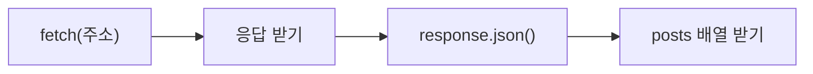
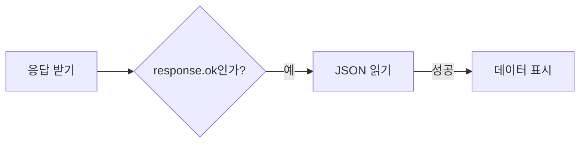
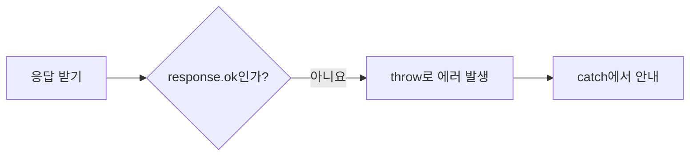
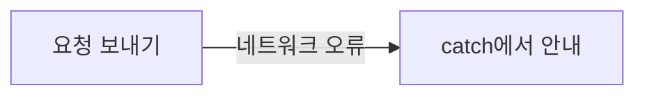
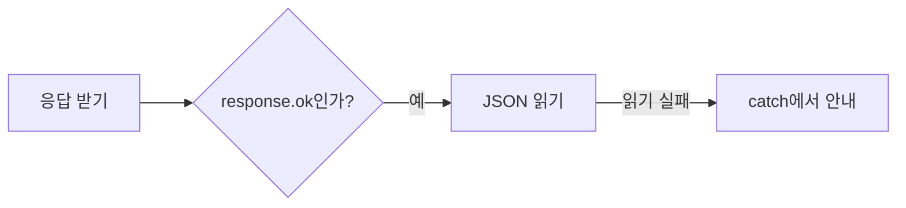

# 18장. AJAX와 fetch

**학습목표**

- AJAX가 페이지를 새로고침하지 않고 데이터를 가져오는 방식임을 설명할 수 있습니다.
- HTTP 요청과 응답의 주소·메서드·헤더·상태 코드를 읽을 수 있습니다.
- JSON 문자열과 JavaScript 값을 변환하고, `fetch()`로 받은 글 목록을 화면에 그릴 수 있습니다.
- HTTP 실패와 네트워크 오류를 `try`·`catch`로 처리할 수 있습니다.

## 18-1 AJAX란

13장에서는 코드에 적어 둔 배열로 화면을 그렸습니다.
이번에는 다른 컴퓨터에서 데이터를 받아 화면을 바꿉니다.
데이터를 제공하고 요청에 답하는 프로그램을 **서버**(server)라고 합니다.
여기서는 연습용 데이터를 제공하는 JSONPlaceholder 서버를 사용합니다.

예제 파일은 `js-course/chapter18` 폴더에 만듭니다.
HTML에서는 1장에서 만든 `../css/common.css`를 그대로 연결합니다.

### AJAX

**AJAX**(Asynchronous JavaScript and XML)는 페이지 전체를 새로고침하지 않고 비동기로 서버와 데이터를 주고받는 방식입니다.
쉽게 말해 열린 페이지는 그대로 두고, 필요한 데이터만 받아 화면의 일부를 바꿉니다.
이름에는 XML이 들어 있지만, 주고받는 데이터가 반드시 XML일 필요는 없습니다.
이 장에서는 JSON 형식의 데이터를 사용합니다.

### AJAX는 왜 필요할까?

화면에서 하던 일을 유지하면서 서버의 데이터를 가져오기 위해 필요합니다.

메모 입력칸에 글을 적다가 서버의 게시글을 확인한다고 생각해 봅시다.
페이지 전체를 새로 불러오면 현재 입력 중인 내용도 초기화될 수 있습니다.
게시글 제목 하나를 확인하려고 페이지 전체를 다시 만들 필요는 없습니다.

AJAX로 제목을 받아 `postTitle`만 채우면 입력칸은 그대로 남습니다.
다음 예제에서 메모를 적고 버튼을 눌러 이 동작을 확인합니다.

**비교 — 페이지 새로고침과 AJAX**

| 비교 항목 | 페이지 새로고침 | AJAX |
|---|---|---|
| 다시 가져오는 것 | HTML 문서 전체 | 요청한 데이터 |
| 화면을 바꾸는 방법 | 문서를 다시 읽는다 | JavaScript로 필요한 요소를 바꾼다 |
| 현재 입력칸 | 문서와 함께 다시 만들어진다 | 기존 요소를 유지할 수 있다 |

### 버튼으로 서버의 글 가져오기

`fetch()`는 주소로 요청을 보내고 응답을 나타내는 Promise를 반환하는 함수입니다.
`await fetch(주소)`로 받은 `response`는 서버 응답을 담은 객체입니다.
`response.json()`은 응답의 데이터를 JavaScript 값으로 읽는 비동기 메서드이므로, 이 호출도 `await`로 기다립니다.
17장의 `async`·`await`·`try`·`catch`를 사용합니다.

**기본 문법**

```javascript
const 응답 = await fetch(주소);
const 데이터 = await 응답.json();
```

**예제 18-1** `ajax.html`

메모 입력칸에 `작성 중인 메모`를 적고 글 가져오기 버튼을 누릅니다.

```html
<!DOCTYPE html>
<html lang="ko">
<head>
  <meta charset="UTF-8">
  <title>새로고침 없이 글 가져오기</title>
  <link rel="stylesheet" href="../css/common.css">
</head>
<body>
  <main class="page">
    <p class="label">새로고침 없이 / AJAX</p>
    <h1>서버의 글 확인하기</h1>
    <label class="form">메모
      <input id="memoInput" class="input" placeholder="메모를 적어 보세요">
    </label>
    <button id="loadButton" class="btn" type="button">글 가져오기</button>
    <section class="card">
      <h2 id="postTitle">아직 글을 가져오지 않았습니다.</h2>
    </section>
  </main>

  <script>
    const postTitle = document.querySelector("#postTitle");
    const loadButton = document.querySelector("#loadButton");

    async function handleClick() {
      try {
        const response = await fetch("https://jsonplaceholder.typicode.com/posts/1");
        const post = await response.json();
        postTitle.innerHTML = post.title;
      } catch (error) {
        postTitle.innerHTML = "글을 가져오지 못했습니다.";
      }
    }

    loadButton.addEventListener("click", handleClick);
  </script>
</body>
</html>
```

**실행 결과**


글 가져오기 버튼을 누르면 서버의 제목이 들어오고, 입력한 메모는 그대로 남습니다.


- `handleClick()`은 `async function`으로 선언하므로 안에서 `await`를 사용할 수 있습니다.
- `post.title`은 받은 글 객체의 제목입니다. 서버의 예제 데이터는 영문이므로 제목도 그대로 영문으로 나옵니다.
- `postTitle.innerHTML = post.title;`은 제목만 바꿉니다. 메모 입력칸을 새로 만들거나 값을 바꾸지 않습니다.
- 이 예제의 `catch`는 요청이나 응답 읽기에서 생긴 에러를 처리합니다. HTTP 상태 코드로 실패를 가리는 조건은 18-5에서 다룹니다.

## 18-2 HTTP 요청과 응답

### 요청과 응답

**HTTP**(Hypertext Transfer Protocol)는 웹에서 요청과 응답을 주고받을 때 따르는 통신 규칙입니다.
브라우저가 서버에 어떤 데이터를 원하는지 알리는 것을 **요청**(request)이라고 합니다.
서버가 요청의 처리 결과를 돌려주는 것을 **응답**(response)이라고 합니다.

요청의 **메서드**(method)는 서버에 하려는 일을 나타냅니다.
`GET`은 데이터를 조회하는 메서드입니다.
주소인 **URL**(Uniform Resource Locator)은 요청할 서버와 데이터의 위치를 나타냅니다.
`https://jsonplaceholder.typicode.com/posts/1`은 그 서버의 1번 글을 가리킵니다.

### 헤더·본문·상태 코드

요청과 응답에는 데이터를 설명하는 **헤더**(header)가 붙습니다.
예를 들어 `Content-Type` 헤더는 **본문**(body), 즉 실제로 주고받는 내용의 형식을 알려 줍니다.
응답의 **상태 코드**(status code)는 요청의 처리 결과를 나타내는 숫자입니다.

글 한 건을 조회한 결과를 보면, 응답 헤더에는 데이터 형식이 있고 본문에는 글 데이터가 있습니다.
상태 코드로 조회가 성공했는지 확인한 뒤 본문을 읽습니다.

**시각자료 — 글 조회의 요청과 응답**


요청은 브라우저에서 서버로, 응답은 서버에서 브라우저로 갑니다.
상태 코드 `200`과 글 데이터는 서버가 보낸 응답에 속합니다.

| 요청에서 읽는 것 | 예 | 뜻 |
|---|---|---|
| 메서드 | `GET` | 조회한다 |
| URL | `https://jsonplaceholder.typicode.com/posts/1` | 1번 글의 주소 |
| 요청 헤더 | `Accept: */*` | 어떤 형식의 응답도 받을 수 있음 |

| 응답에서 읽는 것 | 예 | 뜻 |
|---|---|---|
| 상태 코드 | `200` | 요청 성공 |
| 응답 헤더 | `Content-Type: application/json; charset=utf-8` | JSON 형식의 본문 |
| 본문 | `id`, `title` 등을 가진 데이터 | 조회한 글 |

요청 헤더는 브라우저가 자동으로 붙이기도 합니다.
이 장의 GET 요청은 별도의 헤더를 설정하지 않습니다.
자주 만나는 상태 코드는 다음과 같습니다.

| 상태 코드 | 뜻 |
|---|---|
| `200` | 요청 성공 |
| `201` | 새 데이터 생성 성공 |
| `404` | 요청한 자원을 찾지 못함 |
| `500` | 서버 내부 오류 |

### 응답 정보 읽기

`response.status`는 응답의 상태 코드입니다.
`response.headers.get("Content-Type")`은 응답 헤더에서 `Content-Type`의 값을 읽습니다.
`headers.get()`의 괄호에는 읽을 헤더 이름을 문자열로 씁니다.

**기본 문법**

```javascript
응답.status;
응답.headers.get("헤더 이름");
```

**예제 18-2** `http-response.html`

```html
<!DOCTYPE html>
<html lang="ko">
<head>
  <meta charset="UTF-8">
  <title>HTTP 응답 읽기</title>
  <link rel="stylesheet" href="../css/common.css">
</head>
<body>
  <main class="page">
    <p class="label">응답 정보 / HTTP RESPONSE</p>
    <h1>HTTP 응답 읽기</h1>
    <section id="responseInfo" class="card"></section>
  </main>

  <script>
    const responseInfo = document.querySelector("#responseInfo");

    async function main() {
      try {
        const response = await fetch("https://jsonplaceholder.typicode.com/posts/1");
        const contentType = response.headers.get("Content-Type");
        responseInfo.innerHTML = `
          <p>상태 코드: ${response.status}</p>
          <p>본문 형식: ${contentType}</p>
        `;
      } catch (error) {
        responseInfo.innerHTML = "응답 정보를 가져오지 못했습니다.";
      }
    }

    main();
  </script>
</body>
</html>
```

**실행 결과**


- `response.status`는 숫자 `200`입니다. 제목 데이터와 별도로 요청의 처리 결과를 읽었습니다.
- `contentType`은 `application/json; charset=utf-8`입니다. 본문이 JSON이고 문자 인코딩이 UTF-8임을 뜻합니다.
- `main()`을 맨 아래에서 호출하므로 페이지를 열면 요청합니다. 버튼을 누르는 예제와 시작 시점이 다릅니다.

### Network 탭에서 확인하기

**Network 탭**은 브라우저가 주고받은 요청과 응답을 보여 주는 개발자 도구 화면입니다.
코드의 변수에 넣지 않은 정보도 이곳에서 확인할 수 있습니다.
예제 18-2를 열고 다음 순서로 확인합니다.

1. F12 키로 개발자 도구를 열고 Network 탭을 선택합니다.
2. Fetch/XHR 필터를 누르고 페이지를 새로고침합니다.
3. `1`이라는 이름의 요청을 누릅니다. Headers의 General에서 Request URL, Request Method `GET`, Status Code `200`을 확인합니다.
4. Headers에서 Request Headers와 Response Headers를 각각 확인합니다. 응답의 `Content-Type` 값을 찾습니다.
5. Response 탭에서 본문을 확인합니다. `id: 1`에 해당하는 값과 제목 데이터가 들어 있습니다.

[스크린샷: Chrome 개발자 도구 — Network의 1 요청, Headers의 URL·GET·200·Content-Type과 Response의 글 데이터]

여기서 새로고침하는 이유는 Network 탭에 요청 기록을 남기기 위해서입니다.
AJAX 요청 자체가 페이지 새로고침을 필요로 하는 것은 아닙니다.
예제 18-1에서는 Network 탭을 연 뒤 글 가져오기 버튼만 눌러도 요청이 기록됩니다.

## 18-3 REST API와 JSON

### REST API

**API**(Application Programming Interface)는 프로그램이 다른 프로그램의 기능을 사용하도록 정해 둔 사용 방법입니다.
이 장의 웹 API는 주소와 HTTP 메서드로 서버의 데이터를 요청하는 방법입니다.
**REST**(Representational State Transfer)는 자원을 중심으로 통신을 설계하는 방식입니다.
여기서 **자원**(resource)은 게시글이나 사용자처럼 서버가 다루는 대상입니다.

REST 방식의 API는 주소로 자원을 나타내고 HTTP 메서드로 하려는 일을 구분합니다.
`/posts/1`은 1번 글이라는 자원을 가리키고, `GET /posts/1`은 그 글을 조회한다는 뜻입니다.
주소에 `getPost` 같은 동작 이름을 붙이는 대신 자원의 이름과 번호를 사용합니다.

**비교 — 같은 자원에 보내는 HTTP 메서드**

| 비교 항목 | GET | POST | PUT | DELETE |
|---|---|---|---|---|
| 하는 일 | 조회 | 등록 | 전체 수정 | 삭제 |
| 글 주소 예 | `/posts/1` | `/posts` | `/posts/1` | `/posts/1` |

이 장에서 실제로 보내는 요청은 GET입니다.
REST는 주소·메서드 등 통신을 설계하는 방식이고, JSON은 데이터를 표현하는 형식입니다.
두 용어는 서로 다른 역할을 가리킵니다.

### JSON

**JSON**(JavaScript Object Notation)은 데이터를 텍스트로 표현하는 형식입니다.
객체와 배열처럼 생긴 글자라서 JavaScript뿐 아니라 다른 언어에서도 같은 형식으로 읽고 쓸 수 있습니다.
서버의 응답 본문은 JSON 텍스트이고, `response.json()`을 거치면 코드에서 쓸 JavaScript 값이 됩니다.

**특징**

- 객체의 키와 문자열 값은 큰따옴표로 감쌉니다.
- 값으로 문자열·숫자·불리언·`null`·배열·객체를 표현할 수 있습니다.
- 주석과 마지막 속성 뒤의 쉼표는 쓰지 않습니다.
- 함수와 `undefined`는 JSON 값으로 표현하지 않습니다.

### JSON.stringify와 JSON.parse

`JSON.stringify()`는 JavaScript 값을 JSON 문자열로 바꾸는 메서드입니다.
`JSON.parse()`는 JSON 문자열을 JavaScript 값으로 읽는 메서드입니다.
둘 다 17장의 비동기 작업과 달리 결과를 바로 반환하므로 `await`를 붙이지 않습니다.

글 객체를 그대로 전달하는 대신 텍스트로 바꾸면 다른 프로그램도 같은 형식으로 읽을 수 있습니다.
다음 예제는 `post`를 문자열로 바꾼 뒤 다시 객체로 읽어 제목을 꺼냅니다.

**시각자료 — 객체와 JSON 문자열의 모양**

| JavaScript 객체의 속성 | JSON 텍스트의 속성 |
|---|---|
| `title: "AJAX 연습"` | `"title": "AJAX 연습"` |
| `userId: 1` | `"userId": 1` |

모양은 비슷하지만 JSON 텍스트에서는 키도 큰따옴표로 감쌉니다.
문자열을 객체로 읽은 뒤에야 `parsedPost.title`처럼 속성을 꺼낼 수 있습니다.

**기본 문법**

```javascript
const JSON문자열 = JSON.stringify(값);
const 읽은값 = JSON.parse(JSON문자열);
```

터미널의 현재 위치를 `chapter18`로 옮기고 `node json.js`로 실행합니다.

**예제 18-3** `json.js`

```javascript
const post = {
  title: "AJAX 연습",
  body: "서버와 데이터를 주고받습니다.",
  userId: 1
};

const jsonText = JSON.stringify(post);
const parsedPost = JSON.parse(jsonText);

console.log(jsonText);
console.log(typeof jsonText);
console.log(parsedPost.title);
console.log(typeof parsedPost);
```

**실행 결과**

```text
{"title":"AJAX 연습","body":"서버와 데이터를 주고받습니다.","userId":1}
string
AJAX 연습
object
```

- `JSON.stringify(post)`는 객체를 한 줄짜리 JSON 문자열로 바꿉니다. 출력에 키의 큰따옴표가 보입니다.
- `typeof jsonText`는 `string`입니다. 객체처럼 보이는 글자이지만 아직 문자열입니다.
- `JSON.parse(jsonText)`는 문자열을 읽어 새 객체를 만듭니다. `parsedPost.title`로 제목을 꺼냈습니다.
- `body`는 JSONPlaceholder 글의 내용 속성 이름입니다. 13장 메모의 `content`와 뜻은 비슷하지만 서버가 정한 이름을 그대로 사용합니다.

이미 문자열이 있는 경우는 `JSON.parse()`를 사용합니다.
`await response.json()`으로 받은 값은 이미 읽어 낸 객체나 배열이므로 다시 `JSON.parse()`에 넣지 않습니다.

## 18-4 fetch로 GET 요청

### 응답을 받고 본문 읽기

18-1에서는 글 한 건을 요청했습니다.
이번에는 `fetch()`가 반환하는 응답과 그 응답에서 읽는 데이터를 구분하며 글 목록을 받습니다.
`fetch()`에 주소만 넘기면 기본 메서드는 GET입니다.

**특징**

- `await fetch(주소)`는 응답의 상태와 헤더를 읽을 수 있는 `Response` 객체를 줍니다.
- `await response.json()`은 본문을 끝까지 읽고 JSON을 JavaScript 값으로 변환합니다.
- 같은 응답의 본문은 한 번만 읽습니다.
- `await`로 요청을 기다리는 동안 현재 함수 밖의 코드는 계속 실행할 수 있습니다.

`fetch()`를 기다리는 것과 본문 읽기를 기다리는 것은 서로 다른 단계입니다.
첫 번째 `await` 뒤의 `response`를 글 배열처럼 사용하지 않습니다.
두 번째 `await` 뒤의 `posts`가 실제로 사용할 배열입니다. [MDN의 fetch 안내](https://developer.mozilla.org/en-US/docs/Web/API/Fetch_API/Using_Fetch)

**시각자료 — GET 요청에서 데이터까지**



응답을 먼저 받은 뒤 본문을 읽습니다.
두 호출에 각각 `await`를 붙여 완료된 값을 받습니다.

### 주소에 조회 조건 붙이기

URL의 `?` 뒤에 붙이는 조회 조건을 **쿼리 문자열**(query string)이라고 합니다.
JSONPlaceholder의 `/posts?_limit=10`은 글 목록에서 10개만 달라는 요청입니다.
`_limit`은 이 서버가 정한 조건 이름이므로 모든 서버에서 같은 이름을 쓰는 것은 아닙니다.

| 주소 부분 | 값 | 의미 |
|---|---|---|
| 서버 주소 | `https://jsonplaceholder.typicode.com` | 요청받을 서버 |
| 자원 경로 | `/posts` | 글 목록 |
| 쿼리 문자열 | `?_limit=10` | 최대 10개 조회 |

**기본 문법**

```javascript
const 응답 = await fetch(조회주소);
const 목록 = await 응답.json();
목록 요소.innerHTML = 목록을 그린 문자열;
```

**예제 18-4** `get-posts.html`

```html
<!DOCTYPE html>
<html lang="ko">
<head>
  <meta charset="UTF-8">
  <title>글 목록 GET 요청</title>
  <link rel="stylesheet" href="../css/common.css">
</head>
<body>
  <main class="page">
    <p class="label">목록 조회 / GET</p>
    <h1>글 목록 GET 요청</h1>
    <section id="result" class="card"></section>
  </main>

  <script>
    const result = document.querySelector("#result");

    async function main() {
      try {
        const response = await fetch("https://jsonplaceholder.typicode.com/posts?_limit=10");
        const posts = await response.json();
        result.innerHTML = `
          <p>받은 글: ${posts.length}개</p>
          <p>첫 글 번호: ${posts[0].id}</p>
        `;
      } catch (error) {
        result.innerHTML = "글 목록을 가져오지 못했습니다.";
      }
    }

    main();
  </script>
</body>
</html>
```

**실행 결과**


- `/posts` 응답은 글 객체 여러 개를 담은 배열입니다. `/posts/1` 응답은 글 객체 하나라는 차이가 있습니다.
- `posts.length`는 받은 배열의 길이 `10`입니다. 전체 글 목록을 받은 뒤 `slice()`로 자른 것이 아니라 요청 주소에서 개수를 제한했습니다.
- `posts[0].id`는 첫 번째 글의 번호 `1`입니다. 인덱스와 글 번호는 서로 다른 값입니다.

## 18-5 실패 처리

### HTTP 실패와 네트워크 오류

요청이 끝났다는 것과 요청한 데이터를 얻었다는 것은 다릅니다.
HTTP 실패는 서버가 응답했지만 상태 코드로 실패를 알린 경우입니다.
**네트워크 오류**(network error)는 서버에 연결하지 못하는 등 HTTP 응답을 받지 못한 경우입니다.
이때는 `fetch()`의 Promise가 실패하므로 `await fetch()`에서 `catch`로 갑니다.

`response.ok`는 상태 코드가 200 이상 300 미만이면 `true`, 그 밖이면 `false`인 속성입니다.
404 응답을 받아도 `fetch()`의 Promise는 응답 객체를 성공한 값으로 줄 수 있습니다.
따라서 HTTP 실패까지 다루려면 `response.ok`를 직접 확인해야 합니다. [MDN의 실패 응답 설명](https://developer.mozilla.org/en-US/docs/Web/API/Fetch_API/Using_Fetch)

### 404를 확인하지 않았을 때

다음 예제는 HTTP 실패를 놓치는 상황을 확인하려고 일부러 없는 999번 글을 요청합니다.
`catch`만 있으면 404도 잡힐 것이라고 생각하고 실행해 봅니다.

**예제 18-5** `unchecked-status.html`

```html
<!DOCTYPE html>
<html lang="ko">
<head>
  <meta charset="UTF-8">
  <title>404 응답 확인</title>
  <link rel="stylesheet" href="../css/common.css">
</head>
<body>
  <main class="page">
    <p class="label">실패 확인 / HTTP ERROR</p>
    <h1>404 응답 확인</h1>
    <section id="result" class="card"></section>
  </main>

  <script>
    const result = document.querySelector("#result");

    async function main() {
      try {
        const response = await fetch("https://jsonplaceholder.typicode.com/posts/999");
        const post = await response.json();
        console.log(`상태 코드: ${response.status}`);
        console.log(`성공 상태: ${response.ok}`);
        result.innerHTML = `제목: ${post.title}`;
      } catch (error) {
        result.innerHTML = "요청 오류를 처리했습니다.";
      }
    }

    main();
  </script>
</body>
</html>
```

**실행 결과**


Console 탭에는 다음 두 줄이 출력됩니다.

```text
상태 코드: 404
성공 상태: false
```

- 서버가 `404`와 빈 객체 `{}`를 응답 본문으로 보냈습니다. JSON 읽기도 성공하므로 `catch`에 가지 않습니다.
- `{}`에는 `title`이 없어서 `post.title`은 `undefined`입니다. 화면에 `제목: undefined`가 나오는 것이 이 예제의 잘못된 결과입니다.
- 브라우저는 Console에 404 요청 진단을 함께 표시할 수 있습니다. 이 두 줄은 코드의 `console.log()` 출력만 옮긴 것입니다.
- `try` 안에 썼다는 이유만으로 실패 상태 코드가 에러가 되지는 않습니다. 응답을 받은 바로 다음에 성공 여부를 검사해야 합니다.

### throw로 HTTP 실패 알리기

**throw**는 현재 실행에서 에러를 발생시키는 문법입니다.
`throw new Error("메시지")`는 메시지를 담은 에러 객체를 만들어 발생시킵니다.
여기서 `new Error()`는 에러 객체를 만드는 표현으로 사용합니다.
17장에서 읽은 `error.name`과 `error.message`에 각각 `Error`와 지정한 메시지가 들어갑니다.

**특징**

- `throw`를 만나면 그 아래의 정상 처리 코드를 이어서 실행하지 않습니다.
- `try` 안에서 발생시킨 에러는 대응하는 `catch`로 갑니다.
- `response.ok`를 먼저 검사하면 실패 응답의 본문을 글 데이터로 사용하지 않습니다.

**기본 문법**

```javascript
if (!응답.ok) {
  throw new Error(오류메시지);
}
```

**비교 — 404 응답과 네트워크 오류**

| 비교 항목 | 404 응답 | 네트워크 오류 |
|---|---|---|
| HTTP 응답 | 받음 | 받지 못함 |
| 실패를 아는 곳 | `response.ok` 검사 | `await fetch()` |
| `catch`로 가는 방법 | `throw`로 에러 발생 | Promise의 실패 |
| 이 장의 에러 이름 | `Error` | `TypeError` |

다음 예제는 정상 조회·404·도메인 오타를 같은 화면에서 확인합니다.
도메인 오타는 `.com`을 `.cmo`로 바꾼 주소이며, 연결 실패를 확인하려고 일부러 사용합니다.
세 버튼을 한 번씩 차례로 누르고 각 요청의 결과가 표시된 뒤 다음 버튼을 누릅니다.

**예제 18-6** `request-error.html`

```html
<!DOCTYPE html>
<html lang="ko">
<head>
  <meta charset="UTF-8">
  <title>요청 성공과 실패</title>
  <link rel="stylesheet" href="../css/common.css">
</head>
<body>
  <main class="page">
    <p class="label">요청 처리 / REQUEST</p>
    <h1>요청 성공과 실패</h1>
    <section class="form">
      <button class="btn" type="button" data-url="https://jsonplaceholder.typicode.com/posts/1">정상 조회</button>
      <button class="btn" type="button" data-url="https://jsonplaceholder.typicode.com/posts/999">404 확인</button>
      <button class="btn" type="button" data-url="https://jsonplaceholder.typicode.cmo/posts/1">도메인 오타 확인</button>
    </section>
    <section class="card">
      <p id="message">버튼을 눌러 요청합니다.</p>
    </section>
  </main>

  <script>
    const buttons = document.querySelectorAll("button");
    const message = document.querySelector("#message");

    async function handleClick(e) {
      try {
        const response = await fetch(e.target.dataset.url);
        if (!response.ok) {
          throw new Error(`요청 실패: ${response.status}`);
        }

        const post = await response.json();
        message.innerHTML = `글 번호: ${post.id}`;
      } catch (error) {
        message.innerHTML = "글을 가져오지 못했습니다. 주소와 연결을 확인해 주세요.";
        console.log(`오류 이름: ${error.name}`);
        console.log(`오류 메시지: ${error.message}`);
      }
    }

    buttons.forEach((button) => {
      button.addEventListener("click", handleClick);
    });
  </script>
</body>
</html>
```

**실행 결과**


정상 조회를 누르면 글 번호가 표시됩니다.


404 확인을 누르면 오류 안내로 바뀝니다.


404 확인 뒤 Console 탭에는 다음이 출력됩니다.

```text
오류 이름: Error
오류 메시지: 요청 실패: 404
```

도메인 오타 확인을 누르면 같은 화면 안내가 표시되지만, Console 탭의 원인은 다릅니다.


```text
오류 이름: TypeError
오류 메시지: Failed to fetch
```

`Failed to fetch`는 요청을 완료하지 못했다는 뜻이며, 브라우저와 실행 환경에 따라 메시지 표현은 달라질 수 있습니다.
위 출력은 Chrome 계열 브라우저에서 실제로 확인한 값입니다.

- `e.target.dataset.url`은 누른 버튼의 `data-url` 값입니다. 12장의 이벤트 객체를 이용해 요청 주소를 고릅니다.
- `if (!response.ok)`가 참이면 `throw new Error(...)`에서 `catch`로 갑니다. 아래의 JSON 읽기와 글 번호 표시는 건너뜁니다.
- 도메인 오타에서는 `await fetch(...)`에서 실패하므로 `response`를 할당하지 못합니다. `response.ok` 검사에도 도달하지 않습니다.
- 사용자에게는 한국어 안내를 보여 주고, Console에는 실제 에러 이름과 메시지를 남깁니다. 개발자 도구의 네트워크 진단은 이 출력과 별도로 나올 수 있습니다.
- 실패 뒤 정상 조회를 다시 눌러도 새 요청을 처리할 수 있습니다. 에러를 `catch`에서 처리했기 때문입니다.

**시각자료 — 정상 응답의 데이터 표시**



`response.ok`가 참이고 JSON 읽기도 성공하면 데이터를 표시합니다.
다음 그림들은 이 정상 흐름에서 실패하는 지점을 각각 보여 줍니다.

**시각자료 — HTTP 실패 응답 처리**



404 응답은 `response.ok`가 거짓이므로 `throw`를 거쳐 `catch`로 갑니다.
JSON 본문을 읽기 전에 실패를 처리합니다.

**시각자료 — 네트워크 오류 처리**



도메인 오타처럼 응답을 받지 못하면 `response.ok`를 검사할 단계까지 가지 않습니다.
`await fetch()`에서 받은 에러가 바로 `catch`로 갑니다.

**시각자료 — JSON 읽기 실패 처리**



성공 상태 코드여도 본문을 읽거나 JSON으로 해석하지 못하면 `catch`로 갑니다.
각 그림의 오류 안내는 예제 18-6의 같은 `catch` 블록을 가리킵니다.

## 따라하기 실습 — JSONPlaceholder 글 목록을 화면에 그리기

**실습 목표**

- GET으로 글 10개를 받아 상태 배열에 넣습니다.
- `render()`로 글 번호·제목·내용을 카드로 그립니다.
- 실패 상태 코드를 검사하고 요청 오류를 화면에 알립니다.

8장의 게시글 배열 이름 `posts`와 13장의 `render()` 이름을 이어 씁니다.
서버의 글에는 `id`, `title`, `body`, `userId`가 들어 있고, 이 실습은 앞의 세 속성을 표시합니다.

**준비**

1. `js-course` 안에 `chapter18` 폴더를 만들고 `post-list.html`을 만듭니다.
2. 1장에서 만든 `css/common.css`를 그대로 사용합니다. 이 장의 다른 HTML 예제도 `chapter18`에 저장합니다.

**실습 코드**

`chapter18/post-list.html`

```html
<!DOCTYPE html>
<html lang="ko">
<head>
  <meta charset="UTF-8">
  <title>서버의 글 목록</title>
  <link rel="stylesheet" href="../css/common.css">
</head>
<body>
  <main class="page">
    <p class="label">게시글 / POSTS</p>
    <h1>서버의 글 목록</h1>
    <button id="loadButton" class="btn" type="button">글 목록 가져오기</button>
    <p id="message" class="muted">글 목록을 가져와 주세요.</p>
    <section id="postList" class="form"></section>
  </main>

  <script>
    let posts = [];
    const postList = document.querySelector("#postList");
    const message = document.querySelector("#message");
    const loadButton = document.querySelector("#loadButton");

    function render() {
      postList.innerHTML = posts.map((post) => `
        <article class="card">
          <span class="badge">글 ${post.id}</span>
          <h2>${post.title}</h2>
          <p>${post.body}</p>
        </article>
      `).join("");
    }

    async function handleClick() {
      try {
        const response = await fetch("https://jsonplaceholder.typicode.com/posts?_limit=10");
        if (!response.ok) {
          throw new Error(`요청 실패: ${response.status}`);
        }

        posts = await response.json();
        render();
        message.innerHTML = `글 ${posts.length}개를 가져왔습니다.`;
      } catch (error) {
        message.innerHTML = "글 목록을 가져오지 못했습니다. 주소와 연결을 확인해 주세요.";
        console.log(`오류: ${error.message}`);
      }
    }

    loadButton.addEventListener("click", handleClick);
    render();
  </script>
</body>
</html>
```

**실행 방법**

1. 파일을 저장하고 `post-list.html`을 Live Server로 엽니다.
2. 글 목록 가져오기 버튼을 누릅니다.
3. 결과가 나온 뒤 버튼을 한 번 더 눌러 목록 개수가 유지되는지 확인합니다.

**실행 결과**


글 목록 가져오기 버튼을 누르면 글 10개를 받은 상태로 바뀝니다.


**코드 설명**

- `let posts = [];`는 처음에는 빈 목록으로 시작합니다. 응답을 읽은 뒤 새 배열을 재할당합니다.
- `posts = await response.json();`이 끝난 뒤 `render()`를 호출합니다. 데이터를 받기 전에 목록을 그리지 않습니다.
- `render()`는 13장처럼 목록만 채웁니다. `map()`으로 만든 카드 문자열 배열을 `join("")`으로 이어 `postList`에 넣습니다.
- 버튼을 다시 눌러도 응답 배열로 `posts`를 교체하므로 카드가 누적되지 않습니다.
- 요청이 실패하면 상태와 목록은 그대로 두고 `message`에 오류 안내를 표시합니다. 성공한 뒤 다시 요청해서 실패해도 마지막으로 받은 목록이 남습니다.
- JSONPlaceholder는 연습용 가짜 REST API입니다. 이 실습은 그 서버가 제공하는 글 데이터를 조회합니다. [JSONPlaceholder 안내](https://jsonplaceholder.typicode.com/)

**바꿔 보기 1**

조회 개수를 3개로 줄여 봅니다.
기본 실습 코드의 `const response = await fetch("https://jsonplaceholder.typicode.com/posts?_limit=10");` 줄을 다음처럼 바꿉니다.

```javascript
const response = await fetch("https://jsonplaceholder.typicode.com/posts?_limit=3");
```

저장한 뒤 글 목록 가져오기 버튼을 누르면 1~3번 글만 그려지고 `글 3개를 가져왔습니다.`가 표시됩니다.


**바꿔 보기 2**

기본 실습 코드로 돌아와 작성자 번호를 더 표시해 봅니다.
`render()` 안의 `<h2>${post.title}</h2>` 바로 아래에 다음 줄을 추가합니다.

```html
<p class="muted">작성자 번호: ${post.userId}</p>
```

글 10개는 그대로이고 각 카드에 작성자 번호가 추가됩니다.
현재 1~10번 글의 작성자 번호는 모두 `1`입니다.


## 연습문제

### 연습문제 1 — 사용자 목록 카드로 그리기

**요구사항**

1. `chapter18` 폴더에 `user-list.html`을 만들고 공통 CSS를 연결합니다.
2. 사용자 목록 가져오기 버튼을 만들고, 누르면 `https://jsonplaceholder.typicode.com/users`로 GET 요청을 보냅니다.
3. 응답이 성공 상태인지 검사하고 본문을 읽어 `users` 배열에 넣습니다.
4. `render()`에서 사용자마다 이름(`name`)·이메일(`email`)·도시(`address.city`)를 카드로 표시합니다. 도시는 `도시: Gwenborough`처럼 표시합니다.
5. 성공하면 받은 사용자 수를, 실패하면 한국어 오류 안내를 화면에 표시합니다.

**완료 조건**

- 사용자 목록 가져오기 버튼을 누르면 카드가 10개 표시됩니다.
- 첫 카드에는 `Leanne Graham`, `Sincere@april.biz`, `도시: Gwenborough`가 표시됩니다.
- 버튼을 다시 누른 뒤에도 카드는 10개입니다.
- HTTP 실패를 검사하는 조건과 `try`·`catch`가 있습니다.

### 연습문제 2 — 잘못된 주소 요청 시 오류 메시지 표시

**요구사항**

1. `chapter18` 폴더에 `wrong-url.html`을 만들고 공통 CSS를 연결합니다.
2. 요청 버튼을 누르면 `https://jsonplaceholder.typicode.com/posts/999`로 GET 요청을 보냅니다.
3. `response.ok`가 `false`면 상태 코드를 넣어 `throw new Error()`로 에러를 발생시킵니다.
4. `catch`에서 화면에 `글을 가져오지 못했습니다.`를 표시하고, Console에 `오류: 요청 실패: 404` 형태로 실제 메시지를 출력합니다.
5. 정상 응답이면 `글 번호: 1`처럼 받은 글 번호를 표시합니다.

**완료 조건**

- 999번 글 요청은 제목이나 글 번호 대신 오류 안내를 표시합니다.
- 요청 주소를 `/posts/1`로 고치면 글 번호를 표시합니다.
- 요청 주소의 `.com`을 `.cmo`로 고치면 같은 오류 안내를 표시하고, Console에 실제 네트워크 오류 메시지를 출력합니다.

## 정답과 해설

### 연습문제 1 — 사용자 목록 카드로 그리기

`user-list.html`

```html
<!DOCTYPE html>
<html lang="ko">
<head>
  <meta charset="UTF-8">
  <title>사용자 목록</title>
  <link rel="stylesheet" href="../css/common.css">
</head>
<body>
  <main class="page">
    <p class="label">사용자 / USERS</p>
    <h1>사용자 목록</h1>
    <button id="loadButton" class="btn" type="button">사용자 목록 가져오기</button>
    <p id="message" class="muted">사용자 목록을 가져와 주세요.</p>
    <section id="userList" class="form"></section>
  </main>

  <script>
    let users = [];
    const userList = document.querySelector("#userList");
    const message = document.querySelector("#message");
    const loadButton = document.querySelector("#loadButton");

    function render() {
      userList.innerHTML = users.map((user) => `
        <article class="card">
          <h2>${user.name}</h2>
          <p>${user.email}</p>
          <p>도시: ${user.address.city}</p>
        </article>
      `).join("");
    }

    async function handleClick() {
      try {
        const response = await fetch("https://jsonplaceholder.typicode.com/users");
        if (!response.ok) {
          throw new Error(`요청 실패: ${response.status}`);
        }

        users = await response.json();
        render();
        message.innerHTML = `사용자 ${users.length}명을 가져왔습니다.`;
      } catch (error) {
        message.innerHTML = "사용자 목록을 가져오지 못했습니다.";
        console.log(`오류: ${error.message}`);
      }
    }

    loadButton.addEventListener("click", handleClick);
    render();
  </script>
</body>
</html>
```

**실행 결과**


사용자 목록 가져오기 버튼을 누르면 사용자 카드가 표시됩니다.


**해설**

- 글 목록의 `posts` 대신 `users`를 상태 배열로 둡니다. 서버 주소와 카드에서 꺼내는 속성만 바뀝니다.
- `user.address.city`는 3장에서 배운 중첩 객체 읽기입니다. 응답에 들어 있는 주소 객체의 도시를 꺼냅니다.
- `response.ok`를 확인한 뒤 배열을 읽으므로 HTTP 실패 응답을 사용자 목록으로 그리지 않습니다.
- 다시 조회할 때 `users`를 새 응답으로 교체하고 `innerHTML`을 채우므로 중복 카드가 생기지 않습니다.
- 새 카드를 `createElement()`로 만들고 목록에 넣는 방법도 가능합니다. 이 정답은 기존 목록 요소를 채우므로 `innerHTML`을 사용했습니다.

### 연습문제 2 — 잘못된 주소 요청 시 오류 메시지 표시

`wrong-url.html`

```html
<!DOCTYPE html>
<html lang="ko">
<head>
  <meta charset="UTF-8">
  <title>잘못된 주소 처리</title>
  <link rel="stylesheet" href="../css/common.css">
</head>
<body>
  <main class="page">
    <p class="label">오류 처리 / ERROR</p>
    <h1>잘못된 주소 처리</h1>
    <button id="requestButton" class="btn" type="button">요청</button>
    <section class="card">
      <p id="message">요청 버튼을 눌러 주세요.</p>
    </section>
  </main>

  <script>
    const requestButton = document.querySelector("#requestButton");
    const message = document.querySelector("#message");

    async function handleClick() {
      try {
        const response = await fetch("https://jsonplaceholder.typicode.com/posts/999");
        if (!response.ok) {
          throw new Error(`요청 실패: ${response.status}`);
        }

        const post = await response.json();
        message.innerHTML = `글 번호: ${post.id}`;
      } catch (error) {
        message.innerHTML = "글을 가져오지 못했습니다.";
        console.log(`오류: ${error.message}`);
      }
    }

    requestButton.addEventListener("click", handleClick);
  </script>
</body>
</html>
```

**실행 결과**


요청 버튼을 누르면 오류 안내가 표시됩니다.


Console 탭에는 다음이 출력됩니다.

```text
오류: 요청 실패: 404
```

주소를 `/posts/1`로 고친 뒤 요청하면 글 번호가 표시됩니다.


도메인을 `.cmo`로 고친 뒤 요청하면 같은 오류 안내를 표시합니다.


이때 Console 탭의 실제 출력은 다음과 같습니다.

```text
오류: Failed to fetch
```

**해설**

- `!response.ok`가 참이라서 `throw`를 실행합니다. `response.json()`과 글 번호 표시는 실행하지 않습니다.
- `catch`는 에러를 받아 한국어 안내를 표시합니다. 이 메시지는 화면의 요소에 넣은 값이며 브라우저의 기본 오류 화면이 아닙니다.
- 주소를 `/posts/1`로 고친 뒤 다시 요청하면 `글 번호: 1`이 표시됩니다. 이때는 `catch`를 건너뜁니다.
- 도메인을 `.cmo`로 고치면 `await fetch()`에서 실패합니다. HTTP 상태 코드가 없어도 같은 `catch`가 처리합니다.
- 상태 코드가 `404`일 때 별도의 한국어 메시지를 정하는 풀이도 가능합니다.
