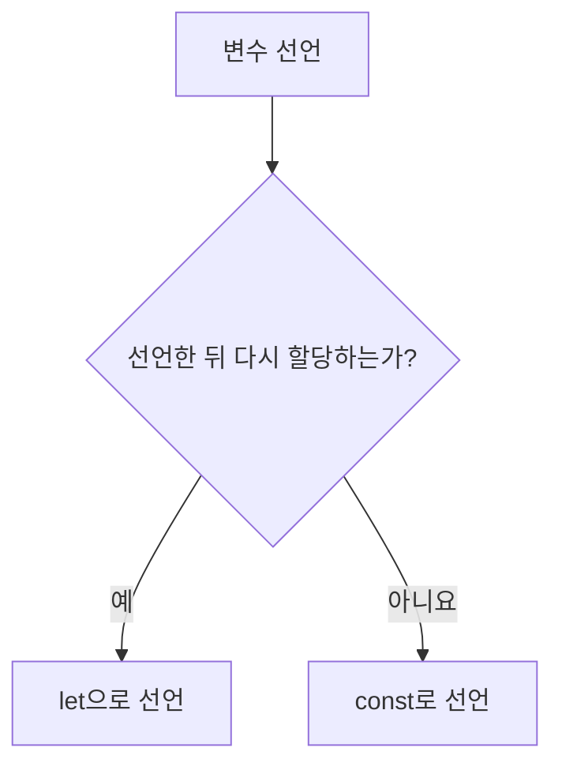
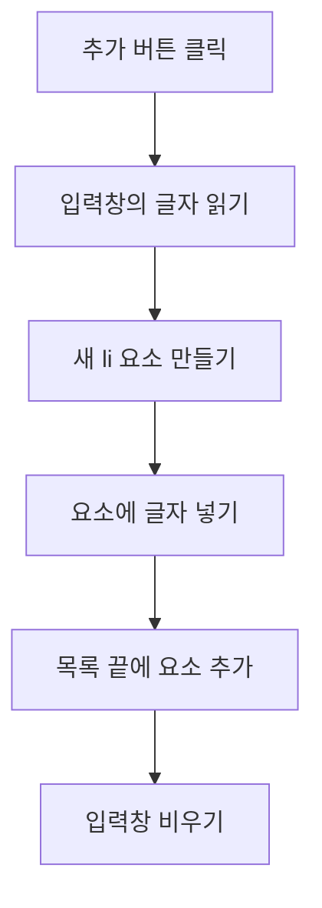
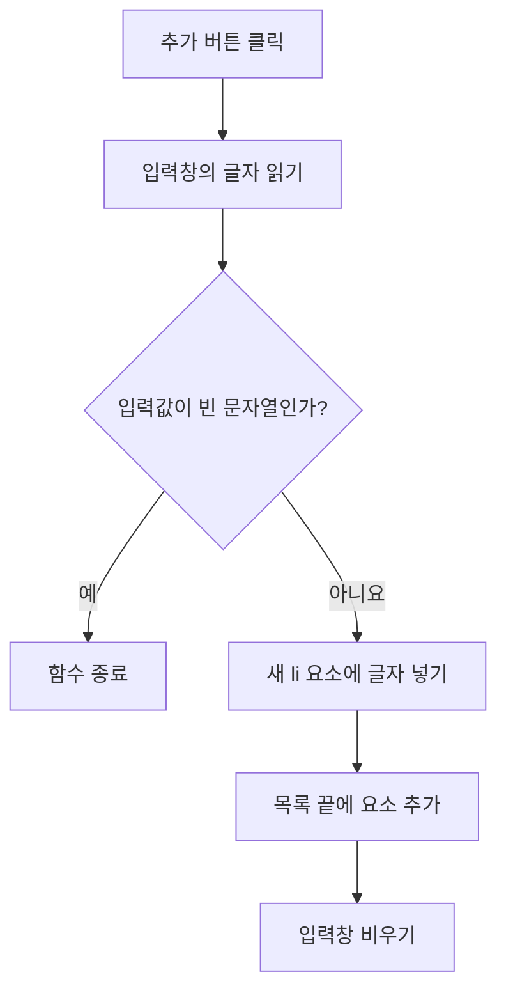

# 좋은 강의 원고 예시 (Few-shot)

다음 예시는 원고의 구조, 문체, 코드 블록 네 종류(기본 문법, 예제, 코드 조각, 따라하기 실습), 시각자료, 연습문제, 정답과 해설을 장 종류별로 보여 준다.
작성 기준은 `style-guide.md`에 있다.
공통 실행 환경은 01장에서 안내한 것으로 전제하므로 아래 예시에 환경 블록을 반복하지 않는다.

예시의 JavaScript 주제, 블로그와 과일 목록 같은 도메인, 소제목, 실행 환경을 다른 강의에 그대로 옮기지 않는다.
실제 강의의 학습목표, 선수지식, 강의계획서, course-setup.md에 맞춰 쓴다.

| 예시 | 장 종류 | 보여 주는 것 |
|---|---|---|
| 예시 1 | 일반 장 (Node.js) | 변수 선택 Mermaid, 예제와 코드 조각, 따라하기, 연습문제와 해설 |
| 예시 2 | 일반 장 (HTML, Live Server) | 삽입 위치 텍스트 도식, 완결된 HTML 예제, 통합 실습 |
| 예시 3 | 미니프로젝트 장 | 요구사항, 단계별 힌트, 장 끝 완성 코드 |
| 예시 4 | 프로젝트형 장 | 체크포인트, 단계별 코드, 처리 흐름 Mermaid와 해설 |
| 예시 5 | 나쁜 예와 고친 예 | 자주 나오는 실수 |

---

# 예시 1 — 일반 장: 변수 (JavaScript 입문자, Node.js)

# 3장. 변수

**학습목표**

- 변수를 선언하고 값을 할당할 수 있습니다.
- `const`와 `let`을 상황에 맞게 고를 수 있습니다.

## 3-1 변수란?

### 변수의 정의

**변수**(variable)는 값을 이름과 연결하여 프로그램에서 참조할 수 있게 하는 방법입니다.
쉽게 말해 프로그램에서 데이터를 이름으로 관리하고 다시 사용할 수 있게 해줍니다.

### 변수는 왜 필요할까?

블로그 제목을 여러 곳에서 사용한다고 생각해 봅시다.
같은 제목을 코드에 직접 반복 작성하면 제목이 바뀔 때마다 모든 코드를 수정해야 합니다.
변수를 사용하면 하나의 이름으로 값을 참조할 수 있어 변경과 관리가 편리해집니다.

### 선언과 할당

변수를 만드는 것을 **선언**(declaration)이라고 합니다.

변수에 값을 지정하는 것을 **할당**(assignment)이라고 합니다.

**기본 문법**

```javascript
const 변수명 = 값;
let 변수명 = 값;
```

**예제 3-1** `declare.js`

```javascript
const title = "첫 글";
console.log(title);
```

**실행 결과**

```text
첫 글
```

- `title`은 변수 이름이고, `"첫 글"`은 할당된 값입니다.
- `console.log()`는 괄호 안의 값을 콘솔에 출력합니다.

## 3-2 const와 let

`const`는 재할당하지 않을 변수를 선언할 때 사용합니다.
`let`은 나중에 다른 값을 할당할 수 있는 변수를 선언할 때 사용합니다.

**예제 3-2** `reassign.js`

```javascript
let viewCount = 0;
viewCount = 1;

console.log(viewCount);
```

**실행 결과**

```text
1
```

- `viewCount`에 처음에는 `0`을 할당하고, 이후 `1`을 다시 할당했습니다.

예제 3-2의 `viewCount = 1;` 줄을 다음처럼 바꾸면 `5`가 출력됩니다.

```javascript
viewCount = 5;
```

`let`으로 선언한 변수에는 몇 번이든 새 값을 할당할 수 있습니다.
`const`로 선언한 변수는 선언할 때 넣은 값을 끝까지 유지합니다.

**시각자료 — const와 let 고르기**



`viewCount`처럼 선언한 뒤 새 값을 할당하면 `let`을 사용합니다.
`title`처럼 다시 할당하지 않으면 `const`를 사용합니다.

## 따라하기 실습 — 게시글 정보 관리

**실습 목표**

- `const`와 `let`을 값의 성격에 맞게 고릅니다.
- 재할당으로 조회수를 증가시킵니다.

**준비**

1. VS Code에서 `chapter03` 폴더를 만들고 엽니다.
2. `chapter03` 폴더 안에 `post.js` 파일을 만듭니다.
3. VS Code 메뉴에서 터미널 > 새 터미널을 열고, 현재 위치가 `chapter03`인지 확인합니다.

**실습 코드**

`post.js`

```javascript
const title = "첫 번째 게시글";
const author = "김코딩";
let viewCount = 0;

console.log(title);
console.log(author);
console.log(viewCount);

viewCount = viewCount + 1;

console.log(viewCount);
```

**실행 방법**

1. 코드를 입력하고 저장합니다.
2. 터미널에서 다음 명령어를 실행합니다.
   ```bash
   node post.js
   ```

**실행 결과**

```text
첫 번째 게시글
김코딩
0
1
```

**코드 설명**

- `title`과 `author`는 게시글을 쓴 뒤 바뀌지 않으므로 `const`를 사용합니다.
- `viewCount`는 게시글을 읽을 때마다 바뀌므로 `let`을 사용합니다.
- `viewCount + 1`은 현재 조회수에 1을 더합니다. 계산 결과를 다시 `viewCount`에 할당하여 조회수를 증가시킵니다.

**바꿔 보기 1**

조회수를 한 번 더 증가시켜 봅니다.
마지막 `console.log(viewCount);` 줄 위에 다음 줄을 추가합니다.

```javascript
viewCount = viewCount + 1;
```

마지막 줄의 출력이 `2`로 바뀝니다.

**바꿔 보기 2**

작성자를 바꿔 봅니다.
`const author = "김코딩";` 줄을 다음처럼 바꿉니다.

```javascript
const author = "이자바";
```

두 번째 줄의 출력이 `이자바`로 바뀝니다.
`const`는 선언한 뒤에 다시 할당하지 않는 변수이므로, 선언할 때 넣는 값은 자유롭게 정할 수 있습니다.

## 연습문제

### 연습문제 1 — 상품 가격 변경

**요구사항**

1. 상품 이름을 `productName` 변수에 저장합니다.
2. `price` 변수를 선언하고 `10000`을 할당합니다.
3. 가격을 `12000`으로 변경합니다.
4. 상품 이름과 변경된 가격을 출력합니다.

**완료 조건**

- 상품 이름이 출력됩니다.
- 가격은 `12000`으로 출력됩니다.
- 가격 변경에 재할당을 사용합니다.

## 정답과 해설

### 연습문제 1 — 상품 가격 변경

```javascript
const productName = "무선 마우스";
let price = 10000;

price = 12000;

console.log(productName);
console.log(price);
```

**실행 결과**

```text
무선 마우스
12000
```

**해설**

- 상품 이름은 선언한 뒤 바꾸지 않으므로 `const`로 둡니다.
- 가격은 요구사항 3에서 `12000`으로 바꾸므로 `let`으로 선언하고, `price = 12000;`처럼 `let` 없이 재할당합니다.

---

# 예시 2 — 일반 장: DOM 요소 삽입 (JavaScript 초급자, Live Server)

# 7장. DOM 요소 삽입

**학습목표**

- 새 요소를 부모 요소의 처음이나 끝에 넣을 수 있습니다.
- 새 요소를 기준 요소의 앞이나 뒤에 넣을 수 있습니다.

## 7-1 DOM 요소 삽입이란?

**DOM 요소 삽입**은 JavaScript로 생성하거나 선택한 요소를 문서의 특정 위치에 추가하는 작업입니다.
이를 이용하면 HTML 파일을 직접 수정하지 않고도 화면에 표시되는 목록이나 내용을 변경할 수 있습니다.

### DOM 요소는 어디에 삽입할까?

HTML 요소는 부모·자식·형제 관계로 구성됩니다.
새로운 요소는 부모 요소의 내부에 추가하거나, 특정 요소의 앞뒤에 삽입할 수 있습니다.

| 메서드 | 삽입 위치 |
|---|---|
| `append()` | 대상 요소의 마지막 자식 |
| `prepend()` | 대상 요소의 첫 번째 자식 |
| `before()` | 대상 요소 바로 앞의 형제 |
| `after()` | 대상 요소 바로 뒤의 형제 |

**시각자료 — DOM 요소 삽입 위치**

```text
↑ before() : 대상 요소 앞

<ul id="list">
  ↑ prepend() : 첫 번째 자식
  <li>사과</li>
  <li>바나나</li>
  ↓ append() : 마지막 자식
</ul>

↓ after() : 대상 요소 뒤
```

`prepend()`와 `append()`는 대상 요소의 내부에 삽입합니다.
`before()`와 `after()`는 대상 요소의 외부에 형제 노드로 삽입합니다.

## 7-2 append()와 prepend()

`append()`는 요소나 문자열을 대상 요소의 마지막 자식 위치에 삽입합니다.
`prepend()`는 첫 번째 자식 위치에 삽입합니다.

**기본 문법**

```javascript
부모 요소.append(노드 또는 문자열);
부모 요소.prepend(노드 또는 문자열);
```

**예제 7-1** `prepend.html`

```html
<!DOCTYPE html>
<html lang="ko">
<head>
  <meta charset="UTF-8">
  <title>prepend 예제</title>
</head>
<body>
  <ul id="list">
    <li>사과</li>
    <li>바나나</li>
  </ul>

  <script>
    const list = document.querySelector("#list");
    const item = document.createElement("li");

    item.textContent = "포도";
    list.prepend(item);
  </script>
</body>
</html>
```

**실행 결과**

페이지를 열면 목록이 다음 순서로 표시됩니다.

```text
포도
사과
바나나
```

- `createElement("li")`는 새로운 목록 항목을 생성합니다.
- `prepend()`는 생성한 항목을 목록의 첫 번째 위치에 삽입합니다.

예제 7-1의 `prepend()`를 `append()`로 바꾸면 포도가 목록의 맨 끝에 표시됩니다.

```javascript
list.append(item);
```

## 7-3 before()와 after()

`before()`는 대상 요소 바로 앞에, `after()`는 바로 뒤에 노드를 삽입합니다.

**기본 문법**

```javascript
대상 요소.before(노드 또는 문자열);
대상 요소.after(노드 또는 문자열);
```

**예제 7-2** `after.html`

```html
<!DOCTYPE html>
<html lang="ko">
<head>
  <meta charset="UTF-8">
  <title>after 예제</title>
</head>
<body>
  <ul>
    <li>사과</li>
    <li id="banana">바나나</li>
    <li>포도</li>
  </ul>

  <script>
    const banana = document.querySelector("#banana");
    const item = document.createElement("li");

    item.textContent = "키위";
    banana.after(item);
  </script>
</body>
</html>
```

**실행 결과**

페이지를 열면 목록이 다음 순서로 표시됩니다.

```text
사과
바나나
키위
포도
```

- `after()`는 바나나의 자식이 아니라 바로 뒤의 형제로 키위를 삽입합니다. 그래서 부모인 `<ul>`을 선택하지 않아도 됩니다.

예제 7-2의 `after()`를 `before()`로 바꾸면 키위가 사과와 바나나 사이에 표시됩니다.

```javascript
banana.before(item);
```

## 따라하기 실습 — 버튼으로 과일 목록 편집하기

**실습 목표**

- 네 가지 삽입 메서드를 버튼마다 연결해 삽입 위치를 한 화면에서 비교합니다.
- 같은 일을 하는 코드를 함수로 묶어 다시 사용합니다.

**준비**

1. VS Code에서 `chapter07` 폴더를 만들고 엽니다.
2. `chapter07` 폴더 안에 `fruit-list.html` 파일을 만듭니다.

**실습 코드**

`fruit-list.html`

```html
<!DOCTYPE html>
<html lang="ko">
<head>
  <meta charset="UTF-8">
  <title>과일 목록 편집</title>
</head>
<body>
  <h2>과일 목록</h2>

  <ul id="list">
    <li>사과</li>
    <li id="banana">바나나</li>
  </ul>

  <button id="prependBtn">맨 위에 추가</button>
  <button id="appendBtn">맨 끝에 추가</button>
  <button id="beforeBtn">바나나 앞에 추가</button>
  <button id="afterBtn">바나나 뒤에 추가</button>

  <script>
    const list = document.querySelector("#list");
    const banana = document.querySelector("#banana");

    function createItem(text) {
      const item = document.createElement("li");
      item.textContent = text;
      return item;
    }

    document.querySelector("#prependBtn").addEventListener("click", () => {
      list.prepend(createItem("딸기"));
    });

    document.querySelector("#appendBtn").addEventListener("click", () => {
      list.append(createItem("포도"));
    });

    document.querySelector("#beforeBtn").addEventListener("click", () => {
      banana.before(createItem("망고"));
    });

    document.querySelector("#afterBtn").addEventListener("click", () => {
      banana.after(createItem("키위"));
    });
  </script>
</body>
</html>
```

**실행 방법**

1. 코드를 입력하고 저장합니다.
2. `fruit-list.html`을 Live Server로 엽니다.
3. 버튼 네 개를 왼쪽부터 한 번씩 클릭합니다.

**실행 결과**

```text
딸기
사과
망고
바나나
키위
포도
```

**코드 설명**

- `createItem()`은 글자를 받아 새 `<li>` 요소를 만들어 돌려줍니다. 네 버튼이 모두 새 항목을 만들기 때문에 함수로 묶었습니다.
- 딸기와 포도는 `list`를 기준으로 목록의 처음과 끝에, 망고와 키위는 `banana`를 기준으로 바나나의 앞뒤에 들어갑니다.

**바꿔 보기 1**

바나나 뒤에 추가 버튼을 두 번 클릭해 봅니다.

두 번째 키위는 첫 번째 키위의 앞, 바나나 바로 뒤에 들어갑니다.
`after()`는 항상 기준 요소 바로 뒤에 넣기 때문입니다.

**바꿔 보기 2**

맨 끝에 추가 버튼이 목록 밖에 안내문을 붙이도록 바꿔 봅니다.
`appendBtn`의 코드를 다음처럼 바꿉니다.

```javascript
document.querySelector("#appendBtn").addEventListener("click", () => {
  const guide = document.createElement("p");
  guide.textContent = "목록 끝";
  list.after(guide);
});
```

버튼을 누르면 "목록 끝" 문단이 목록 안의 항목이 아니라 목록 바로 아래에 표시됩니다.

## 연습문제

### 연습문제 1 — 공지사항 관리하기

**요구사항**

1. 공지사항 목록을 HTML로 작성합니다.
2. 새 공지사항 추가 버튼을 누르면 `prepend()`로 새 공지사항을 맨 위에 추가합니다.
3. 안내문 표시 버튼을 누르면 `after()`로 목록 바로 뒤에 안내문 문단을 표시합니다.

**완료 조건**

- 새로운 공지사항이 첫 번째 위치에 표시됩니다.
- 안내문이 목록 안이 아니라 목록 바로 뒤에 표시됩니다.
- 버튼을 여러 번 클릭해도 오류 없이 동작합니다.

## 정답과 해설

### 연습문제 1 — 공지사항 관리하기

```html
<!DOCTYPE html>
<html lang="ko">
<head>
  <meta charset="UTF-8">
  <title>공지사항 관리</title>
</head>
<body>
  <ul id="notices">
    <li>서버 점검 안내</li>
    <li>신규 기능 업데이트</li>
  </ul>

  <button id="addBtn">새 공지사항 추가</button>
  <button id="guideBtn">안내문 표시</button>

  <script>
    const notices = document.querySelector("#notices");

    document.querySelector("#addBtn").addEventListener("click", () => {
      const item = document.createElement("li");
      item.textContent = "새 공지사항";
      notices.prepend(item);
    });

    document.querySelector("#guideBtn").addEventListener("click", () => {
      const guide = document.createElement("p");
      guide.textContent = "공지사항은 매주 월요일에 갱신됩니다.";
      notices.after(guide);
    });
  </script>
</body>
</html>
```

**실행 결과**

새 공지사항 추가 버튼을 누르면 목록 맨 위에 "새 공지사항"이 표시됩니다.
안내문 표시 버튼을 누르면 목록 바로 아래에 안내문 문단이 표시됩니다.

**해설**

- 공지사항은 목록 안에 들어가야 하므로 부모인 `#notices`에 `prepend()`를 씁니다.
- 안내문은 목록 밖에 있어야 하므로 `#notices`를 기준으로 `after()`를 씁니다. 여기서 `append()`를 쓰면 안내문이 목록 안의 항목처럼 들어갑니다.

---

# 예시 3 — 미니프로젝트 장: 콘솔 도서 대출 관리기 (실습 중심)

# 7장. [미니프로젝트] 콘솔 도서 대출 관리기

**학습목표**

- 객체 배열에서 대출 가능한 책을 고릅니다.
- 원본을 유지하며 대출 상태를 변경하고 목록을 출력합니다.

**사용하는 장**

1~6장

**이 장에서 만드는 것**

도서 목록을 배열로 관리하고, 대출 가능한 책을 찾고, 책을 대출 처리하는 프로그램을 만듭니다.
완성하면 다음과 같이 출력됩니다.

```text
[대출 가능] 어린 왕자
[대출 중] 데미안
[대출 가능] 모모
```

**요구사항**

| 번호 | 기능 | 사용하는 문법 |
|---|---|---|
| 1 | 도서 목록 데이터 만들기 | 객체 배열 (5장) |
| 2 | 대출 가능한 책만 고르기 | `filter()` (6장) |
| 3 | 제목으로 책을 대출 처리하기 | `map()`, 전개 연산자 (5, 6장) |
| 4 | 목록을 문장으로 출력하기 | `map()`, 템플릿 리터럴 (2, 6장) |

**시작 코드**

`library.js`

```javascript
const books = [
  { id: 1, title: "어린 왕자", isBorrowed: false },
  { id: 2, title: "데미안", isBorrowed: true },
  { id: 3, title: "모모", isBorrowed: false },
];
```

## 7-1 대출 가능한 책 고르기

**목표**

`getAvailableBooks(books)` 함수를 만들어 대출 가능한 책만 담은 새 배열을 돌려줍니다.

**힌트**

- `isBorrowed`가 `false`인 책만 남기면 됩니다.
- 6장의 `filter()`를 사용합니다.

**확인 방법**

`console.log(getAvailableBooks(books).length);`가 `2`를 출력하면 됩니다.

## 7-2 대출 처리하기

**목표**

`borrowBook(books, id)` 함수를 만들어, 해당 `id`의 책만 `isBorrowed: true`로 바꾼 새 배열을 돌려줍니다.

**힌트**

- 원본 배열을 직접 바꾸지 않습니다.
- 6장 6-6의 "map으로 하나만 수정하기" 패턴을 사용합니다.

**확인 방법**

`borrowBook(books, 1)`의 결과를 출력하면 어린 왕자가 대출 중으로 바뀌고, `books`는 그대로입니다.

## 완성 코드와 해설

```javascript
const books = [
  { id: 1, title: "어린 왕자", isBorrowed: false },
  { id: 2, title: "데미안", isBorrowed: true },
  { id: 3, title: "모모", isBorrowed: false },
];

const getAvailableBooks = (books) => books.filter((book) => !book.isBorrowed);

const borrowBook = (books, id) =>
  books.map((book) => (book.id === id ? { ...book, isBorrowed: true } : book));

const formatBooks = (books) =>
  books.map((book) => `[${book.isBorrowed ? "대출 중" : "대출 가능"}] ${book.title}`);

for (const line of formatBooks(books)) {
  console.log(line);
}
```

**해설**

- `borrowBook()`은 `id`가 같은 책만 전개 연산자로 복사해 `isBorrowed`를 바꾸고, 나머지 책은 그대로 돌려줍니다. 원본 `books`가 바뀌지 않으므로 대출 전과 후를 비교할 수 있습니다.

---

# 예시 4 — 프로젝트형 장: 할 일 추가 기능 (프로젝트형)

# 5장. 할 일 추가 기능 만들기

**학습목표**

- 입력창의 글자로 새 목록 항목을 만듭니다.
- 빈 입력을 확인하고 할 일을 목록에 추가합니다.

**시작 코드 체크포인트**

checkpoint-05

**이 장에서 만드는 것**

입력창에 할 일을 적고 추가 버튼을 누르면 목록에 표시되는 기능을 만듭니다.

checkpoint-05의 `main.js`에는 목록 요소를 가리키는 `todoList`가 이미 선언되어 있습니다.

## 5-1 입력값 읽기

개념: `input.value`로 입력창에 적힌 글자를 읽습니다.
값은 항상 문자열입니다.

`main.js`의 맨 아래에 다음 코드를 추가합니다.

```javascript
const input = document.querySelector("#todoInput");
const addButton = document.querySelector("#addButton");

addButton.addEventListener("click", () => {
  console.log(input.value);
});
```

**실행 결과**

입력창에 "장보기"를 적고 추가 버튼을 누르면 콘솔에 `장보기`가 출력됩니다.

## 5-2 목록에 추가하기

개념: `createElement()`로 새 요소를 만들고 `append()`로 목록 끝에 붙입니다.

5-1에서 작성한 `console.log(input.value);` 줄을 다음 코드로 바꿉니다.

```javascript
const item = document.createElement("li");
item.textContent = input.value;
todoList.append(item);
input.value = "";
```

**실행 결과**

할 일을 추가할 때마다 목록 끝에 항목이 생기고 입력창은 비워집니다.

**시각자료 — 할 일이 목록에 추가되는 순서**



버튼을 누르면 입력창의 글자로 목록 항목을 만들고 `todoList`의 끝에 추가합니다.
입력창을 비우는 동작은 목록에 항목을 추가한 뒤에 실행됩니다.

## 연습문제

### 연습문제 1 — 빈 할 일 막기

**요구사항**

1. 입력창이 비어 있으면 목록에 추가하지 않습니다.

**완료 조건**

- 빈 입력으로 추가 버튼을 눌러도 목록이 바뀌지 않습니다.

## 정답과 해설

### 연습문제 1 — 빈 할 일 막기

```javascript
addButton.addEventListener("click", () => {
  if (input.value === "") {
    return;
  }

  const item = document.createElement("li");
  item.textContent = input.value;
  todoList.append(item);
  input.value = "";
});
```

**실행 결과**

입력창이 비어 있을 때 추가 버튼을 누르면 목록이 그대로입니다.
글자를 적고 누르면 전처럼 목록 끝에 항목이 추가됩니다.

**해설**

- `return`을 만나면 함수가 그 자리에서 끝나므로 아래의 추가 코드가 실행되지 않습니다.

**시각자료 — 빈 입력을 확인한 뒤 할 일 추가하기**



빈 입력이면 `return`으로 함수를 끝내므로 목록에 항목을 추가하지 않습니다.
빈 입력이 아니면 앞서 만든 추가 동작을 그대로 실행합니다.

완성 코드: checkpoint-06

---

# 예시 5 — 나쁜 예와 고친 예

## 비유로 시작하고 수식어가 많은 설명

**나쁜 예**

```markdown
변수는 마치 마법 상자와 같습니다! 자바스크립트의 강력한 기능인 변수를 함께 마스터해 볼까요?
```

**고친 예**

```markdown
**변수**(variable)는 값을 이름과 연결하여 프로그램에서 참조할 수 있게 하는 방법입니다.
값에 이름표를 붙여 두고, 필요할 때 이름으로 꺼내 쓴다고 생각하면 됩니다.
```

정의를 먼저 쓰고, 비유는 정의 다음에 보조로 씁니다.

## 배우지 않은 문법을 쓴 예제

**나쁜 예** (반복문만 배운 3장의 예제)

```javascript
const scores = [80, 95, 70];
const passed = scores.filter((score) => score >= 75);
```

**고친 예**

```javascript
const scores = [80, 95, 70];

for (const score of scores) {
  if (score >= 75) {
    console.log(score);
  }
}
```

`filter()`와 화살표 함수는 아직 배우지 않았으므로, 배운 반복문과 조건문으로 같은 일을 합니다.

## 굵은 글씨가 깨지는 문장

**나쁜 예**

```markdown
**선언(declaration)**이라고 합니다.
```

**고친 예**

```markdown
**선언**(declaration)이라고 합니다.
```

닫는 `**` 앞에 괄호가 있고 뒤에 조사가 붙으면 마크다운에서 굵게 표시되지 않습니다.

## 다른 코드에 기대는 예제

**나쁜 예**

````markdown
**예제 7-1** `prepend.html`

다음 코드는 HTML 문서에 `id="list"`인 `<ul>` 요소가 있다고 가정합니다.

```javascript
const list = document.querySelector("#list");
list.prepend(item);
```
````

**고친 예**

예제는 `<!DOCTYPE html>`부터 `</html>`까지 파일 하나로 실행되게 쓴다(예시 2의 예제 7-1). 앞 예제의 일부만 바꿔 보이고 싶으면 번호 없는 코드 조각으로 쓰고 "예제 7-1의 `prepend()`를 `append()`로 바꾸면"처럼 어느 예제를 바꾼 것인지 밝힌다.

## 에러나 잘못된 결과를 내 보이는 바꿔 보기

**나쁜 예** (에러 메시지 읽기나 에러 처리가 주제가 아닌 세부항목)

```markdown
`const userName = "김코딩";` 아래에 `userName = "이자바";`를 추가하면 `TypeError`가 나고 실행이 멈춥니다.

`(price - discount) * quantity`에서 괄호를 빼면 상품 금액이 틀리게 나옵니다.
```

**고친 예**

```markdown
`const userName = "김코딩";` 줄의 값을 `"이자바"`로 바꾸면 출력도 `이자바`로 바뀝니다.

`const quantity = 3;`을 `5`로 바꾸면 상품 금액과 결제 금액이 수량에 맞게 함께 바뀝니다.
```

바꿔 보기는 바꾼 뒤에도 맞는 결과를 내는 변형으로 고릅니다.
에러나 잘못된 결과를 내는 코드는 style-guide.md 4장 "에러를 다루는 범위" 안에서 씁니다.

## 줄 번호로 가리키는 설명

**나쁜 예**

```markdown
14번째 줄에서 `level`을 재할당했습니다.
```

**고친 예**

```markdown
`level = 2;` 줄에서 `level`을 재할당했습니다.
```

책에는 줄 번호가 보이지 않으므로 그 줄의 코드를 인용해 가리킵니다.
