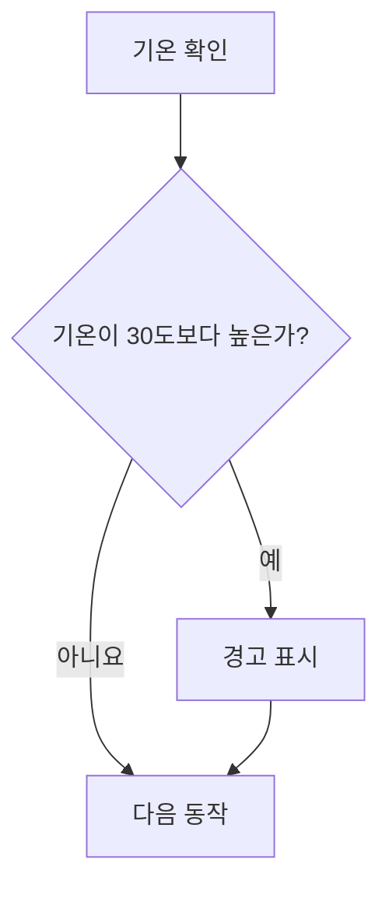

# 원고 스타일 가이드

모든 강의 원고에 공통으로 적용하는 기준이다. 강의마다 달라지는 것(실행 환경, 예제 도메인 등)은 여기 두지 않고 `.book/manuscript/course-setup.md`에 둔다. 두 문서가 충돌하면 course-setup.md를 따른다.

원고는 강사와 수강생이 함께 읽는 책이다. 강사의 말을 받아 적은 대본이 아니라, 수강생이 혼자 읽어도 이해되는 글로 쓴다.

## 1. 문체

- 문장은 "~합니다" 체로 쓴다.
- 한 문장에는 한 가지 내용만 담는다.
- 문장은 한 줄에 하나씩 쓴다. 같은 내용을 이어 가는 문장들은 빈 줄 없이 일반 줄바꿈으로 이어 한 문단으로 묶는다. 본문과 목록의 줄 끝에는 줄바꿈용 역슬래시를 붙이지 않는다.
- 빈 줄(문단 나눔)은 다루는 내용이 바뀔 때만 둔다. 한 문단은 네 문장까지로 한다.
- 예제 뒤 설명, 따라하기 실습의 `**코드 설명**`, 정답의 `**해설**`처럼 코드의 줄을 풀이하는 설명은 하이픈(`-`) 목록으로 쓴다. 한 항목에는 한두 문장을 쓴다.
- 용어가 처음 나올 때 영어를 병기한다: `**변수**(variable)는`.
- 굵은 글씨를 닫는 `**` 바로 앞에 괄호나 따옴표 같은 문장부호가 오고 바로 뒤에 조사가 붙으면 마크다운에서 굵게 표시되지 않는다. `**변수(variable)**는` 대신 `**변수**(variable)는`으로 쓴다.
- 코드 요소(변수명, 함수명, 메서드, 파일명)는 본문에서 백틱으로 감싼다: `` `console.log()` ``.
- 이모지는 쓰지 않는다.

문단과 줄 풀이는 다음처럼 쓴다. 자료형과 `typeof`는 다른 내용이라 빈 줄로 나누고, 같은 내용의 두 문장은 일반 줄바꿈으로 이어 쓴다.

```markdown
**자료형**(data type)은 값의 종류입니다.
숫자의 자료형은 `number`, 문자열의 자료형은 `string`입니다.

`typeof`는 값의 자료형 이름을 문자열로 알려 주는 연산자입니다.
`typeof` 뒤에 한 칸 띄고 값을 씁니다.

**실행 결과**

(출력 블록)

- `price`와 `priceText`는 둘 다 12000처럼 보이지만, `priceText`는 따옴표로 감쌌으므로 문자열입니다.
- `priceText + 1`은 문자열 연결로 `"12000"` 뒤에 `1`을 붙인 `120001`이 됩니다.
```

다음 표현은 쓰지 않는다. 내용 없이 분량만 늘리고, 글을 AI가 쓴 것처럼 보이게 한다.

| 쓰지 않는 표현 | 대신 |
|---|---|
| "강력한", "놀라운", "마법처럼" 같은 수식어 | 수식어를 빼고 무엇을 하는지 쓴다 |
| "~를 마스터해 봅시다!", "함께 알아볼까요?" | 소제목으로 바로 시작한다 |
| "이제 여러분은 ~를 완벽히 이해했습니다" | 장 끝 요약 대신 연습문제로 넘어간다 |
| 정의 없이 비유로 시작하기 | 정의를 먼저 쓰고, 비유는 그 뒤에 보조로 쓴다 |
| 느낌표 | 마침표 |

## 2. 원고 파일 구조

한 장이 원고 파일 하나다. 제목 단계는 다음과 같다.

| 단계 | 형식 | 예 |
|---|---|---|
| 장 | `# {N}장. {장 제목}` | `# 1장. 자바스크립트 시작하기` |
| 세부항목 | `## {N}-{M} {세부항목 제목}` | `## 1-4 변수와 상수 (let, const)` |
| 따라하기 실습 | `## 따라하기 실습 — {실습 이름}` | `## 따라하기 실습 — 회원 프로필 출력하기` |
| 세부항목 안 소제목 | `###` | `### const와 let` |
| 블록 제목 | 굵은 글씨 한 줄 | `**기본 문법**`, `` **예제 1-2** `hello.js` `` |

- 장 제목과 세부항목 제목, 번호는 강의계획서를 그대로 따른다. 원고에서 바꾸지 않는다.
- 세부항목 안의 소제목은 개념에 필요한 만큼만 둔다. few-shot의 소제목을 그대로 복제하지 않는다.
- 모든 장 맨 앞에는 `**학습목표**` 아래 이 장을 마치고 수행할 수 있는 일을 2~4개 하이픈 목록으로 적는다. 프로젝트 장에도 같은 제목을 쓴다.
- 실행 환경 설치·설정과 코드 유형별 실행 방법은 01장의 ‘실행 환경 준비’ 세부항목에 한 번만 모은다. 과정에서 쓸 도구, 버전, 폴더·파일 규칙, 실행 명령, 결과 확인 위치를 안내한다.
- 장별 도입의 `**실행 환경**`과 따라하기의 `**실습 환경**` 블록은 두지 않는다. 이후 장은 실습에 필요한 파일 준비와 조작 순서만 적는다. 공통 실행 방법을 다시 설명해야 할 때는 01장의 해당 항목을 짧게 참조한다.
- 장 맨 끝은 `## 연습문제`, 그다음 `## 정답과 해설` 순서다.

## 3. 장 종류별 구성

강의계획서의 장 제목으로 종류를 판단한다.

| 장 종류 | 판단 기준 | 구성 |
|---|---|---|
| 일반 장 | 제목에 [미니프로젝트], [종합 프로젝트]가 없음 | 세부항목마다 개념 -> 기본 문법 -> 예제(필요하면 코드 조각). 여러 세부항목의 개념을 합치는 지점에 따라하기 실습. 장 끝에 연습문제와 정답과 해설 |
| 미니프로젝트 장 | 제목에 `[미니프로젝트]` | 프로젝트 소개 -> 요구사항 -> 시작 코드 -> 단계별 안내(목표, 힌트, 확인 방법) -> 장 끝에 완성 코드와 해설. 연습문제 없음 |
| 종합 프로젝트 장 | 제목에 `[종합 프로젝트]` | 미니프로젝트 장과 같다. 앞 미니프로젝트의 어떤 파일과 함수를 가져오는지 단계마다 밝힌다 |
| 외부 예제 장 | 프로젝트 장인데 계획서 장 제목 아래 `- 예제: 외부 예제` | 학습목표 -> "이 장은 별도 예제로 라이브 코딩한다" 한 문장 -> 세부항목마다 `## {번호} {항목명} 실습하기`와 계획서의 한 줄 설명. 코드, 해설, 시각자료, 연습문제 없음 |
| 프로젝트형 장 | 강의방법이 프로젝트형 | 장 제목 아래 시작 코드 체크포인트 -> 단계마다 코드를 추가하며 "개념:" 설명 -> 장 끝에 연습문제, 정답과 해설, 완성 코드 체크포인트 |

프로젝트형 장의 단계 코드는 프로젝트 파일에 더하는 부분 코드라서 코드 조각 규칙(0칸 시작, 바꿀 위치를 문장으로 밝힘)을 따른다. 다만 단계마다 `**실행 결과**`를 두고 화면 변화를 문장으로 쓴다. 이것이 코드 조각 규칙의 유일한 예외다.

강의방법에 따른 일반 장의 비중:

| 강의방법 | 개념 설명 | 예제 | 따라하기 실습 |
|---|---|---|---|
| 이론 중심 | 정의, 등장 배경, 동작 원리까지 충분히 | 세부항목마다 1개 이상 | 장마다 1개 |
| 실습 중심 | 정의와 핵심 동작만 짧게 | 세부항목마다 1개 이상, 개념은 예제를 실행하며 익힌다 | 장마다 1~3개 |
| 프로젝트형 | 프로젝트 단계에 필요한 만큼만 | 프로젝트 코드가 예제다 | 프로젝트 자체가 따라하기다 |

## 4. 블록 형식

### 개념 설명

- 정의를 기술적으로 정확하게 쓰고, 다음 줄에 쉬운 말로 다시 설명한다. 정의와 쉬운 설명은 한 문단이다.
- 비유는 정의를 대신하지 않는다.
- 등장 배경이나 해결하려는 문제는 이해에 도움이 될 때만 쓴다.

### 코드 블록 네 종류

원고의 코드는 모두 아래 네 종류 중 하나다. 종류마다 실행 여부와 쓰는 사람이 다르므로 섞지 않는다.

| 종류 | 역할 | 실행 | 수업에서 |
|---|---|---|---|
| 기본 문법 | 형태만 보여 준다 | 안 함 | 강사가 설명한다 |
| 예제 | 개념 하나를 확인하는 완결 코드와 실행 결과 | 바로 실행 | 강사가 시연하고 수강생이 같이 실행한다 |
| 코드 조각 | 앞 예제를 바꿔 보이거나 비교하는 부분 코드 | 단독 실행 불가 | 설명용 |
| 따라하기 실습 | 환경을 만들고, 여러 개념을 합치고, 바꿔 본다 | 실행 | 수강생이 직접 한다 |

### 기본 문법

- `**기본 문법**` 아래에 형식만 쓴다. 값 자리에는 `변수명`, `값`처럼 한국어 자리표시를 쓴다.
- 실행 결과를 붙이지 않는다.

### 예제

- 제목 줄은 `` **예제 {N}-{k}** `{파일명}` ``이다. N은 장 번호, k는 장 안에서 1부터 매기는 순번이다.
- 코드는 그 파일 하나만으로 실행되는 완결 코드다. 앞 예제나 다른 파일에 기대지 않는다. HTML 예제는 `<!DOCTYPE html>`부터 끝까지 쓴다.
- 개념 하나만 확인한다. 개념 두 개를 합치는 코드는 따라하기 실습으로 보낸다.
- 코드 바로 뒤에 `**실행 결과**`를 둔다. 콘솔 출력은 `text` 코드 블록으로, 화면 변화는 문장으로 쓴다.
- 그다음 핵심 줄의 의미를 하이픈 목록으로 설명한다. 항목 하나에 코드 한 부분을 풀이한다.
- 공통 실행 방법은 01장의 ‘실행 환경 준비’에서 설명한다. 이후 예제에는 해당 파일·실습에 필요한 실행 명령이나 조작만 적는다.
- 실행 방법은 정상적으로 실행되는 순서만 쓴다.

### 코드 조각

- 앞 예제의 일부를 바꾼 모습, 두 방식의 비교처럼 설명에 필요한 부분만 쓴다.
- 이름이나 번호를 붙이지 않는다. 어느 예제를 바꾼 것인지 문장으로 밝힌다(예: "예제 3-2에서 `let`을 `const`로 바꾸면").
- 결과는 문장으로 설명한다. 실행 결과 블록을 붙이지 않는다.
- 바탕 예제에서 들여쓰기된 줄이라도 공통 들여쓰기를 빼고 0칸부터 쓴다. 조각 안의 상대 들여쓰기는 2칸 단위로 유지한다.

### 따라하기 실습

문제가 아니라 실습이다. 수강생이 그대로 따라 쳐서 완성할 수 있도록 모든 코드를 제공한다.

- 제목은 `## 따라하기 실습 — {실습 이름}`이다. 여러 세부항목을 묶는 실습이므로 목차에서 세부항목과 같은 단계에 보이게 한다.
- 여러 세부항목의 개념을 합치는 지점에 둔다. 보통 장의 뒷부분, 연습문제 앞이다.
- 순서대로 다음 블록을 둔다.
  1. `**실습 목표**`: 1~3개 항목
  2. `**준비**`: 해당 실습의 폴더와 파일 만들기를 번호 목록으로. 도구 설치·설정은 01장을 따른다.
  3. `**실습 코드**`: 파일마다 파일명과 전체 코드. 그대로 실행되는 완성 코드
  4. `**실행 방법**`: 해당 실습 파일의 실행 명령·버튼 클릭·입력 등 조작 순서를 번호 목록으로
  5. `**실행 결과**`
  6. `**코드 설명**`: 하이픈 목록
  7. `**바꿔 보기 1**`, `**바꿔 보기 2**`처럼 항목마다 블록 제목을 둔다: 1~3개. 무엇을 바꾸는지와 바뀐 결과를 쓴다. 코드를 바꾸는 경우 바꾼 코드를 반드시 쓰고, 어느 줄을 바꾸거나 어디에 추가하는지 그 줄을 인용해 적는다. 바꾼 코드는 바뀌는 부분만 보여도 된다. 바꾼 뒤에도 프로그램이 의도대로 맞는 결과를 내는 변형으로 고른다(값 바꾸기, 출력 추가, 기능 늘리기).
- 장에서 배운 핵심 기능을 빠뜨리지 않는다.
- 메서드 이름만 바꾼 비슷한 실습을 여러 개 만들지 않는다. 비슷한 동작은 한 실습에서 비교한다.

### 배우지 않은 문법

예제, 코드 조각, 따라하기 실습 모두 수강생이 배운 범위 안의 문법만 쓴다. 꼭 필요하면 "지금은 이렇게 쓴다고만 알아 두세요. N장에서 자세히 배웁니다."라고 적고 ledger.md의 "앞으로 미룬 설명"에 남긴다.

### 에러를 다루는 범위

원고의 코드는 모두 의도대로 맞는 결과를 내는 코드로 설명한다. 코드 조각과 바꿔 보기도 바꾼 뒤의 결과가 맞는 결과다.

강의계획서에서 에러 메시지 읽기나 에러 처리(try/catch, 요청 실패 처리 같은 예외 처리)가 주제인 세부항목이 있으면, 그 세부항목의 예제와 따라하기, 그 주제의 연습문제에서 에러나 잘못된 결과(버그)를 내는 코드를 쓴다. 처리 코드가 동작하는 모습은 실패가 일어나야 보이기 때문이다.

### 연습문제

- 강의계획서의 연습문제 제목을 그대로 쓴다: `### 연습문제 1 — {제목}`.
- `**요구사항**`(번호 목록)과 `**완료 조건**`(체크할 수 있는 문장)을 둔다.
- 출력 형식을 요구하면 실제 출력 한 줄을 예로 함께 쓴다(예: "`항목: 값` 형태로 출력합니다. 예: `사는 곳: 서울`").
- 따라하기와 난이도는 비슷하게, 상황이나 요구사항은 다르게 만든다.
- 배우지 않은 기술을 필수로 요구하지 않는다.
- 문제 본문에는 정답 코드를 넣지 않는다.

### 정답과 해설

- 장 맨 끝 `## 정답과 해설`에 문제 순서대로 둔다: `### 연습문제 1 — {제목}`.
- 정답 코드, 실행 결과, 해설을 둔다. 해설에는 핵심 줄의 의미와 이 코드를 고른 이유를 하이픈 목록으로 쓴다.
- 다른 정답도 가능하면 한 줄로 언급한다.

## 5. 코드 컨벤션

course-setup.md에 예외가 있으면 그것을 따른다.

- 들여쓰기 2칸, 문자열은 큰따옴표, 문장 끝 세미콜론.
- 변수와 함수 이름은 영어 camelCase로, 뜻이 드러나게 짓는다(`a`, `temp` 금지).
- 화면에 보이는 문자열과 데이터 값은 한국어로 쓴다.
- 주석은 코드만으로 의도가 드러나지 않을 때만 짧게 한국어로 단다.
- 수강생이 배운 범위 안의 문법만 쓴다.

## 6. 시각자료

### 넣을 위치와 선택 기준

- 집필할 세부항목에서 흐름·분기·관계·구조·상태 변화·비교를 먼저 찾는다. 문장만으로 순서나 관계를 따라가기 어려운 곳에는 시각자료를 포함한다.
- 설명 대상이 처음 나오는 곳이나 관련 예제 뒤에 배치한다. 그림을 장 끝에 한꺼번에 모으지 않는다.
- 장마다 그림 개수를 강제하지 않는다. 간단한 문법을 그대로 반복하는 그림은 생략하고, 핵심 관계를 보여 주는 그림을 선택한다.

| 설명할 내용 | 표현 방식 |
|---|---|
| 실행 흐름, 처리 순서, 조건 분기 | Mermaid 흐름도 |
| 요소 간 관계, 호출 관계, 데이터 모델 | Mermaid 관계도 또는 ER도 |
| 실제 상태와 상태 간 전이가 학습목표 | Mermaid 상태도 |
| 화면의 대기·로딩·성공·실패 처리 순서 | Mermaid 흐름도, 필요하면 단계별 설명과 예외 그림 |
| 메모리 칸, 배열 칸, 화면 배치와 삽입 위치 | 텍스트 도식 |
| 값이나 특성의 나란한 비교 | 표 |
| 비유의 장면이나 별도 삽화 | 이미지 생성 프롬프트 |
| 실제 도구의 설치·메뉴·패널 | 스크린샷 자리 표시 |

화면상의 삽입 위치를 그리는 DOM 텍스트 도식과, 요소 사이의 관계를 그리는 Mermaid 관계도를 구분한다.

### 원고 안의 도식 형식

- 제목은 `**시각자료 — 그림 이름**`으로 쓴다. 장·세부항목의 제목 단계는 바꾸지 않는다.
- 제목 아래에 언어명이 `mermaid`인 코드 블록으로 실제 도식을 작성한다. book-mermaid의 디자인으로 렌더링해 검증하되 책 원고에는 Mermaid 코드 블록을 그대로 유지한다. PNG/SVG 이미지 링크로 대체하지 않는다. 텍스트 도식은 `text` 코드 블록을 사용한다. 도식은 프로그래밍 예제와 구분하여 예제 번호나 실행 결과 블록을 붙이지 않는다.
- 흐름·분기·관계·상태 전환은 Mermaid로 직접 그린다. 처리 순서는 `flowchart LR`을 우선하고 복잡하면 `TD`를 허용한다. 실제 상태 전이가 학습목표면 `stateDiagram-v2`를 사용한다. 먼저 한 장으로 쓰고 book-mermaid로 재 본다(`--format none`). 세로가 가로보다 길거나, 글자가 11px보다 작아지거나, 선·글자가 겹치면 완료·실패, 계속·종료처럼 끝나는 곳 기준으로 시나리오 그림을 나눈다. 가장 단순한 정상 흐름을 먼저 보여 준다. 다시 시작하거나 반복하는 전이는 해당 그림에 유지하고 종료 경로는 멈춘다. 분리한 그림이 공유하는 초기값·조건·다른 시나리오로 넘어가는 기준을 설명한다. 처음 그림에 문제가 없으면 통합 그림 한 장으로 둔다. 상세 선택은 book-mermaid의 ‘Mermaid 다이어그램 작성 규칙’을 따른다. ‘여기에 흐름도를 넣습니다’라는 안내나 이미지 생성 프롬프트만 적고 끝내지 않는다.
- 그림 아래에는 읽어야 할 핵심을 한두 문장으로 설명한다. 그림에 등장하는 용어·값·화살표·조건은 본문 및 예제 코드와 일치하게 한다.
- 노드에는 짧은 한국어 문구를 쓰고, 학습자가 아직 배우지 않은 기능이나 정답을 미리 넣지 않는다. 복잡한 그림은 설명 범위에 맞춰 나눈다.
- Mermaid 구문을 확인하고 렌더링 도구가 있으면 실제 렌더링한다. 확인하지 못한 범위는 검토 결과에서 밝힌다.

다음은 조건 분기를 설명하는 형식 예시다. 실제 주제와 조건은 해당 장에 맞춘다.

**시각자료 — 기온에 따른 경고 표시**



기온이 30도보다 높을 때만 경고를 표시합니다.
경고 표시 여부와 관계없이 다음 동작으로 이어집니다.

### 이미지와 도구 화면

- 별도 삽화가 필요하면 그 위치에 `[이미지 생성 프롬프트]`를 쓰고 보여 줄 것, 그림 속 글자, 삽입 위치, 스타일을 적는다. 실제 이미지 생성과 구분한다.
- 수강생이 처음 쓰는 도구 화면(설치, 메뉴, 패널)은 그 위치에 `[스크린샷: {화면 이름} — {표시할 부분}]`을 쓴다(예: `[스크린샷: Chrome 개발자 도구 — Console 탭 위치]`). 실제 프로그램 화면을 이미지 생성으로 대체하지 않는다.

## 7. 중복과 분량

- ledger.md의 "설명한 개념"에 있는 정의는 다시 쓰지 않는다. "N장에서 배운 X"처럼 짧게 언급한다.
- 짧게 설명할 수 있는 개념을 억지로 늘리지 않는다.
- 핵심 원리와 주의사항은 생략하지 않는다.

## 8. 읽기 쉬움

원고는 강의계획서 "대상"의 수강생이 혼자 읽는다고 보고 쓴다. 그 수강생은 앞 장에서 ledger.md의 "설명한 개념"과 "쓴 문법과 API"만큼 배웠다.

book-review는 아래 ID로 보고한다.

- **R-1** 코드의 특정 줄은 그 줄의 코드를 인용해 가리킨다. 줄 번호는 에러 메시지의 위치를 읽는 설명에서 쓴다.
  - 예: "`level = 2;` 줄을 주석으로 만듭니다."
- **R-2** 용어는 정의한 뒤에 쓴다. 표 머리와 설명 문장도 같다. 정의 전에 필요하면 쉬운 말로 풀어 쓴다.
  - 예: 표 머리 "키워드" 대신 "선언에 쓰는 단어"
- **R-3** 예제에 처음 나오는 기호와 형태(점, 괄호 등)는 그 예제 설명에서 한 줄로 설명한다. 뒤 장에서 자세히 배우면 장 번호를 붙인다.
  - 예: "`console.log`는 콘솔에 출력하는 명령의 이름입니다. 이름 뒤 괄호에 출력할 값을 넣습니다. 4장에서 자세히 배웁니다."
- **R-4** 예제 하나에서 새로 정의하는 개념은 두 개까지로 하고, 나머지는 다음 예제에서 정의한다.
  - 예: 예제 뒤에서 "문장"과 "세미콜론"을 정의했으면 "실행 순서"는 다음 예제에서 설명
- **R-5** 개념이 필요한 이유를 쓰면 예제 코드가 그 이유를 보여 준다.
  - 예: "한 곳만 고치면 된다"고 썼으면 같은 변수를 여러 번 출력하는 예제
- **R-6** 정의는 코드 가까이 둔다. 코드 앞에는 두 개까지 두고, 나머지는 예제 뒤에서 코드의 해당 부분을 가리키며 정의한다.
  - 예: "`age = 26;`처럼 이미 값이 있는 변수에 새 값을 넣는 것을 **재할당**이라고 합니다."
- **R-7** 주제가 바뀌는 문단은 앞 문단과 이어 주는 말로 시작한다.
  - 예: "이렇게 페이지가 반응하게 하는 코드는 `<script>` 태그 안에 씁니다."
- **R-8** 처음 쓰는 도구 화면에는 6장의 스크린샷 자리 표시를 둔다.
  - 예: `[스크린샷: VS Code — Open with Live Server 메뉴]`
- **R-9** 출력 형식을 요구하는 연습문제는 실제 출력 한 줄을 예로 함께 쓴다.
  - 예: "`항목: 값` 형태로 출력합니다. 예: `사는 곳: 서울`"

## 9. MD 가독성

원고는 마크다운으로 렌더링해서 읽는다. 렌더링한 화면과 목차(아웃라인)에서 구조가 그대로 보이게 쓴다.

book-review는 아래 ID로 보고한다. MD-2~MD-5는 `book-review/scripts/check-markdown.mjs`가 센다.

- **MD-1** 제목 단계는 내용의 범위와 맞춘다. 여러 세부항목을 묶는 따라하기 실습은 `##`로 둔다. 제목은 한 단계씩 내려간다(`##` 다음은 `###`).
- **MD-2** 목록 안에는 빈 줄을 두지 않는다. 빈 줄이 하나라도 있으면 모든 항목이 문단으로 바뀌어 간격이 벌어진다. 항목에 딸린 스크린샷 자리, 코드 블록, 하위 목록은 빈 줄 없이 항목 바로 아래에 붙이고, 이어지는 내용은 항목 글자 위치에 맞춰 들여 쓴다. 줄 끝에는 역슬래시를 붙이지 않는다. 표는 목록 안에 넣지 않고 하위 목록으로 쓴다.
  - 예: `1. 설치합니다.` 다음 줄에 `   [스크린샷: ...]`
- **MD-2** 목록 항목에 코드 블록이 딸리면 코드 블록을 항목 글자 위치(`1. ` 뒤, 3칸)에 맞춰 들여 넣는다. 코드 뒤에 설명 문단이 이어지는 단계는 굵은 글씨 블록 제목으로 나눈다(`**바꿔 보기 1**`).
- **MD-3** 문단 안에서는 한 줄에 한 문장을 쓰고 일반 줄바꿈으로 이어 쓴다. 줄 끝에 역슬래시를 붙이지 않는다. 빈 줄은 내용이 바뀔 때만 두고, 한 문단은 네 문장까지 쓴다(1. 문체).
  - 예: 한 문장짜리 문단이 빈 줄을 사이에 두고 이어지면 같은 내용인지 보고 한 문단으로 묶는다
- **MD-4** 블록 제목은 콜론 없는 굵은 글씨 한 줄로 쓰고, 내용은 다음 줄부터 쓴다. 여러 파일 코드의 파일명은 인라인 코드 한 줄(`` `index.html` ``)로 쓴다.
- **MD-5** 표 칸에는 명사구 하나나 한 문장을 넣는다. 더 긴 설명은 표 아래 문단이나 목록으로 쓴다.

## 10. 검수 체크리스트

원고를 보여 주기 전에 모두 확인한다.

- [ ] 장 제목, 세부항목 제목과 번호가 강의계획서와 같다.
- [ ] 계획서의 세부항목과 연습문제가 모두 들어 있다.
- [ ] 장 도입 제목은 `학습목표`이고, 수행할 수 있는 일을 2~4개 목록으로 적었다.
- [ ] 공통 실행 환경은 01장의 ‘실행 환경 준비’에서 안내하고, 장·실습마다 환경 블록을 반복하지 않았다.
- [ ] 본문과 목록의 줄 끝에 줄바꿈용 역슬래시가 없다.
- [ ] 모든 예제에 `예제 {N}-{k}` 번호와 파일명이 있고, 그 파일 하나만으로 실행된다.
- [ ] 코드 조각에는 번호와 실행 결과 블록이 없고, 어느 예제를 바꾼 것인지 문장으로 밝혔다.
- [ ] 코드 조각이 0칸부터 시작한다.
- [ ] 따라하기 실습에 빠진 코드가 없고, 바꿔 보기에도 바꾼 코드와 결과가 있다.
- [ ] 바꿔 보기와 코드 조각을 적용한 결과가 의도대로 맞는 결과다. 에러나 잘못된 결과를 내는 코드는 4장 "에러를 다루는 범위" 안에만 있다.
- [ ] 흐름·분기·관계·구조·상태 변화·비교를 검토했고, 이해에 필요한 시각자료가 해당 설명 가까이에 있다.
- [ ] Mermaid·텍스트 도식·표의 선택과 제목 형식이 6장 기준에 맞고, 도식을 자리 표시만으로 대체하지 않았다.
- [ ] 시각자료의 용어·값·화살표·조건이 본문 및 코드와 일치하고, 배우지 않은 내용이나 연습문제 정답을 미리 보여 주지 않는다.
- [ ] Mermaid 문법을 검증했다. 실제 렌더링을 확인하지 못한 것은 검토 결과에 밝혔다.
- [ ] 책 원고에 실제 Mermaid 코드 블록이 있으며 이미지 링크로 대체하지 않았다. 목적에 맞는 종류와 설명 구성을 선택했고 중요한 상태·분기·반복·예외를 보존했다.
- [ ] 8장 읽기 쉬움(R-1~R-9)과 9장 MD 가독성(MD-1~MD-5)을 지켰다.
- [ ] 모든 실행 결과를 실제로 실행해서 확인했다. 확인하지 못한 것은 사용자에게 알렸다.
- [ ] ledger.md 기준으로 배우지 않은 문법을 쓰지 않았다.
- [ ] 이미 설명한 개념의 정의를 반복하지 않았다.
- [ ] 앞 장에서 정한 파일명, 함수명, 데이터 구조를 그대로 썼다.
- [ ] 연습문제 본문에 정답이 없고, 정답과 해설은 장 끝에 있다.
- [ ] 1장의 "쓰지 않는 표현"이 없다.
- [ ] 굵은 글씨 뒤 조사 문제(`**...)**는`)가 없다.
- [ ] 이모지가 없다.
