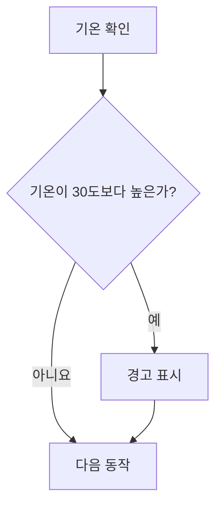

# 원고 스타일 가이드

모든 강의 원고에 공통으로 적용하는 기준이다. 강의마다 달라지는 것(실행 환경, 예제 도메인 등)은 여기 두지 않고 `.book/manuscript/course-setup.md`에 둔다. 두 문서가 충돌하면 course-setup.md를 따른다.

원고는 강사와 수강생이 함께 읽는 책이다. 강사의 말을 받아 적은 대본이 아니라, 수강생이 혼자 읽어도 이해되는 글로 쓴다.

## 1. 문체

- 문장은 "~합니다" 체로 쓴다.
- 한 문장에는 한 가지 내용만 담는다.
- 문장은 한 줄에 하나씩 쓴다. 같은 내용을 이어 가는 문장들은 빈 줄 없이 일반 줄바꿈으로 이어 한 문단으로 묶는다. 본문과 목록의 줄 끝에는 줄바꿈용 역슬래시를 붙이지 않는다.
- 빈 줄(문단 나눔)은 다루는 내용이 바뀔 때만 둔다. 한 문단은 네 문장까지로 한다.
- 한 문장 쓰고 빈 줄, 한 문장 쓰고 빈 줄처럼 문단을 잘게 나누지 않는다. 앞 문장을 이어 설명하는 문장(정의 뒤의 관련 용어, 이유 뒤의 결과)은 빈 줄 없이 다음 줄에 쓴다. 문장을 억지로 하나로 합치지는 않는다.
  - 예: 변수의 정의 두 문장과 선언·할당 두 문장은 같은 설명이므로 빈 줄 없이 네 줄로 쓴다.
- 예제 뒤 설명, 따라하기 실습의 `**코드 설명**`, 정답의 `**해설**`처럼 코드의 줄을 풀이하는 설명은 하이픈(`-`) 목록으로 쓴다. 한 항목에는 한두 문장을 쓴다.
- 용어가 처음 나올 때 영어를 병기한다: `**변수**(variable)는`.
- 굵은 글씨를 닫는 `**` 바로 앞에 괄호나 따옴표 같은 문장부호가 오고 바로 뒤에 조사가 붙으면 마크다운에서 굵게 표시되지 않는다. `**변수(variable)**는` 대신 `**변수**(variable)는`으로 쓴다.
- 코드 요소(변수명, 함수명, 메서드, 파일명)는 본문에서 백틱으로 감싼다: `` `console.log()` ``.
- 이모지는 쓰지 않는다.

문단과 줄 풀이는 다음처럼 쓴다. 자료형과 `typeof`는 다른 내용이라 빈 줄로 나누고, 같은 내용의 두 문장은 일반 줄바꿈으로 이어 쓴다.

```markdown
**자료형**(data type)은 값의 종류입니다.
숫자의 자료형은 `number`, 문자열의 자료형은 `string`입니다.

`typeof`는 값의 자료형 이름을 문자열로 알려 주는 연산자입니다.
`typeof` 뒤에 한 칸 띄고 값을 씁니다.

**실행 결과**

(출력 블록)

- `price`와 `priceText`는 둘 다 12000처럼 보이지만, `priceText`는 따옴표로 감쌌으므로 문자열입니다.
- `priceText + 1`은 문자열 연결로 `"12000"` 뒤에 `1`을 붙인 `120001`이 됩니다.
```

다음 표현은 쓰지 않는다. 내용 없이 분량만 늘리고, 글을 AI가 쓴 것처럼 보이게 한다.

| 쓰지 않는 표현 | 대신 |
|---|---|
| "강력한", "놀라운", "마법처럼" 같은 수식어 | 수식어를 빼고 무엇을 하는지 쓴다 |
| "~를 마스터해 봅시다!", "함께 알아볼까요?" | 소제목으로 바로 시작한다 |
| "이제 여러분은 ~를 완벽히 이해했습니다" | 장 끝 요약 대신 연습문제로 넘어간다 |
| 정의 없이 비유로 시작하기 | 정의를 먼저 쓰고, 비유는 그 뒤에 보조로 쓴다 |
| 느낌표 | 마침표 |

## 2. 원고 파일 구조

한 장이 원고 파일 하나다. 제목 단계는 다음과 같다.

| 단계 | 형식 | 예 |
|---|---|---|
| 장 | `# {N}장. {장 제목}` | `# 1장. 자바스크립트 시작하기` |
| 세부항목 | `## {N}-{M} {세부항목 제목}` | `## 1-4 변수와 상수 (let, const)` |
| 따라하기 실습 | `## 따라하기 실습 — {실습 이름}` | `## 따라하기 실습 — 회원 프로필 출력하기` |
| 세부항목 안 소제목 | `###` | `### const와 let` |
| 블록 제목 | 굵은 글씨 한 줄 | `**기본 문법**`, `` **예제 1-2** `hello.js` `` |

- 장 제목과 세부항목 제목, 번호는 강의계획서를 그대로 따른다. 원고에서 바꾸지 않는다.
- 세부항목 안의 소제목은 개념에 필요한 만큼만 둔다. few-shot의 소제목을 그대로 복제하지 않는다.
- 모든 장 맨 앞에는 `**학습목표**` 아래 이 장을 마치고 수행할 수 있는 일을 2~4개 하이픈 목록으로 적는다. 프로젝트 장에도 같은 제목을 쓴다.
- 실행 환경 설치·설정과 코드 유형별 실행 방법은 01장의 ‘실행 환경 준비’ 세부항목에 한 번만 모은다. 과정에서 쓸 도구, 버전, 폴더·파일 규칙, 실행 명령, 결과 확인 위치를 안내한다.
- 장별 도입의 `**실행 환경**`과 따라하기의 `**실습 환경**` 블록은 두지 않는다. 이후 장은 실습에 필요한 파일 준비와 조작 순서만 적는다. 공통 실행 방법을 다시 설명해야 할 때는 01장의 해당 항목을 짧게 참조한다.
- 장 맨 끝은 `## 연습문제`, 그다음 `## 정답과 해설` 순서다.

## 3. 장 종류별 구성

강의계획서의 장 제목으로 종류를 판단한다.

| 장 종류 | 판단 기준 | 구성 |
|---|---|---|
| 일반 장 | 제목에 [미니프로젝트], [종합 프로젝트]가 없음 | 세부항목마다 개념 -> 기본 문법 -> 예제(필요하면 코드 조각). 여러 세부항목의 개념을 합치는 지점에 따라하기 실습. 장 끝에 연습문제와 정답과 해설 |
| 미니프로젝트 장 | 제목에 `[미니프로젝트]` | 프로젝트 소개 -> 요구사항 -> 시작 코드 -> 단계별 안내(목표, 힌트, 확인 방법) -> 장 끝에 완성 코드와 해설. 연습문제 없음 |
| 종합 프로젝트 장 | 제목에 `[종합 프로젝트]` | 미니프로젝트 장과 같다. 앞 미니프로젝트의 어떤 파일과 함수를 가져오는지 단계마다 밝힌다 |
| 외부 예제 장 | 프로젝트 장인데 계획서 장 제목 아래 `- 예제: 외부 예제` | 학습목표 -> "이 장은 별도 예제로 라이브 코딩한다" 한 문장 -> 세부항목마다 `## {번호} {항목명} 실습하기`와 계획서의 한 줄 설명. 코드, 해설, 시각자료, 연습문제 없음 |
| 프로젝트형 장 | 강의방법이 프로젝트형 | 장 제목 아래 시작 코드 체크포인트 -> 단계마다 코드를 추가하며 "개념:" 설명 -> 장 끝에 연습문제, 정답과 해설, 완성 코드 체크포인트 |

프로젝트형 장의 단계 코드는 프로젝트 파일에 더하는 부분 코드라서 코드 조각 규칙(0칸 시작, 바꿀 위치를 문장으로 밝힘)을 따른다. 다만 단계마다 `**실행 결과**`를 두고 화면 변화를 문장으로 쓴다. 이것이 코드 조각 규칙의 유일한 예외다.

강의방법에 따른 일반 장의 비중:

| 강의방법 | 개념 설명 | 예제 | 따라하기 실습 |
|---|---|---|---|
| 이론 중심 | 정의, 등장 배경, 동작 원리까지 충분히 | 세부항목마다 1개 이상 | 장마다 1개 |
| 실습 중심 | 정의와 핵심 동작만 짧게 | 세부항목마다 1개 이상, 개념은 예제를 실행하며 익힌다 | 장마다 1~3개 |
| 프로젝트형 | 프로젝트 단계에 필요한 만큼만 | 프로젝트 코드가 예제다 | 프로젝트 자체가 따라하기다 |

## 4. 블록 형식

### 개념 설명

개념 하나는 아래 순서로 쓴다.
왜 필요할까, 특징, 비교, 비유, 그림은 필요할 때만 둔다.

정의·쉬운 설명 → 왜 필요할까 → 특징 → 비교 → 비유 → 그림 → 기본 문법 → 예제

- 정의를 기술적으로 정확하게 쓰고, 다음 줄에 쉬운 말로 다시 설명한다. 정의와 쉬운 설명은 한 문단이다.
- 등장 배경이나 해결하려는 문제는 이해에 도움이 될 때만 쓴다.

### 왜 필요할까

- 개념(변수, 자료형, `const`, 객체, 함수처럼 이름이 붙은 생각)이 처음 나오고 필요한 이유가 분명하지 않을 때 둔다. 넣을지는 집필하며 판단한다.
- 사용법만 있는 문법(`typeof` 쓰는 법, 세미콜론)이나 이유가 정의에 이미 드러난 개념에는 두지 않는다.
- 소제목은 `### {개념}는 왜 필요할까?`이다. 다음 순서로 쓴다.
  - 답: 필요한 이유를 한 문장으로 먼저 쓴다.
  - 문제 장면: 그 개념 없이 생기는 불편을 일상 예시로 한 문단에 쓴다.
  - 해결: 개념을 쓰면 어떻게 풀리는지 코드 이름을 들어 한 문단에 쓴다.
  - 시각자료와 핵심 한 줄: 장면을 그림으로 보여야 이해가 쉬울 때만 둔다.
- 장면에 쓴 이름과 값(`chairCount`, `24`)을 바로 뒤 예제에서 그대로 써서 이유를 코드로 보여 준다(R-5).
- 예시는 few-shot 예시 1의 3-1, 3-2에 있다.

### 특징

- 규칙이나 제약이 있는 개념(선언 키워드, 자료형, 문법, 메서드)에 `**특징**` 블록을 둔다. 규칙이 없는 소개 개념에는 두지 않는다.
- 하이픈 목록 2~5개로 쓰고 항목마다 한 문장이다. 예: `const`의 "재할당할 수 없습니다.", "선언할 때 반드시 값을 넣어야 합니다."
- 이미 배운 범위의 특징만 쓴다. 뒤에서 배울 특징은 그 개념을 배우는 세부항목에서 덧붙인다.
- 이어지는 예제가 특징을 보여 주게 쓴다. 에러가 나는 특징은 문장으로 쓴다. 개념의 목적이 그 에러를 막는 것이면 4장 "에러를 다루는 범위"에 따라 실행해 보인다.
- 특징에는 그 개념 하나의 성질만 쓴다. 다른 개념과 견주는 내용은 목록에 섞지 않고 비교표로 만든다.

### 비교

- 견줄 개념(`let`과 `const`, `undefined`와 `null`, 점 표기법과 대괄호 표기법)이 있으면 특징 바로 뒤에 `**비교 — A와 B**` 표를 둔다.
- 견줄 두 개념을 모두 정의한 뒤에 둔다.
- 표 머리는 `비교 항목 | A | B`이고, 칸에는 짧은 명사구나 한 문장을 쓴다(MD-5).

### 비유

- 비유는 정의와 특징 뒤에 보조로 쓴다. 정의를 대신하지 않는다.
- 특징과 하나씩 맞물리는 비유를 고른다. 예: 재할당할 수 없다 → 나사로 박은 명판
- 뒤 세부항목에서 같은 개념을 넓히면 같은 비유를 이어 쓴다.

### 그림

- 비유나 쉬운 예시 장면이 있을 때만 둔다. 세부항목마다 많아야 하나다.
- Mermaid, 표, 텍스트 도식으로 충분하면 두지 않는다.
- 위치는 비유 문단 바로 뒤, 기본 문법 바로 위다.
- 종류, 스타일, 형식은 6장 "그림"을 따른다.

### 코드 블록 네 종류

원고의 코드는 모두 아래 네 종류 중 하나다. 종류마다 실행 여부와 쓰는 사람이 다르므로 섞지 않는다.

| 종류 | 역할 | 실행 | 수업에서 |
|---|---|---|---|
| 기본 문법 | 형태만 보여 준다 | 안 함 | 강사가 설명한다 |
| 예제 | 개념 하나를 확인하는 완결 코드와 실행 결과 | 바로 실행 | 강사가 시연하고 수강생이 같이 실행한다 |
| 코드 조각 | 앞 예제를 바꿔 보이거나 비교하는 부분 코드 | 단독 실행 불가 | 설명용 |
| 따라하기 실습 | 환경을 만들고, 여러 개념을 합치고, 바꿔 본다 | 실행 | 수강생이 직접 한다 |

### 기본 문법

- `**기본 문법**` 아래에 형식만 쓴다. 값 자리에는 `변수명`, `값`처럼 한국어 자리표시를 쓴다.
- 실행 결과를 붙이지 않는다.

### 예제

- 제목 줄은 `` **예제 {N}-{k}** `{파일명}` ``이다. N은 장 번호, k는 장 안에서 1부터 매기는 순번이다.
- 코드는 그 파일 하나만으로 실행되는 완결 코드다. 앞 예제나 다른 파일에 기대지 않는다. HTML 예제는 `<!DOCTYPE html>`부터 끝까지 쓴다.
- 개념 하나만 확인한다. 개념 두 개를 합치는 코드는 따라하기 실습으로 보낸다.
- 코드 바로 뒤에 `**실행 결과**`를 둔다. 콘솔 출력은 실제 실행 로그를 `text` 코드 블록으로 쓴다. 페이지 모양은 글로 묘사하지 않고 실제로 캡처한 이미지를 넣는다(6장 "실행 결과 화면"). 클릭처럼 동작으로 바뀌는 결과는 전후 캡처 두 장 사이에 바뀌는 동작을 한 문장으로 쓴다.
- 그다음 핵심 줄의 의미를 하이픈 목록으로 설명한다. 항목 하나에 코드 한 부분을 풀이한다.
- 공통 실행 방법은 01장의 ‘실행 환경 준비’에서 설명한다. 이후 예제에는 해당 파일·실습에 필요한 실행 명령이나 조작만 적는다.
- 실행 방법은 정상적으로 실행되는 순서만 쓴다.

### 코드 조각

- 앞 예제의 일부를 바꾼 모습, 두 방식의 비교처럼 설명에 필요한 부분만 쓴다.
- 이름이나 번호를 붙이지 않는다. 어느 예제를 바꾼 것인지 문장으로 밝힌다(예: "예제 3-2에서 `let`을 `const`로 바꾸면").
- 결과는 문장으로 설명한다. 실행 결과 블록을 붙이지 않는다.
- 바탕 예제에서 들여쓰기된 줄이라도 공통 들여쓰기를 빼고 0칸부터 쓴다. 조각 안의 상대 들여쓰기는 2칸 단위로 유지한다.

### 따라하기 실습

문제가 아니라 실습이다. 수강생이 그대로 따라 쳐서 완성할 수 있도록 모든 코드를 제공한다.

- 제목은 `## 따라하기 실습 — {실습 이름}`이다. 여러 세부항목을 묶는 실습이므로 목차에서 세부항목과 같은 단계에 보이게 한다.
- 여러 세부항목의 개념을 합치는 지점에 둔다. 보통 장의 뒷부분, 연습문제 앞이다.
- 순서대로 다음 블록을 둔다.
  1. `**실습 목표**`: 1~3개 항목
  2. `**준비**`: 해당 실습의 폴더와 파일 만들기를 번호 목록으로. 도구 설치·설정은 01장을 따른다.
  3. `**실습 코드**`: 파일마다 파일명과 전체 코드. 그대로 실행되는 완성 코드
  4. `**실행 방법**`: 해당 실습 파일의 실행 명령·버튼 클릭·입력 등 조작 순서를 번호 목록으로
  5. `**실행 결과**`: 예제의 실행 결과와 같은 방식으로 쓴다
  - 실행 대상이 둘 이상이면(터미널의 `.js`와 Live Server의 `.html` 등) `**실행 방법 1**` → `**실행 결과 1**` → `**실행 방법 2**` → `**실행 결과 2**`처럼 번호로 짝지어, 하나를 실행하고 바로 그 결과를 보게 한다. 각 실행 방법의 첫 줄에 무엇을 실행하는지 쓴다.
  6. `**코드 설명**`: 하이픈 목록
  7. `**바꿔 보기 1**`, `**바꿔 보기 2**`처럼 항목마다 블록 제목을 둔다: 1~3개. 무엇을 바꾸는지와 바뀐 결과를 쓴다. 코드를 바꾸는 경우 바꾼 코드를 반드시 쓰고, 어느 줄을 바꾸거나 어디에 추가하는지 그 줄을 인용해 적는다. 바꾼 코드는 바뀌는 부분만 보여도 된다. 바꾼 뒤에도 프로그램이 의도대로 맞는 결과를 내는 변형으로 고른다(값 바꾸기, 출력 추가, 기능 늘리기).
- 장에서 배운 핵심 기능을 빠뜨리지 않는다.
- 메서드 이름만 바꾼 비슷한 실습을 여러 개 만들지 않는다. 비슷한 동작은 한 실습에서 비교한다.

### 배우지 않은 문법

예제, 코드 조각, 따라하기 실습 모두 수강생이 배운 범위 안의 문법만 쓴다. 꼭 필요하면 "지금은 결과만 확인합니다", "지금은 그대로 입력합니다"처럼 그 장 안에서 끝나는 말로 적고 ledger.md의 "앞으로 미룬 설명"에 남긴다.

원고에는 뒤 장의 번호와 내용을 적지 않는다. "N장에서 배웁니다", "N장부터는 ~합니다" 같은 예고 문장과 장 범위를 적은 표 행을 쓰지 않는다. 뒤 장과의 연결은 ledger.md에만 남긴다. 앞 장을 가리키는 "N장에서 배운 X"는 쓸 수 있다.

### 에러를 다루는 범위

에러 시연은 장마다, 세부항목마다 반복하는 기본 틀이 아니다. 예제, 특징, 코드 조각, 바꿔 보기는 의도대로 맞는 결과를 내는 코드로 쓴다. "이렇게 바꾸면 에러가 납니다"를 습관처럼 덧붙이지 않는다.

에러가 보여야 개념이 이해되는 곳에서는 에러를 실제로 실행해 보인다.

- 기술의 목적이 에러를 막는 것일 때: 그 기술 없이 실행해 에러가 나는 예제를 먼저 두고, 같은 상황에 기술을 적용해 끝까지 실행되는 예제를 바로 이어 둔다. 무엇을 막는지 보여야 기술이 왜 있는지 알 수 있다.
- 강의계획서에서 에러 메시지 읽기나 에러 처리(try/catch, 요청 실패 처리 같은 예외 처리)가 주제인 세부항목: 그 세부항목의 예제와 따라하기, 그 주제의 연습문제에서 에러나 잘못된 결과(버그)를 내는 코드를 쓴다. 처리 코드가 동작하는 모습은 실패가 일어나야 보이기 때문이다.

에러를 보이는 예제는 다음처럼 쓴다.

- 예제 앞에 확인을 위해 일부러 에러를 낸다고 한 문장으로 밝힌다.
- 에러를 내는 코드도 번호를 붙인 완결 예제로 쓰고 실제로 실행한다.
- 실행 결과에는 위치, 코드 줄, `^` 표시, 에러 이름과 메시지 줄까지 싣는다. `at`으로 시작하는 아래 줄과 컴퓨터마다 다른 경로는 생략했다고 결과 아래에 쓴다.
- 설명에서 위치, 에러 이름, 메시지의 뜻, 에러 뒤 코드가 실행되지 않은 점을 짚는다.
- 에러 예제는 그 기술을 처음 설명하는 곳에 한 번만 둔다. 같은 장의 다른 예제와 바꿔 보기에서 되풀이하지 않는다.

### 연습문제

- 강의계획서의 연습문제 제목을 그대로 쓴다: `### 연습문제 1 — {제목}`.
- `**요구사항**`(번호 목록)과 `**완료 조건**`(체크할 수 있는 문장)을 둔다.
- 출력 형식을 요구하면 실제 출력 한 줄을 예로 함께 쓴다(예: "`항목: 값` 형태로 출력합니다. 예: `사는 곳: 서울`").
- 따라하기와 난이도는 비슷하게, 상황이나 요구사항은 다르게 만든다.
- 배우지 않은 기술을 필수로 요구하지 않는다.
- 문제 본문에는 정답 코드를 넣지 않는다.

### 정답과 해설

- 장 맨 끝 `## 정답과 해설`에 문제 순서대로 둔다: `### 연습문제 1 — {제목}`.
- 정답 코드, 실행 결과, 해설을 둔다. 해설에는 핵심 줄의 의미와 이 코드를 고른 이유를 하이픈 목록으로 쓴다.
- 다른 정답도 가능하면 한 줄로 언급한다.

## 5. 코드 컨벤션

course-setup.md에 예외가 있으면 그것을 따른다.

- 들여쓰기 2칸, 문자열은 큰따옴표, 문장 끝 세미콜론.
- 변수와 함수 이름은 영어 camelCase로, 뜻이 드러나게 짓는다(`a`, `temp` 금지).
- 화면에 보이는 문자열과 데이터 값은 한국어로 쓴다.
- 주석은 코드만으로 의도가 드러나지 않을 때만 짧게 한국어로 단다.
- 수강생이 배운 범위 안의 문법만 쓴다.

## 6. 시각자료

### 넣을 위치와 선택 기준

- 집필할 세부항목에서 흐름·분기·관계·구조·상태 변화·비교를 먼저 찾는다. 문장만으로 순서나 관계를 따라가기 어려운 곳에는 시각자료를 포함한다.
- 설명 대상이 처음 나오는 곳이나 관련 예제 뒤에 배치한다. 그림을 장 끝에 한꺼번에 모으지 않는다.
- 장마다 그림 개수를 강제하지 않는다. 간단한 문법을 그대로 반복하는 그림은 생략하고, 핵심 관계를 보여 주는 그림을 선택한다.

| 설명할 내용 | 표현 방식 |
|---|---|
| 실행 흐름, 처리 순서, 조건 분기 | Mermaid 흐름도 |
| 요소 간 관계, 호출 관계, 데이터 모델 | Mermaid 관계도 또는 ER도 |
| 실제 상태와 상태 간 전이가 학습목표 | Mermaid 상태도 |
| 화면의 대기·로딩·성공·실패 처리 순서 | Mermaid 흐름도, 필요하면 단계별 설명과 예외 그림 |
| 메모리 칸, 배열 칸, 화면 배치와 삽입 위치 | 텍스트 도식 |
| 값이나 특성의 나란한 비교 | 표 |
| 비유 장면(사물이 나오는 삽화) | 생성 이미지 자리 (6장 "그림") |
| 개념 구조(이름표와 값, 상자와 화살표) | 개념 그림 (6장 "그림") |
| 예제·실습을 실행한 페이지 모양 | 실제 캡처 이미지 |
| 실제 도구의 설치·메뉴·패널 | 스크린샷 자리 표시 |

화면상의 삽입 위치를 그리는 DOM 텍스트 도식과, 요소 사이의 관계를 그리는 Mermaid 관계도를 구분한다.

### 원고 안의 도식 형식

- 제목은 `**시각자료 — 그림 이름**`으로 쓴다. 장·세부항목의 제목 단계는 바꾸지 않는다.
- 제목 아래에 언어명이 `mermaid`인 코드 블록으로 실제 도식을 작성한다. book-mermaid의 디자인으로 렌더링해 검증하되 책 원고에는 Mermaid 코드 블록을 그대로 유지한다. PNG/SVG 이미지 링크로 대체하지 않는다. 텍스트 도식은 `text` 코드 블록을 사용한다. 도식은 프로그래밍 예제와 구분하여 예제 번호나 실행 결과 블록을 붙이지 않는다.
- 흐름·분기·관계·상태 전환은 Mermaid로 직접 그린다. 처리 순서는 `flowchart LR`을 우선하고 복잡하면 `TD`를 허용한다. 실제 상태 전이가 학습목표면 `stateDiagram-v2`를 사용한다. 먼저 한 장으로 쓰고 book-mermaid로 재 본다(`--format none`). 세로가 가로보다 길거나, 글자가 11px보다 작아지거나, 선·글자가 겹치면 완료·실패, 계속·종료처럼 끝나는 곳 기준으로 시나리오 그림을 나눈다. 가장 단순한 정상 흐름을 먼저 보여 준다. 다시 시작하거나 반복하는 전이는 해당 그림에 유지하고 종료 경로는 멈춘다. 분리한 그림이 공유하는 초기값·조건·다른 시나리오로 넘어가는 기준을 설명한다. 처음 그림에 문제가 없으면 통합 그림 한 장으로 둔다. 상세 선택은 book-mermaid의 ‘Mermaid 다이어그램 작성 규칙’을 따른다. ‘여기에 흐름도를 넣습니다’라는 안내나 생성 이미지 자리만 적고 끝내지 않는다.
- 그림 아래에는 읽어야 할 핵심을 한두 문장으로 설명한다. 그림에 등장하는 용어·값·화살표·조건은 본문 및 예제 코드와 일치하게 한다.
- 노드에는 짧은 한국어 문구를 쓰고, 학습자가 아직 배우지 않은 기능이나 정답을 미리 넣지 않는다. 복잡한 그림은 설명 범위에 맞춰 나눈다.
- Mermaid 구문을 확인하고 렌더링 도구가 있으면 실제 렌더링한다. 확인하지 못한 범위는 검토 결과에서 밝힌다.

다음은 조건 분기를 설명하는 형식 예시다. 실제 주제와 조건은 해당 장에 맞춘다.

**시각자료 — 기온에 따른 경고 표시**



기온이 30도보다 높을 때만 경고를 표시합니다.
경고 표시 여부와 관계없이 다음 동작으로 이어집니다.

### 그림

4장 "그림"의 조건을 만족할 때만 쓴다.
생성 이미지와 개념 그림은 같은 스타일이다.
책에 넣는 이미지는 종류와 상관없이 모두 연한 회색 테두리(1px `#d9d9d9`, 모서리 8px)를 붙인 PNG로 넣는다. 실행 결과는 `assets/result-frame.html`이, 개념 그림은 `scripts/capture-figure.mjs`가 붙인다. 테두리는 그림 밖의 액자라서 아래 색 규칙에 세지 않는다.

- 스타일: 굵기가 일정한 검정 외곽선의 단순한 선 그림, 흰 배경, 그림자와 그라데이션 없음
- 색: 기본은 흰색과 검정만 쓴다. 강조하려고 색을 넣지 않는다. 강조는 굵은 글씨, 화살표, 캡션으로 한다
- 색이 꼭 필요할 때만 파랑(#3B8FE0) 한 가지를 평면으로 채운다. 꼭 필요한 때는 색이 없으면 주인공이 배경에 묻혀 알아보기 어려운 경우다(예: 선이 많은 지도 위에 올린 캐릭터). 넣을 때는 그 이유를 생성 이미지 자리의 스타일 줄이나 그림 HTML 주석에 적는다
- 기준 그림: book-manuscript 스킬의 `assets/style-ref/` (`line-art-shark.png` 선 그림, `concept-figure-sample.png` 개념 그림)

| 그릴 것 | 종류 | 만드는 때 |
|---|---|---|
| 비유 장면(포스트잇, 명판 같은 사물) | 생성 이미지 자리 | 나중에 이미지 생성 도구로 만든다 |
| 개념 구조(이름표와 값, 상자와 화살표) | 개념 그림 | 원고를 쓸 때 직접 그린다 |

한글이 들어가 칸이 어긋나는 텍스트 도식도 개념 그림으로 그린다.

**생성 이미지 자리**

- `**시각자료 — 그림 이름**` 아래에 `text` 코드 블록으로 둔다. 첫 줄은 `[생성 이미지: images/{NN}/{파일명}.png]`이다.
- 장면, 그림 속 글자, 비율(기본 가로 3:2), 스타일, 참고 그림을 한 줄씩 쓴다. 스타일 줄은 위 스타일과 색을 문장으로 그대로 옮긴다. 색이 꼭 필요한 경우에만 파랑을 채울 곳과 이유를 덧붙인다.
- 그림 속 글자는 코드 이름과 숫자 위주로 짧게 쓴다. 생성 도구가 한글을 틀리게 그리기 쉽기 때문이다.
- 이미지가 생기면 `` 한 줄짜리 HTML을 만들어 `capture-figure.mjs`로 다시 캡처해 테두리를 붙인다. 그다음 코드 블록을 `` 한 줄로 바꾼다.
- 예시는 few-shot 예시 1의 3-2에 있다.

**개념 그림**

- 틀 `assets/concept-figure.html`을 `.book/figures/{NN}/{파일명}.html`로 복사하고 `<svg>` 안만 바꾼다. 폭은 760 고정이다.
- 틀의 클래스(`line`, `shape`, `text`, `title`, `caption`)만 쓰고 새 색을 넣지 않는다. `accent`(파랑 채움)는 위 색 규칙의 꼭 필요한 경우에만 쓴다. 글자는 17px 이상이다.
- `node .claude/skills/book-manuscript/scripts/capture-figure.mjs .book/figures/{NN}/{파일명}.html book/images/{NN}/{파일명}.png`로 PNG를 만든다. 스크립트가 연한 회색 테두리를 붙이므로 HTML에 테두리를 그리지 않는다.
- 원고에는 `**시각자료 — 그림 이름**` 아래 ``을 0칸 문단으로 넣는다.
- 완성 PNG를 열어 잘림, 겹침, 용어가 본문과 같은지 확인한다. 원본 HTML은 고칠 때 쓰므로 지우지 않는다.
- 예시는 few-shot 예시 6에 있다.

### 실행 결과 화면과 도구 화면

- **실행 결과 화면:** HTML 예제·따라하기·정답의 페이지 모양은 직접 실행해 캡처한다. 맨 캡처를 그대로 넣지 않고, 연한 회색 테두리 상자에 넣은 한 장의 PNG로 만든다. 틀은 book-manuscript 스킬의 `assets/result-frame.html`이다.
  - 한 줄에 하나: 페이지를 창 폭 758px에서 `html` 요소만 캡처한다. 틀을 `result-frame.html?images=index.png&labels=127.0.0.1:5500/chapter01/index.html`로 열고 `#frame`을 캡처한다. 상자 머리에는 Live Server 주소를 쓴다.
  - 한 줄에 둘: 클릭 전후처럼 비교할 두 화면은 창 폭 370px에서 캡처한다. `images=a.png|b.png&labels=클릭 전 / BEFORE|클릭 후 / AFTER`로 열어 한 장으로 만든다.
  - 완성본은 폭 760px이고 `book/images/{NN}/{파일명}.png`(예: `book/images/01/index.png`)에 저장한다. 맨 캡처와 틀 복사본은 작업 뒤 지운다.
  - 원고에는 ``처럼 넣고, 앞뒤를 빈 줄로 띄운 0칸 문단으로 둔다. 완성본은 열어서 잘림과 여백을 확인한다.
- 캡처할 수 없는 도구 화면(설치, 메뉴, 개발자 도구 패널)만 스크린샷 자리로 둔다. 수강생이 처음 쓰는 도구 화면은 그 위치에 `[스크린샷: {화면 이름} — {표시할 부분}]`을 쓴다(예: `[스크린샷: Chrome 개발자 도구 — Console 탭 위치]`). 실제 프로그램 화면을 이미지 생성으로 대체하지 않는다.

## 7. 중복과 분량

- ledger.md의 "설명한 개념"에 있는 정의는 다시 쓰지 않는다. "N장에서 배운 X"처럼 짧게 언급한다.
- 짧게 설명할 수 있는 개념을 억지로 늘리지 않는다.
- 핵심 원리와 주의사항은 생략하지 않는다.

## 8. 읽기 쉬움

원고는 강의계획서 "대상"의 수강생이 혼자 읽는다고 보고 쓴다. 그 수강생은 앞 장에서 ledger.md의 "설명한 개념"과 "쓴 문법과 API"만큼 배웠다.

book-review는 아래 ID로 보고한다.

- **R-1** 코드의 특정 줄은 그 줄의 코드를 인용해 가리킨다. 줄 번호는 에러 메시지의 위치를 읽는 설명에서 쓴다.
  - 예: "`level = 2;` 줄을 주석으로 만듭니다."
- **R-2** 용어는 정의한 뒤에 쓴다. 표 머리와 설명 문장도 같다. 정의 전에 필요하면 쉬운 말로 풀어 쓴다.
  - 예: 표 머리 "키워드" 대신 "선언에 쓰는 단어"
- **R-3** 예제에 처음 나오는 기호와 형태(점, 괄호 등)는 그 예제 설명에서 한 줄로 설명한다. 뒤 장 번호는 붙이지 않는다(4장 "배우지 않은 문법").
  - 예: "`console.log`는 콘솔에 출력하는 명령의 이름입니다. 이름 뒤 괄호에 출력할 값을 넣습니다."
- **R-4** 예제 하나에서 새로 정의하는 개념은 두 개까지로 하고, 나머지는 다음 예제에서 정의한다.
  - 예: 예제 뒤에서 "문장"과 "세미콜론"을 정의했으면 "실행 순서"는 다음 예제에서 설명
- **R-5** 개념이 필요한 이유를 쓰면 예제 코드가 그 이유를 보여 준다.
  - 예: "한 곳만 고치면 된다"고 썼으면 같은 변수를 여러 번 출력하는 예제
- **R-6** 정의는 코드 가까이 둔다. 코드 앞에는 두 개까지 두고, 나머지는 예제 뒤에서 코드의 해당 부분을 가리키며 정의한다.
  - 예: "`age = 26;`처럼 이미 값이 있는 변수에 새 값을 넣는 것을 **재할당**이라고 합니다."
- **R-7** 주제가 바뀌는 문단은 앞 문단과 이어 주는 말로 시작한다.
  - 예: "이렇게 페이지가 반응하게 하는 코드는 `<script>` 태그 안에 씁니다."
- **R-8** 처음 쓰는 도구 화면에는 6장의 스크린샷 자리 표시를 둔다.
  - 예: `[스크린샷: VS Code — Open with Live Server 메뉴]`
- **R-9** 출력 형식을 요구하는 연습문제는 실제 출력 한 줄을 예로 함께 쓴다.
  - 예: "`항목: 값` 형태로 출력합니다. 예: `사는 곳: 서울`"

## 9. MD 가독성

원고는 마크다운으로 렌더링해서 읽는다. 렌더링한 화면과 목차(아웃라인)에서 구조가 그대로 보이게 쓴다.

book-review는 아래 ID로 보고한다. MD-2~MD-5는 `book-review/scripts/check-markdown.mjs`가 센다.

- **MD-1** 제목 단계는 내용의 범위와 맞춘다. 여러 세부항목을 묶는 따라하기 실습은 `##`로 둔다. 제목은 한 단계씩 내려간다(`##` 다음은 `###`).
- **MD-2** 목록 안에는 빈 줄을 두지 않는다. 빈 줄이 하나라도 있으면 모든 항목이 문단으로 바뀌어 간격이 벌어진다. 항목에 딸린 코드 블록, 하위 목록은 빈 줄 없이 항목 바로 아래에 붙이고, 이어지는 내용은 항목 글자 위치에 맞춰 들여 쓴다. 줄 끝에는 역슬래시를 붙이지 않는다. 표는 목록 안에 넣지 않고 하위 목록으로 쓴다.
- **MD-2** 스크린샷 자리는 항목 아래에 붙이지 않는다. 붙이면 앞 글자와 한 줄로 이어져 보인다. 목록을 그 항목에서 끊고, 빈 줄로 앞뒤를 띄운 0칸 문단으로 쓴 뒤 다음 번호로 목록을 이어 간다.
  - 예: `2. 터미널을 엽니다.` / 빈 줄 / `[스크린샷: ...]` / 빈 줄 / `3. 명령을 입력합니다.`
- **MD-2** 목록 항목에 코드 블록이 딸리면 코드 블록을 항목 글자 위치(`1. ` 뒤, 3칸)에 맞춰 들여 넣는다. 코드 뒤에 설명 문단이 이어지는 단계는 굵은 글씨 블록 제목으로 나눈다(`**바꿔 보기 1**`).
- **MD-3** 문단 안에서는 한 줄에 한 문장을 쓰고 일반 줄바꿈으로 이어 쓴다. 줄 끝에 역슬래시를 붙이지 않는다. 빈 줄은 내용이 바뀔 때만 두고, 한 문단은 네 문장까지 쓴다(1. 문체). 한 문장짜리 문단을 빈 줄로 띄워 연달아 쓰지 않는다.
  - 예: 한 문장짜리 문단이 빈 줄을 사이에 두고 이어지면 같은 내용인지 보고 한 문단으로 묶는다
- **MD-4** 블록 제목은 콜론 없는 굵은 글씨 한 줄로 쓰고, 내용은 다음 줄부터 쓴다. 여러 파일 코드의 파일명은 인라인 코드 한 줄(`` `index.html` ``)로 쓴다.
- **MD-5** 표 칸에는 명사구 하나나 한 문장을 넣는다. 더 긴 설명은 표 아래 문단이나 목록으로 쓴다.

## 10. 검수 체크리스트

원고를 보여 주기 전에 모두 확인한다.

- [ ] 장 제목, 세부항목 제목과 번호가 강의계획서와 같다.
- [ ] 계획서의 세부항목과 연습문제가 모두 들어 있다.
- [ ] 장 도입 제목은 `학습목표`이고, 수행할 수 있는 일을 2~4개 목록으로 적었다.
- [ ] 공통 실행 환경은 01장의 ‘실행 환경 준비’에서 안내하고, 장·실습마다 환경 블록을 반복하지 않았다.
- [ ] 본문과 목록의 줄 끝에 줄바꿈용 역슬래시가 없다.
- [ ] 모든 예제에 `예제 {N}-{k}` 번호와 파일명이 있고, 그 파일 하나만으로 실행된다.
- [ ] 코드 조각에는 번호와 실행 결과 블록이 없고, 어느 예제를 바꾼 것인지 문장으로 밝혔다.
- [ ] 코드 조각이 0칸부터 시작한다.
- [ ] 따라하기 실습에 빠진 코드가 없고, 바꿔 보기에도 바꾼 코드와 결과가 있다.
- [ ] 바꿔 보기와 코드 조각을 적용한 결과가 의도대로 맞는 결과다. 에러나 잘못된 결과를 내는 코드는 4장 "에러를 다루는 범위" 안에만 있다.
- [ ] 에러를 막는 것이 목적인 기술은 막기 전의 에러를 실제로 실행해 보였고, 바로 뒤에 막은 결과를 두었다.
- [ ] 흐름·분기·관계·구조·상태 변화·비교를 검토했고, 이해에 필요한 시각자료가 해당 설명 가까이에 있다.
- [ ] Mermaid·텍스트 도식·표의 선택과 제목 형식이 6장 기준에 맞고, 도식을 자리 표시만으로 대체하지 않았다.
- [ ] 시각자료의 용어·값·화살표·조건이 본문 및 코드와 일치하고, 배우지 않은 내용이나 연습문제 정답을 미리 보여 주지 않는다.
- [ ] 이유가 분명하지 않은 개념에 "왜 필요할까"가 있고, 답 → 문제 장면 → 해결 순서이며, 뒤 예제가 같은 이름으로 이유를 보여 준다.
- [ ] 규칙이 있는 개념에 `**특징**` 하이픈 목록이 있고, 배우지 않은 특징을 넣지 않았다.
- [ ] 다른 개념과 견주는 내용은 특징 목록에 섞지 않고 `**비교 — A와 B**` 표로 만들었다.
- [ ] 그림은 비유나 쉬운 예시가 있는 곳에만, 세부항목마다 하나 이하로, 기본 문법 바로 위에 있다.
- [ ] 생성 이미지 자리와 개념 그림이 6장 "그림"의 스타일, 색 규칙(기본 흑백, 꼭 필요할 때만 파랑), 형식을 따른다. 개념 그림 PNG를 열어 확인했다.
- [ ] 책에 넣은 이미지가 모두 연한 회색 테두리를 붙인 PNG다.
- [ ] Mermaid 문법을 검증했다. 실제 렌더링을 확인하지 못한 것은 검토 결과에 밝혔다.
- [ ] 책 원고에 실제 Mermaid 코드 블록이 있으며 이미지 링크로 대체하지 않았다. 목적에 맞는 종류와 설명 구성을 선택했고 중요한 상태·분기·반복·예외를 보존했다.
- [ ] 8장 읽기 쉬움(R-1~R-9)과 9장 MD 가독성(MD-1~MD-5)을 지켰다.
- [ ] 모든 실행 결과를 실제로 실행해서 확인했다. 확인하지 못한 것은 사용자에게 알렸다.
- [ ] ledger.md 기준으로 배우지 않은 문법을 쓰지 않았다.
- [ ] 이미 설명한 개념의 정의를 반복하지 않았다.
- [ ] 뒤 장의 번호나 내용을 예고하는 문장이 없다.
- [ ] 스크린샷 자리가 목록 항목에 붙지 않고 따로 띄운 문단이다.
- [ ] 실행 대상이 둘 이상인 실습은 실행 방법과 결과가 대상마다 짝지어 있다.
- [ ] 실행 결과 페이지를 글로 묘사하지 않고 실제 캡처 이미지로 넣었고, 이미지 링크가 `book/images/{NN}/`의 실제 파일과 맞는다.
- [ ] 앞 장에서 정한 파일명, 함수명, 데이터 구조를 그대로 썼다.
- [ ] 연습문제 본문에 정답이 없고, 정답과 해설은 장 끝에 있다.
- [ ] 1장의 "쓰지 않는 표현"이 없다.
- [ ] 굵은 글씨 뒤 조사 문제(`**...)**는`)가 없다.
- [ ] 이모지가 없다.
