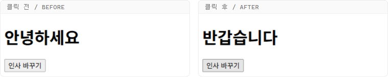
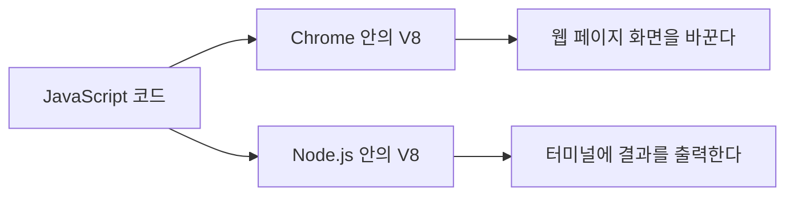
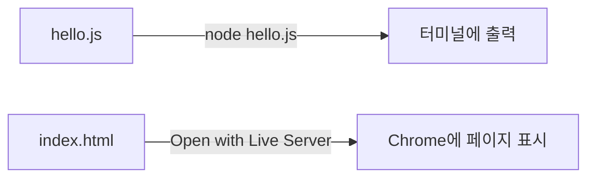
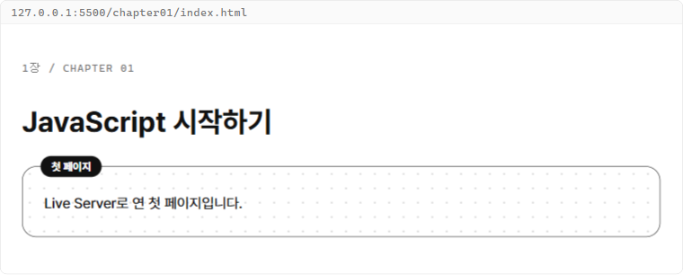
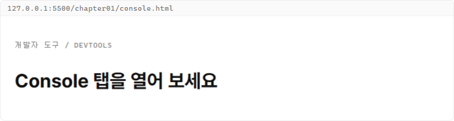
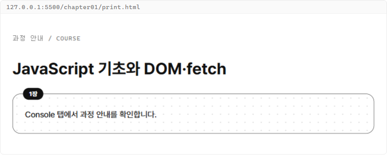
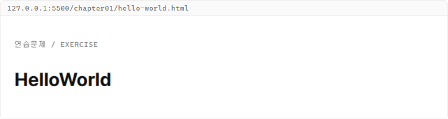

# 1장. JavaScript 시작하기

**학습목표**

- JavaScript가 브라우저와 Node.js에서 하는 일을 설명할 수 있습니다.
- `.js` 파일은 node로, HTML 파일은 Live Server로 실행할 수 있습니다.
- `console.log()`로 값을 터미널과 Console 탭에 출력할 수 있습니다.

## 1-1 JavaScript란

**JavaScript**는 웹 페이지에 동작을 더하는 프로그래밍 언어입니다.
쉽게 말해 버튼을 누르면 글자가 바뀌고, 입력한 내용이 목록에 붙는 것처럼 화면이 반응하게 만듭니다.

### JavaScript는 왜 필요할까?

사용자가 한 행동에 따라 화면이 바뀌게 하기 위해 필요합니다.

버튼을 누르면 제목이 "안녕하세요"에서 "반갑습니다"로 바뀌는 페이지를 만든다고 생각해 봅시다.
HTML은 제목과 버튼을 화면에 놓고, CSS는 그 모양을 꾸밉니다.
하지만 둘 다 버튼이 눌렸다는 것을 알아채고 글자를 바꾸지는 못합니다.

JavaScript는 버튼 클릭을 알아채고 그때 화면의 글자를 바꿉니다.
HTML과 CSS로 만든 화면 위에 동작을 더하는 것이 JavaScript의 일입니다.

**비교 — HTML, CSS, JavaScript**

| 비교 항목 | HTML | CSS | JavaScript |
|---|---|---|---|
| 맡는 일 | 내용과 구조 | 모양 | 동작 |
| 예 | 제목, 버튼, 입력칸 | 글자 색, 테두리, 배치 | 버튼을 누르면 글자 바꾸기 |

### 화면이 반응하는 페이지

JavaScript 코드는 HTML 문서의 `<script>` 태그 안에 씁니다.
다음 예제는 앞에서 말한, 버튼을 누르면 제목 글자가 바뀌는 페이지입니다.
이 파일을 여는 방법은 1-3에서 배우므로, 지금은 화면이 어떻게 바뀌는지만 봅니다.

**예제 1-1** `click.html`

```html
<!DOCTYPE html>
<html lang="ko">
<head>
  <meta charset="UTF-8">
  <title>JavaScript 맛보기</title>
</head>
<body>
  <h1 id="message">안녕하세요</h1>
  <button id="changeButton">인사 바꾸기</button>

  <script>
    const message = document.querySelector("#message");
    const changeButton = document.querySelector("#changeButton");

    changeButton.addEventListener("click", () => {
      message.textContent = "반갑습니다";
    });
  </script>
</body>
</html>
```

**실행 결과**

인사 바꾸기 버튼을 누르면 제목이 "안녕하세요"에서 "반갑습니다"로 바뀝니다.



- `<h1>`과 `<button>`은 HTML이므로 페이지를 열자마자 화면에 보입니다.
- `<script>` 태그 안의 코드가 JavaScript입니다. 버튼을 누를 때마다 제목 글자를 바꿉니다.
- 지금은 코드를 한 줄씩 읽지 않아도 됩니다. 버튼을 누르면 화면이 바뀐다는 결과만 확인합니다.

**시각자료 — 버튼을 눌러 제목이 바뀌는 순서**


HTML만 있으면 화면은 처음 모습 그대로 멈춰 있습니다.
버튼 클릭 뒤에 JavaScript가 실행되어 화면의 글자를 바꿉니다.

## 1-2 Node.js와 V8

1-1의 JavaScript는 브라우저 안에서 실행되었습니다.
브라우저가 JavaScript를 실행할 수 있는 것은 안에 JavaScript 엔진이 들어 있기 때문입니다.

### JavaScript 엔진과 V8

**JavaScript 엔진**(JavaScript engine)은 JavaScript 코드를 읽어 컴퓨터가 실행할 수 있게 바꾸고 실행하는 프로그램입니다.
쉽게 말해 JavaScript를 알아듣고 그대로 움직이는 번역기 겸 실행기입니다.

**V8**은 Google이 Chrome 브라우저에 넣으려고 만든 JavaScript 엔진입니다.
2008년 Chrome과 함께 공개되었고, 코드를 빠르게 실행하는 것으로 알려졌습니다.
이 과정에서 쓰는 Chrome에도 V8이 들어 있습니다.

### 브라우저 밖의 JavaScript, Node.js

JavaScript는 원래 브라우저 안에서 쓰려고 만든 언어입니다.
2009년 라이언 달(Ryan Dahl)은 V8을 브라우저 밖으로 꺼내 컴퓨터에서 바로 쓸 수 있게 만들었습니다.
이것이 Node.js입니다.

**Node.js**는 브라우저 없이 컴퓨터에서 JavaScript를 실행하게 해 주는 실행 환경(runtime)입니다.
**터미널**(terminal)은 글자로 명령을 입력해 컴퓨터를 다루는 창입니다.
터미널에 `node 파일명.js`를 입력하면 V8이 그 파일의 코드를 실행합니다.

**시각자료 — 같은 JavaScript 코드가 실행되는 두 곳**



두 곳 모두 같은 V8 엔진이 코드를 실행합니다.
그래서 같은 문법을 브라우저와 Node.js에서 똑같이 쓸 수 있습니다.

### Node.js는 왜 필요할까?

화면 없이 JavaScript 코드만 바로 실행해 결과를 확인하기 위해 필요합니다.

문법을 연습할 때마다 HTML 파일을 만들고, 브라우저로 열고, 페이지 점검 도구인 개발자 도구까지 열어야 한다고 생각해 봅시다.
확인하고 싶은 것은 출력된 값 하나인데 거쳐야 할 단계가 많습니다.

Node.js가 있으면 `.js` 파일을 저장하고 터미널에서 `node` 명령 한 줄로 바로 실행합니다.
그래서 이 과정은 문법을 연습할 때 Node.js를 쓰고, 화면을 다룰 때는 HTML에 코드를 넣고 브라우저로 엽니다.

**비교 — 브라우저와 Node.js**

| 비교 항목 | 브라우저(Chrome) | Node.js |
|---|---|---|
| JavaScript 엔진 | V8 | V8 |
| 실행 방법 | HTML 파일을 페이지로 연다 | 터미널에서 `node` 명령을 입력한다 |
| 결과를 보는 곳 | 페이지 화면과 Console 탭 | 터미널 |
| 웹 페이지 화면 다루기 | 할 수 있다 | 할 수 없다 |

이 장에서는 두 방법을 모두 써 봅니다.

## 1-3 실행 환경 확인

이 과정은 VS Code, Live Server, Node.js가 설치되어 있다고 보고 시작합니다.
여기서는 설치 여부와 버전을 확인하고, 과정 내내 쓸 폴더와 실행 방법을 정합니다.

### 설치 확인

다음 순서로 세 도구를 확인합니다.

1. VS Code를 실행합니다.
2. VS Code 메뉴에서 터미널 > 새 터미널을 엽니다. 화면 아래쪽에 터미널 창이 열립니다.

[스크린샷: VS Code — 터미널 메뉴와 아래쪽 터미널 창]

3. 터미널에 다음 명령을 입력하고 Enter 키를 누릅니다.
   ```bash
   node --version
   ```
4. `v22`로 시작하는 버전 번호(예: `v22.20.0`)가 출력되면 Node.js 22 LTS가 설치된 것입니다. 22보다 높은 버전이어도 이 과정의 코드는 그대로 실행됩니다.
5. 왼쪽 활동 표시줄에서 확장(Extensions) 아이콘을 누르고 `Live Server`를 검색합니다. Ritwick Dey가 만든 Live Server에 설치됨 표시가 있으면 됩니다.

[스크린샷: VS Code — 확장 탭의 Live Server 설치됨 표시]

`node --version`을 입력했는데 버전 대신 명령을 찾을 수 없다는 문장이 나오면 Node.js가 설치되지 않은 것입니다.
https://nodejs.org 에서 22 LTS를 설치하고 VS Code를 다시 실행합니다.

### 과정 폴더 구조

이 과정의 실습 파일은 모두 `js-course` 폴더 하나에 모읍니다.
장마다 `chapter01`, `chapter02`처럼 폴더를 만들고, 모든 HTML이 함께 쓰는 CSS 파일은 `css` 폴더에 둡니다.

**시각자료 — 1장을 마쳤을 때의 과정 폴더**

```text
js-course/
├─ css/
│  └─ common.css      모든 HTML이 연결하는 공통 CSS
└─ chapter01/
   ├─ hello.js        node로 실행하는 파일
   └─ index.html      Live Server로 여는 파일
```

VS Code에서는 항상 `js-course` 폴더를 엽니다.
그래야 `chapter01`의 HTML이 바깥의 `css/common.css`를 찾아 연결할 수 있습니다.

### js 파일과 HTML 파일의 실행 방법

`.js` 파일은 터미널에서 `node` 명령으로 실행합니다.
터미널의 현재 위치가 파일이 있는 폴더여야 합니다.

**기본 문법**

```bash
cd 폴더명
node 파일명.js
```

- `cd`는 터미널의 현재 위치를 다른 폴더로 옮기는 명령입니다.
- `node` 뒤에 실행할 파일 이름을 씁니다.

HTML 파일은 Live Server로 엽니다.
**Live Server**는 VS Code에서 HTML 파일을 브라우저로 열어 주는 확장 프로그램입니다.
파일을 저장할 때마다 열린 페이지를 자동으로 새로 고쳐 줍니다.

탐색기에서 HTML 파일을 마우스 오른쪽 버튼으로 누르고 Open with Live Server를 선택합니다.
Chrome에 `http://127.0.0.1:5500/chapter01/index.html` 같은 주소로 페이지가 열립니다.

[스크린샷: VS Code — 탐색기의 Open with Live Server 메뉴]

**시각자료 — 파일 종류별 실행 방법**



`.js` 파일의 결과는 터미널에서, HTML 파일의 결과는 Chrome에서 확인합니다.

## 따라하기 실습 — 과정 폴더 만들고 첫 출력하기

**실습 목표**

- 과정 폴더와 공통 CSS 파일을 만듭니다.
- `.js` 파일을 node로 실행해 터미널에 첫 출력을 봅니다.
- 공통 CSS를 연결한 HTML 틀을 Live Server로 엽니다.

**준비**

1. 바탕 화면이나 문서 폴더에 `js-course` 폴더를 만듭니다.
2. VS Code 메뉴에서 파일 > 폴더 열기를 눌러 `js-course` 폴더를 엽니다.
3. `js-course` 안에 `css` 폴더와 `chapter01` 폴더를 만듭니다.
4. `css` 폴더 안에 `common.css` 파일을 만듭니다.
5. `chapter01` 폴더 안에 `hello.js`와 `index.html` 파일을 만듭니다.

**실습 코드**

`css/common.css`

이 파일은 과정의 모든 HTML이 함께 쓰는 공통 CSS입니다.
지금은 각 줄의 뜻을 몰라도 되므로 그대로 입력하고 저장합니다.

```css
/* 공통 스타일 */
* {
  box-sizing: border-box;
}

body {
  margin: 0;
  background-color: #ffffff;
  color: #111111;
  font-family: "Pretendard", "Malgun Gothic", "Apple SD Gothic Neo", sans-serif;
  font-size: 16px;
  line-height: 1.6;
}

h1,
h2,
p {
  margin: 0;
}

/* 페이지 배치 */
.page {
  display: grid;
  gap: 24px;
  max-width: 960px;
  margin: 0 auto;
  padding: 40px 24px;
}

.form {
  display: grid;
  gap: 12px;
}

.button-group {
  display: grid;
  grid-auto-flow: column;
  justify-content: start;
  gap: 8px;
}

.card-list {
  display: grid;
  grid-template-columns: repeat(3, 1fr);
  gap: 24px;
}

/* 라벨과 보조 글자 */
.label {
  color: #777777;
  font-family: "Cascadia Mono", Consolas, monospace;
  font-size: 12px;
  letter-spacing: 0.08em;
}

.muted {
  color: #777777;
}

.divider {
  width: 100%;
  margin: 0;
  border: 0;
  border-top: 1px solid #e5e5e5;
}

/* 카드: 검정 테두리와 점 격자 배경 */
.card {
  position: relative;
  display: grid;
  gap: 12px;
  padding: 28px 24px 24px;
  border: 1px solid #111111;
  border-radius: 16px;
  background-color: #ffffff;
  background-image: radial-gradient(#d9d9d9 1px, transparent 1px);
  background-size: 16px 16px;
}

/* 상태 배지 */
.badge {
  justify-self: start;
  padding: 2px 12px;
  border-radius: 999px;
  background-color: #111111;
  color: #ffffff;
  font-size: 12px;
  font-weight: 700;
}

.card > .badge {
  position: absolute;
  top: -12px;
  left: 20px;
}

/* 알약 모양 버튼 */
.btn {
  padding: 8px 16px;
  border: 1px solid #111111;
  border-radius: 999px;
  background-color: #ffffff;
  color: #111111;
  font: inherit;
  font-size: 14px;
  cursor: pointer;
}

.btn.selected {
  background-color: #111111;
  color: #ffffff;
}

/* 입력칸 */
.input {
  width: 100%;
  padding: 12px 20px;
  border: 1px solid #111111;
  border-radius: 999px;
  font: inherit;
}

.input::placeholder {
  color: #aaaaaa;
}

.title-input {
  width: 100%;
  padding: 8px 0;
  border: 0;
  border-bottom: 1px solid #111111;
  font: inherit;
  font-size: 24px;
  font-weight: 700;
  outline: none;
}

/* 진행 막대 */
.progress {
  height: 4px;
  border-radius: 999px;
  background-color: #e5e5e5;
  overflow: hidden;
}

.progress-bar {
  width: 0;
  height: 100%;
  background-color: #111111;
}
```

`chapter01/hello.js`

```javascript
console.log("Hello, Node.js");
```

`chapter01/index.html`

이 파일이 과정 내내 HTML 실습의 출발점이 되는 틀입니다.

```html
<!DOCTYPE html>
<html lang="ko">
<head>
  <meta charset="UTF-8">
  <title>1장 첫 페이지</title>
  <link rel="stylesheet" href="../css/common.css">
</head>
<body>
  <main class="page">
    <p class="label">1장 / CHAPTER 01</p>
    <h1>JavaScript 시작하기</h1>
    <section class="card">
      <span class="badge">첫 페이지</span>
      <p>Live Server로 연 첫 페이지입니다.</p>
    </section>
  </main>

  <script>
    // 여기에 JavaScript 코드를 씁니다.
  </script>
</body>
</html>
```

**실행 방법 1**

`hello.js`를 node로 실행합니다.

1. 세 파일을 모두 저장합니다.
2. 터미널에서 다음 명령을 차례로 입력합니다.
   ```bash
   cd chapter01
   node hello.js
   ```

**실행 결과 1**

```text
Hello, Node.js
```

**실행 방법 2**

`index.html`을 Live Server로 엽니다.

1. 탐색기에서 `chapter01/index.html`을 마우스 오른쪽 버튼으로 누르고 Open with Live Server를 선택합니다.

**실행 결과 2**



**코드 설명**

- `console.log("Hello, Node.js");`는 괄호 안의 글자를 출력하는 코드입니다. 1-4에서 자세히 배웁니다.
- `<link rel="stylesheet" href="../css/common.css">`는 공통 CSS를 연결합니다. `../`는 한 단계 바깥 폴더라는 뜻이므로 `chapter01` 밖의 `css` 폴더를 가리킵니다.
- `class="page"`, `class="card"`, `class="badge"`처럼 `common.css`에 정해 둔 클래스 이름을 붙이면 그 모양이 적용됩니다.
- `<script>` 태그는 `</body>` 바로 앞에 둡니다. 화면의 HTML을 먼저 읽은 뒤 JavaScript를 실행하기 위해서입니다.
- `//` 뒤에 쓴 글은 **주석**(comment)입니다. 실행되지 않는 메모라서 코드에 설명을 남길 때 씁니다.

**바꿔 보기 1**

`hello.js`의 출력 글자를 바꿔 봅니다.
`console.log("Hello, Node.js");` 줄을 다음처럼 바꾸고 저장한 뒤 `node hello.js`를 다시 실행합니다.

```javascript
console.log("안녕하세요, Node.js");
```

터미널에 `안녕하세요, Node.js`가 출력됩니다.
`.js` 파일은 고친 뒤 `node` 명령을 다시 입력해야 새 결과가 나옵니다.

**바꿔 보기 2**

`index.html`의 제목을 바꿔 봅니다.
`<h1>JavaScript 시작하기</h1>` 줄을 다음처럼 바꾸고 저장합니다.

```html
<h1>나의 첫 JavaScript 페이지</h1>
```

새로고침 버튼을 누르지 않아도 Chrome의 제목이 "나의 첫 JavaScript 페이지"로 바뀝니다.
Live Server가 저장을 알아차리고 페이지를 다시 불러오기 때문입니다.

## 1-4 console.log와 개발자 도구

1-3에서는 `console.log()`로 터미널에 첫 출력을 했습니다.
이제 이 명령을 자세히 봅니다.

### console.log

`console.log()`는 괄호 안의 값을 콘솔에 출력하는 명령입니다.
**콘솔**(console)은 프로그램이 글자로 결과를 보여 주는 창입니다.
node로 실행하면 터미널이, 브라우저에서 실행하면 개발자 도구의 Console 탭이 콘솔입니다.

### console.log는 왜 필요할까?

코드가 실행되는 동안 만들어진 값을 눈으로 확인하기 위해 필요합니다.

코드는 실행되어도 출력하지 않으면 화면에 아무것도 보이지 않습니다.
값이 의도한 대로 만들어졌는지, 어느 문장까지 실행되었는지 코드만 읽어서는 확신하기 어렵습니다.

궁금한 곳에 `console.log()`를 넣으면 그 순간의 값이 콘솔에 찍힙니다.
값을 찍어 보며 확인하는 습관을 들이면 틀린 곳을 빨리 찾을 수 있습니다.

**특징**

- 괄호 안의 값을 콘솔에 출력하고 줄을 바꿉니다.
- 쉼표로 값을 여러 개 넣으면 한 칸씩 띄어 한 줄에 출력합니다.
- 따옴표로 감싼 글자는 따옴표를 빼고 안의 글자만 출력합니다.
- 출력은 웹 페이지 화면에 나오지 않고 콘솔에만 나옵니다.

**기본 문법**

```javascript
console.log(값);
console.log(값1, 값2);
```

**예제 1-2** `log.js`

```javascript
console.log("JavaScript 시작하기");
console.log(1);
console.log("1장", "JavaScript 시작하기");
```

**실행 결과**

```text
JavaScript 시작하기
1
1장 JavaScript 시작하기
```

- `"JavaScript 시작하기"`처럼 큰따옴표로 감싼 글자를 **문자열**(string)이라고 합니다. 따옴표는 출력되지 않고 안의 글자만 출력됩니다.
- `1`처럼 따옴표 없이 쓴 숫자는 숫자 그대로 출력됩니다.
- 괄호 안에 쉼표로 값을 여러 개 넣으면 한 줄에 한 칸씩 띄어 출력합니다.
- `console.log`의 점(`.`)은 "console의 log"라는 뜻입니다. `console`이 가진 여러 명령 중 `log`를 쓴다는 의미입니다.
- 실행할 명령 하나를 **문장**(statement)이라고 합니다. 문장 끝에는 세미콜론(`;`)을 붙입니다.

### 개발자 도구와 Console 탭

HTML의 `<script>` 안에서 `console.log()`를 쓰면 결과가 페이지 화면에 나오지 않습니다.
브라우저의 개발자 도구를 열어야 볼 수 있습니다.

**개발자 도구**(DevTools)는 Chrome에 들어 있는 웹 페이지 점검 도구입니다.
페이지의 HTML 구조, 적용된 CSS, JavaScript 출력과 오류를 확인할 수 있습니다.

다음 방법 중 하나로 개발자 도구를 엽니다.

- 키보드의 F12 키를 누릅니다.
- Windows는 Ctrl+Shift+I, macOS는 Cmd+Option+I를 누릅니다.
- 페이지에서 마우스 오른쪽 버튼을 누르고 검사를 선택합니다.

개발자 도구 위쪽의 탭 중 Console을 누르면 `console.log()`의 출력이 보입니다.

[스크린샷: Chrome 개발자 도구 — Console 탭 위치와 출력 내용]

**예제 1-3** `console.html`

```html
<!DOCTYPE html>
<html lang="ko">
<head>
  <meta charset="UTF-8">
  <title>Console 탭 확인</title>
  <link rel="stylesheet" href="../css/common.css">
</head>
<body>
  <main class="page">
    <p class="label">개발자 도구 / DEVTOOLS</p>
    <h1>Console 탭을 열어 보세요</h1>
  </main>

  <script>
    console.log("첫 번째 줄");
    console.log("두 번째 줄");
    console.log("세 번째 줄");
  </script>
</body>
</html>
```

**실행 결과**



개발자 도구의 Console 탭에는 다음이 출력됩니다.

```text
첫 번째 줄
두 번째 줄
세 번째 줄
```

- 문장은 위에서 아래로 한 줄씩 차례로 실행됩니다. 그래서 출력도 코드에 쓴 순서대로 나옵니다.
- Console 탭의 각 줄 오른쪽에는 `console.html:14`처럼 그 출력을 만든 파일과 줄 번호가 보입니다. 출력이 어느 코드에서 나왔는지 찾을 때 씁니다.
- Live Server로 열면 Console 탭 맨 위에 `Live reload enabled.`가 함께 보일 수 있습니다. Live Server가 자동 새로고침을 켰다고 알리는 문장입니다.

1-2에서 본 것처럼 node와 브라우저는 결과를 보여 주는 곳이 다릅니다.

**비교 — node와 브라우저의 출력 위치**

| 비교 항목 | node | 브라우저 |
|---|---|---|
| 실행하는 파일 | `.js` 파일 | Live Server로 연 HTML 파일 |
| `console.log()` 결과가 보이는 곳 | VS Code 터미널 | Chrome 개발자 도구의 Console 탭 |

## 따라하기 실습 — 터미널과 Console 탭에 출력하기

**실습 목표**

- 같은 출력 코드를 node와 브라우저에서 각각 실행합니다.
- 문자열과 숫자를 쉼표로 이어 한 줄에 출력합니다.
- 두 곳의 출력 결과가 같은지 비교합니다.

**준비**

1. `chapter01` 폴더 안에 `print.js`와 `print.html` 파일을 만듭니다.
2. `print.html`에는 따라하기 실습 — 과정 폴더 만들고 첫 출력하기의 `index.html` 내용을 복사해 붙여 넣고, 아래 코드처럼 고칩니다.

**실습 코드**

`chapter01/print.js`

```javascript
console.log("과정:", "JavaScript 기초와 DOM·fetch");
console.log("1장", "JavaScript 시작하기");
console.log("전체 장 수:", 20);
```

`chapter01/print.html`

```html
<!DOCTYPE html>
<html lang="ko">
<head>
  <meta charset="UTF-8">
  <title>과정 안내</title>
  <link rel="stylesheet" href="../css/common.css">
</head>
<body>
  <main class="page">
    <p class="label">과정 안내 / COURSE</p>
    <h1>JavaScript 기초와 DOM·fetch</h1>
    <section class="card">
      <span class="badge">1장</span>
      <p>Console 탭에서 과정 안내를 확인합니다.</p>
    </section>
  </main>

  <script>
    console.log("과정:", "JavaScript 기초와 DOM·fetch");
    console.log("1장", "JavaScript 시작하기");
    console.log("전체 장 수:", 20);
  </script>
</body>
</html>
```

**실행 방법 1**

`print.js`를 node로 실행합니다.

1. 두 파일을 저장합니다.
2. 터미널의 현재 위치가 `chapter01`인지 확인하고 다음 명령을 입력합니다.
   ```bash
   node print.js
   ```

**실행 결과 1**

```text
과정: JavaScript 기초와 DOM·fetch
1장 JavaScript 시작하기
전체 장 수: 20
```

**실행 방법 2**

`print.html`을 Live Server로 열고 Console 탭을 확인합니다.

1. `print.html`을 Live Server로 엽니다.
2. F12 키로 개발자 도구를 열고 Console 탭을 누릅니다.

**실행 결과 2**



Console 탭에는 실행 결과 1과 같은 세 줄이 출력됩니다.

```text
과정: JavaScript 기초와 DOM·fetch
1장 JavaScript 시작하기
전체 장 수: 20
```

**코드 설명**

- `print.js`와 `print.html`의 `<script>` 안은 같은 코드입니다. 같은 V8 엔진이 실행하므로 결과도 같습니다.
- `console.log("과정:", "JavaScript 기초와 DOM·fetch");`는 문자열 두 개를 쉼표로 이어 `과정: JavaScript 기초와 DOM·fetch`처럼 한 칸 띄어 출력합니다.
- `console.log("전체 장 수:", 20);`처럼 문자열과 숫자도 쉼표로 함께 출력할 수 있습니다.
- `console.log()`의 출력은 페이지 화면에 나오지 않으므로, 페이지 화면에 보이는 글자는 HTML에 쓴 내용뿐입니다.

**바꿔 보기 1**

다음 장 안내를 한 줄 더 출력해 봅니다.
두 파일 모두 `console.log("전체 장 수:", 20);` 줄 아래에 다음 줄을 추가합니다.

```javascript
console.log("다음 장:", "변수와 자료형");
```

터미널과 Console 탭 모두 마지막에 `다음 장: 변수와 자료형`이 한 줄 더 출력됩니다.

**바꿔 보기 2**

출력 순서를 바꿔 봅니다.
`print.js`에서 `console.log("전체 장 수:", 20);` 줄을 맨 위로 옮기고 다시 실행합니다.

```javascript
console.log("전체 장 수:", 20);
console.log("과정:", "JavaScript 기초와 DOM·fetch");
console.log("1장", "JavaScript 시작하기");
```

`전체 장 수: 20`이 첫 줄에 출력됩니다.
문장은 위에서 아래로 실행되므로 코드의 순서가 곧 출력 순서입니다.

## 연습문제

### 연습문제 1 — 자기소개 세 줄 출력 프로그램

**요구사항**

1. `chapter01` 폴더에 `intro.js` 파일을 만듭니다.
2. 이름, 사는 곳, 좋아하는 것을 한 줄에 하나씩 모두 세 줄로 출력합니다.
3. 각 줄은 `항목: 값` 형태로 출력합니다. 예: `사는 곳: 서울`
4. node로 실행합니다.

**완료 조건**

- `node intro.js`를 실행하면 터미널에 세 줄이 출력됩니다.
- 각 줄이 `항목: 값` 형태입니다.
- 이름, 사는 곳, 좋아하는 것 순서로 출력됩니다.

### 연습문제 2 — HTML 페이지에 HelloWorld 출력

**요구사항**

1. `chapter01` 폴더에 `hello-world.html` 파일을 만들고 공통 CSS를 연결합니다.
2. 페이지 화면에 `HelloWorld`를 제목으로 표시합니다.
3. Console 탭에도 `HelloWorld`를 출력합니다.
4. Live Server로 엽니다.

**완료 조건**

- 페이지 화면에 `HelloWorld` 제목이 보입니다.
- Console 탭에 `HelloWorld`가 출력됩니다.
- 공통 CSS의 글꼴과 여백이 적용되어 있습니다.

## 정답과 해설

### 연습문제 1 — 자기소개 세 줄 출력 프로그램

`intro.js`

```javascript
console.log("이름:", "김코딩");
console.log("사는 곳:", "서울");
console.log("좋아하는 것:", "산책");
```

**실행 결과**

```text
이름: 김코딩
사는 곳: 서울
좋아하는 것: 산책
```

**해설**

- 항목 이름과 값을 쉼표로 나눠 넣었으므로, `console.log()`가 둘 사이를 한 칸 띄어 `이름: 김코딩`처럼 출력합니다.
- 문장은 위에서 아래로 실행되므로 이름, 사는 곳, 좋아하는 것 순서로 줄을 씁니다.
- `console.log("이름: 김코딩");`처럼 문자열 하나로 써도 같은 결과가 나옵니다.

### 연습문제 2 — HTML 페이지에 HelloWorld 출력

`hello-world.html`

```html
<!DOCTYPE html>
<html lang="ko">
<head>
  <meta charset="UTF-8">
  <title>HelloWorld</title>
  <link rel="stylesheet" href="../css/common.css">
</head>
<body>
  <main class="page">
    <p class="label">연습문제 / EXERCISE</p>
    <h1>HelloWorld</h1>
  </main>

  <script>
    console.log("HelloWorld");
  </script>
</body>
</html>
```

**실행 결과**



개발자 도구의 Console 탭에는 다음이 출력됩니다.

```text
HelloWorld
```

**해설**

- 페이지 화면에 보이는 `HelloWorld`는 HTML의 `<h1>`이 표시한 것입니다.
- Console 탭의 `HelloWorld`는 `<script>` 안의 `console.log("HelloWorld");`가 출력한 것입니다. `console.log()`의 결과는 페이지 화면에 나오지 않습니다.
- `<link rel="stylesheet" href="../css/common.css">`로 공통 CSS를 연결하고 `class="page"`를 붙였으므로 공통 글꼴과 여백이 적용됩니다.