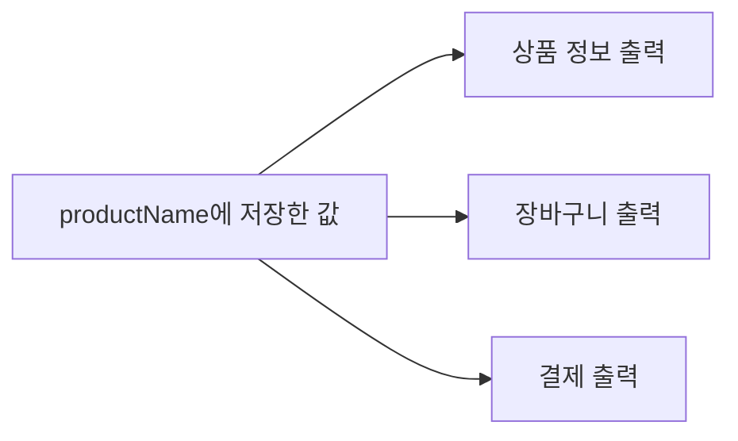
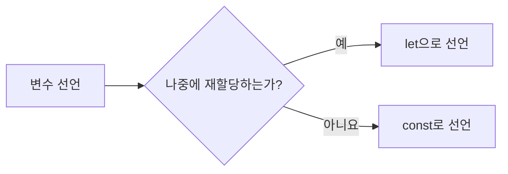
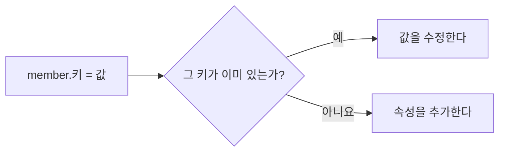
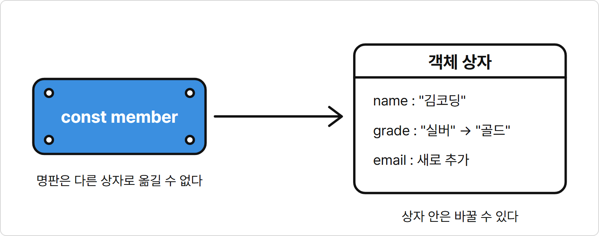

# 2장. 변수와 자료형

**학습목표**

- `let`과 `const`로 변수를 선언하고, 값을 다시 할당할지에 따라 둘 중 하나를 고를 수 있습니다.
- 원시 자료형 다섯 가지를 구분하고 `typeof`로 값의 자료형을 확인할 수 있습니다.
- 템플릿 리터럴로 값을 끼워 넣은 문자열을 만들 수 있습니다.
- 객체를 만들고 속성을 읽고, 추가하고, 수정하고, 삭제할 수 있습니다.

## 2-1 let과 const

1장에서는 `console.log("무선 마우스");`처럼 출력할 값을 괄호 안에 직접 썼습니다.
이 장에서는 값을 저장해 두고 이름으로 꺼내 쓰는 방법부터 배웁니다.

이 장의 예제는 모두 `js-course/chapter02` 폴더에 만들고 node로 실행합니다.
VS Code에서 `js-course` 폴더 안에 `chapter02` 폴더를 만들고, 새 터미널을 열어 `cd chapter02`를 입력해 둡니다.

### 변수

**변수**(variable)는 값에 이름을 붙여 저장해 두고, 그 이름으로 다시 꺼내 쓰는 방법입니다.
쉽게 말해 값에 이름표를 붙여 두는 것입니다.
변수를 만드는 것을 **선언**(declaration)이라고 하고, 변수에 값을 넣는 것을 **할당**(assignment)이라고 합니다.

### 변수는 왜 필요할까?

같은 값을 여러 곳에서 쓰고 그 값이 바뀔 때 한 곳만 고치기 위해 필요합니다.

상품 이름을 상품 정보, 장바구니, 결제 화면 세 곳에 출력한다고 생각해 봅시다.
세 곳에 `"무선 마우스"`를 직접 쓰면 상품이 바뀔 때 세 곳을 모두 고쳐야 합니다.
한 곳이라도 빠뜨리면 화면마다 다른 상품 이름이 나옵니다.

상품 이름을 `productName`에 저장하면 세 곳에서는 이름으로 값을 꺼내 씁니다.
상품이 바뀌면 `productName`에 넣는 값 한 곳만 고치면 됩니다.

**시각자료 — 저장한 값을 세 곳에서 쓰기**



세 출력은 모두 `productName` 하나에서 값을 가져갑니다.

### let으로 선언하고 할당하기

`let` 뒤에 변수 이름을 쓰고 `=` 오른쪽에 넣을 값을 쓰면 선언과 할당을 한 번에 합니다.

**기본 문법**

```javascript
let 변수명 = 값;
```

**예제 2-1** `variable.js`

```javascript
let productName = "무선 마우스";

console.log("상품명:", productName);
console.log("장바구니에 담은 상품:", productName);
console.log("결제할 상품:", productName);
```

**실행 결과**

```text
상품명: 무선 마우스
장바구니에 담은 상품: 무선 마우스
결제할 상품: 무선 마우스
```

- `let productName = "무선 마우스";`는 `productName`이라는 변수를 선언하고 `"무선 마우스"`를 할당합니다.
- 여기서 `=`는 "같다"가 아니라 "오른쪽 값을 왼쪽 변수에 넣는다"는 뜻입니다.
- `console.log()` 괄호 안에 따옴표 없이 변수 이름을 쓰면 변수에 들어 있는 값이 출력됩니다.

예제 2-1의 `let productName = "무선 마우스";` 줄을 다음처럼 바꾸면 세 줄의 출력이 모두 `기계식 키보드`로 바뀝니다.

```javascript
let productName = "기계식 키보드";
```

값을 세 번 직접 쓰지 않고 변수 이름으로 썼기 때문에 한 곳만 고치면 됩니다.

### 변수 이름 짓기

변수 이름은 영어로 짓고 그 값이 무엇인지 드러나게 씁니다.
여러 단어를 이을 때는 `productName`처럼 첫 단어는 소문자로 쓰고 다음 단어의 첫 글자만 대문자로 씁니다.
이렇게 쓰는 방식을 **카멜 표기법**(camelCase)이라고 합니다.

- 이름에 공백을 넣을 수 없습니다. `product name` 대신 `productName`으로 씁니다.
- 이름을 숫자로 시작할 수 없습니다. `1stPrice` 대신 `firstPrice`로 씁니다.
- `let`, `const`처럼 JavaScript가 이미 쓰는 단어는 이름으로 쓸 수 없습니다.

### 재할당

이미 값이 있는 변수에 새 값을 넣는 것을 **재할당**(reassignment)이라고 합니다.
재고나 방문자 수처럼 프로그램이 도는 동안 바뀌는 값은 재할당으로 새 값을 넣습니다.

**특징**

- `let`으로 선언한 변수에는 몇 번이든 재할당할 수 있습니다.
- 재할당할 때는 `let`을 다시 쓰지 않고 변수 이름만 씁니다.
- 재할당하면 이전 값은 사라지고 새 값만 남습니다.

**기본 문법**

```javascript
변수명 = 새 값;
```

**예제 2-2** `reassign.js`

```javascript
let stock = 10;
console.log("재고:", stock);

stock = 9;
console.log("재고:", stock);
```

**실행 결과**

```text
재고: 10
재고: 9
```

- `stock = 9;`에는 `let`이 없습니다. `let`은 변수를 처음 선언할 때 한 번만 씁니다.
- 재할당한 뒤 `stock`에는 `9`만 남습니다.
- 문장은 위에서 아래로 실행되므로, 재할당 전의 `console.log()`는 `10`을, 재할당 뒤의 `console.log()`는 `9`를 출력합니다.

### const

`const`도 변수를 선언하는 단어입니다.
`let`과 달리 `const`로 선언한 변수에는 재할당할 수 없습니다.

### const는 왜 필요할까?

바뀌면 안 되는 값을 실수로 바꾸지 않게 지키기 위해 필요합니다.

가게 이름을 `shopName`에 저장해 영수증과 안내 문구 여러 곳에서 쓴다고 생각해 봅시다.
코드가 길어지면 다른 곳에서 `shopName`에 실수로 다른 값을 넣을 수 있습니다.
그러면 그 뒤로 가게 이름을 쓰는 모든 곳에 틀린 이름이 나옵니다.

`shopName`을 `const`로 선언하면 JavaScript가 재할당을 막아 줍니다.
코드를 읽는 사람도 `const`를 보고 이 값은 바뀌지 않는다는 것을 바로 압니다.

**특징**

- `const`로 선언한 변수에는 재할당할 수 없습니다.
- `const`로 선언할 때는 반드시 값을 함께 넣어야 합니다.

**비교 — let과 const**

| 비교 항목 | let | const |
|---|---|---|
| 재할당 | 할 수 있다 | 할 수 없다 |
| 선언할 때 값 | 넣지 않아도 된다 | 반드시 넣는다 |
| 쓰는 곳 | 재고, 방문자 수 | 가게 이름, 회원 아이디 |

두 단어의 차이는 이름표에 빗대면 쉽게 기억할 수 있습니다.
`let`은 떼어서 다른 값에 다시 붙일 수 있는 포스트잇 이름표입니다.
`const`는 문에 나사로 박아 둔 명판이라서, 한 번 붙이면 다른 값으로 옮길 수 없습니다.

**시각자료 — 포스트잇 이름표와 고정 명판**

```text
[생성 이미지: images/02/let-const-analogy.png]
장면: 왼쪽에는 손이 stock이라고 적힌 포스트잇을 숫자 10 상자에서 떼어 숫자 9 상자에 붙인다. 오른쪽에는 shopName이라고 적힌 명판이 나사 네 개로 문에 박혀 있다.
그림 속 글자: stock, 10, 9, shopName
비율: 가로 3:2
스타일: 굵기가 일정한 검정 외곽선의 단순한 선 그림. 흰 배경. 그림자와 그라데이션 없음. 색은 흰색, 검정, 파랑(#3B8FE0) 세 가지만 쓰고, 파랑은 포스트잇 한 곳만 평면으로 채운다.
참고 그림: book-manuscript/assets/style-ref/line-art-shark.png, line-art-accent.png
```

포스트잇 `stock`은 `9`로 옮겨 붙일 수 있지만, 명판 `shopName`은 처음 박은 자리에 그대로 있습니다.

**기본 문법**

```javascript
const 변수명 = 값;
```

**예제 2-3** `const.js`

```javascript
const shopName = "코딩 문구점";
let visitorCount = 0;

console.log(shopName, "방문자 수:", visitorCount);

visitorCount = 1;
console.log(shopName, "방문자 수:", visitorCount);
```

**실행 결과**

```text
코딩 문구점 방문자 수: 0
코딩 문구점 방문자 수: 1
```

- 가게 이름은 바뀌지 않으므로 `shopName`은 `const`로 선언했습니다.
- 방문자 수는 손님이 올 때마다 바뀌므로 `visitorCount`는 `let`으로 선언하고 `visitorCount = 1;`로 재할당했습니다.
- `shopName`은 두 번 모두 `코딩 문구점`을 출력합니다. `const` 변수는 선언할 때 넣은 값을 그대로 유지합니다.

어느 쪽으로 선언할지 망설여지면 먼저 `const`로 선언합니다.
값을 다시 할당해야 할 때만 `let`으로 바꿉니다.
이렇게 하면 코드를 읽는 사람이 `let`을 보는 순간 "이 값은 바뀌는구나" 하고 알 수 있습니다.

**시각자료 — let과 const 고르기**



`visitorCount`처럼 재할당하는 변수만 `let`으로 선언합니다.
`shopName`처럼 재할당하지 않는 변수는 `const`로 선언합니다.

## 2-2 원시 자료형과 typeof

변수에는 글자도 넣고 숫자도 넣었습니다.
JavaScript는 값마다 종류를 구분합니다.

### 자료형

**자료형**(data type)은 값의 종류입니다.
`12000`은 숫자, `"무선 마우스"`는 문자열처럼 모든 값은 자료형 하나에 속합니다.

### 자료형은 왜 필요할까?

값의 종류에 따라 할 수 있는 일이 다르기 때문에 필요합니다.

상품 가격으로 합계를 계산한다고 생각해 봅시다.
가격을 `"12000"`처럼 글자로 저장해 두면 눈에는 숫자로 보여도 JavaScript는 이 값을 글자로 다룹니다.
그래서 다른 가격과 더하면 숫자 덧셈이 아니라 글자를 이어 붙인 결과가 나옵니다.

JavaScript는 값마다 자료형을 정해 두고, 그 자료형에 맞는 방식으로 값을 다룹니다.
계산할 가격은 숫자 자료형으로, 상품 이름은 문자열 자료형으로 저장하면 각 값을 알맞게 쓸 수 있습니다.

### 원시 자료형

**원시 자료형**(primitive type)은 더 쪼갤 수 없는 값 하나를 나타내는 자료형입니다.
이 장에서는 원시 자료형 다섯 가지를 다룹니다.

| 자료형 | 뜻 | 값의 예 |
|---|---|---|
| `number` | 숫자 | `12000`, `4.5`, `-3` |
| `string` | 문자열 | `"무선 마우스"`, `"12000"` |
| `boolean` | 참과 거짓 | `true`, `false` |
| `undefined` | 값이 아직 할당되지 않음 | `undefined` |
| `null` | 비어 있음을 일부러 나타냄 | `null` |

### typeof

`typeof`는 값의 자료형 이름을 문자열로 알려 주는 연산자입니다.
**연산자**(operator)는 값을 받아 처리하고 결과를 내는 기호나 단어입니다.

**특징**

- `typeof` 뒤에 한 칸 띄고 값이나 변수 이름을 씁니다.
- 결과는 `"number"`, `"string"`처럼 자료형 이름을 담은 문자열입니다.

**기본 문법**

```javascript
typeof 값
```

**예제 2-4** `typeof.js`

```javascript
const price = 12000;
const rating = 4.5;
const productName = "무선 마우스";
const isSoldOut = false;

console.log(typeof price);
console.log(typeof rating);
console.log(typeof productName);
console.log(typeof isSoldOut);
```

**실행 결과**

```text
number
number
string
boolean
```

- `12000`과 `4.5`는 둘 다 `number`입니다. JavaScript는 정수와 소수를 따로 나누지 않고 모두 `number`로 다룹니다.
- `false`는 따옴표가 없으므로 문자열이 아니라 `boolean` 값입니다. `boolean`에는 `true`(참)와 `false`(거짓) 두 값만 있습니다.
- `isSoldOut`처럼 `boolean` 값을 담는 변수는 `is`로 시작하는 이름을 자주 씁니다. 이름만 보고 "그런가, 아닌가"를 담은 변수임을 알 수 있습니다.

### 문자열과 숫자

화면에 같은 모양으로 보이는 값도 자료형이 다를 수 있습니다.
따옴표로 감쌌는지가 문자열과 숫자를 가릅니다.

**예제 2-5** `string-number.js`

```javascript
const price = 12000;
const priceText = "12000";

console.log(price);
console.log(priceText);
console.log(typeof price);
console.log(typeof priceText);
```

**실행 결과**

```text
12000
12000
number
string
```

- `price`와 `priceText`는 출력하면 둘 다 `12000`으로 보입니다. `console.log()`는 문자열의 따옴표를 빼고 출력하기 때문입니다.
- `typeof`로 확인하면 `price`는 `number`, `priceText`는 `string`입니다.
- 가격, 수량처럼 계산할 값은 따옴표 없이 숫자로 씁니다.

### undefined와 null

`undefined`와 `null`은 둘 다 "값이 없다"는 뜻이지만 생기는 방식이 다릅니다.
`undefined`는 값을 넣은 적이 없을 때 JavaScript가 알아서 채우는 값입니다.
`null`은 개발자가 "여기는 비어 있다"고 일부러 넣는 값입니다.

**비교 — undefined와 null**

| 비교 항목 | undefined | null |
|---|---|---|
| 뜻 | 값을 넣은 적 없음 | 비어 있다고 일부러 표시함 |
| 채우는 쪽 | JavaScript | 개발자 |
| 생기는 예 | `let couponCode;` | `const deliveryMemo = null;` |
| `typeof` 결과 | `undefined` | `object` |

**예제 2-6** `empty-value.js`

```javascript
let couponCode;
const deliveryMemo = null;

console.log(couponCode);
console.log(deliveryMemo);
console.log(typeof couponCode);
console.log(typeof deliveryMemo);
```

**실행 결과**

```text
undefined
null
undefined
object
```

- `let couponCode;`는 값을 넣지 않고 선언만 했습니다. 그래서 `couponCode`에는 `undefined`가 들어 있습니다.
- `const deliveryMemo = null;`은 배송 메모가 없다는 것을 `null`로 직접 넣었습니다.
- `typeof null`은 `null`이 아니라 `object`를 돌려줍니다. JavaScript 초기에 생긴 실수가 그대로 남은 결과입니다. `typeof`로는 `null`을 가려낼 수 없다는 것만 기억합니다.

## 2-3 템플릿 리터럴

자료형을 구분했으니 이제 여러 값을 한 문장으로 엮어 봅니다.

### 템플릿 리터럴과 ${}

**템플릿 리터럴**(template literal)은 백틱(`` ` ``)으로 감싸 만드는 문자열입니다.
안에 `${변수명}`을 쓰면 그 자리에 변수의 값이 끼워 들어갑니다.

### 템플릿 리터럴은 왜 필요할까?

값과 글자를 원하는 모양 그대로 한 문장으로 엮기 위해 필요합니다.

상품명과 가격을 넣어 "무선 마우스의 가격은 12000원입니다."라는 문장을 출력한다고 생각해 봅시다.
1장처럼 `console.log()`에 쉼표로 값을 나열하면 값 사이에 언제나 한 칸이 들어갑니다.
그래서 `무선 마우스 의 가격은 12000 원입니다.`처럼 `마우스`와 `의`, `12000`과 `원` 사이가 벌어집니다.

템플릿 리터럴을 쓰면 `${productName}의`, `${price}원`처럼 값 바로 옆에 글자를 붙일 수 있습니다.
만든 문장은 문자열 하나라서 변수에 담아 두고 다시 쓸 수도 있습니다.

**특징**

- 큰따옴표 대신 백틱으로 감쌉니다.
- `${}` 자리마다 값이 들어가고, 나머지 글자는 쓴 그대로 남습니다.
- 백틱 안에서 줄을 바꾸면 줄바꿈도 문자열에 담깁니다.
- 만든 값의 자료형은 `string`입니다.

**비교 — 큰따옴표 문자열과 템플릿 리터럴**

| 비교 항목 | 큰따옴표 문자열 | 템플릿 리터럴 |
|---|---|---|
| 감싸는 기호 | `"` | `` ` `` |
| 값 끼워 넣기 | 할 수 없다 | `${}`로 끼워 넣는다 |
| 여러 줄 | 한 줄로만 쓴다 | 쓴 모양 그대로 여러 줄이 된다 |

백틱은 키보드 숫자 1 왼쪽, 물결표(`~`)와 같은 키에 있습니다.
작은따옴표(`'`)와 모양이 비슷하므로 헷갈리지 않게 주의합니다.

**기본 문법**

```javascript
`문자열 ${변수명} 문자열`
```

**예제 2-7** `template.js`

```javascript
const productName = "무선 마우스";
const price = 12000;

const message = `${productName}의 가격은 ${price}원입니다.`;

console.log(message);
console.log(typeof message);
```

**실행 결과**

```text
무선 마우스의 가격은 12000원입니다.
string
```

- `${productName}` 자리에 `무선 마우스`가, `${price}` 자리에 `12000`이 들어갔습니다.
- `${price}원`처럼 끼워 넣은 값 바로 뒤에 글자를 붙여도 빈칸이 생기지 않습니다.
- 템플릿 리터럴로 만든 값도 문자열이므로 `typeof message`는 `string`입니다.

**시각자료 — ${} 자리가 값으로 바뀌는 모습**

```text
${productName}  ─▶  무선 마우스
${price}        ─▶  12000

`${productName}의 가격은 ${price}원입니다.`
─▶ "무선 마우스의 가격은 12000원입니다."
```

백틱 안의 `${}` 자리마다 변수의 값이 들어가고, 나머지 글자는 쓴 그대로 남습니다.

### 여러 줄 문자열

특징에서 본 것처럼 템플릿 리터럴은 백틱 안에서 줄을 바꾸면 쓴 모양 그대로 여러 줄 문자열이 됩니다.

**예제 2-8** `multiline.js`

```javascript
const customerName = "김코딩";
const deliveryDate = "10월 12일";

const notice = `${customerName}님, 주문하신 상품이
${deliveryDate}에 도착합니다.`;

console.log(notice);
```

**실행 결과**

```text
김코딩님, 주문하신 상품이
10월 12일에 도착합니다.
```

- `상품이` 뒤에서 줄을 바꿨으므로 출력도 두 줄입니다.
- 둘째 줄 `${deliveryDate}에 도착합니다.`는 맨 앞에서 시작합니다. 백틱 안의 공백은 모두 문자열에 들어가므로, 들여 쓰면 출력에도 빈칸이 생깁니다.

## 따라하기 실습 — 상품 정보 문장 만들기

**실습 목표**

- 상품 정보를 값의 성격에 맞게 `const`와 `let`으로 나눠 선언합니다.
- 템플릿 리터럴로 상품 정보 문장을 만들어 출력합니다.
- 할인가를 재할당하고 바뀐 값을 출력합니다.

**준비**

1. `chapter02` 폴더 안에 `product.js` 파일을 만듭니다.
2. 터미널의 현재 위치가 `chapter02`인지 확인합니다.

**실습 코드**

`chapter02/product.js`

```javascript
const brand = "코딩전자";
const productName = "무선 마우스";
let price = 12000;
const isSoldOut = false;

const title = `[${brand}] ${productName}`;

console.log(title);
console.log(`가격: ${price}원`);
console.log(`품절 여부: ${isSoldOut}`);
console.log(`가격의 자료형: ${typeof price}`);

price = 10900;
console.log(`할인가: ${price}원`);
```

**실행 방법**

1. 코드를 입력하고 저장합니다.
2. 터미널에서 다음 명령을 입력합니다.
   ```bash
   node product.js
   ```

**실행 결과**

```text
[코딩전자] 무선 마우스
가격: 12000원
품절 여부: false
가격의 자료형: number
할인가: 10900원
```

**코드 설명**

- 브랜드, 상품명, 품절 여부는 이 코드에서 바뀌지 않으므로 `const`로 선언했습니다. 가격은 할인가로 재할당하므로 `let`으로 선언했습니다.
- `` `[${brand}] ${productName}` ``은 두 변수 값을 대괄호, 빈칸과 함께 한 문자열로 엮어 `title`에 담습니다.
- `` console.log(`가격: ${price}원`); ``처럼 템플릿 리터럴을 변수에 담지 않고 `console.log()` 괄호 안에 바로 쓸 수도 있습니다.
- `${isSoldOut}` 자리에는 `boolean` 값 `false`가 글자 `false`로 들어갑니다.
- `${}` 안에는 변수 이름뿐 아니라 `typeof price`처럼 값을 만들어 내는 코드도 쓸 수 있습니다. `typeof price`가 만든 `number`가 그 자리에 들어갑니다.
- `price = 10900;`으로 재할당한 뒤의 `${price}`에는 새 값 `10900`이 들어갑니다.

**바꿔 보기 1**

재고 수량을 한 줄 더 출력해 봅니다.
`const isSoldOut = false;` 줄 아래에 첫 번째 줄을, `` console.log(`품절 여부: ${isSoldOut}`); `` 줄 아래에 두 번째 줄을 추가합니다.

```javascript
const stock = 25;
console.log(`재고: ${stock}개`);
```

`품절 여부: false` 아래에 `재고: 25개`가 출력됩니다.

**바꿔 보기 2**

할인가를 바꿔 봅니다.
`price = 10900;` 줄을 다음처럼 바꿉니다.

```javascript
price = 9900;
```

마지막 줄이 `할인가: 9900원`으로 바뀝니다.
재할당 전의 `가격: 12000원`은 그대로입니다.

## 2-4 객체 기초

지금까지는 변수 하나에 값 하나를 담았습니다.
이번에는 여러 값을 한 덩어리로 묶는 방법을 배웁니다.

### 객체와 속성

**객체**(object)는 이름이 붙은 여러 값을 하나로 묶은 값입니다.
쉽게 말해 회원 한 명, 상품 하나처럼 한 대상의 정보를 한곳에 모아 두는 상자입니다.
객체 안의 이름과 값 한 쌍을 **속성**(property)이라고 합니다.
속성의 이름을 **키**(key), 키에 연결된 값을 **값**(value)이라고 합니다.

### 객체는 왜 필요할까?

한 대상의 여러 정보를 하나로 묶어 다루기 위해 필요합니다.

회원 한 명의 이름, 나이, 이메일을 `memberName`, `memberAge`, `memberEmail` 세 변수에 따로 담는다고 생각해 봅시다.
회원이 두 명만 되어도 변수가 여섯 개로 늘고, 어느 값이 어느 회원의 것인지 이름만으로 맞춰야 합니다.
세 변수가 같은 회원의 정보라는 사실도 코드에 드러나지 않습니다.

회원 정보를 `member` 객체 하나에 담으면 `member` 한 이름 아래에서 이름과 나이를 꺼냅니다.
회원 한 명이 객체 하나이므로, 정보가 늘어도 같은 대상의 값끼리 함께 움직입니다.

**특징**

- 중괄호 `{}` 안에 `키: 값` 형태로 속성을 쓰고, 속성 사이는 쉼표로 나눕니다.
- 한 객체 안에 문자열, 숫자, `boolean`처럼 자료형이 다른 값을 섞어 담을 수 있습니다.
- 객체는 값 여러 개를 담으므로 원시 자료형이 아닙니다. `typeof`의 결과는 `object`입니다.

**기본 문법**

```javascript
const 객체명 = {
  키1: 값1,
  키2: 값2
};
```

**예제 2-9** `object.js`

```javascript
const member = {
  name: "김코딩",
  age: 26,
  email: "coding@example.com",
  isAdmin: false
};

console.log(member);
console.log(member.name);
console.log(member.age);
console.log(typeof member);
```

**실행 결과**

```text
{ name: '김코딩', age: 26, email: 'coding@example.com', isAdmin: false }
김코딩
26
object
```

- `member`는 속성 네 개를 가진 객체입니다.
- `console.log(member)`는 객체 전체를 출력합니다. node는 객체 안의 문자열을 작은따옴표로 감싸 보여 줍니다.
- `member.name`처럼 객체 이름 뒤에 점(`.`)과 키를 쓰면 그 속성의 값을 읽습니다. 이 방법을 **점 표기법**(dot notation)이라고 합니다.
- `typeof member`는 `object`입니다.

**시각자료 — member 객체의 구조**

```text
member ─┬─ name    : "김코딩"
        ├─ age     : 26
        ├─ email   : "coding@example.com"
        └─ isAdmin : false
```

`member` 한 이름 아래에 속성 네 개가 묶여 있습니다.
콜론 왼쪽이 키, 오른쪽이 값입니다.
`member.email`은 이 가운데 `email` 줄의 값을 꺼냅니다.

### 대괄호 표기법

속성은 대괄호로도 읽을 수 있습니다.
**대괄호 표기법**(bracket notation)은 `member["name"]`처럼 객체 이름 뒤 대괄호 안에 키를 문자열로 쓰는 방법입니다.

**비교 — 점 표기법과 대괄호 표기법**

| 비교 항목 | 점 표기법 | 대괄호 표기법 |
|---|---|---|
| 쓰는 모양 | `member.grade` | `member["grade"]`, `member[key]` |
| 키를 쓰는 방법 | 키 이름을 그대로 쓴다 | 문자열이나 변수로 쓴다 |
| 쓰는 때 | 읽을 키가 정해져 있을 때 | 읽을 키가 변수에 담겨 있을 때 |

**기본 문법**

```javascript
객체명.키
객체명["키"]
객체명[키가 담긴 변수]
```

**예제 2-10** `bracket.js`

```javascript
const member = {
  name: "김코딩",
  grade: "실버"
};

console.log(member["name"]);

const key = "grade";
console.log(member[key]);
```

**실행 결과**

```text
김코딩
실버
```

- `member["name"]`은 `member.name`과 같은 값을 읽습니다. 대괄호 안의 키는 따옴표로 감싼 문자열로 씁니다.
- `member[key]`처럼 대괄호 안에 따옴표 없이 변수 이름을 쓰면, 변수에 담긴 문자열 `"grade"`를 키로 씁니다. 그래서 `member["grade"]`와 같은 값을 읽습니다.
- 점 표기법으로 `member.key`라고 쓰면 변수 `key`의 값이 아니라 이름이 `key`인 속성을 찾습니다. 읽을 키가 변수에 담겨 있으면 대괄호 표기법을 씁니다.

### 속성 추가와 수정

속성 값을 바꿀 때도 변수의 재할당처럼 `=`를 씁니다.
같은 모양으로 새 속성을 추가할 수도 있습니다.

**기본 문법**

```javascript
객체명.키 = 값;
```

**예제 2-11** `object-update.js`

```javascript
const member = {
  name: "김코딩",
  grade: "실버"
};

member.grade = "골드";
member.email = "coding@example.com";

console.log(member);
```

**실행 결과**

```text
{ name: '김코딩', grade: '골드', email: 'coding@example.com' }
```

- `member.grade = "골드";`는 이미 있는 `grade` 속성의 값을 `"실버"`에서 `"골드"`로 수정합니다.
- `member.email = "coding@example.com";`은 없던 `email` 속성을 새로 추가합니다. 추가한 속성은 객체의 맨 뒤에 붙습니다.

**시각자료 — 속성에 값을 할당할 때**



수정과 추가는 쓰는 모양이 같습니다.
키가 이미 있으면 값을 바꾸고, 없으면 새 속성을 만듭니다.

### const 객체의 속성 바꾸기

예제 2-11의 `member`는 `const`로 선언했는데도 속성 값이 바뀌었습니다.
`const`가 막는 것은 변수에 새 값을 재할당하는 일뿐이고, 객체 안의 속성을 바꾸는 일은 막지 않습니다.

**특징**

- `const`로 선언한 객체 변수에 다른 값을 재할당할 수 없습니다.
- `const`로 선언한 객체의 속성은 수정하고 추가할 수 있습니다.

2-1의 비유로 보면, `const` 명판은 객체라는 상자 하나에 붙어 있습니다.
명판을 떼어 다른 상자에 붙일 수는 없지만, 상자를 열고 안의 물건을 바꾸거나 새 물건을 넣을 수는 있습니다.

**시각자료 — const 명판이 붙은 객체 상자**



명판 `member`는 처음 붙인 상자를 계속 가리키고, 바뀌는 것은 상자 안의 `grade`와 새로 넣은 `email`뿐입니다.
그래서 객체를 담는 변수는 속성을 바꿀 예정이어도 `const`로 선언합니다.

### 속성 삭제

속성을 지울 때는 `delete` 연산자를 씁니다.
`delete` 뒤에 한 칸 띄고 지울 속성을 씁니다.

**특징**

- `delete`는 속성의 키와 값을 함께 객체에서 없앱니다.
- 없는 속성을 읽으면 `undefined`가 나옵니다.

**기본 문법**

```javascript
delete 객체명.키;
```

**예제 2-12** `object-delete.js`

```javascript
const member = {
  name: "김코딩",
  grade: "골드",
  phone: "010-1234-5678"
};

delete member.phone;

console.log(member);
console.log(member.phone);
```

**실행 결과**

```text
{ name: '김코딩', grade: '골드' }
undefined
```

- `delete member.phone;`으로 `phone` 속성이 객체에서 사라졌습니다.
- 지운 `member.phone`을 읽으면 `undefined`가 나옵니다. 2-2에서 본 것처럼 `undefined`는 값이 할당되지 않았다는 뜻입니다.

## 따라하기 실습 — 회원 정보 객체

**실습 목표**

- 회원 정보를 객체 하나로 묶고, 템플릿 리터럴로 속성 값을 끼워 넣은 문장을 출력합니다.
- 속성을 수정, 추가, 삭제한 뒤 객체 전체를 출력해 바뀐 모습을 확인합니다.
- 키를 변수에 담아 대괄호 표기법으로 속성을 읽습니다.

**준비**

1. `chapter02` 폴더 안에 `member.js` 파일을 만듭니다.
2. 터미널의 현재 위치가 `chapter02`인지 확인합니다.

**실습 코드**

`chapter02/member.js`

```javascript
const member = {
  id: "coding01",
  name: "김코딩",
  age: 26,
  grade: "실버",
  isAdmin: false
};

console.log(`${member.name}님(${member.id})의 등급은 ${member.grade}입니다.`);

member.grade = "골드";
member.email = "coding@example.com";
delete member.isAdmin;

const field = "email";

console.log(`바뀐 등급: ${member.grade}`);
console.log(`${field}: ${member[field]}`);
console.log(member);
```

**실행 방법**

1. 코드를 입력하고 저장합니다.
2. 터미널에서 다음 명령을 입력합니다.
   ```bash
   node member.js
   ```

**실행 결과**

```text
김코딩님(coding01)의 등급은 실버입니다.
바뀐 등급: 골드
email: coding@example.com
{
  id: 'coding01',
  name: '김코딩',
  age: 26,
  grade: '골드',
  email: 'coding@example.com'
}
```

**코드 설명**

- `${member.name}`처럼 `${}` 안에 점 표기법을 써서 속성 값을 문장에 바로 끼워 넣습니다.
- 첫 줄은 속성을 바꾸기 전에 출력했으므로 등급이 `실버`입니다.
- `member.grade = "골드";`는 수정, `member.email = "coding@example.com";`은 추가, `delete member.isAdmin;`은 삭제입니다.
- `const field = "email";`로 키를 변수에 담았습니다. `${field}`에는 키 이름 `email`이, `${member[field]}`에는 그 속성의 값이 들어갑니다.
- 마지막 출력에는 `grade`가 `'골드'`로 바뀌어 있고, `email`이 맨 뒤에 붙고, `isAdmin`이 사라졌습니다.
- 출력할 속성이 많아 한 줄에 다 들어가지 않으면 node는 속성을 한 줄에 하나씩 나눠 보여 줍니다.

**바꿔 보기 1**

전화번호 속성을 더해 봅니다.
`member.email = "coding@example.com";` 줄 아래에 다음 줄을 추가합니다.

```javascript
member.phone = "010-1234-5678";
```

마지막 객체 출력의 `email` 아래에 `phone: '010-1234-5678'`이 추가됩니다.

**바꿔 보기 2**

변수에 담은 키를 바꿔 다른 속성을 읽어 봅니다.
`const field = "email";` 줄을 다음처럼 바꿉니다.

```javascript
const field = "grade";
```

세 번째 줄이 `grade: 골드`로 바뀝니다.
`member[field]`는 코드를 고치지 않아도 `field`에 담긴 키에 따라 다른 속성을 읽습니다.

## 연습문제

### 연습문제 1 — 영수증 문자열 만들기

**요구사항**

1. `chapter02` 폴더에 `receipt.js` 파일을 만듭니다.
2. 가게 이름, 상품명, 단가, 수량, 합계 금액, 결제 수단을 변수 여섯 개에 담습니다. 합계 금액도 변수에 값으로 직접 넣습니다.
3. 단가, 수량, 합계 금액은 `number` 자료형으로 담습니다.
4. 템플릿 리터럴 하나로 여섯 줄짜리 영수증 문자열을 만들어 `receipt` 변수에 담고 출력합니다.
5. 첫 줄은 `[가게 이름 영수증]`, 나머지 줄은 `항목: 값` 형태로 씁니다. 예: `단가: 1500원`

**완료 조건**

- `node receipt.js`를 실행하면 영수증이 여섯 줄로 출력됩니다.
- `console.log()`는 한 번만 씁니다.
- 출력의 각 줄 앞에 빈칸이 없습니다.
- 값을 바꿀 일이 없는 변수는 `const`로 선언했습니다.

### 연습문제 2 — 책 정보 객체 만들고 속성 바꾸기

**요구사항**

1. `chapter02` 폴더에 `book.js` 파일을 만듭니다.
2. 제목(`title`), 저자(`author`), 가격(`price`), 대여 가능 여부(`isAvailable`)를 속성으로 가진 `book` 객체를 만듭니다.
3. 책 정보를 `책: 제목 / 저자: 저자 / 가격: 가격원` 형태로 한 줄 출력합니다. 예: `책: 자바스크립트 첫걸음 / 저자: 박코딩 / 가격: 18000원`
4. 가격을 할인된 값으로 수정하고, 출판사(`publisher`) 속성을 추가하고, `isAvailable` 속성을 삭제합니다.
5. 요구사항 3과 같은 형태로 책 정보를 한 번 더 출력하고, 마지막에 `book` 객체 전체를 출력합니다.

**완료 조건**

- 두 번째 책 정보 줄에 할인된 가격이 출력됩니다.
- 객체 전체 출력에 `publisher`가 있고 `isAvailable`은 없습니다.
- `book`은 `const`로 선언했습니다.

## 정답과 해설

### 연습문제 1 — 영수증 문자열 만들기

`receipt.js`

```javascript
const storeName = "코딩 문구점";
const itemName = "볼펜";
const unitPrice = 1500;
const quantity = 3;
const totalPrice = 4500;
const paymentMethod = "카드";

const receipt = `[${storeName} 영수증]
상품: ${itemName}
단가: ${unitPrice}원
수량: ${quantity}개
합계: ${totalPrice}원
결제: ${paymentMethod}`;

console.log(receipt);
```

**실행 결과**

```text
[코딩 문구점 영수증]
상품: 볼펜
단가: 1500원
수량: 3개
합계: 4500원
결제: 카드
```

**해설**

- 여섯 값 모두 이 코드에서 재할당하지 않으므로 `const`로 선언했습니다.
- `unitPrice`, `quantity`, `totalPrice`는 따옴표 없이 써서 `number`로 담았습니다. `${unitPrice}원`처럼 값 뒤에 단위를 빈칸 없이 붙였습니다.
- 템플릿 리터럴 안에서 줄을 바꿔 여섯 줄을 문자열 하나에 담았으므로 `console.log()` 한 번으로 출력됩니다.
- 둘째 줄부터는 들여 쓰지 않고 맨 앞에서 시작해야 출력에 빈칸이 생기지 않습니다.
- 결제 수단을 바꿔 출력해야 한다면 `paymentMethod`만 `let`으로 선언하고 재할당하는 방법도 있습니다.

### 연습문제 2 — 책 정보 객체 만들고 속성 바꾸기

`book.js`

```javascript
const book = {
  title: "자바스크립트 첫걸음",
  author: "박코딩",
  price: 18000,
  isAvailable: true
};

console.log(`책: ${book.title} / 저자: ${book.author} / 가격: ${book.price}원`);

book.price = 16200;
book.publisher = "코딩출판";
delete book.isAvailable;

console.log(`책: ${book.title} / 저자: ${book.author} / 가격: ${book.price}원`);
console.log(book);
```

**실행 결과**

```text
책: 자바스크립트 첫걸음 / 저자: 박코딩 / 가격: 18000원
책: 자바스크립트 첫걸음 / 저자: 박코딩 / 가격: 16200원
{ title: '자바스크립트 첫걸음', author: '박코딩', price: 16200, publisher: '코딩출판' }
```

**해설**

- `book`은 속성만 바꾸고 다른 객체를 재할당하지 않으므로 `const`로 선언했습니다.
- `book.price = 16200;`은 이미 있는 `price` 속성을 수정하고, `book.publisher = "코딩출판";`은 없던 속성을 추가합니다.
- `delete book.isAvailable;`로 대여 가능 여부를 지웠으므로 객체 전체 출력에 `isAvailable`이 없습니다.
- 같은 템플릿 리터럴을 두 번 썼지만, 두 번째 줄은 수정한 뒤에 실행되므로 바뀐 가격이 출력됩니다.
- `book["price"] = 16200;`처럼 대괄호 표기법으로 수정해도 같은 결과가 나옵니다.
