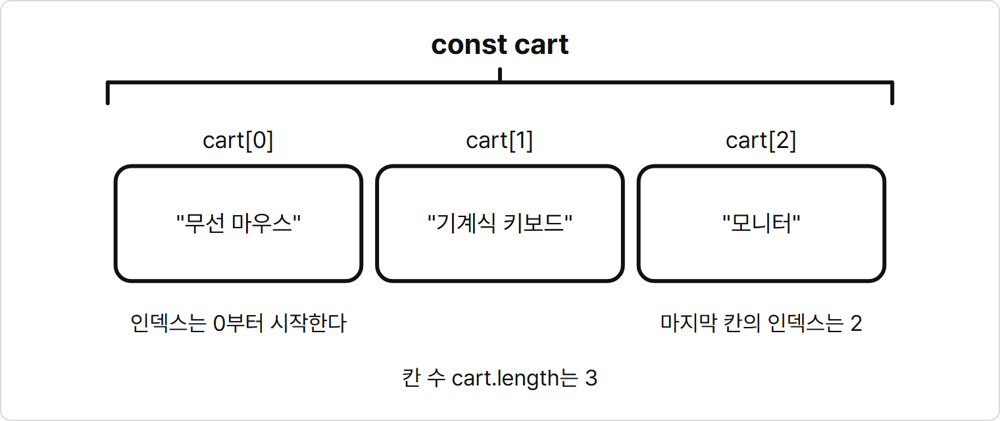
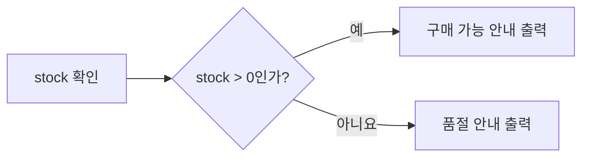
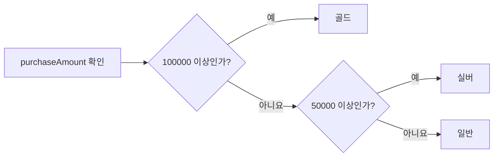
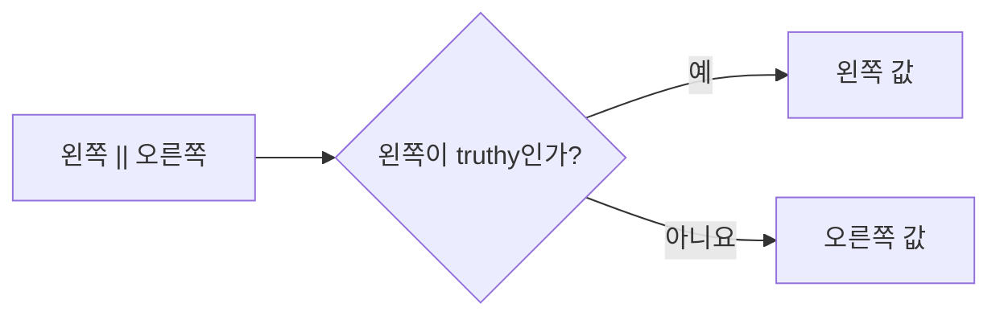
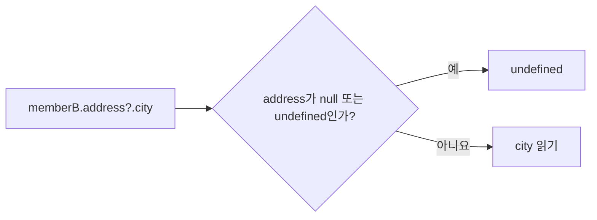

# 3장. 연산자와 조건문

**학습목표**

- 배열을 만들고 인덱스로 값을 꺼낼 수 있습니다.
- 산술·비교·논리 연산자로 값을 계산하고 조건을 만들 수 있습니다.
- `if`·`else`와 삼항 연산자로 조건에 따라 다른 코드를 실행할 수 있습니다.
- `&&`, `||`, `??`로 값을 고르고 `?.`로 없을 수도 있는 속성을 안전하게 읽을 수 있습니다.

## 3-1 객체와 배열 기초

2장에서는 객체로 한 대상의 정보를 묶었습니다.
이 장에서는 값을 계산하고 비교해서 조건에 따라 다른 일을 하게 만듭니다.
그 전에 예제에서 자주 쓸 두 가지 모양, 객체 안의 객체와 배열을 익힙니다.

이 장의 예제는 모두 `js-course/chapter03` 폴더에 만들고 node로 실행합니다.
VS Code에서 `js-course` 폴더 안에 `chapter03` 폴더를 만들고, 새 터미널을 열어 `cd chapter03`을 입력해 둡니다.

### 객체 안의 객체

속성 값 자리에는 문자열, 숫자뿐 아니라 객체도 넣을 수 있습니다.
객체 안에 들어 있는 객체를 **중첩 객체**(nested object)라고 합니다.
회원의 주소처럼 한 속성 안에 다시 여러 정보가 있을 때 씁니다.

**기본 문법**

```javascript
const 객체명 = {
  키: {
    안쪽 키: 값
  }
};

객체명.키.안쪽 키
```

**예제 3-1** `nested.js`

```javascript
const member = {
  name: "김코딩",
  address: {
    city: "서울",
    zipCode: "04524"
  }
};

console.log(member.address);
console.log(member.address.city);
console.log(`${member.name}님은 ${member.address.city}에 삽니다.`);
```

**실행 결과**

```text
{ city: '서울', zipCode: '04524' }
서울
김코딩님은 서울에 삽니다.
```

- `address` 속성의 값은 `city`와 `zipCode`를 가진 객체입니다.
- `zipCode`는 계산하지 않는 번호이고 0으로 시작하므로 따옴표로 감싸 문자열로 담았습니다.
- `member.address`는 안쪽 객체 전체를 읽습니다.
- `member.address.city`는 왼쪽부터 차례로 읽습니다. `member`에서 `address`를 꺼내고 꺼낸 객체에서 다시 `city`를 꺼냅니다.

**시각자료 — member 객체 안의 address 객체**

```text
member ─┬─ name    : "김코딩"
        └─ address ─┬─ city    : "서울"
                    └─ zipCode : "04524"
```

`member.address.city`는 `member`에서 `address`로, `address`에서 `city`로 한 칸씩 들어가 값을 꺼냅니다.

### 배열

**배열**(array)은 여러 값을 순서대로 담은 값입니다.
쉽게 말해 번호가 붙은 칸에 값을 하나씩 넣어 둔 목록입니다.
칸마다 붙은 번호를 **인덱스**(index)라고 합니다.

### 배열은 왜 필요할까?

같은 종류의 값 여러 개를 목록 하나로 묶어 순서대로 다루기 위해 필요합니다.

장바구니에 담은 상품 세 개를 `cartItem1`, `cartItem2`, `cartItem3` 세 변수에 따로 담는다고 생각해 봅시다.
상품을 하나 더 담으면 변수를 또 만들어야 하고, 지금 몇 개를 담았는지는 변수 이름을 세어 봐야 압니다.
세 변수가 한 장바구니의 목록이라는 사실도 코드에 드러나지 않습니다.

상품 이름을 `cart` 배열 하나에 담으면 `cart[0]`, `cart[1]`처럼 칸 번호로 꺼냅니다.
몇 개를 담았는지는 `cart.length`가 알려 줍니다.

**특징**

- 대괄호 `[]` 안에 값을 쉼표로 나눠 씁니다.
- 인덱스는 0부터 시작합니다. 첫 번째 값의 인덱스는 0, 세 번째 값의 인덱스는 2입니다.
- `배열명.length`는 배열에 담긴 값의 개수입니다.
- 없는 인덱스를 읽으면 `undefined`가 나옵니다.

**비교 — 객체와 배열**

| 비교 항목 | 객체 | 배열 |
|---|---|---|
| 감싸는 기호 | `{}` | `[]` |
| 값을 찾는 기준 | 키(이름) | 인덱스(순서 번호) |
| 꺼내는 모양 | `member.name` | `cart[0]` |
| 담기 좋은 것 | 한 대상의 여러 정보 | 같은 종류의 여러 값 |

배열은 칸마다 번호가 적힌 사물함과 비슷합니다.
0번 칸부터 차례로 값이 들어 있고 번호만 알면 원하는 칸을 바로 열 수 있습니다.

**시각자료 — 번호가 붙은 칸에 담긴 cart 배열**



첫 칸의 번호가 1이 아니라 0이므로, 칸이 세 개면 마지막 칸의 인덱스는 2입니다.

**기본 문법**

```javascript
const 배열명 = [값1, 값2, 값3];

배열명[인덱스]
배열명.length
```

**예제 3-2** `array.js`

```javascript
const cart = ["무선 마우스", "기계식 키보드", "모니터"];

console.log(cart);
console.log(cart[0]);
console.log(cart[2]);
console.log(cart.length);
console.log(cart[3]);
```

**실행 결과**

```text
[ '무선 마우스', '기계식 키보드', '모니터' ]
무선 마우스
모니터
3
undefined
```

- 배열에 담긴 값 하나하나를 **요소**(element)라고 합니다. `cart`에는 요소가 세 개 있습니다.
- `cart[0]`은 첫 번째 요소, `cart[2]`는 세 번째 요소를 읽습니다. 배열 이름 뒤 대괄호 안에 인덱스를 숫자로 씁니다.
- `cart.length`는 요소 개수 `3`입니다. 객체의 속성을 읽을 때처럼 점 뒤에 `length`를 씁니다.
- `cart`에는 인덱스 3인 칸이 없으므로 `cart[3]`은 `undefined`입니다.

### 객체를 담은 배열

배열의 요소로 객체를 넣을 수도 있습니다.
상품 목록처럼 같은 모양의 정보가 여러 개일 때 객체 하나에 대상 하나를 담고, 그 객체들을 배열로 묶습니다.

**예제 3-3** `object-array.js`

```javascript
const products = [
  { name: "무선 마우스", price: 12000 },
  { name: "기계식 키보드", price: 89000 }
];

console.log(products[1]);
console.log(products[1].name);
console.log(`${products[0].name}: ${products[0].price}원`);
```

**실행 결과**

```text
{ name: '기계식 키보드', price: 89000 }
기계식 키보드
무선 마우스: 12000원
```

- `products`의 요소는 `name`과 `price`를 가진 객체 두 개입니다. 요소가 길면 한 줄에 하나씩 써서 읽기 쉽게 합니다. 속성이 적은 객체는 `{ name: "무선 마우스", price: 12000 }`처럼 중괄호 안을 한 줄로 써도 됩니다.
- `products[1]`은 두 번째 요소인 객체 전체를 읽습니다.
- `products[1].name`은 왼쪽부터 차례로 읽습니다. 두 번째 객체를 꺼낸 뒤 그 객체의 `name`을 읽습니다.

**시각자료 — products[1].name을 읽는 순서**

```text
products[1]       ─▶ { name: "기계식 키보드", price: 89000 }
products[1].name  ─▶ "기계식 키보드"
```

인덱스로 객체를 먼저 꺼내고, 꺼낸 객체에서 점 표기법으로 속성을 읽습니다.

## 3-2 산술·비교·논리 연산자

2장에서 연산자는 값을 받아 처리하고 결과를 내는 기호나 단어라고 했습니다.
이번에는 계산하고, 비교하고, 조건을 묶는 연산자를 차례로 배웁니다.

### 산술 연산자

**산술 연산자**(arithmetic operator)는 숫자를 계산하는 연산자입니다.

| 연산자 | 뜻 | 예 | 결과 |
|---|---|---|---|
| `+` | 더하기 | `12000 + 1` | `12001` |
| `-` | 빼기 | `12000 - 2000` | `10000` |
| `*` | 곱하기 | `12000 * 3` | `36000` |
| `/` | 나누기 | `12000 / 4` | `3000` |
| `%` | 나머지 | `20 % 6` | `2` |

**특징**

- 곱하기, 나누기, 나머지를 더하기, 빼기보다 먼저 계산합니다.
- 괄호 `()`로 감싼 부분을 가장 먼저 계산합니다.
- 계산 결과는 `number`입니다.

**기본 문법**

```javascript
값1 연산자 값2
```

**예제 3-4** `arithmetic.js`

```javascript
const price = 12000;
const quantity = 3;
const discount = 2000;

console.log(price * quantity);
console.log(price * quantity - discount);
console.log((price - discount) * quantity);
console.log(price / 4);
console.log(20 % 6);
```

**실행 결과**

```text
36000
34000
30000
3000
2
```

- `price * quantity - discount`는 곱하기를 먼저 해서 `36000`을 만든 뒤 `2000`을 뺍니다. 주문 금액에서 할인을 한 번 빼는 계산입니다.
- `(price - discount) * quantity`는 괄호 안을 먼저 계산해 `10000`을 만든 뒤 `3`을 곱합니다. 상품마다 할인한 가격으로 세 개를 사는 계산입니다.
- `20 % 6`은 20을 6으로 나눈 나머지 `2`입니다. 사과 20개를 6개씩 상자에 담으면 2개가 남는다는 뜻입니다.

### 문자열 연결

`+`는 숫자에서는 더하기지만 양쪽 가운데 하나라도 문자열이면 두 값을 이어 붙입니다.
문자열을 이어 붙이는 것을 **문자열 연결**(string concatenation)이라고 합니다.
2장에서 가격을 `"12000"`처럼 글자로 저장하면 더하기 대신 이어 붙인 결과가 나온다고 한 것이 이 동작입니다.

**예제 3-5** `concat.js`

```javascript
const brand = "코딩전자";
const productName = "무선 마우스";
const price = 12000;

console.log(brand + " " + productName);
console.log(productName + "의 가격은 " + price + "원입니다.");
console.log("12000" + 1);
console.log(12000 + 1);
```

**실행 결과**

```text
코딩전자 무선 마우스
무선 마우스의 가격은 12000원입니다.
120001
12001
```

- `brand + " " + productName`은 두 문자열 사이에 빈칸 문자열 `" "`을 끼워 이어 붙입니다.
- `productName + "의 가격은 " + price + "원입니다."`에서 숫자 `price`도 문자열 옆에 있으므로 글자로 바뀌어 이어 붙습니다.
- `"12000" + 1`은 왼쪽이 문자열이라 `120001`, `12000 + 1`은 둘 다 숫자라 `12001`입니다.
- 값이 여럿이면 `+`를 여러 번 써야 하므로, 2장의 템플릿 리터럴이 더 읽기 쉽습니다. 이 책의 예제는 문장을 만들 때 템플릿 리터럴을 씁니다.

### 증가 연산자 ++

`++`는 변수의 값을 1 늘리는 **증가 연산자**(increment operator)입니다.
`visitorCount++;`는 `visitorCount = visitorCount + 1;`과 같은 일을 합니다.

**특징**

- 변수 이름 뒤에 `++`를 붙입니다.
- 값을 다시 할당하는 일이므로 `let`으로 선언한 변수에만 씁니다.
- 반대로 1을 줄일 때는 `--`를 씁니다.

**기본 문법**

```javascript
변수명++;
변수명--;
```

**예제 3-6** `increment.js`

```javascript
let visitorCount = 0;

visitorCount++;
console.log("방문자 수:", visitorCount);

visitorCount++;
console.log("방문자 수:", visitorCount);
```

**실행 결과**

```text
방문자 수: 1
방문자 수: 2
```

- `visitorCount++;`를 실행할 때마다 `visitorCount`가 1씩 늘어납니다.
- 2장 예제 2-3에서 `visitorCount = 1;`로 직접 넣던 값을 `++`로 하나씩 늘린 것입니다.

### 비교 연산자

**비교 연산자**(comparison operator)는 두 값을 비교해 `true`나 `false`를 돌려주는 연산자입니다.

| 연산자 | 뜻 | 예 | 결과 |
|---|---|---|---|
| `>` | 크다 | `12000 > 10000` | `true` |
| `<` | 작다 | `12000 < 10000` | `false` |
| `>=` | 크거나 같다 | `12000 >= 12000` | `true` |
| `<=` | 작거나 같다 | `12000 <= 10000` | `false` |
| `===` | 같다 | `12000 === 12000` | `true` |
| `!==` | 같지 않다 | `12000 !== 12000` | `false` |

**예제 3-7** `compare.js`

```javascript
const price = 12000;
const budget = 10000;

console.log(price > budget);
console.log(price <= budget);
console.log(price === 12000);
console.log(price !== 12000);
```

**실행 결과**

```text
true
false
true
false
```

- `price > budget`은 가격이 예산보다 크므로 `true`입니다.
- `price === 12000`은 가격이 12000과 같으므로 `true`, `price !== 12000`은 그 반대인 `false`입니다.
- 비교 연산자의 결과는 언제나 `boolean`입니다.
- 같은지 비교할 때는 `=`를 세 번 씁니다. `=` 하나는 2장에서 배운 할당입니다.

### ==와 ===

같은지 비교하는 연산자에는 `===` 말고 `==`도 있습니다.
`==`는 자료형이 다르면 같은 자료형으로 바꾼 뒤 비교하고, `===`는 자료형까지 같아야 `true`를 돌려줍니다.

**비교 — ==와 ===**

| 비교 항목 | `==` | `===` |
|---|---|---|
| 자료형이 다를 때 | 자료형을 바꾼 뒤 값만 비교한다 | 바로 `false`다 |
| `12000`과 `"12000"` | `true` | `false` |
| 이 책에서 | 쓰지 않는다 | 같은지 비교할 때 쓴다 |

**예제 3-8** `strict-equal.js`

```javascript
const price = 12000;
const priceText = "12000";
const deliveryMemo = null;

console.log(price == priceText);
console.log(price === priceText);
console.log(deliveryMemo === null);
```

**실행 결과**

```text
true
false
true
```

- `price == priceText`는 문자열 `"12000"`을 숫자로 바꿔 비교하므로 `true`입니다.
- `price === priceText`는 `number`와 `string`으로 자료형이 다르므로 `false`입니다.
- 숫자와 문자열을 같다고 보면 계산할 값과 글자를 구분하지 못합니다. 그래서 같은지 비교할 때는 언제나 `===`와 `!==`를 씁니다.
- 2장에서 `typeof`로는 `null`을 가려낼 수 없다고 했습니다. 값이 `null`인지는 `deliveryMemo === null`처럼 `===`로 확인합니다.

### 논리 연산자

**논리 연산자**(logical operator)는 `true`와 `false`를 묶거나 뒤집는 연산자입니다.
"나이가 19세 이상이고 회원이다"처럼 조건 두 개를 하나로 묶을 때 씁니다.

| 연산자 | 읽는 법 | 결과가 `true`인 때 |
|---|---|---|
| `&&` | 그리고 | 양쪽이 모두 `true`일 때 |
| `\|\|` | 또는 | 한쪽이라도 `true`일 때 |
| `!` | 아니다 | 뒤의 값이 `false`일 때 |

**기본 문법**

```javascript
조건1 && 조건2
조건1 || 조건2
!조건
```

**예제 3-9** `logical.js`

```javascript
const age = 26;
const isMember = true;
const hasCoupon = false;

console.log(age >= 19 && isMember);
console.log(isMember && hasCoupon);
console.log(isMember || hasCoupon);
console.log(!hasCoupon);
```

**실행 결과**

```text
true
false
true
true
```

- `age >= 19 && isMember`는 먼저 `age >= 19`를 계산해 `true`를 만들고, `isMember`도 `true`이므로 `true`입니다.
- `isMember && hasCoupon`은 `hasCoupon`이 `false`라서 `false`입니다. `&&`는 한쪽이라도 `false`면 `false`입니다.
- `isMember || hasCoupon`은 `isMember`가 `true`이므로 `true`입니다.
- `!hasCoupon`은 `false`를 뒤집은 `true`입니다. 느낌표는 값 바로 앞에 붙여 씁니다.

**시각자료 — 두 조건을 묶은 결과**

| 왼쪽 | 오른쪽 | `&&` 결과 | `\|\|` 결과 |
|---|---|---|---|
| `true` | `true` | `true` | `true` |
| `true` | `false` | `false` | `true` |
| `false` | `true` | `false` | `true` |
| `false` | `false` | `false` | `false` |

`&&`는 맨 윗줄에서만 `true`이고, `||`는 맨 아랫줄에서만 `false`입니다.

## 3-3 if·else와 삼항 연산자

비교 연산자와 논리 연산자로 `true`나 `false`를 만들 수 있게 되었습니다.
이 값으로 실행할 코드를 고르는 방법을 배웁니다.

### 조건문

**조건문**(conditional statement)은 조건이 `true`인지 `false`인지에 따라 실행할 코드를 고르는 문장입니다.
쉽게 말해 "이러면 이렇게 하고, 아니면 저렇게 한다"를 코드로 쓰는 방법입니다.

### 조건문은 왜 필요할까?

상황에 따라 다른 일을 하는 프로그램을 만들기 위해 필요합니다.

상품의 재고를 확인해 안내 문구를 출력한다고 생각해 봅시다.
1장에서 본 것처럼 문장은 위에서 아래로 모두 실행되므로, `"품절입니다."`를 출력하는 줄을 쓰면 재고가 남아 있어도 그 줄이 실행됩니다.
재고가 0일 때만 이 문구를 출력할 방법이 필요합니다.

조건문을 쓰면 `stock === 0`이 `true`일 때만 `"품절입니다."`를 출력하게 할 수 있습니다.
재고가 남아 있으면 그 줄을 건너뜁니다.

조건문은 갈림길에 빗댈 수 있습니다.
갈림길 앞에서 신호를 확인하고, 그 결과에 따라 두 길 가운데 하나로 갑니다.

**시각자료 — 신호를 보고 길을 고르는 갈림길**

```text
[생성 이미지: images/03/condition-fork.png]
장면: 한 사람이 Y자 갈림길 앞에 서서 갈림길 가운데에 선 신호등을 본다. 신호등은 위쪽 등 하나만 켜져 있다. 왼쪽 길 끝에는 문이 열린 가게가 있고, 오른쪽 길 끝에는 셔터가 내려간 가게가 있다.
비율: 가로 3:2
스타일: 굵기가 일정한 검정 외곽선의 단순한 선 그림. 흰 배경. 그림자와 그라데이션 없음. 채움 색은 초록(신호등의 켜진 등) 한 가지. 글자, 숫자, 기호는 넣지 않는다.
참고 그림: book-manuscript/assets/style-ref/line-art-shark.png
```

신호등이 `stock === 0` 같은 조건입니다.
조건이 `true`인지 `false`인지에 따라 두 길 가운데 한 길의 코드만 실행합니다.

### if

`if`는 조건이 `true`일 때만 중괄호 안의 코드를 실행합니다.

**특징**

- `if` 뒤 괄호 안에 조건을 씁니다.
- 조건이 `true`면 중괄호 안의 코드를 실행하고, `false`면 건너뜁니다.
- 중괄호로 묶은 코드 덩어리를 **블록**(block)이라고 합니다. 블록 안의 줄은 2칸 들여씁니다.
- 블록을 닫는 중괄호 뒤에는 세미콜론을 붙이지 않습니다.

**기본 문법**

```javascript
if (조건) {
  조건이 true일 때 실행할 코드
}
```

**예제 3-10** `if.js`

```javascript
const stock = 0;

if (stock === 0) {
  console.log("품절입니다.");
}

console.log("상품 확인을 마쳤습니다.");
```

**실행 결과**

```text
품절입니다.
상품 확인을 마쳤습니다.
```

- `stock === 0`이 `true`이므로 블록 안의 `console.log("품절입니다.");`가 실행됩니다.
- `console.log("상품 확인을 마쳤습니다.");`는 블록 밖에 있으므로 조건과 상관없이 실행됩니다.

예제 3-10의 `const stock = 0;` 줄을 다음처럼 바꾸면 조건이 `false`가 되어 `상품 확인을 마쳤습니다.` 한 줄만 출력됩니다.

```javascript
const stock = 3;
```

### if·else

`else`는 `if`의 조건이 `false`일 때 실행할 블록을 붙입니다.
두 블록 가운데 하나만 실행됩니다.

**기본 문법**

```javascript
if (조건) {
  조건이 true일 때 실행할 코드
} else {
  조건이 false일 때 실행할 코드
}
```

**예제 3-11** `if-else.js`

```javascript
const stock = 5;

if (stock > 0) {
  console.log(`구매할 수 있습니다. 남은 수량: ${stock}개`);
} else {
  console.log("품절입니다.");
}
```

**실행 결과**

```text
구매할 수 있습니다. 남은 수량: 5개
```

- `stock > 0`이 `true`이므로 `if` 블록만 실행되고 `else` 블록은 건너뜁니다.
- `const stock = 5;`를 `const stock = 0;`으로 바꾸면 조건이 `false`가 되어 `품절입니다.`만 출력됩니다.

**시각자료 — 재고에 따라 고르는 블록**



조건 하나로 두 갈래 가운데 한 갈래만 실행합니다.

### else if

갈래가 셋 이상이면 `else if`로 조건을 더 붙입니다.
조건을 위에서부터 차례로 확인하고, 처음으로 `true`가 된 블록 하나만 실행합니다.

**기본 문법**

```javascript
if (조건1) {
  조건1이 true일 때 실행할 코드
} else if (조건2) {
  조건1은 false이고 조건2가 true일 때 실행할 코드
} else {
  모든 조건이 false일 때 실행할 코드
}
```

**예제 3-12** `else-if.js`

```javascript
const purchaseAmount = 72000;
let grade;

if (purchaseAmount >= 100000) {
  grade = "골드";
} else if (purchaseAmount >= 50000) {
  grade = "실버";
} else {
  grade = "일반";
}

console.log(`구매 금액 ${purchaseAmount}원, 등급: ${grade}`);
```

**실행 결과**

```text
구매 금액 72000원, 등급: 실버
```

- `let grade;`로 값 없이 선언해 두고, 실행된 블록에서 등급을 할당합니다. 블록마다 다른 값을 넣으므로 `let`으로 선언했습니다.
- `purchaseAmount >= 100000`은 `false`이므로 다음 조건으로 넘어갑니다.
- `purchaseAmount >= 50000`은 `true`이므로 `grade`에 `"실버"`를 할당하고, 남은 `else`는 확인하지 않습니다.
- 두 번째 조건에 "100000 미만"을 따로 쓰지 않아도 됩니다. 첫 번째 조건이 `false`일 때만 두 번째 조건까지 오기 때문입니다.

**시각자료 — 구매 금액으로 등급 고르기**



위의 조건부터 확인하고 `true`가 나온 곳에서 등급을 정하고 끝납니다.
`72000`은 첫 조건에서 아니요, 두 번째 조건에서 예로 가서 `실버`가 됩니다.

### 삼항 연산자

**삼항 연산자**(ternary operator)는 조건에 따라 두 값 가운데 하나를 고르는 연산자입니다.
조건, `true`일 때의 값, `false`일 때의 값 세 가지를 받아서 삼항이라고 부릅니다.

**특징**

- 조건 뒤에 `?`를 쓰고 `true`일 때의 값과 `false`일 때의 값을 `:`로 나눕니다.
- 결과가 값이므로 변수에 할당하거나 템플릿 리터럴의 `${}` 안에 바로 쓸 수 있습니다.

**비교 — if·else와 삼항 연산자**

| 비교 항목 | if·else | 삼항 연산자 |
|---|---|---|
| 고르는 것 | 실행할 코드 블록 | 두 값 가운데 하나 |
| 결과 | 남는 값이 없다 | 고른 값 하나가 남는다 |
| 쓰는 곳 | 여러 줄을 실행할 때 | 변수에 넣을 값을 고를 때 |

**기본 문법**

```javascript
조건 ? true일 때의 값 : false일 때의 값
```

**예제 3-13** `ternary.js`

```javascript
const stock = 0;

const stockText = stock > 0 ? "구매 가능" : "품절";

console.log(`무선 마우스: ${stockText}`);
```

**실행 결과**

```text
무선 마우스: 품절
```

- `stock > 0`이 `false`이므로 `:` 뒤의 `"품절"`이 `stockText`에 할당됩니다.
- 같은 일을 `if`·`else`로 쓰면 `let stockText;`를 선언하고 블록 두 개에서 각각 할당해야 합니다. 값 하나를 고를 때는 삼항 연산자가 짧습니다.

예제 3-13에서 `stockText` 변수 없이 `${}` 안에 삼항 연산자를 바로 써도 같은 결과가 나옵니다.

```javascript
console.log(`무선 마우스: ${stock > 0 ? "구매 가능" : "품절"}`);
```

## 따라하기 실습 — 점수로 학점 매기기

**실습 목표**

- 배열에 담긴 점수로 총점과 평균을 계산합니다.
- `if`·`else if`·`else`로 평균에 맞는 학점을 정합니다.
- 삼항 연산자로 통과 여부를 고릅니다.

학점은 평균 점수로 다음처럼 정합니다.
평균이 60점 이상이면 통과, 60점 미만이면 재수강입니다.

| 평균 | 학점 |
|---|---|
| 90점 이상 | A |
| 80점 이상 90점 미만 | B |
| 70점 이상 80점 미만 | C |
| 60점 이상 70점 미만 | D |
| 60점 미만 | F |

**준비**

1. `chapter03` 폴더 안에 `grade.js` 파일을 만듭니다.
2. 터미널의 현재 위치가 `chapter03`인지 확인합니다.

**실습 코드**

`chapter03/grade.js`

```javascript
const student = {
  name: "김코딩",
  scores: [92, 85, 78]
};

const total = student.scores[0] + student.scores[1] + student.scores[2];
const average = total / student.scores.length;

let grade;

if (average >= 90) {
  grade = "A";
} else if (average >= 80) {
  grade = "B";
} else if (average >= 70) {
  grade = "C";
} else if (average >= 60) {
  grade = "D";
} else {
  grade = "F";
}

const result = average >= 60 ? "통과" : "재수강";

console.log(`${student.name}님의 총점은 ${total}점, 평균은 ${average}점입니다.`);
console.log(`학점: ${grade} (${result})`);
```

**실행 방법**

1. 코드를 입력하고 저장합니다.
2. 터미널에서 다음 명령을 입력합니다.
   ```bash
   node grade.js
   ```

**실행 결과**

```text
김코딩님의 총점은 255점, 평균은 85점입니다.
학점: B (통과)
```

**코드 설명**

- `scores` 속성은 과목 점수 세 개를 담은 배열입니다. `student.scores[0]`처럼 객체의 속성을 읽은 뒤 인덱스로 점수를 꺼냅니다.
- `total`은 세 점수를 더한 `255`입니다.
- `total / student.scores.length`는 총점을 점수 개수 `3`으로 나눈 평균 `85`입니다. 개수를 숫자로 직접 쓰지 않고 `length`로 읽었습니다.
- `average >= 90`은 `false`, `average >= 80`은 `true`이므로 `grade`에 `"B"`가 들어가고 아래 조건은 확인하지 않습니다.
- `average >= 60`이 `true`이므로 `result`는 `"통과"`입니다.
- 학점은 갈래가 다섯이라 `if`·`else if`로, 통과 여부는 두 값 가운데 하나라 삼항 연산자로 정했습니다.

**바꿔 보기 1**

점수를 바꿔 A 학점이 나오게 해 봅니다.
`scores: [92, 85, 78]` 줄을 다음처럼 바꿉니다.

```javascript
scores: [95, 98, 92]
```

총점 `285`점, 평균 `95`점으로 바뀌고 `학점: A (통과)`가 출력됩니다.

**바꿔 보기 2**

평균이 60점보다 낮은 점수로 바꿔 봅니다.
`scores: [92, 85, 78]` 줄을 다음처럼 바꿉니다.

```javascript
scores: [55, 62, 48]
```

총점 `165`점, 평균 `55`점으로 바뀌고 `학점: F (재수강)`이 출력됩니다.
모든 조건이 `false`라서 마지막 `else` 블록이 실행되었습니다.

## 3-4 truthy·falsy와 단축 평가

지금까지 `if`의 괄호에는 `stock === 0`처럼 `true`나 `false`가 나오는 조건을 넣었습니다.
괄호에 `boolean`이 아닌 값을 넣으면 JavaScript는 그 값을 `true`나 `false`처럼 다룹니다.

### truthy와 falsy

**truthy**는 조건 자리에서 `true`처럼 다뤄지는 값이고, **falsy**는 `false`처럼 다뤄지는 값입니다.
쉽게 말해 JavaScript가 "값이 있다"고 보면 truthy, "비었다"고 보면 falsy입니다.

자주 만나는 falsy 값은 다음 다섯 가지입니다.
지금까지 배운 값 가운데 이 다섯을 뺀 나머지는 모두 truthy입니다.

| falsy 값 | 자료형 |
|---|---|
| `false` | `boolean` |
| `0` | `number` |
| `""` (빈 문자열) | `string` |
| `null` | `null` |
| `undefined` | `undefined` |

**특징**

- falsy 값을 `if`의 조건에 넣으면 `false`일 때처럼 블록을 건너뜁니다.
- `"0"`, `" "`처럼 글자가 하나라도 들어 있는 문자열은 truthy입니다.
- 비어 있는 배열 `[]`과 비어 있는 객체 `{}`도 truthy입니다.

**기본 문법**

```javascript
if (값) {
  값이 truthy일 때 실행할 코드
}
```

**예제 3-14** `truthy.js`

```javascript
const nickname = "";
const cartCount = 3;

if (nickname) {
  console.log(`${nickname}님, 환영합니다.`);
} else {
  console.log("닉네임을 정해 주세요.");
}

if (cartCount) {
  console.log(`장바구니에 상품이 ${cartCount}개 있습니다.`);
}
```

**실행 결과**

```text
닉네임을 정해 주세요.
장바구니에 상품이 3개 있습니다.
```

- `nickname`은 빈 문자열이라 falsy입니다. 그래서 `else` 블록이 실행됩니다.
- `cartCount`는 `3`이라 truthy입니다. `if (cartCount)`는 "장바구니 개수가 0이 아니면"이라는 뜻으로 읽힙니다.
- `const nickname = "";`을 `const nickname = "코딩왕";`으로 바꾸면 `코딩왕님, 환영합니다.`가 출력됩니다.

### 단축 평가

3-2에서 `&&`와 `||`는 `true`와 `false`를 묶었습니다.
사실 두 연산자는 `true`나 `false`를 새로 만들지 않고, 왼쪽 값과 오른쪽 값 가운데 하나를 그대로 돌려줍니다.
예제 3-9의 결과가 `true`나 `false`였던 것은 양쪽 값이 모두 `boolean`이었기 때문입니다.

**단축 평가**(short-circuit evaluation)는 왼쪽 값만 보고 결과가 정해지면 오른쪽은 확인하지 않고 끝내는 계산 방식입니다.
`&&`와 `||`는 왼쪽 값이 truthy인지 falsy인지를 보고 어느 쪽 값을 돌려줄지 바로 정합니다.

### ||로 기본값 고르기

`왼쪽 || 오른쪽`은 왼쪽이 truthy면 왼쪽 값을, falsy면 오른쪽 값을 돌려줍니다.
값이 비어 있을 때 대신 쓸 **기본값**(default value)을 정할 때 씁니다.

**기본 문법**

```javascript
값 || 기본값
```

**예제 3-15** `or-default.js`

```javascript
const nickname = "";
const savedNickname = "코딩왕";

const displayName = nickname || "손님";
const savedName = savedNickname || "손님";

console.log(displayName);
console.log(savedName);
```

**실행 결과**

```text
손님
코딩왕
```

- `nickname`은 빈 문자열이라 falsy이므로 `nickname || "손님"`은 오른쪽 값 `"손님"`입니다.
- `savedNickname`은 truthy이므로 `savedNickname || "손님"`은 왼쪽 값 `"코딩왕"`입니다. 오른쪽 `"손님"`은 확인하지도 않습니다.

**시각자료 — ||가 값을 고르는 순서**



왼쪽 값이 있으면 그 값을 쓰고 비어 있을 때만 오른쪽 기본값을 씁니다.

### &&로 조건이 맞을 때만 값 쓰기

`왼쪽 && 오른쪽`은 왼쪽이 falsy면 왼쪽 값을, truthy면 오른쪽 값을 돌려줍니다.
조건이 맞을 때만 어떤 값을 쓰고, 맞지 않으면 아무것도 쓰지 않을 때 씁니다.

**기본 문법**

```javascript
조건 && 값
```

**예제 3-16** `and-value.js`

```javascript
const isAdmin = true;
const isGuest = false;

console.log(isAdmin && "관리자 메뉴");
console.log(isGuest && "가입 안내");
```

**실행 결과**

```text
관리자 메뉴
false
```

- `isAdmin`이 truthy이므로 `isAdmin && "관리자 메뉴"`는 오른쪽 값 `"관리자 메뉴"`입니다.
- `isGuest`가 falsy이므로 `isGuest && "가입 안내"`는 오른쪽을 보지 않고 왼쪽 값 `false`를 그대로 돌려줍니다.
- 화면에 보일 내용을 조건에 따라 넣거나 뺄 때 이 모양을 자주 씁니다.

**비교 — &&와 ||**

| 비교 항목 | `&&` | `\|\|` |
|---|---|---|
| 왼쪽이 truthy일 때 | 오른쪽 값 | 왼쪽 값 |
| 왼쪽이 falsy일 때 | 왼쪽 값 | 오른쪽 값 |
| 쓰는 곳 | 조건이 맞을 때만 값 쓰기 | 값이 비었을 때 기본값 쓰기 |

### ??로 기본값 고르기

`??`는 왼쪽 값이 `null`이나 `undefined`일 때만 오른쪽 값을 돌려주는 연산자입니다.
**널 병합 연산자**(nullish coalescing operator)라고 부릅니다.
`||`는 `0`과 빈 문자열도 비었다고 보지만, `??`는 `0`과 빈 문자열을 값으로 남깁니다.

**기본 문법**

```javascript
값 ?? 기본값
```

**예제 3-17** `nullish.js`

```javascript
const stock = 0;
const deliveryMemo = null;

console.log(stock || "재고 정보 없음");
console.log(stock ?? "재고 정보 없음");
console.log(deliveryMemo ?? "배송 메모 없음");
```

**실행 결과**

```text
재고 정보 없음
0
배송 메모 없음
```

- `stock || "재고 정보 없음"`은 `0`을 falsy로 보고 오른쪽 값을 돌려줍니다.
- `stock ?? "재고 정보 없음"`은 `0`이 `null`도 `undefined`도 아니므로 왼쪽 값 `0`을 그대로 돌려줍니다.
- 재고 0개도 확인한 정보이므로, 0을 값으로 살리려면 `??`를 씁니다.
- `deliveryMemo`는 `null`이므로 `??`가 오른쪽 기본값을 돌려줍니다.

**비교 — ||와 ??**

| 비교 항목 | `\|\|` | `??` |
|---|---|---|
| 기본값을 쓰는 때 | 왼쪽이 falsy | 왼쪽이 `null`이나 `undefined` |
| 왼쪽이 `0`이나 `""`이면 | 기본값 | 왼쪽 값 그대로 |
| 쓰는 곳 | 빈 문자열도 기본값으로 바꿀 때 | `0`, `""`을 값으로 살릴 때 |

## 3-5 옵셔널 체이닝

3-1에서는 `member.address.city`처럼 객체 안의 객체를 읽었습니다.
그런데 회원마다 주소를 등록했을 수도 있고 안 했을 수도 있습니다.

### 옵셔널 체이닝

**옵셔널 체이닝**(optional chaining)은 `?.` 앞의 값이 `null`이나 `undefined`이면 뒤를 읽지 않고 `undefined`를 돌려주는 문법입니다.
쉽게 말해 앞의 값이 있으면 읽고, 없으면 거기서 멈춥니다.

### 옵셔널 체이닝은 왜 필요할까?

없을 수도 있는 객체 안의 속성을 읽다가 프로그램이 멈추지 않게 하기 위해 필요합니다.

주소가 없는 회원 `memberB`의 `memberB.address.city`를 읽는다고 생각해 봅시다.
2장에서 본 것처럼 없는 속성 `memberB.address`는 `undefined`입니다.
`undefined`에는 속성이 없으므로, 거기서 `city`를 읽으려 하면 JavaScript는 에러를 내고 그 줄에서 프로그램을 멈춥니다.

`memberB.address?.city`처럼 쓰면 `address`가 `undefined`일 때 `city`를 읽지 않고 `undefined`를 돌려줍니다.
프로그램은 멈추지 않고 다음 줄로 넘어갑니다.

### 없는 속성 안을 읽을 때 나는 에러

`?.` 없이 읽으면 어떤 일이 생기는지 먼저 실행해 봅니다.
다음 예제는 확인을 위해 일부러 에러를 냅니다.

**예제 3-18** `optional-error.js`

```javascript
const memberB = {
  name: "이자바"
};

console.log(memberB.address);
console.log(memberB.address.city);
console.log("회원 정보 확인을 마쳤습니다.");
```

**실행 결과**

```text
undefined
...\js-course\chapter03\optional-error.js:6
console.log(memberB.address.city);
                            ^

TypeError: Cannot read properties of undefined (reading 'city')
```

에러 줄 아래에는 `at`으로 시작하는 줄이 여러 개 더 나오고, 맨 앞의 폴더 경로는 컴퓨터마다 다릅니다.
여기서는 에러를 읽는 데 필요한 줄만 실었습니다.

- 첫 줄 `undefined`는 `console.log(memberB.address);`의 결과입니다. 없는 속성이라 `undefined`입니다.
- `optional-error.js:6`은 파일의 6번째 줄에서 에러가 났다는 뜻입니다. 그 아래 줄에 해당 코드가 나오고, `^` 표시가 `city`를 읽으려던 자리를 가리킵니다.
- `TypeError`는 값의 종류에 맞지 않는 일을 하려 할 때 나는 에러입니다. 메시지 `Cannot read properties of undefined (reading 'city')`는 "`undefined`에서 `city` 속성을 읽을 수 없다"는 뜻입니다.
- 에러가 난 줄에서 프로그램이 멈췄으므로 마지막 줄 `회원 정보 확인을 마쳤습니다.`는 출력되지 않습니다.

### ?.로 에러 막기

예제 3-18의 `memberB.address.city`에서 점 하나를 `?.`로 바꾸면 에러 없이 끝까지 실행됩니다.

**특징**

- `?.` 앞의 값이 `null`이나 `undefined`면 결과는 `undefined`입니다.
- `?.` 앞의 값이 있으면 점 표기법과 똑같이 속성을 읽습니다.
- 배열의 요소를 읽을 때도 `배열명[인덱스]?.키`처럼 씁니다.

**기본 문법**

```javascript
객체명.키?.안쪽 키
배열명[인덱스]?.키
```

**예제 3-19** `optional.js`

```javascript
const memberA = {
  name: "김코딩",
  address: {
    city: "서울"
  }
};

const memberB = {
  name: "이자바"
};

console.log(memberA.address?.city);
console.log(memberB.address?.city);
console.log("회원 정보 확인을 마쳤습니다.");
```

**실행 결과**

```text
서울
undefined
회원 정보 확인을 마쳤습니다.
```

- `memberA.address`는 객체가 있으므로 `?.` 뒤의 `city`를 읽어 `서울`을 출력합니다.
- `memberB.address`는 `undefined`이므로 `city`를 읽지 않고 `undefined`를 출력합니다.
- 예제 3-18에서는 출력되지 않던 마지막 줄 `회원 정보 확인을 마쳤습니다.`가 이번에는 출력됩니다. 프로그램이 멈추지 않았습니다.

**시각자료 — ?.가 속성을 읽는 순서**



`?.`는 바로 앞의 값만 확인합니다.
앞의 값이 비어 있으면 뒤를 읽지 않고 `undefined`로 끝냅니다.

### 옵셔널 체이닝과 ??

`?.`의 결과가 `undefined`일 때 그대로 출력하면 읽는 사람이 무슨 뜻인지 알기 어렵습니다.
3-4의 `??`를 이어 붙이면 값이 없을 때 보여 줄 기본값을 정할 수 있습니다.

**기본 문법**

```javascript
객체명.키?.안쪽 키 ?? 기본값
```

**예제 3-20** `optional-default.js`

```javascript
const member = {
  name: "이자바"
};
const orders = [];

const city = member.address?.city ?? "주소 미등록";
const firstOrder = orders[0]?.productName ?? "주문 내역 없음";

console.log(`${member.name}: ${city}`);
console.log(`첫 주문: ${firstOrder}`);
```

**실행 결과**

```text
이자바: 주소 미등록
첫 주문: 주문 내역 없음
```

- `member.address?.city`는 `undefined`이므로 `??`가 기본값 `"주소 미등록"`을 돌려줍니다.
- `const orders = [];`는 요소가 하나도 없는 빈 배열입니다. `orders[0]`은 없는 칸이라 `undefined`입니다.
- `orders[0]?.productName`은 `undefined`에서 멈추고, `??`가 `"주문 내역 없음"`을 돌려줍니다.
- 주소나 주문이 있으면 `?.`가 실제 값을 읽고, `??`는 그 값을 그대로 돌려줍니다.

## 따라하기 실습 — 주문 요약 출력하기

**실습 목표**

- 객체와 배열이 섞인 주문 정보에서 필요한 값을 꺼냅니다.
- `||`, `?.`, `??`로 비어 있을 수 있는 값을 기본값으로 바꿉니다.
- 산술 연산자와 삼항 연산자로 결제 금액과 배송비를 정합니다.

배송비는 상품 금액이 30000원 이상이면 무료, 그보다 적으면 3000원입니다.

**준비**

1. `chapter03` 폴더 안에 `order.js` 파일을 만듭니다.
2. 터미널의 현재 위치가 `chapter03`인지 확인합니다.

**실습 코드**

`chapter03/order.js`

```javascript
const order = {
  id: "A1024",
  customer: {
    name: "김코딩",
    nickname: ""
  },
  items: [
    { name: "무선 마우스", price: 12000 },
    { name: "마우스 패드", price: 5000 }
  ],
  coupon: null
};

const displayName = order.customer.nickname || order.customer.name;
const firstItemName = order.items[0]?.name ?? "상품 없음";
const couponName = order.coupon?.name ?? "적용 안 함";
const discount = order.coupon?.amount ?? 0;

const totalPrice = order.items[0].price + order.items[1].price - discount;
const shippingFee = totalPrice >= 30000 ? 0 : 3000;

console.log(`${displayName}님의 주문(${order.id})`);
console.log(`대표 상품: ${firstItemName} 외 ${order.items.length - 1}개`);
console.log(`쿠폰: ${couponName}`);
console.log(`상품 금액: ${totalPrice}원, 배송비: ${shippingFee}원`);
console.log(`결제 금액: ${totalPrice + shippingFee}원`);
```

**실행 방법**

1. 코드를 입력하고 저장합니다.
2. 터미널에서 다음 명령을 입력합니다.
   ```bash
   node order.js
   ```

**실행 결과**

```text
김코딩님의 주문(A1024)
대표 상품: 무선 마우스 외 1개
쿠폰: 적용 안 함
상품 금액: 17000원, 배송비: 3000원
결제 금액: 20000원
```

**코드 설명**

- `order`는 중첩 객체 `customer`, 객체를 담은 배열 `items`, 쿠폰이 없다는 뜻의 `null`을 함께 가진 객체입니다.
- `nickname`이 빈 문자열이라 falsy이므로, `displayName`에는 `||` 오른쪽의 `order.customer.name` 값 `"김코딩"`이 들어갑니다.
- `order.items[0]?.name`은 첫 상품이 있으므로 `"무선 마우스"`를 읽습니다. 상품이 하나도 없으면 `??`가 `"상품 없음"`을 돌려줍니다.
- `order.coupon`이 `null`이므로 `order.coupon?.name`과 `order.coupon?.amount`는 둘 다 `undefined`입니다. `??`가 각각 `"적용 안 함"`과 `0`을 돌려줍니다.
- 할인 금액의 기본값을 `0`으로 정했기 때문에 `- discount` 계산이 그대로 동작합니다.
- `totalPrice >= 30000`이 `false`이므로 `shippingFee`는 `3000`입니다.
- `${order.items.length - 1}`처럼 `${}` 안에서 계산도 할 수 있습니다. 상품 두 개 가운데 대표 상품을 뺀 `1`이 들어갑니다.

**바꿔 보기 1**

쿠폰을 적용해 봅니다.
`coupon: null` 줄을 다음처럼 바꿉니다.

```javascript
coupon: { name: "신규 가입 쿠폰", amount: 2000 }
```

`쿠폰: 신규 가입 쿠폰`이 출력되고, 상품 금액이 `15000원`, 결제 금액이 `18000원`으로 바뀝니다.
`order.coupon`에 객체가 있으므로 `?.`가 실제 속성 값을 읽었습니다.

**바꿔 보기 2**

닉네임을 정해 봅니다.
`nickname: ""` 줄을 다음처럼 바꿉니다.

```javascript
nickname: "코딩왕"
```

첫 줄이 `코딩왕님의 주문(A1024)`으로 바뀝니다.
`nickname`이 truthy가 되어 `||`가 왼쪽 값을 돌려주었습니다.

**바꿔 보기 3**

무료 배송이 되게 해 봅니다.
`{ name: "무선 마우스", price: 12000 },` 줄을 다음처럼 바꿉니다.

```javascript
{ name: "무선 마우스", price: 26000 },
```

상품 금액이 `31000원`이 되어 배송비가 `0원`, 결제 금액이 `31000원`으로 바뀝니다.

## 연습문제

### 연습문제 1 — 나이별 입장료 계산기

**요구사항**

1. `chapter03` 폴더에 `ticket.js` 파일을 만듭니다.
2. 이름(`name`)과 나이(`age`)를 속성으로 가진 `visitor` 객체를 만듭니다.
3. 아래 표에 따라 입장료를 정해 `fee` 변수에 담습니다.
4. 입장료가 0원이면 `무료`, 아니면 `10000원`처럼 금액 뒤에 `원`을 붙인 글자를 만듭니다.
5. `이름님(나이세) 입장료: 금액` 형태로 한 줄 출력합니다. 예: `김코딩님(26세) 입장료: 10000원`

| 나이 | 입장료 |
|---|---|
| 8세 미만 | 무료 |
| 8세 이상 20세 미만 | 5000원 |
| 20세 이상 65세 미만 | 10000원 |
| 65세 이상 | 무료 |

**완료 조건**

- `age`를 5, 15, 26, 70으로 바꿔 실행하면 입장료가 각각 `무료`, `5000원`, `10000원`, `무료`로 출력됩니다.
- 나이가 경계값인 8, 20, 65일 때 각각 `5000원`, `10000원`, `무료`로 출력됩니다.
- 입장료를 정할 때 `if`·`else if`·`else`를 씁니다.

### 연습문제 2 — 로그인 상태에 따른 인사말 출력

**요구사항**

1. `chapter03` 폴더에 `login.js` 파일을 만듭니다.
2. `user` 변수를 만듭니다. 로그인한 상태면 이름(`name`), 닉네임(`nickname`), 관리자 여부(`isAdmin`)를 가진 객체를 넣고, 로그인하지 않은 상태면 `null`을 넣습니다.
3. 로그인한 상태면 `안녕하세요, 닉네임님.`을 출력합니다. 닉네임이 빈 문자열이면 이름을 씁니다. 예: `안녕하세요, 김코딩님.`
4. 로그인하지 않은 상태면 `로그인해 주세요.`를 출력합니다.
5. 관리자면 `관리자 메뉴를 사용할 수 있습니다.`를 한 줄 더 출력합니다.

**완료 조건**

- `user`가 `{ name: "김코딩", nickname: "", isAdmin: true }`이면 `안녕하세요, 김코딩님.`과 관리자 안내 두 줄이 출력됩니다.
- `nickname`을 `"코딩왕"`, `isAdmin`을 `false`로 바꾸면 `안녕하세요, 코딩왕님.` 한 줄만 출력됩니다.
- `user`를 `null`로 바꾸면 `로그인해 주세요.` 한 줄만 출력되고 프로그램이 멈추지 않습니다.

## 정답과 해설

### 연습문제 1 — 나이별 입장료 계산기

`ticket.js`

```javascript
const visitor = {
  name: "김코딩",
  age: 26
};

let fee;

if (visitor.age < 8) {
  fee = 0;
} else if (visitor.age < 20) {
  fee = 5000;
} else if (visitor.age < 65) {
  fee = 10000;
} else {
  fee = 0;
}

const feeText = fee === 0 ? "무료" : `${fee}원`;

console.log(`${visitor.name}님(${visitor.age}세) 입장료: ${feeText}`);
```

**실행 결과**

```text
김코딩님(26세) 입장료: 10000원
```

**해설**

- 나이 조건을 작은 쪽부터 차례로 확인합니다. `visitor.age < 8`이 `false`일 때만 다음 조건으로 가므로, 두 번째 조건은 "8세 이상 20세 미만"을 뜻합니다.
- 65세 이상은 앞의 세 조건이 모두 `false`일 때이므로 `else`로 처리했습니다.
- `fee`는 블록마다 다른 값을 넣으므로 `let`으로 선언했습니다.
- 표시할 글자는 `무료`와 금액 두 가지라서 삼항 연산자로 골랐습니다. `:` 뒤에 템플릿 리터럴을 써서 금액 뒤에 `원`을 붙였습니다.
- `age`를 8, 20, 65로 바꾸면 `<`가 "미만"이라서 각각 다음 구간인 `5000원`, `10000원`, `무료`가 나옵니다.
- 8세 미만과 65세 이상을 `visitor.age < 8 || visitor.age >= 65`로 묶어 첫 조건에서 `fee = 0;`으로 처리하는 방법도 있습니다.

### 연습문제 2 — 로그인 상태에 따른 인사말 출력

`login.js`

```javascript
const user = {
  name: "김코딩",
  nickname: "",
  isAdmin: true
};

const displayName = user?.nickname || user?.name;

if (user) {
  console.log(`안녕하세요, ${displayName}님.`);
} else {
  console.log("로그인해 주세요.");
}

if (user?.isAdmin) {
  console.log("관리자 메뉴를 사용할 수 있습니다.");
}
```

**실행 결과**

```text
안녕하세요, 김코딩님.
관리자 메뉴를 사용할 수 있습니다.
```

**해설**

- `user`가 `null`일 수 있으므로 속성을 읽을 때 `user?.nickname`처럼 `?.`를 씁니다. `user`가 `null`이면 `displayName`은 `undefined`가 되지만, 이때는 `else` 블록이 실행되므로 출력에 쓰이지 않습니다.
- `nickname`이 빈 문자열이면 falsy이므로 `||`가 `user?.name`을 고릅니다.
- `if (user)`는 객체가 있으면 truthy, `null`이면 falsy라는 규칙으로 로그인 여부를 가립니다.
- `user?.isAdmin`은 `user`가 `null`이면 `undefined`가 되어 falsy이므로, 로그아웃 상태에서도 멈추지 않고 블록을 건너뜁니다.
- 인사말을 `` const greeting = user ? `안녕하세요, ${user.nickname || user.name}님.` : "로그인해 주세요."; ``처럼 삼항 연산자 하나로 만드는 방법도 있습니다.
