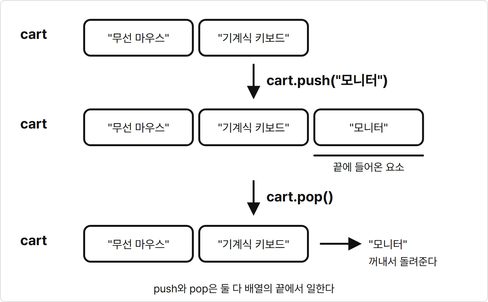
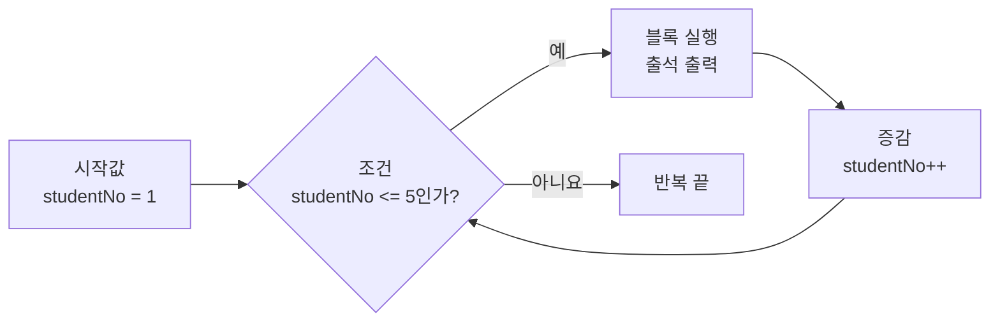
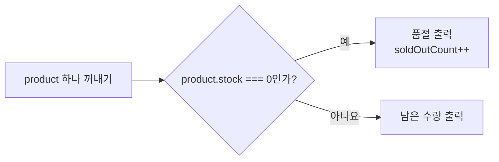

# 4장. 배열과 반복문

**학습목표**

- 배열의 요소를 바꾸고 `push`·`pop`으로 배열 끝에 값을 넣고 뺄 수 있습니다.
- `for`로 같은 코드를 정한 횟수만큼 되풀이할 수 있습니다.
- 되풀이되는 코드에서 바뀌는 수를 찾아 변수로 만들고 반복문으로 바꿀 수 있습니다.
- `for...of`로 객체 배열을 돌며 합계와 개수를 구할 수 있습니다.

## 4-1 배열 만들기와 접근

3장에서는 배열을 만들고 인덱스로 요소를 꺼냈습니다.
이 장에서는 배열의 요소를 바꾸고 넣고 빼 봅니다.
그다음 배열의 요소를 처음부터 끝까지 하나씩 다루는 반복문을 배웁니다.

이 장의 예제는 모두 `js-course/chapter04` 폴더에 만들고 node로 실행합니다.
VS Code에서 `js-course` 폴더 안에 `chapter04` 폴더를 만들고, 새 터미널을 열어 `cd chapter04`를 입력해 둡니다.

3장에서 배운 배열의 모양을 다시 보면 다음과 같습니다.

| 모양 | 뜻 |
|---|---|
| `["무선 마우스", "모니터"]` | 요소 두 개를 담은 배열 |
| `cart[0]` | 인덱스 0, 첫 번째 요소 |
| `cart.length` | 요소의 개수 |
| `cart[5]` | 없는 인덱스라서 `undefined` |

### 요소 바꾸기

배열의 요소를 바꿀 때는 인덱스로 칸을 고르고 `=`로 새 값을 할당합니다.
2장에서 객체의 속성을 `member.grade = "골드";`처럼 바꾼 것과 같은 모양입니다.

**특징**

- 고른 인덱스 칸의 값만 새 값으로 바뀌고 나머지 요소는 그대로입니다.
- `const`로 선언한 배열도 요소를 바꿀 수 있습니다.

2장의 비유로 보면 `const` 명판은 배열이라는 상자 하나에 붙어 있습니다.
명판을 떼어 다른 상자에 붙일 수는 없지만, 상자 안의 칸에 든 값은 바꿀 수 있습니다.
`const` 객체의 속성을 바꿀 수 있던 것과 같은 이유입니다.

**기본 문법**

```javascript
배열명[인덱스] = 새 값;
```

**예제 4-1** `array-update.js`

```javascript
const cart = ["무선 마우스", "기계식 키보드", "모니터"];

console.log(cart[1]);

cart[1] = "무선 키보드";

console.log(cart[1]);
console.log(cart);
```

**실행 결과**

```text
기계식 키보드
무선 키보드
[ '무선 마우스', '무선 키보드', '모니터' ]
```

- `cart[1] = "무선 키보드";`는 인덱스 1인 칸에 든 `"기계식 키보드"`를 `"무선 키보드"`로 바꿉니다.
- 인덱스 0과 2의 요소는 그대로입니다.
- `cart`는 `const`로 선언했지만 `cart`에 다른 배열을 할당한 것이 아니라 칸 하나의 값을 바꿨으므로 그대로 실행됩니다.

### push와 pop

배열의 요소 개수는 정해져 있지 않습니다.
장바구니에 상품을 더 담거나 빼듯이 배열에도 요소를 넣고 뺄 수 있습니다.

`cart.push()`처럼 값 뒤에 점을 찍고 이름과 괄호를 붙여 쓰는, 그 값에 딸린 명령을 **메서드**(method)라고 합니다.
1장부터 써 온 `console.log()`도 `console`에 딸린 `log` 메서드입니다.
`push`는 배열의 끝에 요소를 넣는 메서드이고, `pop`은 배열의 마지막 요소를 빼는 메서드입니다.

**특징**

- `push`는 괄호 안의 값을 배열의 맨 끝에 넣고, `length`가 1 늘어납니다.
- `pop`은 괄호를 비워 쓰고 마지막 요소를 빼서 결과로 돌려줍니다.
- `pop`을 쓰면 `length`가 1 줄어듭니다.
- `const`로 선언한 배열에도 `push`와 `pop`이 동작합니다.

**비교 — push와 pop**

| 비교 항목 | push | pop |
|---|---|---|
| 하는 일 | 끝에 요소를 넣는다 | 끝 요소를 뺀다 |
| 괄호 안 | 넣을 값 | 비워 둔다 |
| 결과로 돌려주는 값 | 늘어난 `length` | 뺀 요소 |
| `length` 변화 | 1 늘어난다 | 1 줄어든다 |

**시각자료 — push와 pop이 바꾸는 배열의 끝**



`push`와 `pop`은 둘 다 배열의 끝에서 일합니다.
앞쪽 요소의 인덱스는 바뀌지 않습니다.

**기본 문법**

```javascript
배열명.push(값);
const 변수명 = 배열명.pop();
```

**예제 4-2** `push.js`

```javascript
const cart = ["무선 마우스", "기계식 키보드"];

cart.push("모니터");
console.log(cart);
console.log(cart.length);

cart.push("마우스 패드");
console.log(cart);
console.log(cart.length);
```

**실행 결과**

```text
[ '무선 마우스', '기계식 키보드', '모니터' ]
3
[ '무선 마우스', '기계식 키보드', '모니터', '마우스 패드' ]
4
```

- `cart.push("모니터");`는 `"모니터"`를 인덱스 2인 칸에 넣습니다. 요소가 두 개였으므로 새 요소는 세 번째 칸에 들어갑니다.
- `push`를 할 때마다 요소가 맨 끝에 붙고 `cart.length`가 `3`, `4`로 늘어납니다.

**예제 4-3** `pop.js`

```javascript
const cart = ["무선 마우스", "기계식 키보드", "모니터"];

const removedItem = cart.pop();

console.log(removedItem);
console.log(cart);
console.log(cart.length);
```

**실행 결과**

```text
모니터
[ '무선 마우스', '기계식 키보드' ]
2
```

- `cart.pop()`은 마지막 요소 `"모니터"`를 배열에서 빼고 그 값을 돌려줍니다.
- 돌려준 값을 `removedItem`에 할당했으므로, 뺀 상품이 무엇인지 출력했습니다.
- `cart`에는 요소 두 개가 남고 `cart.length`는 `2`입니다.

## 4-2 for 반복문

**반복문**(loop)은 같은 코드를 여러 번 되풀이해 실행하는 문법입니다.
그 가운데 `for`는 몇 번 되풀이할지 정해 두고 실행하는 반복문입니다.

### 반복문은 왜 필요할까?

같은 모양의 코드를 줄 수만큼 쓰지 않고 한 번만 쓰기 위해 필요합니다.

학생 다섯 명의 출석을 출력한다고 생각해 봅시다.
`console.log("1번 학생 출석");`부터 `console.log("5번 학생 출석");`까지 다섯 줄을 쓰면 됩니다.
학생이 30명이면 30줄을 써야 하고, 학생 수가 바뀔 때마다 줄을 더하거나 지워야 합니다.
다섯 줄은 번호만 다르고 모양이 모두 같은데도 그렇습니다.

`for`를 쓰면 출력하는 줄은 한 번만 쓰고, 번호를 담은 변수 `studentNo`를 1부터 5까지 늘려 가며 되풀이합니다.
학생 수가 바뀌면 숫자 `5` 하나만 고칩니다.

### for의 구조

`for` 뒤 괄호 안에는 세 부분을 세미콜론으로 나눠 씁니다.
반복할 때마다 값이 바뀌는 변수를 **반복 변수**라고 합니다.

| 부분 | 하는 일 | 예제 4-4에서 |
|---|---|---|
| 시작값 | 반복 변수를 선언하고 처음 값을 넣는다 | `let studentNo = 1` |
| 조건 | `true`인 동안 블록을 되풀이한다 | `studentNo <= 5` |
| 증감 | 블록을 한 번 실행할 때마다 반복 변수를 바꾼다 | `studentNo++` |

**특징**

- 시작값은 맨 처음에 한 번만 실행합니다.
- 블록을 실행하기 전에 매번 조건을 확인하고, 조건이 `false`가 되면 반복을 끝냅니다.
- 증감은 블록을 실행한 뒤에 실행합니다. 3장에서 개념만 본 `++`를 여기서 씁니다.
- 반복 변수는 값이 바뀌므로 `let`으로 선언합니다.

**시각자료 — for가 실행되는 순서**



시작값 다음부터는 조건 → 블록 → 증감을 돌고, 조건이 `false`가 되는 순간 반복을 빠져나옵니다.

**기본 문법**

```javascript
for (시작값; 조건; 증감) {
  되풀이할 코드
}
```

**예제 4-4** `for.js`

```javascript
for (let studentNo = 1; studentNo <= 5; studentNo++) {
  console.log(`${studentNo}번 학생 출석`);
}

console.log("출석 확인을 마쳤습니다.");
```

**실행 결과**

```text
1번 학생 출석
2번 학생 출석
3번 학생 출석
4번 학생 출석
5번 학생 출석
출석 확인을 마쳤습니다.
```

- 출력하는 줄은 블록 안에 한 번만 썼지만 다섯 번 실행되었습니다.
- 블록을 한 번 실행하는 단위를 **회차**라고 합니다. 회차마다 `studentNo`가 1씩 늘어 출력되는 번호가 바뀝니다.
- `studentNo`가 `6`이 되면 `studentNo <= 5`가 `false`라서 반복을 끝내고 블록 아래의 `console.log("출석 확인을 마쳤습니다.");`로 넘어갑니다.

| 회차 | `studentNo` | `studentNo <= 5` | 출력 |
|---|---|---|---|
| 1 | 1 | `true` | 1번 학생 출석 |
| 2 | 2 | `true` | 2번 학생 출석 |
| 3 | 3 | `true` | 3번 학생 출석 |
| 4 | 4 | `true` | 4번 학생 출석 |
| 5 | 5 | `true` | 5번 학생 출석 |
| - | 6 | `false` | 반복 끝 |

학생 수를 30명으로 바꾸려면 예제 4-4의 조건만 다음처럼 고칩니다.

```javascript
for (let studentNo = 1; studentNo <= 30; studentNo++) {
```

### for로 배열 돌기

반복 변수를 배열의 인덱스로 쓰면 배열의 요소를 처음부터 끝까지 하나씩 꺼낼 수 있습니다.
인덱스가 0부터 시작하므로 반복 변수도 0부터 시작합니다.

**예제 4-5** `for-array.js`

```javascript
const cart = ["무선 마우스", "기계식 키보드", "모니터"];

for (let i = 0; i < cart.length; i++) {
  console.log(`${i + 1}. ${cart[i]}`);
}
```

**실행 결과**

```text
1. 무선 마우스
2. 기계식 키보드
3. 모니터
```

- `i`는 인덱스(index)의 첫 글자입니다. 배열의 인덱스를 도는 반복 변수에는 관례로 이 이름을 씁니다.
- `cart[i]`는 회차마다 `cart[0]`, `cart[1]`, `cart[2]`가 됩니다.
- 조건은 `i <= cart.length`가 아니라 `i < cart.length`입니다. `cart.length`는 `3`이고 마지막 인덱스는 `2`이므로, `i`가 `3`이 되면 멈춰야 합니다.
- 화면에 보이는 번호는 1부터 세므로 `${i + 1}`로 인덱스에 1을 더해 출력했습니다.

`cart`에 상품을 더 넣어도 반복문은 고치지 않아도 됩니다.
예제 4-5의 배열을 다음처럼 바꾸면 조건 `i < cart.length`가 알아서 네 번 반복해 `4. 마우스 패드`까지 출력합니다.

```javascript
const cart = ["무선 마우스", "기계식 키보드", "모니터", "마우스 패드"];
```

### 반복하며 합계 구하기

반복문으로 합계를 구할 때는 반복문 위에 합계를 담을 변수를 `0`으로 만들어 둡니다.
회차마다 지금까지의 합계에 요소 하나를 더해 다시 할당합니다.

**예제 4-6** `for-sum.js`

```javascript
const steps = [5200, 8100, 6400, 7300];
let totalSteps = 0;

for (let i = 0; i < steps.length; i++) {
  totalSteps = totalSteps + steps[i];
}

console.log(`${steps.length}일 동안 걸은 걸음 수: ${totalSteps}걸음`);
```

**실행 결과**

```text
4일 동안 걸은 걸음 수: 27000걸음
```

- `steps`는 날마다 걸은 걸음 수 네 개를 담은 배열입니다.
- `totalSteps`는 값이 계속 바뀌므로 `let`으로 선언하고 `0`에서 시작합니다.
- `totalSteps = totalSteps + steps[i];`는 오른쪽을 먼저 계산합니다. 지금까지의 합계에 이번 회차의 걸음 수를 더한 값을 `totalSteps`에 다시 할당합니다.
- 합계 출력은 반복이 다 끝난 뒤에 한 번만 하므로 블록 밖에 둡니다.

| 회차 | `i` | `steps[i]` | 할당 뒤 `totalSteps` |
|---|---|---|---|
| 1 | 0 | 5200 | 5200 |
| 2 | 1 | 8100 | 13300 |
| 3 | 2 | 6400 | 19700 |
| 4 | 3 | 7300 | 27000 |

## 따라하기 실습 — 구구단 2단 출력하기

**실습 목표**

- 되풀이되는 코드에서 바뀌는 수를 찾아 변수로 만듭니다.
- 똑같은 줄이 되풀이되는 코드를 `for`로 바꿉니다.

이 실습은 세 단계로 진행합니다.
처음에는 2단을 직접 적습니다.
그다음 바뀌는 수를 찾아 변수로 바꾸고 마지막으로 `for`에 넣습니다.
단계마다 파일을 따로 만들어 실행 결과가 같은지 비교합니다.

**준비**

1. `chapter04` 폴더 안에 `gugudan-1.js`, `gugudan-2.js`, `gugudan-3.js` 파일을 만듭니다.
2. 터미널의 현재 위치가 `chapter04`인지 확인합니다.

### 1단계 — 콘솔에 직접 적기

먼저 반복문을 생각하지 않고 2단 아홉 줄을 그대로 적습니다.

**실습 코드**

`chapter04/gugudan-1.js`

```javascript
console.log("2 * 1 = 2");
console.log("2 * 2 = 4");
console.log("2 * 3 = 6");
console.log("2 * 4 = 8");
console.log("2 * 5 = 10");
console.log("2 * 6 = 12");
console.log("2 * 7 = 14");
console.log("2 * 8 = 16");
console.log("2 * 9 = 18");
```

**실행 방법**

1. 코드를 입력하고 저장합니다.
2. 터미널에서 다음 명령을 입력합니다.
   ```bash
   node gugudan-1.js
   ```

**실행 결과**

```text
2 * 1 = 2
2 * 2 = 4
2 * 3 = 6
2 * 4 = 8
2 * 5 = 10
2 * 6 = 12
2 * 7 = 14
2 * 8 = 16
2 * 9 = 18
```

**바뀌는 수 찾기**

아홉 줄을 세로로 놓고 자리마다 무엇이 바뀌는지 봅니다.

| 줄 | 앞의 수 | 곱하는 수 | 결과 |
|---|---|---|---|
| `2 * 1 = 2` | 2 | 1 | 2 |
| `2 * 2 = 4` | 2 | 2 | 4 |
| `2 * 3 = 6` | 2 | 3 | 6 |
| ... | ... | ... | ... |
| `2 * 9 = 18` | 2 | 9 | 18 |

- 앞의 수 `2`는 아홉 줄 모두 같습니다.
- 곱하는 수는 1부터 9까지 한 줄에 1씩 늘어납니다. 줄마다 바뀌는 수이므로 변수로 만들 수 있습니다.
- 결과는 줄마다 바뀌지만 따로 정할 필요가 없습니다. 언제나 `2 * 곱하는 수`이므로 곱하는 수가 정해지면 함께 정해집니다.

### 2단계 — 바뀌는 수를 변수로 바꾸기

곱하는 수를 변수 `num`에 담습니다.
문자열 안에 변수와 계산 결과를 넣어야 하므로 2장에서 배운 템플릿 리터럴로 바꿉니다.
1단계에서 찾은 대로 곱하는 수 자리에는 `${num}`, 결과 자리에는 `${2 * num}`을 씁니다.
한 줄을 출력할 때마다 `num++`로 곱하는 수를 1 늘립니다.

**실습 코드**

`chapter04/gugudan-2.js`

```javascript
let num = 1;

console.log(`2 * ${num} = ${2 * num}`);
num++;

console.log(`2 * ${num} = ${2 * num}`);
num++;

console.log(`2 * ${num} = ${2 * num}`);
num++;

console.log(`2 * ${num} = ${2 * num}`);
num++;

console.log(`2 * ${num} = ${2 * num}`);
num++;

console.log(`2 * ${num} = ${2 * num}`);
num++;

console.log(`2 * ${num} = ${2 * num}`);
num++;

console.log(`2 * ${num} = ${2 * num}`);
num++;

console.log(`2 * ${num} = ${2 * num}`);
num++;
```

**실행 방법**

1. 코드를 입력하고 저장합니다.
2. 터미널에서 다음 명령을 입력합니다.
   ```bash
   node gugudan-2.js
   ```

**실행 결과**

```text
2 * 1 = 2
2 * 2 = 4
2 * 3 = 6
2 * 4 = 8
2 * 5 = 10
2 * 6 = 12
2 * 7 = 14
2 * 8 = 16
2 * 9 = 18
```

**코드 설명**

- 1단계와 결과가 똑같습니다. 숫자를 직접 적던 자리를 `num`과 `2 * num`으로 바꿨을 뿐입니다.
- `num`은 값이 바뀌므로 `let`으로 선언했습니다.
- 이제 `console.log(...)`와 `num++;` 두 줄이 글자 하나 다르지 않고 아홉 번 되풀이됩니다. 1단계에서는 줄마다 숫자가 달라서 이렇게 똑같이 만들 수 없었습니다.
- 마지막 `num++;`를 실행하면 `num`은 `10`이 되지만 그 뒤에는 출력하지 않으므로 결과에 나오지 않습니다.

### 3단계 — for에 넣기

똑같은 줄이 되풀이되면 `for`로 바꿀 수 있습니다.
2단계 코드의 각 부분을 `for`의 세 부분에 옮겨 담습니다.

| 2단계 코드 | `for`에서 |
|---|---|
| `let num = 1;` | 시작값 `let num = 1` |
| 아홉 번에서 멈춤 | 조건 `num <= 9` |
| 되풀이하는 `console.log(...)` | 블록 |
| 되풀이하는 `num++;` | 증감 `num++` |

**실습 코드**

`chapter04/gugudan-3.js`

```javascript
for (let num = 1; num <= 9; num++) {
  console.log(`2 * ${num} = ${2 * num}`);
}
```

**실행 방법**

1. 코드를 입력하고 저장합니다.
2. 터미널에서 다음 명령을 입력합니다.
   ```bash
   node gugudan-3.js
   ```

**실행 결과**

```text
2 * 1 = 2
2 * 2 = 4
2 * 3 = 6
2 * 4 = 8
2 * 5 = 10
2 * 6 = 12
2 * 7 = 14
2 * 8 = 16
2 * 9 = 18
```

**코드 설명**

- 세 단계의 결과가 모두 같습니다. 2단계에서 아홉 번 쓴 두 줄이 `for` 한 덩어리로 줄었습니다.
- 2단계에서 줄 수를 세어 정하던 "아홉 번"은 조건 `num <= 9`가 맡습니다. `num`이 `10`이 되면 조건이 `false`라서 반복을 끝냅니다.
- 2단계에서 출력 뒤에 쓴 `num++;`는 증감 자리로 옮겼습니다. 증감은 블록을 실행한 뒤에 실행되므로 순서가 같습니다.
- 코드가 이렇게 바뀐 출발점은 1단계에서 "줄마다 바뀌는 수"를 찾은 것입니다. 바뀌는 수를 변수로 만들면 나머지 코드는 똑같아지고, 똑같은 코드는 반복문으로 묶을 수 있습니다.

**바꿔 보기 1**

곱하는 수를 12까지 늘려 봅니다.
`for (let num = 1; num <= 9; num++) {` 줄을 다음처럼 바꿉니다.

```javascript
for (let num = 1; num <= 12; num++) {
```

`2 * 10 = 20`, `2 * 11 = 22`, `2 * 12 = 24` 세 줄이 더 출력됩니다.
몇 번 되풀이할지는 조건 하나로 정해집니다.

**바꿔 보기 2**

2단 위에 제목 줄을 붙여 봅니다.
`for (let num = 1; num <= 9; num++) {` 줄 위에 다음 줄을 추가합니다.

```javascript
console.log("[2단]");
```

첫 줄에 `[2단]`이 한 번 출력되고 그 아래에 2단 아홉 줄이 이어집니다.
블록 밖에 쓴 줄이라서 반복되지 않습니다.

## 4-3 for...of와 객체 배열

4-2에서는 반복 변수 `i`로 인덱스를 만들고 `cart[i]`로 요소를 꺼냈습니다.
인덱스는 필요 없고 요소만 차례로 다루면 되는 경우가 많습니다.
이럴 때는 요소를 바로 꺼내 주는 `for...of`를 씁니다.

### for...of

**for...of**는 배열의 요소를 처음부터 끝까지 하나씩 꺼내 변수에 담고 블록을 실행하는 반복문입니다.
쉽게 말해 "배열의 요소마다 이 블록을 실행하라"는 뜻입니다.

**특징**

- `of` 뒤에 배열을 쓰고 `of` 앞에 요소를 담을 변수를 선언합니다.
- 요소 개수만큼 자동으로 반복하므로 시작값, 조건, 증감을 쓰지 않습니다.
- 회차마다 새 변수에 요소가 담기므로 변수를 `const`로 선언합니다.
- 변수 이름은 배열 이름의 단수형으로 짓습니다. 예: `products`의 요소는 `product`

**비교 — for와 for...of**

| 비교 항목 | for | for...of |
|---|---|---|
| 회차마다 얻는 것 | 인덱스 `i` | 요소 |
| 요소를 꺼내는 모양 | `cart[i]` | 변수 이름 그대로 |
| 반복 횟수를 정하는 것 | 조건 `i < cart.length` | 배열의 요소 개수 |
| 쓰는 곳 | 횟수를 정해 반복하거나 인덱스가 필요할 때 | 배열의 요소를 차례로 다룰 때 |

**기본 문법**

```javascript
for (const 변수명 of 배열명) {
  되풀이할 코드
}
```

**예제 4-7** `for-of.js`

```javascript
const cart = ["무선 마우스", "기계식 키보드", "모니터"];

for (const item of cart) {
  console.log(item);
}
```

**실행 결과**

```text
무선 마우스
기계식 키보드
모니터
```

- `item`에는 회차마다 `cart`의 요소가 차례로 담깁니다.
- 예제 4-5와 같은 배열을 돌지만 `i`, `cart.length`, `cart[i]`가 모두 사라졌습니다.

| 회차 | `item` |
|---|---|
| 1 | `"무선 마우스"` |
| 2 | `"기계식 키보드"` |
| 3 | `"모니터"` |

### 객체 배열 돌기

3장에서 상품 정보를 객체 하나에 담고 그 객체들을 배열로 묶었습니다.
이런 객체 배열을 `for...of`로 돌면 변수에 객체가 하나씩 담기므로 점 표기법으로 속성을 읽습니다.

**예제 4-8** `object-loop.js`

```javascript
const products = [
  { name: "무선 마우스", price: 12000, stock: 5 },
  { name: "기계식 키보드", price: 89000, stock: 0 },
  { name: "모니터", price: 230000, stock: 2 }
];

for (const product of products) {
  console.log(`${product.name}: ${product.price}원`);
}
```

**실행 결과**

```text
무선 마우스: 12000원
기계식 키보드: 89000원
모니터: 230000원
```

- `product`에는 회차마다 상품 객체 하나가 담깁니다. 첫 회차의 `product`는 `{ name: "무선 마우스", price: 12000, stock: 5 }`입니다.
- `product.name`과 `product.price`는 그 회차 상품의 이름과 가격입니다.

### 반복문 안의 조건문

블록 안에는 어떤 코드든 쓸 수 있으므로 `if`도 넣을 수 있습니다.
요소마다 조건을 확인해 다르게 처리하거나, 조건에 맞는 요소의 개수를 셀 때 씁니다.

**예제 4-9** `stock-check.js`

```javascript
const products = [
  { name: "무선 마우스", price: 12000, stock: 5 },
  { name: "기계식 키보드", price: 89000, stock: 0 },
  { name: "모니터", price: 230000, stock: 2 }
];
let soldOutCount = 0;

for (const product of products) {
  if (product.stock === 0) {
    console.log(`${product.name}: 품절`);
    soldOutCount++;
  } else {
    console.log(`${product.name}: ${product.stock}개 남음`);
  }
}

console.log(`품절 상품: ${soldOutCount}개`);
```

**실행 결과**

```text
무선 마우스: 5개 남음
기계식 키보드: 품절
모니터: 2개 남음
품절 상품: 1개
```

- 회차마다 `product.stock === 0`을 확인해 품절 안내와 남은 수량 안내 가운데 하나를 출력합니다.
- 품절 상품을 만날 때마다 `soldOutCount++`로 개수를 1 늘립니다. 기계식 키보드 한 개만 품절이라 `1`이 됩니다.
- `if` 블록은 `for...of` 블록 안에 있으므로 2칸 더 들여씁니다.

**시각자료 — 한 회차에서 재고를 확인하는 순서**



그림은 한 회차의 일입니다.
`for...of`가 이 일을 상품 수만큼 세 번 되풀이하고, 모든 상품을 처리한 뒤에야 블록 밖의 품절 상품 수를 출력합니다.

## 따라하기 실습 — 상품 목록 총액 구하기

**실습 목표**

- `for...of`로 객체 배열을 돌며 상품마다 가격과 수량을 곱한 금액을 출력합니다.
- 반복문 위에 만든 변수에 총액과 총 수량을 더해 갑니다.
- `push`와 `pop`으로 장바구니를 바꿔 결과가 함께 바뀌는지 확인합니다.

상품마다 가격과 수량을 곱한 금액을 소계라고 합니다.
배송비는 3장 따라하기와 같이 상품 금액이 30000원 이상이면 무료, 그보다 적으면 3000원입니다.

**준비**

1. `chapter04` 폴더 안에 `cart-total.js` 파일을 만듭니다.
2. 터미널의 현재 위치가 `chapter04`인지 확인합니다.

**실습 코드**

`chapter04/cart-total.js`

```javascript
const cartItems = [
  { name: "무선 마우스", price: 12000, quantity: 1 },
  { name: "마우스 패드", price: 5000, quantity: 2 }
];

let totalPrice = 0;
let totalQuantity = 0;

for (const item of cartItems) {
  console.log(`${item.name}: ${item.price}원 x ${item.quantity}개 = ${item.price * item.quantity}원`);
  totalPrice = totalPrice + item.price * item.quantity;
  totalQuantity = totalQuantity + item.quantity;
}

const shippingFee = totalPrice >= 30000 ? 0 : 3000;

console.log(`총 수량: ${totalQuantity}개`);
console.log(`상품 금액: ${totalPrice}원, 배송비: ${shippingFee}원`);
console.log(`결제 금액: ${totalPrice + shippingFee}원`);
```

**실행 방법**

1. 코드를 입력하고 저장합니다.
2. 터미널에서 다음 명령을 입력합니다.
   ```bash
   node cart-total.js
   ```

**실행 결과**

```text
무선 마우스: 12000원 x 1개 = 12000원
마우스 패드: 5000원 x 2개 = 10000원
총 수량: 3개
상품 금액: 22000원, 배송비: 3000원
결제 금액: 25000원
```

**코드 설명**

- `cartItems`의 요소는 이름, 가격, 수량을 가진 상품 객체입니다. 반복문 안에서는 `item`으로 한 상품씩 다룹니다.
- 첫 줄의 `x`는 곱하기 기호가 아니라 화면에 보이는 글자입니다. 실제 곱셈은 `${item.price * item.quantity}`가 합니다.
- `totalPrice = totalPrice + item.price * item.quantity;`는 곱하기를 먼저 계산해 소계를 만든 뒤 지금까지의 총액에 더합니다.
- `totalQuantity`도 같은 방법으로 수량을 더해 갑니다. 상품은 두 종류지만 수량을 더하면 `3`입니다.
- 배송비와 결제 금액은 총액이 다 정해진 뒤에 한 번만 계산하므로 반복문 아래에 둡니다.
- `22000`은 `30000`보다 작으므로 배송비는 `3000`원입니다.

**바꿔 보기 1**

장바구니에 상품을 하나 더 담아 봅니다.
`let totalPrice = 0;` 줄 위에 다음 줄을 추가합니다.

```javascript
cartItems.push({ name: "USB 허브", price: 18000, quantity: 1 });
```

`USB 허브: 18000원 x 1개 = 18000원` 줄이 더 출력됩니다.
총 수량이 `4개`, 상품 금액이 `40000원`이 되어 배송비는 `0원`, 결제 금액은 `40000원`으로 바뀝니다.
반복문은 고치지 않았지만 요소가 늘어난 만큼 한 번 더 반복했습니다.

**바꿔 보기 2**

이번에는 마지막 상품을 빼 봅니다.
바꿔 보기 1에서 추가한 줄을 지우고 같은 자리에 다음 줄을 추가합니다.

```javascript
cartItems.pop();
```

마우스 패드가 빠져서 무선 마우스 한 줄만 출력됩니다.
총 수량이 `1개`, 상품 금액이 `12000원`이 되어 결제 금액은 배송비를 더한 `15000원`으로 바뀝니다.

## 연습문제

### 연습문제 1 — 구구단 2~9단 출력

**요구사항**

1. `chapter04` 폴더에 `gugudan-all.js` 파일을 만듭니다.
2. 따라하기 실습 3단계의 `gugudan-3.js` 코드에서 시작합니다.
3. 2단 코드를 3단, 4단 코드로 바꾸려면 어느 수를 바꿔야 하는지 찾습니다. 따라하기 1단계에서 곱하는 수를 찾은 것처럼 단이 바뀔 때 바뀌는 수를 찾습니다.
4. 찾은 수를 변수 `dan`으로 만들고, `dan`이 2부터 9까지 바뀌게 합니다.
5. 단마다 `[2단]`처럼 제목 줄을 먼저 출력하고, 이어서 `2 * 1 = 2` 형태로 아홉 줄을 출력합니다.

**완료 조건**

- 첫 줄에 `[2단]`, 둘째 줄에 `2 * 1 = 2`가 출력됩니다.
- 마지막 줄에 `9 * 9 = 81`이 출력됩니다.
- 제목 8줄과 곱셈 72줄, 모두 80줄이 출력됩니다.
- 코드에 `console.log`가 두 번만 나옵니다.

### 연습문제 2 — 성적 배열에서 평균과 최고점 구하기

**요구사항**

1. `chapter04` 폴더에 `score-stats.js` 파일을 만듭니다.
2. 점수 다섯 개 `88, 92, 75, 96, 84`를 담은 `scores` 배열을 만듭니다.
3. 반복문으로 점수를 모두 더해 총점을 구합니다.
4. 총점을 점수 개수로 나눠 평균을 구합니다. 개수는 숫자로 직접 쓰지 않고 배열에서 읽습니다.
5. 최고점을 구합니다. 지금까지 본 점수 가운데 가장 큰 점수를 담을 변수를 두고, 그보다 큰 점수를 만나면 그 변수에 다시 할당합니다.
6. `항목: 값점` 형태로 세 줄을 출력합니다. 예: `총점: 435점`

**완료 조건**

- `총점: 435점`, `평균: 87점`, `최고점: 96점` 세 줄이 출력됩니다.
- `scores`를 `[70, 100, 85]`로 바꾸면 다른 코드를 고치지 않아도 `총점: 255점`, `평균: 85점`, `최고점: 100점`이 출력됩니다.

## 정답과 해설

### 연습문제 1 — 구구단 2~9단 출력

`gugudan-all.js`

```javascript
for (let dan = 2; dan <= 9; dan++) {
  console.log(`[${dan}단]`);

  for (let num = 1; num <= 9; num++) {
    console.log(`${dan} * ${num} = ${dan * num}`);
  }
}
```

**실행 결과**

```text
[2단]
2 * 1 = 2
2 * 2 = 4
2 * 3 = 6
2 * 4 = 8
2 * 5 = 10
2 * 6 = 12
2 * 7 = 14
2 * 8 = 16
2 * 9 = 18
[3단]
3 * 1 = 3
...
9 * 7 = 63
9 * 8 = 72
9 * 9 = 81
```

결과가 80줄이라 `3 * 2 = 6`부터 `9 * 6 = 54`까지는 `...`로 줄였습니다.

**해설**

- 2단 코드와 3단 코드를 나란히 놓으면 바뀌는 곳은 `2 * ${num}`과 `${2 * num}`의 `2` 두 군데입니다. 이 `2`가 단이므로 `dan`으로 바꿨습니다.
- `dan`도 2부터 9까지 1씩 늘어나므로, 곱하는 수를 `for`로 만든 것처럼 `dan`도 `for`로 만듭니다. 그리고 2단을 출력하던 `for`를 `dan`의 `for` 블록 안에 넣습니다.
- 반복문 안에 반복문을 넣은 것을 **중첩 반복문**(nested loop)이라고 합니다. 바깥 `for`가 한 회차 도는 동안 안쪽 `for`는 처음부터 끝까지 아홉 번 돕니다.
- 제목 줄은 단마다 한 번만 출력하므로 바깥 블록 안, 안쪽 `for` 위에 둡니다.
- 안쪽 `for`의 블록은 2칸씩 두 번 들여써서 4칸입니다.

| `dan` | 안쪽 `for`가 출력하는 줄 |
|---|---|
| 2 | `2 * 1 = 2`부터 `2 * 9 = 18`까지 |
| 3 | `3 * 1 = 3`부터 `3 * 9 = 27`까지 |
| ... | ... |
| 9 | `9 * 1 = 9`부터 `9 * 9 = 81`까지 |

### 연습문제 2 — 성적 배열에서 평균과 최고점 구하기

`score-stats.js`

```javascript
const scores = [88, 92, 75, 96, 84];

let total = 0;
let maxScore = scores[0];

for (const score of scores) {
  total = total + score;

  if (score > maxScore) {
    maxScore = score;
  }
}

const average = total / scores.length;

console.log(`총점: ${total}점`);
console.log(`평균: ${average}점`);
console.log(`최고점: ${maxScore}점`);
```

**실행 결과**

```text
총점: 435점
평균: 87점
최고점: 96점
```

**해설**

- 인덱스가 필요 없고 점수만 차례로 다루면 되므로 `for...of`를 썼습니다.
- `total`은 예제 4-6처럼 `0`에서 시작해 회차마다 점수를 더합니다.
- `maxScore`는 첫 점수 `scores[0]`에서 시작합니다. 점수를 하나씩 보면서 지금의 `maxScore`보다 크면 그 점수로 바꾸므로, 반복이 끝나면 가장 큰 점수가 남습니다.
- `maxScore`는 88에서 시작해 92, 96을 만날 때 바뀌고 75와 84에서는 그대로입니다.
- 평균은 `scores.length`로 나누므로 점수 개수가 바뀌어도 코드를 고치지 않아도 됩니다.
- 인덱스로 도는 `for (let i = 0; i < scores.length; i++)`로 풀고 `scores[i]`를 써도 같은 결과가 나옵니다.
