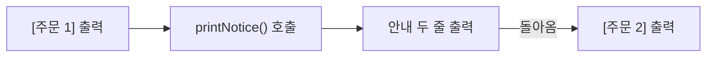
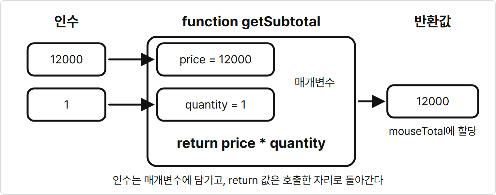
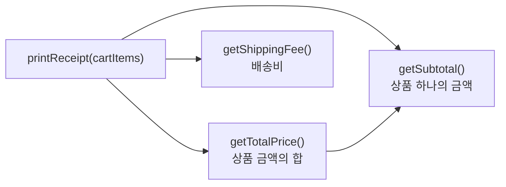
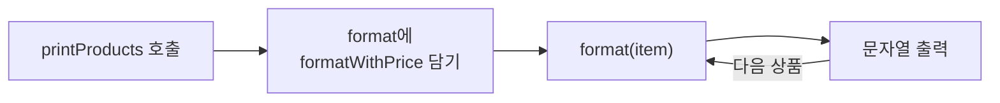

# 5장. 함수와 화살표 함수

**학습목표**

- 코드를 함수로 묶어 선언하고 필요한 곳에서 호출할 수 있습니다.
- 매개변수로 값을 받고 `return`으로 결과를 돌려주는 함수를 만들 수 있습니다.
- 함수를 변수에 담고 다른 함수에 인수로 넘기거나 반환값으로 돌려줄 수 있습니다.
- 같은 함수를 함수 선언문, 익명 함수, 화살표 함수로 바꿔 쓸 수 있습니다.

## 5-1 함수 선언과 호출

4장까지는 코드를 위에서 아래로 한 번씩 실행했습니다.
같은 코드 묶음이 여러 곳에 필요하면 그때마다 다시 적었습니다.
이 장에서는 코드 묶음에 이름을 붙여 두고 이름으로 다시 쓰는 방법을 배웁니다.

이 장의 예제는 모두 `js-course/chapter05` 폴더에 만들고 node로 실행합니다.
VS Code에서 `js-course` 폴더 안에 `chapter05` 폴더를 만들고 새 터미널을 열어 `cd chapter05`를 입력해 둡니다.

### 함수

**함수**(function)는 어떤 일을 하는 코드 묶음에 이름을 붙여 둔 것입니다.
쉽게 말해 자주 하는 일을 한 번 적어 두고 이름을 불러 그 일을 시키는 방법입니다.

### 함수는 왜 필요할까?

같은 코드 묶음을 여러 곳에서 다시 쓰고 한 곳에서 고치기 위해 필요합니다.

쇼핑몰에서 주문이 들어올 때마다 안내 두 줄을 출력한다고 생각해 봅시다.
주문이 두 건이면 같은 두 줄을 두 번, 열 건이면 열 번 적어야 합니다.
안내 문구가 바뀌면 적은 곳을 모두 찾아 고쳐야 합니다.
한 곳이라도 빠뜨리면 주문마다 안내가 달라집니다.

안내 두 줄을 `printNotice`라는 함수로 묶으면 주문마다 `printNotice();` 한 줄만 씁니다.
문구는 함수 안 한 곳에만 있으므로 그곳만 고치면 모든 주문의 안내가 함께 바뀝니다.

함수는 미리 녹음해 둔 안내 방송 버튼에 빗댈 수 있습니다.
버튼을 누를 때마다 같은 방송이 나오고, 녹음을 바꾸면 다음 방송부터 모두 바뀝니다.

**시각자료 — 누를 때마다 같은 방송이 나오는 버튼**

```text
[생성 이미지: images/05/function-button.png]
장면: 책상 위에 둥근 버튼 하나가 달린 작은 스피커 상자가 있다. 손가락이 버튼을 누르고, 스피커에서 소리 물결 세 줄이 퍼져 나간다.
비율: 가로 3:2
스타일: 굵기가 일정한 검정 외곽선의 단순한 선 그림. 흰 배경. 그림자와 그라데이션 없음. 채움 색은 빨강(버튼) 한 가지. 글자, 숫자, 기호는 넣지 않는다.
참고 그림: book-manuscript/assets/style-ref/line-art-shark.png
```

녹음해 둔 방송이 함수 안의 안내 두 줄이고, 버튼을 누르는 일이 `printNotice();` 호출입니다.

### 함수 선언과 호출

함수를 만드는 것을 **함수 선언**(function declaration)이라고 합니다.
`function` 뒤에 함수 이름과 괄호를 쓰고 중괄호 블록 안에 실행할 코드를 씁니다.
선언한 함수를 이름으로 불러 실행하는 것을 **호출**(call)이라고 합니다.
함수 이름 뒤에 괄호를 붙이면 호출입니다.

**특징**

- 선언만 해서는 블록 안의 코드가 실행되지 않습니다. 호출해야 실행됩니다.
- 호출할 때마다 블록을 처음부터 끝까지 실행합니다.
- 블록을 다 실행하면 호출한 자리로 돌아와 그다음 줄을 실행합니다.
- 함수 이름은 변수처럼 카멜 표기법으로 짓고 `print`나 `get`처럼 하는 일을 나타내는 동사로 시작합니다.

**시각자료 — 함수를 호출하고 돌아오는 순서**



호출하면 실행 위치가 함수 블록으로 옮겨 갑니다.
블록을 다 실행하면 호출한 줄로 돌아와 다음 줄을 이어서 실행합니다.

**기본 문법**

```javascript
function 함수명() {
  실행할 코드
}

함수명();
```

**예제 5-1** `function.js`

```javascript
function printNotice() {
  console.log("주문이 접수되었습니다.");
  console.log("배송은 2~3일 걸립니다.");
}

console.log("[주문 1] 무선 마우스");
printNotice();

console.log("[주문 2] 모니터");
printNotice();
```

**실행 결과**

```text
[주문 1] 무선 마우스
주문이 접수되었습니다.
배송은 2~3일 걸립니다.
[주문 2] 모니터
주문이 접수되었습니다.
배송은 2~3일 걸립니다.
```

- `function printNotice() { ... }`는 함수를 선언만 합니다. 파일 맨 위에 있지만 이 부분에서는 아무것도 출력되지 않습니다.
- `printNotice();`를 두 번 호출했으므로 안내 두 줄이 두 번 출력됩니다.
- 첫 번째 호출이 끝나면 돌아와서 `console.log("[주문 2] 모니터");`를 실행합니다.

안내 문구를 바꾸려면 예제 5-1의 함수 블록 한 곳만 고칩니다.
`console.log("배송은 2~3일 걸립니다.");` 줄을 다음처럼 바꾸면 두 주문의 안내가 모두 `배송은 내일 도착합니다.`로 바뀝니다.

```javascript
console.log("배송은 내일 도착합니다.");
```

4장에서는 `cart.push()`처럼 값에 딸린 명령을 메서드라고 했습니다.
이 명령도 함수입니다.
메서드는 값에 딸린 함수입니다.
1장부터 써 온 `console.log()`도 `console`에 딸린 함수입니다.

## 5-2 매개변수와 반환값

예제 5-1의 `printNotice()`는 부를 때마다 똑같은 두 줄을 출력합니다.
상품 이름이나 수량처럼 호출할 때마다 다른 값으로 일을 시키려면 함수에 값을 넘겨야 합니다.

### 매개변수와 인수

**매개변수**(parameter)는 함수를 선언할 때 괄호 안에 쓰는 변수입니다.
호출할 때 넘겨받은 값을 담아 함수 블록 안에서 씁니다.
**인수**(argument)는 함수를 호출할 때 괄호 안에 넣는 값입니다.

**특징**

- 매개변수와 인수는 쉼표로 나눠 여러 개 쓸 수 있습니다.
- 인수는 쓴 순서대로 매개변수에 담깁니다. 첫 번째 인수는 첫 번째 매개변수에 담깁니다.
- 매개변수는 `let`이나 `const` 없이 이름만 씁니다.
- 매개변수는 그 함수 블록 안에서만 씁니다.

**비교 — 매개변수와 인수**

| 비교 항목 | 매개변수 | 인수 |
|---|---|---|
| 쓰는 곳 | 함수를 선언하는 괄호 안 | 함수를 호출하는 괄호 안 |
| 쓰는 것 | 변수 이름 | 값 |
| 예제 5-2에서 | `productName`, `quantity` | `"무선 마우스"`, `1` |

**기본 문법**

```javascript
function 함수명(매개변수1, 매개변수2) {
  실행할 코드
}

함수명(인수1, 인수2);
```

**예제 5-2** `parameter.js`

```javascript
function printOrder(productName, quantity) {
  console.log(`${productName} ${quantity}개를 주문했습니다.`);
}

printOrder("무선 마우스", 1);
printOrder("마우스 패드", 2);
```

**실행 결과**

```text
무선 마우스 1개를 주문했습니다.
마우스 패드 2개를 주문했습니다.
```

- 첫 번째 호출에서는 `productName`에 `"무선 마우스"`, `quantity`에 `1`이 담깁니다.
- 두 번째 호출에서는 `productName`에 `"마우스 패드"`, `quantity`에 `2`가 담깁니다.
- 함수 블록은 하나지만 넘긴 인수가 달라서 출력도 다릅니다.

### return과 반환값

`return`은 함수의 결과를 호출한 곳으로 돌려주는 문장입니다.
이렇게 돌려준 값을 **반환값**(return value)이라고 합니다.
쉽게 말해 반환값은 함수가 일을 마치고 내놓는 결과입니다.
4장의 `cart.pop()`이 뺀 요소를 돌려준 것처럼, 함수를 호출한 자리는 반환값으로 바뀝니다.

### 반환값은 왜 필요할까?

함수가 계산한 결과를 받아 다른 계산이나 출력에 다시 쓰기 위해 필요합니다.

상품 금액을 계산하는 함수가 결과를 `console.log()`로 출력만 한다고 생각해 봅시다.
화면에는 금액이 보이지만 그 금액은 함수 밖으로 나오지 않습니다.
그래서 마우스 금액과 마우스 패드 금액을 더해 합계를 구할 수 없습니다.

`getSubtotal` 함수가 금액을 `return`으로 돌려주면 `mouseTotal`과 `padTotal`처럼 변수에 받아 둘 수 있습니다.
받아 둔 두 금액을 더하면 합계가 됩니다.

### 반환값 받기

**특징**

- `return` 뒤에 쓴 값이 반환값입니다.
- `return`을 실행하면 함수가 그 자리에서 끝납니다. 블록 안에서 `return` 아래에 있는 코드는 실행되지 않습니다.
- 반환값은 변수에 담거나 계산과 출력에 바로 씁니다.
- `return`이 없는 함수를 호출하면 결과는 `undefined`입니다.

**비교 — console.log와 return**

| 비교 항목 | console.log | return |
|---|---|---|
| 하는 일 | 값을 화면에 출력한다 | 값을 호출한 곳으로 돌려준다 |
| 값을 다시 쓸 수 있는가 | 쓸 수 없다 | 변수에 담아 다시 쓴다 |
| 함수가 끝나는가 | 다음 줄로 이어진다 | 그 자리에서 끝난다 |

함수는 주문 금액 계산기와 비슷합니다.
가격과 수량을 넣으면(인수) 계산기 안의 칸(매개변수)에 들어갑니다.
계산이 끝나면 결과가 출구로 나옵니다(반환값).
나온 결과는 받은 사람이 필요한 곳에 씁니다.

**시각자료 — 인수, 매개변수, 반환값**



`getSubtotal(12000, 1)`을 호출하면 `12000`은 `price`에, `1`은 `quantity`에 담깁니다.
`return` 뒤의 `price * quantity`를 계산한 `12000`이 호출한 자리로 돌아가 `mouseTotal`에 할당됩니다.

**기본 문법**

```javascript
function 함수명(매개변수) {
  return 돌려줄 값;
}

const 변수명 = 함수명(인수);
```

**예제 5-3** `return.js`

```javascript
function getSubtotal(price, quantity) {
  return price * quantity;
}

const mouseTotal = getSubtotal(12000, 1);
const padTotal = getSubtotal(5000, 2);

console.log(mouseTotal);
console.log(padTotal);
console.log(`합계: ${mouseTotal + padTotal}원`);
```

**실행 결과**

```text
12000
10000
합계: 22000원
```

- `getSubtotal(12000, 1)`은 `12000 * 1`을 계산해 `12000`을 돌려줍니다. 이 값이 `mouseTotal`에 할당됩니다.
- `getSubtotal(5000, 2)`는 `10000`을 돌려주고 `padTotal`에 할당됩니다.
- 함수 안에는 `console.log()`가 없습니다. 출력은 돌려받은 값으로 함수 밖에서 합니다.
- 두 반환값을 변수에 받아 두었으므로 `mouseTotal + padTotal`로 합계를 구했습니다.

### 함수 안에서 만드는 변수

함수 블록 안에서도 `let`이나 `const`로 변수를 선언해 씁니다.
함수 안에서 선언한 변수는 그 함수 안에서만 씁니다.
호출할 때마다 새로 만들어지고 함수가 끝나면 사라집니다.

**예제 5-4** `average.js`

```javascript
function getAverage(scores) {
  let total = 0;

  for (const score of scores) {
    total = total + score;
  }

  return total / scores.length;
}

console.log(`1반 평균: ${getAverage([88, 92, 75, 96, 84])}점`);
console.log(`2반 평균: ${getAverage([70, 100, 85])}점`);
```

**실행 결과**

```text
1반 평균: 87점
2반 평균: 85점
```

- 4장 연습문제 2에서 평균을 구한 코드를 함수 블록에 넣었습니다. 점수 배열은 매개변수 `scores`로 받습니다.
- `total`은 함수 안에서 선언했으므로 호출할 때마다 `0`에서 새로 시작합니다. 그래서 두 번째 호출의 평균에 첫 번째 반의 점수가 섞이지 않습니다.
- `${getAverage([88, 92, 75, 96, 84])}`처럼 템플릿 리터럴의 `${}` 안에서 함수를 호출하면 그 자리에 반환값이 들어갑니다.

### 기본값 매개변수

인수를 넣지 않고 호출하면 그 매개변수에는 `undefined`가 담깁니다.
**기본값 매개변수**(default parameter)는 인수가 없을 때 쓸 값을 미리 정해 둔 매개변수입니다.
매개변수 이름 뒤에 `=`와 기본값을 씁니다.

**특징**

- 인수를 넣지 않으면 기본값이 매개변수에 담깁니다.
- 인수를 넣으면 기본값 대신 넣은 인수가 담깁니다.
- 기본값을 둔 매개변수는 뒤쪽에 둡니다. 인수는 앞에서부터 차례로 담기기 때문입니다.

**기본 문법**

```javascript
function 함수명(매개변수1, 매개변수2 = 기본값) {
  실행할 코드
}
```

**예제 5-5** `default-parameter.js`

```javascript
function getSubtotal(price, quantity = 1) {
  return price * quantity;
}

console.log(getSubtotal(12000));
console.log(getSubtotal(5000, 2));
```

**실행 결과**

```text
12000
10000
```

- `getSubtotal(12000)`은 인수를 하나만 넣었으므로 `quantity`에 기본값 `1`이 담깁니다.
- `getSubtotal(5000, 2)`는 두 번째 인수 `2`가 기본값 대신 `quantity`에 담깁니다.
- 수량을 적지 않으면 한 개로 계산하므로, 한 개씩 사는 상품은 가격만 넘기면 됩니다.

## 따라하기 실습 — 장바구니 계산을 함수로 나누기

**실습 목표**

- 4장 따라하기의 장바구니 계산을 하는 일마다 함수로 나눕니다.
- 함수의 반환값을 다른 함수의 계산에 넘겨 씁니다.
- 기본값 매개변수로 무료 배송 기준 금액을 정합니다.

4장 따라하기 `cart-total.js`는 반복문과 계산을 한 덩어리로 적었습니다.
이번에는 상품 금액, 상품 금액의 합, 배송비, 영수증 출력을 함수 네 개로 나눕니다.
출력 줄은 조금 줄였고 금액 계산 결과는 4장과 같습니다.

**준비**

1. `chapter05` 폴더 안에 `cart-function.js` 파일을 만듭니다.
2. 터미널의 현재 위치가 `chapter05`인지 확인합니다.

**실습 코드**

`chapter05/cart-function.js`

```javascript
const cartItems = [
  { name: "무선 마우스", price: 12000, quantity: 1 },
  { name: "마우스 패드", price: 5000, quantity: 2 }
];

function getSubtotal(price, quantity = 1) {
  return price * quantity;
}

function getTotalPrice(items) {
  let totalPrice = 0;

  for (const item of items) {
    totalPrice = totalPrice + getSubtotal(item.price, item.quantity);
  }

  return totalPrice;
}

function getShippingFee(totalPrice, freeLimit = 30000) {
  return totalPrice >= freeLimit ? 0 : 3000;
}

function printReceipt(items) {
  for (const item of items) {
    console.log(`${item.name}: ${getSubtotal(item.price, item.quantity)}원`);
  }

  const totalPrice = getTotalPrice(items);
  const shippingFee = getShippingFee(totalPrice);

  console.log(`상품 금액: ${totalPrice}원, 배송비: ${shippingFee}원`);
  console.log(`결제 금액: ${totalPrice + shippingFee}원`);
}

printReceipt(cartItems);
```

**실행 방법**

1. 코드를 입력하고 저장합니다.
2. 터미널에서 다음 명령을 입력합니다.
   ```bash
   node cart-function.js
   ```

**실행 결과**

```text
무선 마우스: 12000원
마우스 패드: 10000원
상품 금액: 22000원, 배송비: 3000원
결제 금액: 25000원
```

**시각자료 — printReceipt가 호출하는 함수**



화살표는 함수 안에서 다른 함수를 호출하는 방향입니다.
`getTotalPrice()`도 상품 하나의 금액을 구할 때 `getSubtotal()`을 다시 씁니다.

**코드 설명**

- 파일에서 실제로 호출하는 줄은 맨 아래 `printReceipt(cartItems);` 하나입니다. 나머지 함수는 `printReceipt()` 안에서 차례로 호출됩니다.
- `getSubtotal()`은 예제 5-5와 같은 함수입니다. 상품 객체의 `item.price`와 `item.quantity`를 인수로 넘깁니다.
- `getTotalPrice()`는 4장처럼 `0`에서 시작해 상품 금액을 더해 가고 다 더한 값을 돌려줍니다.
- `getShippingFee()`는 3장의 삼항 연산자 결과를 바로 돌려줍니다. 무료 배송 기준 `freeLimit`는 인수를 넣지 않았으므로 기본값 `30000`입니다.
- `getShippingFee()`의 매개변수 `totalPrice`와 `printReceipt()` 안의 `totalPrice`는 이름만 같고 서로 다른 변수입니다. 매개변수는 그 함수 안에서만 쓰기 때문입니다.
- 함수 이름만 읽어도 `printReceipt()`가 무슨 순서로 일하는지 알 수 있습니다.

**바꿔 보기 1**

장바구니에 상품을 하나 더 담아 봅니다.
`{ name: "마우스 패드", price: 5000, quantity: 2 }` 줄 끝에 쉼표를 붙이고 그 아래에 다음 줄을 추가합니다.

```javascript
{ name: "USB 허브", price: 18000, quantity: 1 }
```

`USB 허브: 18000원` 줄이 더 출력됩니다.
상품 금액이 `40000원`이 되어 배송비는 `0원`, 결제 금액은 `40000원`으로 바뀝니다.
함수는 하나도 고치지 않았습니다.

**바꿔 보기 2**

무료 배송 기준을 20000원으로 낮춰 봅니다.
`const shippingFee = getShippingFee(totalPrice);` 줄을 다음처럼 바꿉니다.

```javascript
const shippingFee = getShippingFee(totalPrice, 20000);
```

상품 금액 `22000원`이 기준 이상이 되어 배송비는 `0원`, 결제 금액은 `22000원`으로 바뀝니다.
두 번째 인수를 넣었으므로 기본값 `30000` 대신 `20000`이 `freeLimit`에 담깁니다.

## 5-3 일급 객체

지금까지는 함수를 선언하고 호출만 했습니다.
JavaScript에서는 함수를 숫자나 문자열 같은 값처럼 다룰 수도 있습니다.

### 일급 객체

**일급 객체**(first-class object)는 프로그래밍 언어에서 값처럼 자유롭게 다룰 수 있는 대상입니다.
쉽게 말해 숫자 `12000`이나 문자열 `"모니터"`와 똑같이 다룰 수 있다는 뜻입니다.
JavaScript에서는 함수도 일급 객체입니다.

**특징**

- 변수에 할당할 수 있습니다.
- 함수의 인수로 넘길 수 있습니다.
- 함수의 반환값으로 돌려줄 수 있습니다.

세 가지 특징을 하나씩 코드로 확인합니다.

### 함수를 변수에 담기

함수 이름은 함수가 담긴 변수와 같습니다.
그래서 함수 이름을 다른 변수에 할당하면 그 변수로도 같은 함수가 호출됩니다.

**비교 — 괄호 없는 함수 이름과 괄호 붙인 호출**

| 비교 항목 | getSubtotal | getSubtotal(5000, 2) |
|---|---|---|
| 뜻 | 함수 자체 | 함수를 호출한 결과 |
| 값 | 함수 | 반환값 `10000` |
| 함수가 실행되는가 | 실행되지 않는다 | 실행된다 |

**예제 5-6** `function-value.js`

```javascript
function getSubtotal(price, quantity) {
  return price * quantity;
}

const calculate = getSubtotal;

console.log(getSubtotal);
console.log(typeof getSubtotal);
console.log(calculate(5000, 2));
```

**실행 결과**

```text
[Function: getSubtotal]
function
10000
```

- `const calculate = getSubtotal;`은 괄호가 없으므로 함수를 호출하지 않습니다. 함수 자체를 `calculate`에 할당합니다.
- `console.log(getSubtotal);`은 함수 자체를 출력합니다. node는 함수를 `[Function: 함수 이름]`으로 보여 줍니다.
- 2장에서 배운 `typeof`로 확인하면 함수의 자료형은 `function`입니다.
- `calculate(5000, 2)`는 `getSubtotal(5000, 2)`와 같은 함수를 호출하므로 `10000`을 돌려줍니다.

### 함수를 인수로 넘기기

함수도 값이므로 다른 함수를 호출할 때 인수로 넘길 수 있습니다.
다른 함수에 인수로 넘겨서 그 함수 안에서 호출되게 하는 함수를 **콜백 함수**(callback function)라고 합니다.
콜백 함수를 받는 함수는 **고차 함수**(higher-order function)라고 합니다.

**특징**

- 콜백 함수를 넘길 때는 괄호 없이 함수 이름만 씁니다.
- 고차 함수는 넘겨받은 함수를 매개변수 이름 뒤에 괄호를 붙여 호출합니다.
- 콜백 함수를 언제, 몇 번 호출할지는 고차 함수가 정합니다.

**기본 문법**

```javascript
function 고차함수명(매개변수, 콜백매개변수) {
  콜백매개변수(인수);
}

고차함수명(인수, 콜백함수명);
```

**예제 5-7** `callback.js`

```javascript
const products = [
  { name: "무선 마우스", price: 12000 },
  { name: "모니터", price: 230000 }
];

function formatWithPrice(product) {
  return `${product.name}: ${product.price}원`;
}

function formatNameOnly(product) {
  return product.name;
}

function printProducts(items, format) {
  for (const item of items) {
    console.log(format(item));
  }
}

printProducts(products, formatWithPrice);
printProducts(products, formatNameOnly);
```

**실행 결과**

```text
무선 마우스: 12000원
모니터: 230000원
무선 마우스
모니터
```

- `printProducts(products, formatWithPrice);`는 `formatWithPrice` 함수 자체를 넘깁니다. 이 호출 동안 매개변수 `format`에는 `formatWithPrice`가 담깁니다.
- 반복문 안의 `format(item)`은 회차마다 넘겨받은 함수를 호출하고 돌려받은 문자열을 출력합니다.
- 두 번째 호출에서는 `format`에 `formatNameOnly`가 담기므로 이름만 출력됩니다.
- `printProducts()`의 반복문은 한 번만 적었습니다. 출력 모양을 바꿀 때는 넘기는 함수만 바꿉니다.

**시각자료 — 콜백 함수가 호출되는 순서**



`printProducts()`는 상품 수만큼 `format(item)`을 호출합니다.
실제로 실행되는 함수는 호출할 때 넘긴 `formatWithPrice`입니다.

### 함수를 반환값으로 돌려주기

함수도 값이므로 `return` 뒤에 쓰면 그대로 돌려줍니다.
돌려받은 함수는 변수에 담아 두고 호출합니다.

**예제 5-8** `return-function.js`

```javascript
const monitor = { name: "모니터", price: 230000 };

function formatWithPrice(product) {
  return `${product.name}: ${product.price}원`;
}

function formatNameOnly(product) {
  return product.name;
}

function getFormatter(showPrice) {
  return showPrice ? formatWithPrice : formatNameOnly;
}

const priceFormat = getFormatter(true);
const nameFormat = getFormatter(false);

console.log(priceFormat(monitor));
console.log(nameFormat(monitor));
```

**실행 결과**

```text
모니터: 230000원
모니터
```

- `getFormatter()`는 `showPrice`가 `true`면 `formatWithPrice`를, `false`면 `formatNameOnly`를 돌려줍니다. 괄호 없이 썼으므로 호출 결과가 아니라 함수 자체를 돌려줍니다.
- `priceFormat`에는 `formatWithPrice` 함수가, `nameFormat`에는 `formatNameOnly` 함수가 담깁니다.
- `priceFormat(monitor)`처럼 돌려받은 함수를 담은 변수 이름 뒤에 괄호를 붙이면 그 함수가 호출됩니다.

### 없을 수도 있는 함수 호출하기

콜백 함수는 필요할 때만 넘기기도 합니다.
주문을 받는 `placeOrder` 함수가 주문이 끝나면 할 일을 콜백 함수 `onComplete`로 받는다고 해 봅시다.
문자를 보내야 하는 주문만 콜백 함수를 넘기고 나머지 주문은 넘기지 않습니다.

넘기지 않은 콜백 함수를 그대로 호출하면 어떻게 되는지 확인하기 위해 일부러 에러를 내 보겠습니다.

**예제 5-9** `callback-error.js`

```javascript
function placeOrder(productName, onComplete) {
  console.log(`${productName} 주문을 접수했습니다.`);
  onComplete();
}

function sendMessage() {
  console.log("주문 완료 문자를 보냈습니다.");
}

placeOrder("무선 마우스", sendMessage);
placeOrder("모니터");
console.log("모든 주문을 처리했습니다.");
```

**실행 결과**

```text
무선 마우스 주문을 접수했습니다.
주문 완료 문자를 보냈습니다.
모니터 주문을 접수했습니다.
...\js-course\chapter05\callback-error.js:3
  onComplete();
  ^

TypeError: onComplete is not a function
```

에러 줄 아래에는 `at`으로 시작하는 줄이 여러 개 더 나오고 맨 앞의 폴더 경로는 컴퓨터마다 다릅니다.
여기서는 에러를 읽는 데 필요한 줄만 실었습니다.

- 첫 번째 호출은 `sendMessage`를 넘겼으므로 끝까지 실행되어 문자 안내까지 출력합니다.
- 두 번째 호출 `placeOrder("모니터");`는 인수를 하나만 넣었으므로 `onComplete`에 `undefined`가 담깁니다.
- `callback-error.js:3`은 3번째 줄 `onComplete();`에서 에러가 났다는 뜻이고 `^` 표시가 호출하려던 자리를 가리킵니다.
- 메시지 `onComplete is not a function`은 "`onComplete`는 함수가 아니다"라는 뜻입니다. `undefined`는 함수가 아니라서 호출할 수 없습니다.
- 에러가 난 곳에서 프로그램이 멈췄으므로 마지막 줄 `모든 주문을 처리했습니다.`는 출력되지 않습니다.

3장에서 배운 옵셔널 체이닝 `?.`는 함수를 호출할 때도 씁니다.
함수 이름과 괄호 사이에 `?.`를 넣어 `onComplete?.()`로 쓰면 함수가 있을 때만 호출합니다.

**특징**

- `?.` 앞의 값이 `null`이나 `undefined`면 호출하지 않고 결과는 `undefined`입니다.
- `?.` 앞의 값이 함수면 괄호 안의 인수를 넣어 그대로 호출합니다.

**기본 문법**

```javascript
함수명?.(인수);
```

**예제 5-10** `optional-call.js`

```javascript
function placeOrder(productName, onComplete) {
  console.log(`${productName} 주문을 접수했습니다.`);
  onComplete?.();
}

function sendMessage() {
  console.log("주문 완료 문자를 보냈습니다.");
}

placeOrder("무선 마우스", sendMessage);
placeOrder("모니터");
console.log("모든 주문을 처리했습니다.");
```

**실행 결과**

```text
무선 마우스 주문을 접수했습니다.
주문 완료 문자를 보냈습니다.
모니터 주문을 접수했습니다.
모든 주문을 처리했습니다.
```

- 예제 5-9에서 `onComplete();`를 `onComplete?.();`로 바꾼 것만 다릅니다.
- 모니터 주문은 `onComplete`가 `undefined`라서 호출을 건너뜁니다. 에러가 나지 않으므로 마지막 줄까지 출력됩니다.

## 5-4 익명 함수

지금까지는 `function` 뒤에 이름을 붙여 함수를 선언했습니다.
이렇게 선언하는 문장을 **함수 선언문**이라고 합니다.
함수를 값처럼 변수에 담거나 인수로 넘길 수 있으므로, 이름 없이 함수를 만들어 바로 담거나 넘기기도 합니다.

### 익명 함수와 함수 표현식

**익명 함수**(anonymous function)는 이름이 없는 함수입니다.
`function` 뒤에 이름을 쓰지 않고 바로 괄호를 씁니다.
익명 함수를 변수에 할당해 만드는 방법을 **함수 표현식**(function expression)이라고 합니다.

**특징**

- `function` 뒤에 함수 이름이 없습니다.
- 호출할 때는 함수를 담은 변수 이름 뒤에 괄호를 붙입니다.
- 변수에 할당하는 문장이므로 닫는 중괄호 뒤에 세미콜론을 붙입니다.
- 함수를 담은 변수는 다시 할당하지 않으므로 `const`로 선언합니다.

**비교 — 함수 선언문과 함수 표현식**

| 비교 항목 | 함수 선언문 | 함수 표현식 |
|---|---|---|
| 모양 | `function greet() {}` | `const greet = function () {};` |
| 이름을 붙이는 곳 | `function` 뒤 | 함수를 담는 변수 |
| 끝의 세미콜론 | 붙이지 않는다 | 붙인다 |
| 선언보다 위에서 호출 | 할 수 있다 | 할 수 없다 |

함수 선언문은 파일의 어디에 있든 실행 전에 미리 준비되므로 선언보다 위에서 호출해도 동작합니다.
함수 표현식은 변수에 할당하는 줄을 실행한 뒤에야 쓸 수 있습니다.
어느 쪽이든 선언을 먼저 쓰고 그 아래에서 호출하면 헷갈리지 않습니다.

**기본 문법**

```javascript
const 함수명 = function (매개변수) {
  실행할 코드
};
```

**예제 5-11** `anonymous.js`

```javascript
const greet = function (userName) {
  return `${userName}님, 반갑습니다.`;
};

console.log(greet("김코딩"));
console.log(greet("이자바"));
```

**실행 결과**

```text
김코딩님, 반갑습니다.
이자바님, 반갑습니다.
```

- `function (userName) { ... }`가 이름 없는 함수입니다. 이 함수를 `greet`에 할당했습니다.
- `greet("김코딩")`처럼 변수 이름으로 호출합니다. 호출하는 모양은 함수 선언문과 같습니다.

### 인수 자리에 바로 쓰기

익명 함수는 변수에 담지 않고 고차 함수의 인수 자리에 바로 쓸 수도 있습니다.
한 번만 넘기고 다른 곳에서 부를 일이 없는 콜백 함수는 이렇게 씁니다.

**예제 5-12** `anonymous-callback.js`

```javascript
const products = [
  { name: "무선 마우스", price: 12000 },
  { name: "모니터", price: 230000 }
];

function printProducts(items, format) {
  for (const item of items) {
    console.log(format(item));
  }
}

printProducts(products, function (product) {
  return `${product.name}: ${product.price}원`;
});
```

**실행 결과**

```text
무선 마우스: 12000원
모니터: 230000원
```

- 예제 5-7에서 `formatWithPrice`로 선언해 넘기던 함수를 이름 없이 인수 자리에 바로 썼습니다.
- `printProducts(` 호출의 괄호가 익명 함수의 닫는 중괄호 뒤 `});`에서 닫힙니다. `}`는 함수 블록의 끝, `)`는 호출 괄호의 끝입니다.

## 5-5 화살표 함수

**화살표 함수**(arrow function)는 `function` 대신 `=>` 기호로 만드는 익명 함수입니다.
`=>`가 화살표처럼 생겨서 이런 이름이 붙었습니다.

### 화살표 함수는 왜 필요할까?

짧은 함수를 짧게 써서 하는 일이 바로 보이게 하기 위해 필요합니다.

예제 5-12에서 인수로 넘긴 익명 함수가 하는 일은 `` `${product.name}: ${product.price}원` ``을 돌려주는 것 하나입니다.
그런데 그 한 가지 일을 `function`, 중괄호, `return`이 감싸고 있어 세 줄이 되었습니다.
이런 함수를 여러 개 넘기면 감싸는 글자가 많아져 정작 하는 일이 눈에 덜 띕니다.

화살표 함수로 쓰면 `` (product) => `${product.name}: ${product.price}원` ``처럼 한 줄이 됩니다.
매개변수와 돌려줄 값만 남으므로 무엇을 받아 무엇을 돌려주는지 바로 읽힙니다.

### 화살표 함수의 두 가지 모양

화살표 함수는 `=>` 뒤에 무엇을 쓰는지에 따라 두 가지 모양이 있습니다.
`=>` 뒤에 중괄호 블록을 쓰는 모양과 값 하나만 쓰는 모양입니다.

**특징**

- `function`을 쓰지 않고 매개변수 괄호 뒤에 `=>`를 씁니다.
- `=>` 뒤에 블록 없이 값 하나만 쓰면 그 값을 자동으로 돌려줍니다. `return`을 쓰지 않습니다.
- `=>` 뒤에 블록을 쓰면 `function`으로 만든 함수처럼 돌려줄 값에 `return`을 씁니다.
- 매개변수가 없으면 빈 괄호 `()`를 씁니다. 매개변수가 하나면 괄호를 뺄 수 있지만 이 책은 항상 괄호를 씁니다.

**비교 — 블록을 쓰는 화살표 함수와 값 하나를 쓰는 화살표 함수**

| 비교 항목 | 블록을 쓰는 모양 | 값 하나를 쓰는 모양 |
|---|---|---|
| `=>` 뒤 | 중괄호 블록 | 돌려줄 값 |
| `return` | 쓴다 | 쓰지 않는다 |
| 쓰는 곳 | 여러 줄이 필요한 함수 | 값 하나를 계산해 돌려주는 함수 |

**시각자료 — 익명 함수를 화살표 함수로 바꾸는 순서**

```text
function (price) { return `${price}원`; }

↓ function을 지우고 매개변수 괄호 뒤에 =>를 붙입니다

(price) => { return `${price}원`; }

↓ 블록에 return 한 줄뿐이면 중괄호와 return을 지웁니다

(price) => `${price}원`
```

세 줄은 모두 같은 일을 하는 함수입니다.
두 번째 줄이 블록을 쓰는 모양, 세 번째 줄이 값 하나를 쓰는 모양입니다.

**기본 문법**

```javascript
const 함수명 = (매개변수) => {
  실행할 코드
  return 돌려줄 값;
};

const 함수명 = (매개변수) => 돌려줄 값;
```

**예제 5-13** `arrow.js`

```javascript
const getSubtotal = (price, quantity) => {
  return price * quantity;
};

const formatPrice = (price) => `${price}원`;

console.log(getSubtotal(5000, 2));
console.log(formatPrice(12000));
console.log(formatPrice(getSubtotal(5000, 2)));
```

**실행 결과**

```text
10000
12000원
10000원
```

- `getSubtotal`은 블록을 쓰는 모양이므로 `return`으로 값을 돌려줍니다.
- `formatPrice`는 값 하나를 쓰는 모양입니다. `=>` 뒤의 템플릿 리터럴이 그대로 반환값이 됩니다.
- `formatPrice(getSubtotal(5000, 2))`는 안쪽 괄호부터 실행합니다. `getSubtotal(5000, 2)`가 돌려준 `10000`이 `formatPrice()`의 인수가 됩니다.
- 화살표 함수도 변수에 담았으므로 호출하는 모양은 지금까지와 같습니다.

### 화살표 함수를 인수로 넘기기

화살표 함수는 콜백 함수로 넘길 때 가장 많이 씁니다.
1장 예제 1-1의 `addEventListener("click", () => { ... })`에서 괄호 안에 있던 `() => { ... }`도 매개변수가 없는 화살표 함수입니다.

**예제 5-14** `arrow-callback.js`

```javascript
const products = [
  { name: "무선 마우스", price: 12000 },
  { name: "모니터", price: 230000 }
];

function printProducts(items, format) {
  for (const item of items) {
    console.log(format(item));
  }
}

function placeOrder(productName, onComplete) {
  console.log(`${productName} 주문을 접수했습니다.`);
  onComplete?.();
}

printProducts(products, (product) => `${product.name}: ${product.price}원`);

placeOrder("모니터", () => {
  console.log("주문 완료 문자를 보냈습니다.");
});
```

**실행 결과**

```text
무선 마우스: 12000원
모니터: 230000원
모니터 주문을 접수했습니다.
주문 완료 문자를 보냈습니다.
```

- 예제 5-12에서 세 줄이던 콜백 함수가 `` (product) => `${product.name}: ${product.price}원` `` 한 줄이 되었습니다.
- `placeOrder()`에는 매개변수가 없는 화살표 함수 `() => { ... }`를 넘겼습니다. 예제 5-10의 `sendMessage`와 같은 일을 이름 없이 합니다.
- `placeOrder()`의 콜백 함수는 돌려줄 값 없이 출력만 하므로 블록을 쓰는 모양으로 썼습니다.

### 객체를 돌려주는 화살표 함수

값 하나를 쓰는 모양으로 객체를 돌려줄 때는 객체를 소괄호로 감싸 `({ ... })`로 씁니다.
`=>` 바로 뒤에 중괄호가 오면 JavaScript는 그것을 객체가 아니라 함수 블록으로 읽기 때문입니다.
소괄호 없이 `() => { name: "모니터" }`로 쓰면 객체를 돌려주지 않고 `undefined`를 돌려줍니다.

**예제 5-15** `arrow-object.js`

```javascript
const createProduct = (name, price) => ({ name: name, price: price, stock: 0 });

console.log(createProduct("무선 마우스", 12000));
console.log(createProduct("모니터", 230000));
```

**실행 결과**

```text
{ name: '무선 마우스', price: 12000, stock: 0 }
{ name: '모니터', price: 230000, stock: 0 }
```

- `({ ... })`의 소괄호 덕분에 중괄호를 객체로 읽고 그 객체를 돌려줍니다.
- `name: name`에서 앞의 `name`은 속성 이름이고 뒤의 `name`은 매개변수입니다. 매개변수에 담긴 값이 속성 값이 됩니다.
- 호출할 때마다 넘긴 이름과 가격으로 새 상품 객체를 만들고 재고 `stock`은 `0`으로 시작합니다.

## 따라하기 실습 — 같은 함수를 세 가지 방식으로 바꿔 쓰기

**실습 목표**

- 같은 일을 하는 함수를 함수 선언문, 익명 함수, 화살표 함수로 각각 씁니다.
- 세 함수를 같은 고차 함수에 넘겨 결과가 같은지 확인합니다.
- 화살표 함수를 블록을 쓰는 모양으로 바꾸고 인수 자리에 바로 써 봅니다.

**준비**

1. `chapter05` 폴더 안에 `three-ways.js` 파일을 만듭니다.
2. 터미널의 현재 위치가 `chapter05`인지 확인합니다.

**실습 코드**

`chapter05/three-ways.js`

```javascript
const products = [
  { name: "무선 마우스", price: 12000, stock: 5 },
  { name: "기계식 키보드", price: 89000, stock: 0 },
  { name: "모니터", price: 230000, stock: 2 }
];

function printProducts(items, format) {
  for (const item of items) {
    console.log(format(item));
  }
}

function formatDeclaration(product) {
  return `${product.name}: ${product.price}원`;
}

const formatExpression = function (product) {
  return `${product.name}: ${product.price}원`;
};

const formatArrow = (product) => `${product.name}: ${product.price}원`;

console.log("[함수 선언문]");
printProducts(products, formatDeclaration);

console.log("[익명 함수]");
printProducts(products, formatExpression);

console.log("[화살표 함수]");
printProducts(products, formatArrow);
```

**실행 방법**

1. 코드를 입력하고 저장합니다.
2. 터미널에서 다음 명령을 입력합니다.
   ```bash
   node three-ways.js
   ```

**실행 결과**

```text
[함수 선언문]
무선 마우스: 12000원
기계식 키보드: 89000원
모니터: 230000원
[익명 함수]
무선 마우스: 12000원
기계식 키보드: 89000원
모니터: 230000원
[화살표 함수]
무선 마우스: 12000원
기계식 키보드: 89000원
모니터: 230000원
```

**코드 설명**

- 세 함수는 상품 객체 하나를 받아 `이름: 가격원` 문자열을 돌려주는 같은 일을 합니다. 그래서 세 묶음의 출력이 똑같습니다.
- `printProducts()`는 넘겨받은 함수가 어떤 방식으로 만들어졌는지 상관하지 않습니다. 상품을 넣어 호출하면 문자열을 돌려준다는 점만 같으면 됩니다.
- 함수 선언문에서 화살표 함수로 갈수록 감싸는 글자가 줄어듭니다.

| 방식 | 만드는 모양 | 끝의 세미콜론 | `return` |
|---|---|---|---|
| 함수 선언문 | `function formatDeclaration(product) {}` | 없다 | 쓴다 |
| 익명 함수 | `const formatExpression = function (product) {};` | 있다 | 쓴다 |
| 화살표 함수 | `const formatArrow = (product) => 값;` | 있다 | 쓰지 않는다 |

**바꿔 보기 1**

화살표 함수가 품절 상품에는 가격 대신 `품절`을 돌려주게 바꿔 봅니다.
조건에 따라 다른 값을 돌려줘야 하므로 블록을 쓰는 모양으로 바꿉니다.
`` const formatArrow = (product) => `${product.name}: ${product.price}원`; `` 줄을 다음 코드로 바꿉니다.

```javascript
const formatArrow = (product) => {
  if (product.stock === 0) {
    return `${product.name}: 품절`;
  }

  return `${product.name}: ${product.price}원`;
};
```

`[화살표 함수]` 묶음에서만 `기계식 키보드: 품절`로 바뀌고 나머지 두 묶음은 그대로입니다.
재고가 `0`이면 첫 번째 `return`에서 함수가 끝나므로 아래 `return`은 실행되지 않습니다.

**바꿔 보기 2**

화살표 함수를 변수에 담지 않고 인수 자리에 바로 써 봅니다.
파일 맨 아래 `printProducts(products, formatArrow);` 줄 아래에 다음 두 줄을 추가합니다.

```javascript
console.log("[이름만]");
printProducts(products, (product) => product.name);
```

맨 끝에 `[이름만]`과 상품 이름 세 줄이 더 출력됩니다.
`printProducts()`는 고치지 않고 넘기는 함수만 바꿔 출력 모양을 바꿨습니다.

## 연습문제

### 연습문제 1 — 할인가 계산 함수

**요구사항**

1. `chapter05` 폴더에 `discount.js` 파일을 만듭니다.
2. 정가 `price`와 할인율 `rate`를 받아 할인가를 돌려주는 함수 `getDiscountPrice`를 화살표 함수로 만듭니다. 할인율은 퍼센트 숫자이고 할인가는 정가에서 `정가 * 할인율 / 100`을 뺀 값입니다.
3. 할인율을 넣지 않으면 10퍼센트로 계산합니다.
4. 함수 안에서는 출력하지 않고 할인가를 돌려주기만 합니다.
5. 다음 세 경우를 `정가 20000원 → 할인가 18000원` 형태로 출력합니다.
   - 정가 20000원, 할인율 없음
   - 정가 20000원, 할인율 25
   - 정가 8000원, 할인율 50

**완료 조건**

- `정가 20000원 → 할인가 18000원`, `정가 20000원 → 할인가 15000원`, `정가 8000원 → 할인가 4000원` 세 줄이 출력됩니다.
- 할인율 없이 호출한 경우에 기본값 매개변수가 쓰입니다.
- 함수 안에 `console.log()`가 없습니다.

### 연습문제 2 — 배열과 함수를 받아 조건에 맞는 개수 세는 함수

**요구사항**

1. `chapter05` 폴더에 `count-if.js` 파일을 만듭니다.
2. 배열 `items`와 함수 `check`를 받는 함수 `countIf`를 만듭니다.
3. `countIf`는 `items`의 요소를 하나씩 `check`에 넣어 호출하고 `check`가 `true`를 돌려준 요소의 개수를 돌려줍니다.
4. 다음 두 배열로 `countIf`를 세 번 호출합니다. 조건은 화살표 함수로 넘깁니다.
   - 4장 예제 4-9의 `products` 배열: 재고가 `0`인 상품, 가격이 50000원 이상인 상품
   - 점수 배열 `[88, 92, 75, 96, 84]`: 90점 이상인 점수
5. `항목: 개수` 형태로 출력합니다. 예: `품절 상품: 1개`

**완료 조건**

- `품절 상품: 1개`, `5만 원 이상 상품: 2개`, `90점 이상 학생: 2명` 세 줄이 출력됩니다.
- `countIf` 안에 상품이나 점수에 관한 조건이 없습니다. 조건은 모두 넘기는 함수에 있습니다.

## 정답과 해설

### 연습문제 1 — 할인가 계산 함수

`discount.js`

```javascript
const getDiscountPrice = (price, rate = 10) => price - price * rate / 100;

console.log(`정가 20000원 → 할인가 ${getDiscountPrice(20000)}원`);
console.log(`정가 20000원 → 할인가 ${getDiscountPrice(20000, 25)}원`);
console.log(`정가 8000원 → 할인가 ${getDiscountPrice(8000, 50)}원`);
```

**실행 결과**

```text
정가 20000원 → 할인가 18000원
정가 20000원 → 할인가 15000원
정가 8000원 → 할인가 4000원
```

**해설**

- 계산식 하나를 돌려주는 함수이므로 값 하나를 쓰는 화살표 함수로 썼습니다.
- `price - price * rate / 100`은 곱하기와 나누기를 먼저 계산합니다. `20000 * 10 / 100`은 `2000`이므로 할인가는 `18000`입니다.
- `rate = 10`이 기본값이라 `getDiscountPrice(20000)`처럼 할인율을 빼면 10퍼센트로 계산합니다.
- 함수는 값만 돌려주고 출력 문장은 밖에서 만들었으므로, 같은 함수를 다른 문장이나 계산에도 쓸 수 있습니다.
- 블록을 쓰는 모양으로 `{ return price - price * rate / 100; }`라고 써도 같은 결과가 나옵니다.

### 연습문제 2 — 배열과 함수를 받아 조건에 맞는 개수 세는 함수

`count-if.js`

```javascript
const products = [
  { name: "무선 마우스", price: 12000, stock: 5 },
  { name: "기계식 키보드", price: 89000, stock: 0 },
  { name: "모니터", price: 230000, stock: 2 }
];
const scores = [88, 92, 75, 96, 84];

const countIf = (items, check) => {
  let count = 0;

  for (const item of items) {
    if (check(item)) {
      count++;
    }
  }

  return count;
};

const soldOutCount = countIf(products, (product) => product.stock === 0);
const expensiveCount = countIf(products, (product) => product.price >= 50000);
const highScoreCount = countIf(scores, (score) => score >= 90);

console.log(`품절 상품: ${soldOutCount}개`);
console.log(`5만 원 이상 상품: ${expensiveCount}개`);
console.log(`90점 이상 학생: ${highScoreCount}명`);
```

**실행 결과**

```text
품절 상품: 1개
5만 원 이상 상품: 2개
90점 이상 학생: 2명
```

**해설**

- `countIf`는 고차 함수이고 `check`가 콜백 함수입니다. 4장 예제 4-9에서 `soldOutCount++`로 품절 상품을 센 방법에서 조건만 `check(item)`으로 빼냈습니다.
- `count`는 함수 안에서 선언했으므로 호출할 때마다 `0`에서 새로 셉니다. 그래서 세 번 호출해도 개수가 섞이지 않습니다.
- `(product) => product.stock === 0`은 비교 결과인 `true`나 `false`를 돌려줍니다. `if (check(item))`은 그 값으로 개수를 셀지 정합니다.
- 함수 안에 반복문과 `if`가 있어 여러 줄이 필요하므로 `countIf`는 블록을 쓰는 화살표 함수로 썼습니다. 넘기는 조건은 비교식 하나라서 값 하나를 쓰는 모양으로 썼습니다.
- 같은 `countIf`로 상품 배열과 점수 배열을 모두 셌습니다. 세는 방법은 그대로 두고 조건만 바꿔 넘기기 때문입니다.
- `countIf`를 `function countIf(items, check) { ... }`처럼 함수 선언문으로 써도 같은 결과가 나옵니다.
