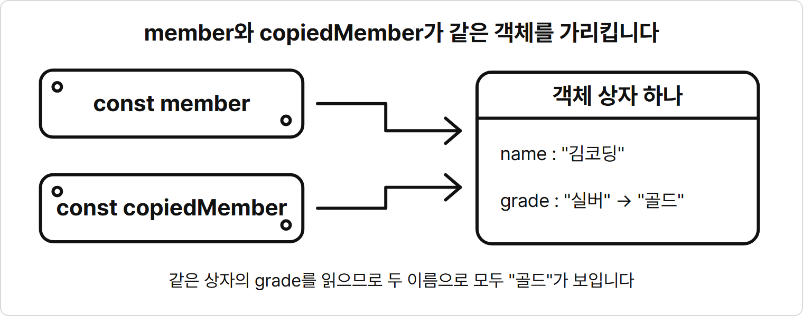
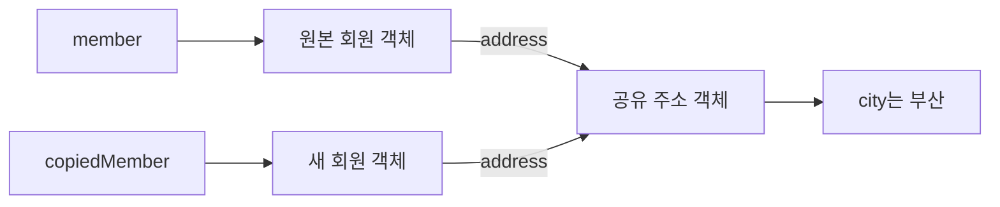

# 6장. 구조분해 할당과 전개 연산자

**학습목표**

- 계산된 속성 이름으로 변수에 담긴 이름의 속성을 만들 수 있습니다.
- 배열과 객체에서 필요한 값을 구조분해로 꺼내고 함수 매개변수에도 적용할 수 있습니다.
- 원시 값의 할당과 객체 참조의 할당을 구분할 수 있습니다.
- 전개 연산자로 배열·객체를 복사하고 안쪽 객체가 공유되는 범위를 설명할 수 있습니다.

## 6-1 계산된 속성 이름

5장에서는 함수가 객체를 받아 값을 읽거나 새 객체를 돌려주었습니다.
이 장에서는 변수로 속성 이름을 정해 객체를 만들고 배열·객체에서 값을 꺼내는 문법을 익힙니다.
그다음 객체를 다른 변수에 할당하는 것과 새 객체로 복사하는 것의 차이를 봅니다.

이 장의 예제는 모두 `js-course/chapter06` 폴더에 만들고 node로 실행합니다.
VS Code에서 `js-course` 폴더 안에 `chapter06` 폴더를 만듭니다.
새 터미널의 현재 위치가 `js-course`이면 `cd chapter06`을 입력해 둡니다.

### 계산된 속성 이름

2장에서 쓴 `{ name: "김코딩" }`처럼 중괄호 안에 속성을 직접 적어 객체를 만드는 모양을 **객체 리터럴**(object literal)이라고 합니다.
객체 리터럴에서는 보통 콜론 왼쪽에 속성 이름을 글자 그대로 적습니다.
**계산된 속성 이름**(computed property name)은 객체를 만들 때 대괄호 `[]` 안의 값으로 속성 이름을 정하는 문법입니다.
`{ [key]: value }`라고 쓰면 변수 `key`에 담긴 문자열이 새 속성의 이름이 됩니다.

### 계산된 속성 이름은 왜 필요할까?

실행할 때 정해지는 속성 이름을 같은 코드로 처리하기 위해 필요합니다.

게시글의 제목을 담을 때는 속성 이름이 `title`이고, 내용을 담을 때는 `content`라고 생각해 봅시다.
어느 속성을 쓸지가 변수 `key`에 담겨 있으면 `post.key`로는 그 이름을 쓸 수 없습니다.
점 뒤의 `key`는 변수의 값이 아니라 글자 그대로의 속성 이름이기 때문입니다.

`makeField(key, value)`에서 `{ [key]: value }`를 돌려주면 받은 이름으로 속성 하나를 만듭니다.
`title`과 `content`마다 함수를 따로 만들 필요가 없습니다.

**특징**

- 객체 리터럴의 속성 이름 자리에 대괄호를 씁니다.
- 대괄호 안에는 속성 이름으로 쓸 값을 담은 변수를 넣을 수 있습니다.
- 콜론 오른쪽에는 그 속성에 담을 값을 씁니다.

**비교 — 속성 이름을 직접 쓰기와 변수로 정하기**

| 비교 항목 | 이름을 직접 쓰기 | 계산된 속성 이름 |
|---|---|---|
| 모양 | `{ key: value }` | `{ [key]: value }` |
| 속성 이름 | `key` | 변수 `key`에 담긴 값 |
| `key`가 `"title"`일 때 | `key` 속성 | `title` 속성 |

**기본 문법**

```javascript
const 객체명 = { [키가 담긴 변수]: 값 };
```

함수는 이 장부터 이름을 붙인 `function` 선언문으로 씁니다.

**예제 6-1** `make-field.js`

```javascript
function makeField(key, value) {
  return { [key]: value };
}

console.log(makeField("title", "첫 번째 게시글"));
console.log(makeField("content", "자바스크립트를 연습합니다."));
```

**실행 결과**

```text
{ title: '첫 번째 게시글' }
{ content: '자바스크립트를 연습합니다.' }
```

- 첫 호출의 `key`에는 `"title"`이 담기므로 `{ [key]: value }`는 `title` 속성을 만듭니다.
- 두 번째 호출에서는 같은 코드가 `content` 속성을 만듭니다.
- 2장의 `member[key]`는 이미 있는 객체에서 값을 읽는 모양이고, 여기의 `{ [key]: value }`는 새 객체에 속성을 만드는 모양입니다.

## 6-2 배열 구조분해

지금까지 배열의 값을 꺼낼 때는 `scores[0]`, `scores[1]`처럼 인덱스를 하나씩 썼습니다.
꺼낼 값이 몇 개로 정해져 있으면 변수 이름을 나란히 적어 한 번에 꺼낼 수 있습니다.

**구조분해 할당**(destructuring assignment)은 배열의 요소나 객체의 속성 값을 여러 변수에 나누어 담는 문법입니다.
**배열 구조분해**(array destructuring)는 대괄호 안에 쓴 변수에 배열의 요소를 앞에서부터 순서대로 담습니다.
쉽게 말해 배열의 첫 칸, 둘째 칸에 붙일 이름을 한 줄에 적는 것입니다.

**특징**

- `=` 왼쪽 대괄호에는 선언할 변수 이름을 씁니다.
- 첫 번째 변수에는 인덱스 0, 두 번째 변수에는 인덱스 1의 값이 담깁니다.
- 배열보다 변수 이름을 적게 쓰면 앞쪽 값만 꺼냅니다.
- 해당 순서의 요소가 없으면 변수에는 `undefined`가 담깁니다.

**시각자료 — 배열의 순서와 변수의 순서**

```text
scores             [ 90,      80,      70 ]
index                0        1        2
                     |        |        |
                     v        v        v
const [            korean, english,   math ] = scores;
```

변수 이름을 보고 과목을 찾는 것이 아니라 배열의 순서대로 값을 담습니다.
따라서 첫 점수가 국어 점수라는 약속에 맞춰 첫 변수 이름을 `korean`으로 씁니다.

**기본 문법**

```javascript
const [변수명1, 변수명2] = 배열명;
```

**예제 6-2** `array-destructure.js`

```javascript
const scores = [90, 80, 70];
const [korean, english, math] = scores;
const [firstScore] = scores;
const [first, second, third, fourth] = scores;

console.log(`국어: ${korean}점, 영어: ${english}점, 수학: ${math}점`);
console.log(`첫 점수: ${firstScore}점`);
console.log(first, second, third, fourth);
console.log(scores);
```

**실행 결과**

```text
국어: 90점, 영어: 80점, 수학: 70점
첫 점수: 90점
90 80 70 undefined
[ 90, 80, 70 ]
```

- `[korean, english, math]`는 세 변수를 선언하면서 점수를 순서대로 담습니다.
- `[firstScore]`처럼 변수 하나만 쓰면 첫 번째 값만 꺼냅니다.
- `fourth`에 해당하는 네 번째 요소가 없으므로 `undefined`입니다.
- 구조분해는 값을 읽는 동작입니다. 요소를 배열에서 빼지 않으므로 `scores`는 그대로입니다.

## 6-3 객체 구조분해와 매개변수 구조분해

배열 구조분해가 순서대로 값을 꺼냈다면 객체 구조분해는 속성 이름으로 값을 꺼냅니다.
2장에서 배운 `member.name`과 `member.grade`를 각각 변수에 담는 일을 한 줄로 쓸 수 있습니다.

### 객체 구조분해

**객체 구조분해**(object destructuring)는 `=` 왼쪽 중괄호에 쓴 이름과 같은 속성을 찾아 변수에 담는 문법입니다.
`const { name, grade } = member;`는 `member`에서 `name`, `grade` 속성을 읽어 같은 이름의 변수를 선언합니다.

**특징**

- 중괄호 안의 이름은 읽을 속성 이름이면서 선언할 변수 이름입니다.
- 변수 이름을 쓰는 순서는 객체 안의 속성 순서와 달라도 됩니다.
- 필요한 속성 이름만 골라 쓸 수 있습니다.
- 없는 속성을 꺼내면 `undefined`가 담깁니다.

**비교 — 배열 구조분해와 객체 구조분해**

| 비교 항목 | 배열 구조분해 | 객체 구조분해 |
|---|---|---|
| 왼쪽 기호 | `[]` | `{}` |
| 값을 찾는 기준 | 요소의 순서 | 속성 이름 |
| 이름의 순서 | 바꾸면 담기는 값이 달라진다 | 바꿔도 같은 속성을 읽는다 |

**기본 문법**

```javascript
const { 키1, 키2 } = 객체명;
```

**예제 6-3** `object-destructure.js`

```javascript
const member = {
  name: "김코딩",
  age: 26,
  grade: "실버"
};

const { grade, name } = member;

console.log(`${name}님의 등급은 ${grade}입니다.`);
console.log(member.age);
```

**실행 결과**

```text
김코딩님의 등급은 실버입니다.
26
```

- 객체에는 `name`을 먼저 썼지만 구조분해에는 `grade`를 먼저 썼습니다. 객체 구조분해는 순서가 아니라 이름으로 찾으므로 결과는 같습니다.
- `age`는 꺼내지 않았습니다. 필요한 `name`과 `grade`만 변수로 만들었습니다.
- 꺼내지 않은 `age` 속성도 원본 객체에 그대로 남아 있습니다.

### 구조분해의 기본값

객체 구조분해에서 `이름 = 기본값`을 쓰면 꺼낸 값이 `undefined`일 때 대신 쓸 값을 정합니다.
5장의 기본값 매개변수처럼 `=` 뒤에 기본값을 씁니다.

**특징**

- 속성이 없거나 속성 값이 `undefined`일 때 기본값을 씁니다.
- 값이 `null`, `0`, `false`, 빈 문자열이면 그 값을 그대로 담습니다.
- 기본값은 꺼낸 변수에만 담기고 원본 객체에 속성을 추가하지 않습니다.

**기본 문법**

```javascript
const { 키 = 기본값 } = 객체명;
```

**예제 6-4** `destructure-default.js`

```javascript
const member = {
  name: "이자바",
  nickname: "",
  points: 0,
  isAdmin: false,
  phone: null
};

const { name, grade = "일반", nickname = "손님" } = member;
const { points = 100, isAdmin = true, phone = "미등록" } = member;

console.log(`${name}님의 등급: ${grade}`);
console.log(`닉네임: [${nickname}]`);
console.log(points, isAdmin, phone);
console.log(member.grade);
```

**실행 결과**

```text
이자바님의 등급: 일반
닉네임: []
0 false null
undefined
```

- `member`에는 `grade`가 없으므로 꺼낸 변수 `grade`에 기본값 `"일반"`이 담깁니다.
- `nickname`은 빈 문자열이므로 `"손님"`으로 바뀌지 않습니다. 출력의 `[]` 안이 비어 있는 것으로 확인합니다.
- `points`, `isAdmin`, `phone`에는 각각 `0`, `false`, `null`이 그대로 담깁니다.
- `member.grade`는 여전히 `undefined`입니다. 기본값은 원본 객체를 바꾸지 않습니다.

3장에서 배운 `||`, `??`와 기본값이 쓰이는 조건을 나란히 보면 다음과 같습니다.

**비교 — 기본값을 쓰는 조건**

| 비교 항목 | 구조분해의 기본값 | `??` | `\|\|` |
|---|---|---|---|
| `undefined` | 기본값 | 기본값 | 기본값 |
| `null` | 원래 값 | 기본값 | 기본값 |
| `0`, `false`, `""` | 원래 값 | 원래 값 | 기본값 |

### 매개변수 구조분해

**매개변수 구조분해**(parameter destructuring)는 함수의 매개변수 자리에 구조분해 모양을 쓰는 방법입니다.
객체를 인수로 넘기면 함수가 시작될 때 필요한 속성을 바로 변수로 꺼냅니다.
쉽게 말해 객체를 받는 일과 속성을 꺼내는 일을 함수의 괄호 안에서 함께 합니다.

**특징**

- 함수의 매개변수 괄호 안에 `{ name, price }`처럼 씁니다.
- 호출할 때는 꺼낼 값이 담긴 객체 하나를 인수로 넘깁니다.
- 꺼낸 이름은 함수 안에서 매개변수로 씁니다.
- 각 속성에 `=`를 붙여 기본값을 정할 수 있습니다.

**기본 문법**

```javascript
function 함수명({ 키1, 키2 = 기본값 }) {
  실행할 코드
}

함수명(객체명);
```

5장의 `formatWithPrice(product)`는 `product.name`과 `product.price`를 읽었습니다.
필요한 두 속성을 매개변수에서 꺼내면 함수 안에서는 `name`, `price`만 씁니다.

**예제 6-5** `parameter-destructure.js`

```javascript
function formatWithPrice({ name, price }) {
  return `${name}: ${price}원`;
}

const product = { name: "무선 마우스", price: 12000, stock: 5 };

console.log(formatWithPrice(product));
console.log(formatWithPrice({ name: "모니터", price: 230000 }));
```

**실행 결과**

```text
무선 마우스: 12000원
모니터: 230000원
```

- `formatWithPrice(product)`는 객체 하나를 넘깁니다. `name`과 `price`는 두 인수를 받는 것이 아니라 그 객체에서 두 속성을 꺼내는 매개변수입니다.
- `stock`은 함수가 쓰지 않으므로 꺼내지 않았습니다.
- 객체를 변수에 담아 넘기거나 호출하는 괄호 안에 바로 만들어 넘겨도 됩니다.

이번에는 수량이 없으면 한 개로 계산하도록 기본값을 붙입니다.

**예제 6-6** `parameter-destructure-default.js`

```javascript
function getSubtotal({ price, quantity = 1 }) {
  return price * quantity;
}

console.log(getSubtotal({ price: 12000 }));
console.log(getSubtotal({ price: 5000, quantity: 2 }));
console.log(getSubtotal({ price: 5000, quantity: 0 }));
```

**실행 결과**

```text
12000
10000
0
```

- 첫 객체에는 `quantity`가 없으므로 기본값 `1`을 씁니다.
- 두 번째 객체에는 `quantity: 2`가 있으므로 `5000 * 2`를 돌려줍니다.
- 세 번째 객체의 수량 `0`도 값이므로 기본값으로 바뀌지 않습니다.
- 이 함수의 기본값은 객체 안의 수량에 대한 것입니다. 호출할 때는 `price`가 담긴 객체를 넘깁니다.

## 6-4 값과 참조

이번에는 변수를 다른 변수에 할당할 때 원래 값과 어떻게 이어지는지 살펴봅니다.
숫자·문자열 같은 원시 값과 객체는 할당 뒤의 관계가 다릅니다.

### 원시 값의 할당

2장에서 배운 원시 값을 다른 변수에 할당하면 그 값이 복사됩니다.
한쪽 변수에 새 값을 재할당해도 다른 쪽 변수의 값은 그대로입니다.

**예제 6-7** `primitive-value.js`

```javascript
let price = 12000;
let copiedPrice = price;

copiedPrice = 10000;

console.log(`원래 가격: ${price}원`);
console.log(`바꾼 가격: ${copiedPrice}원`);
```

**실행 결과**

```text
원래 가격: 12000원
바꾼 가격: 10000원
```

- `let copiedPrice = price;`를 실행한 순간의 숫자 `12000`이 `copiedPrice`에 담깁니다.
- `copiedPrice = 10000;`은 `copiedPrice`만 바꿉니다. `price`는 여전히 `12000`입니다.

### 객체의 참조

**참조**(reference)는 특정 객체를 가리키는 값입니다.
객체를 변수에 담으면 객체를 가리키는 참조가 담기고, 다른 변수에 할당하면 그 참조가 복사됩니다.
쉽게 말해 객체 안의 속성을 옮겨 담는 것이 아니라 같은 객체에 이름을 하나 더 붙이는 것입니다.

**특징**

- 객체를 다른 변수에 할당해도 새 객체가 생기지 않습니다.
- 같은 객체를 가리키면 한쪽에서 바꾼 속성이 다른 쪽에서도 보입니다.
- 객체끼리 `===`로 비교하면 같은 객체를 가리키는지 확인합니다.

2장의 비유를 이어 보면 `const` 이름표 두 개가 객체 상자 하나를 가리킵니다.
`member` 이름으로 열어도 `copiedMember` 이름으로 열어도 같은 상자입니다.

**시각자료 — 두 이름표가 가리키는 객체 하나**



이름표는 두 개지만 객체 상자는 하나입니다.
`copiedMember.grade`를 바꾸면 같은 상자를 읽는 `member.grade`도 바뀐 값입니다.

**기본 문법**

```javascript
const 다른 변수명 = 객체명;
객체명 === 다른 변수명;
```

**예제 6-8** `object-reference.js`

```javascript
const member = { name: "김코딩", grade: "실버" };
const copiedMember = member;

console.log(member === copiedMember);

copiedMember.grade = "골드";

console.log(`member 등급: ${member.grade}`);
console.log(`copiedMember 등급: ${copiedMember.grade}`);

const anotherMember = { name: "김코딩", grade: "골드" };
console.log(member === anotherMember);
```

**실행 결과**

```text
true
member 등급: 골드
copiedMember 등급: 골드
false
```

- `const copiedMember = member;`는 같은 참조를 담으므로 `member === copiedMember`는 `true`입니다.
- `copiedMember.grade = "골드";`로 바꾼 것은 두 변수가 함께 가리키는 객체 안의 속성입니다.
- 이름이 `copiedMember`여도 객체가 새로 복사되지는 않습니다. 변수 이름이 아니라 할당한 코드가 관계를 정합니다.
- `anotherMember`는 같은 이름과 등급을 담았지만 따로 만든 객체입니다. 속성 값이 모두 같아도 객체 자체가 다르므로 `false`입니다.

### 배열의 참조

배열도 객체이므로 다른 변수에 할당하면 같은 배열을 가리킵니다.
4장에서 배운 `push`를 한쪽 변수로 실행하면 다른 쪽에서도 늘어난 요소를 볼 수 있습니다.

**예제 6-9** `array-reference.js`

```javascript
const cart = ["무선 마우스", "기계식 키보드"];
const copiedCart = cart;

copiedCart.push("모니터");

console.log(cart);
console.log(copiedCart);
console.log(cart === copiedCart);
```

**실행 결과**

```text
[ '무선 마우스', '기계식 키보드', '모니터' ]
[ '무선 마우스', '기계식 키보드', '모니터' ]
true
```

- `cart`와 `copiedCart`는 배열 하나를 함께 가리킵니다. `push`는 그 배열의 끝에 값을 넣습니다.
- 두 출력 모두 요소 세 개를 보여 주고, `===`도 `true`입니다.

**비교 — 원시 값과 객체를 할당하기**

| 비교 항목 | 원시 값 | 객체·배열 |
|---|---|---|
| 다른 변수에 할당 | 값이 복사된다 | 참조가 복사된다 |
| 한쪽에서 바꾸기 | 재할당한 변수만 바뀐다 | 속성·요소를 바꾸면 함께 보인다 |
| `===`의 기준 | 자료형과 값 | 같은 객체인지 |

## 6-5 전개 연산자로 복사하기

6-4처럼 참조를 할당하면 원본과 복사본을 따로 수정할 수 없습니다.
이번에는 새 배열이나 새 객체를 만들면서 기존 내용을 옮겨 담습니다.

**전개 연산자**(spread syntax)는 `...` 뒤에 쓴 배열의 요소나 객체의 속성을 펼치는 문법입니다.
새 배열의 `[]` 안이나 새 객체의 `{}` 안에서 펼치면 기존 내용을 담은 새 값이 만들어집니다.
쉽게 말해 새 상자를 마련하고 기존 상자의 내용을 한 번에 옮겨 적는 것입니다.

### 전개 연산자는 왜 필요할까?

원본을 그대로 두고 바뀐 배열이나 객체를 새로 만들기 위해 필요합니다.

회원의 등급만 바꾸고 이름과 나이는 그대로 두고 싶다고 생각해 봅시다.
`member.grade = "골드";`라고 쓰면 원본의 등급이 바뀝니다.
새 객체를 직접 만들려면 바꾸지 않을 `name`과 `age`도 하나하나 다시 적어야 합니다.

`{ ...member, grade: "골드" }`라고 쓰면 기존 속성을 모두 펼친 뒤 등급만 바꾼 새 객체를 만듭니다.
원본의 속성을 옮겨 적는 수고를 줄이면서 원래 등급도 남겨 둡니다.

**특징**

- 배열의 요소는 새 배열의 대괄호 안에서 `...배열명`으로 펼칩니다.
- 객체의 속성은 새 객체의 중괄호 안에서 `...객체명`으로 펼칩니다.
- 펼친 값 앞뒤에 새 요소나 속성을 쓸 수 있습니다.
- 새 배열·객체는 원본과 다른 대상이므로 원본과 `===`로 비교하면 `false`입니다.

전개 연산자로 새 객체를 만드는 일은 새 상자에 물건을 옮겨 담는 장면과 비슷합니다.
기존 상자의 물건을 새 상자에 똑같이 담고, 바꿀 물건 하나만 다른 것으로 넣습니다.
기존 상자는 그대로 남습니다.

**시각자료 — 물건 하나만 바꿔 담은 새 상자**

```text
[생성 이미지: images/06/spread-new-box.png]
장면: 왼쪽에 뚜껑이 열린 상자가 있고 안에 책, 컵, 메달이 들어 있다. 오른쪽에 같은 크기의 새 상자가 있고 안에 똑같은 책과 컵이 들어 있다. 손이 리본 달린 큰 메달 하나를 새 상자에 넣고 있다.
비율: 가로 3:2
스타일: 굵기가 일정한 검정 외곽선의 단순한 선 그림. 흰 배경. 그림자와 그라데이션 없음. 흰색과 검정만 쓴다. 글자, 숫자, 기호는 넣지 않는다.
참고 그림: book-manuscript/assets/style-ref/line-art-shark.png
```

왼쪽 상자가 원본 `member`, 오른쪽 상자가 `{ ...member, grade: "골드" }`로 만든 새 객체입니다.
책과 컵은 펼쳐 옮긴 `name`과 `age`이고, 손에 든 리본 메달이 새로 넣은 `grade`입니다.

### 배열 복사하기

**기본 문법**

```javascript
const 새 배열명 = [...배열명];
```

**예제 6-10** `array-spread.js`

```javascript
const cart = ["무선 마우스", "기계식 키보드"];
const copiedCart = [...cart];

copiedCart[0] = "마우스 패드";

console.log(cart);
console.log(copiedCart);
console.log(cart === copiedCart);
```

**실행 결과**

```text
[ '무선 마우스', '기계식 키보드' ]
[ '마우스 패드', '기계식 키보드' ]
false
```

- `[...cart]`는 새 배열을 만들고 `cart`의 요소를 순서대로 넣습니다.
- `copiedCart[0]`을 바꿔도 원본 `cart[0]`은 `"무선 마우스"`입니다.
- 예제 6-9의 `const copiedCart = cart;`와 달리 두 변수는 서로 다른 배열을 가리킵니다.

### 배열 합치기

새 배열 안에서 배열 여러 개를 펼치면 요소가 순서대로 합쳐집니다.
새 요소도 같은 대괄호 안에 넣습니다.

**기본 문법**

```javascript
const 새 배열명 = [...배열명1, ...배열명2, 새 값];
```

**예제 6-11** `array-merge.js`

```javascript
const cart = ["무선 마우스", "기계식 키보드"];
const accessories = ["마우스 패드", "USB 허브"];

const newCart = [...cart, ...accessories, "모니터"];

console.log(newCart);
console.log(cart);
console.log(accessories);
```

**실행 결과**

```text
[ '무선 마우스', '기계식 키보드', '마우스 패드', 'USB 허브', '모니터' ]
[ '무선 마우스', '기계식 키보드' ]
[ '마우스 패드', 'USB 허브' ]
```

- `cart`의 두 요소 다음에 `accessories`의 두 요소를 펼칩니다.
- 마지막 문자열 `"모니터"`는 새 요소 하나로 들어갑니다.
- 원래 배열 둘은 그대로입니다. `push`로 기존 배열에 넣은 것이 아니라 새 배열을 만들었습니다.

### 객체 복사하고 속성 바꾸기

객체도 전개만 하면 같은 속성을 담은 새 객체가 됩니다.
그 뒤에 바꿀 속성을 쓰면 그 값으로 새 객체의 속성을 정합니다.

**특징**

- 같은 이름의 속성을 여러 번 쓰면 뒤에 쓴 값이 남습니다.
- 바꿀 속성을 전개 뒤에 쓰면 원본의 값 대신 새 값을 담습니다.
- 원본에 없는 속성을 뒤에 쓰면 새 객체에 그 속성이 추가됩니다.

**기본 문법**

```javascript
const 복사본 = { ...객체명 };
const 변경본 = { ...객체명, 키: 새 값 };
```

**예제 6-12** `object-spread.js`

```javascript
const member = { name: "김코딩", age: 26, grade: "실버" };
const copiedMember = { ...member };
const updatedMember = { ...member, grade: "골드" };

console.log(copiedMember);
console.log(`원본 등급: ${member.grade}`);
console.log(`변경본 등급: ${updatedMember.grade}`);
console.log(member === copiedMember);
console.log(member === updatedMember);
```

**실행 결과**

```text
{ name: '김코딩', age: 26, grade: '실버' }
원본 등급: 실버
변경본 등급: 골드
false
false
```

- `{ ...member }`는 모든 속성을 담은 새 객체를 만듭니다. 속성 값이 같아도 `member === copiedMember`는 `false`입니다.
- `{ ...member, grade: "골드" }`는 이름과 나이를 옮겨 담고 등급만 `"골드"`로 정합니다.
- `grade`를 전개 뒤에 썼으므로 뒤의 값이 남습니다. 원본 `member.grade`는 `"실버"` 그대로입니다.

### 객체 합치기

객체 여러 개의 속성도 새 객체 안에서 함께 펼칠 수 있습니다.
기본 설정 위에 사용자가 정한 설정을 적용할 때 쓰기 좋은 모양입니다.

**기본 문법**

```javascript
const 새 객체명 = { ...객체명1, ...객체명2 };
```

**예제 6-13** `object-merge.js`

```javascript
const defaults = { theme: "밝게", fontSize: 16 };
const preferences = { fontSize: 20 };

const settings = { ...defaults, ...preferences };

console.log(settings);
console.log(defaults);
console.log(preferences);
```

**실행 결과**

```text
{ theme: '밝게', fontSize: 20 }
{ theme: '밝게', fontSize: 16 }
{ fontSize: 20 }
```

- 먼저 `defaults`의 `theme`, `fontSize`를 펼칩니다.
- 뒤의 `preferences`에도 `fontSize`가 있으므로 새 객체에는 뒤의 값 `20`이 남습니다.
- 원본 두 객체는 바뀌지 않습니다. 펼치는 순서를 바꾸면 어떤 값이 남는지도 달라집니다.

### 변수로 정한 속성 바꾸기

6-1의 계산된 속성 이름을 전개 뒤에 쓰면 변수에 담긴 이름의 속성을 바꾼 새 객체를 만듭니다.
`key`에 `"title"`이 담기면 제목을, `"content"`가 담기면 내용을 바꿀 수 있습니다.

**기본 문법**

```javascript
const 새 객체명 = { ...객체명, [키가 담긴 변수]: 새 값 };
```

**예제 6-14** `field-spread.js`

```javascript
const post = {
  title: "첫 번째 게시글",
  content: "자바스크립트를 연습합니다."
};

const key = "title";
const value = "수정한 제목";
const updatedPost = { ...post, [key]: value };

console.log(post);
console.log(updatedPost);
```

**실행 결과**

```text
{ title: '첫 번째 게시글', content: '자바스크립트를 연습합니다.' }
{ title: '수정한 제목', content: '자바스크립트를 연습합니다.' }
```

- `...post`가 제목과 내용을 펼치고, `[key]`가 `title`을 속성 이름으로 정합니다.
- 뒤에 쓴 `title`의 값이 남으므로 새 객체는 제목만 바뀝니다.
- 이 코드의 `key`는 변수 이름입니다. 새 객체에 이름이 `key`인 속성을 만드는 것이 아닙니다.

## 따라하기 실습 — 게시글 초안 복사하고 요약하기

**실습 목표**

- 제목과 내용 변수를 같은 이름의 속성에 담아 게시글 객체를 만듭니다.
- 속성 이름을 받아 해당 값만 바꾼 새 객체를 만드는 함수를 작성합니다.
- 전개로 새 태그 배열을 만들고 구조분해로 게시글과 태그를 요약합니다.

이 실습의 태그는 게시글을 분류하는 짧은 문자열입니다.
원래 초안을 남겨 두고 제목과 태그를 바꾼 게시글을 따로 만듭니다.

**준비**

1. `chapter06` 폴더 안에 `post-copy.js` 파일을 만듭니다.
2. 터미널의 현재 위치가 `chapter06`인지 확인합니다.

**실습 코드**

`chapter06/post-copy.js`

```javascript
const title = "첫 번째 게시글";
const content = "자바스크립트를 연습합니다.";
const tags = ["학습", "기록"];
const post = { title: title, content: content, tags: tags };

function updateField(post, key, value) {
  return { ...post, [key]: value };
}

function formatPost({ title, content, author = "김코딩" }) {
  return `${author} / ${title} / ${content}`;
}

const changedPost = updateField(post, "title", "구조분해 연습");
const updatedPost = {
  ...changedPost,
  tags: [...post.tags, "자바스크립트"]
};

const [firstTag, secondTag] = updatedPost.tags;

console.log(`[원본] ${formatPost(post)}`);
console.log(`[변경본] ${formatPost(updatedPost)}`);
console.log(`앞의 두 태그: ${firstTag}, ${secondTag}`);
console.log("원본 태그:", post.tags);
console.log("변경본 태그:", updatedPost.tags);
console.log("같은 게시글인가:", post === updatedPost);
console.log("같은 태그 배열인가:", post.tags === updatedPost.tags);
```

**실행 방법**

1. 코드를 입력하고 저장합니다.
2. 터미널에서 다음 명령을 입력합니다.
   ```bash
   node post-copy.js
   ```

**실행 결과**

```text
[원본] 김코딩 / 첫 번째 게시글 / 자바스크립트를 연습합니다.
[변경본] 김코딩 / 구조분해 연습 / 자바스크립트를 연습합니다.
앞의 두 태그: 학습, 기록
원본 태그: [ '학습', '기록' ]
변경본 태그: [ '학습', '기록', '자바스크립트' ]
같은 게시글인가: false
같은 태그 배열인가: false
```

**코드 설명**

- `{ title: title, content: content, tags: tags }`는 변수 셋의 값을 같은 이름의 속성에 담아 게시글 객체를 만듭니다. 콜론 왼쪽은 속성 이름이고 오른쪽은 변수입니다.
- `updateField()`는 전개 뒤에 `[key]: value`를 써서 받은 이름의 속성을 바꾼 새 객체를 돌려줍니다.
- `changedPost`에는 바뀐 제목이 담기고 원본의 제목은 그대로 남습니다.
- `tags: [...post.tags, "자바스크립트"]`는 새 태그 배열을 만들어 새 게시글에 담습니다. 원래 배열에 `push`하지 않았습니다.
- `formatPost()`는 매개변수 구조분해로 제목과 내용을 꺼냅니다. `author` 속성이 없으므로 기본값 `"김코딩"`을 씁니다.
- `[firstTag, secondTag]`는 변경본 태그 배열의 앞 두 요소를 꺼냅니다. 마지막 태그는 배열에 그대로 남습니다.
- 마지막 두 비교로 게시글 객체와 태그 배열 모두 원본과 다른 대상임을 확인합니다.

**바꿔 보기 1**

제목 대신 내용을 바꿔 봅니다.
원래 실습 코드에서 `const changedPost = updateField(post, "title", "구조분해 연습");` 줄을 다음처럼 바꿉니다.

```javascript
const changedPost = updateField(post, "content", "전개 연산자를 연습합니다.");
```

변경본 줄은 `[변경본] 김코딩 / 첫 번째 게시글 / 전개 연산자를 연습합니다.`가 됩니다.
원본 줄과 태그 출력은 그대로입니다.

**바꿔 보기 2**

원래 실습 코드로 되돌린 뒤 새 태그를 배열 맨 앞에 넣어 봅니다.
`tags: [...post.tags, "자바스크립트"]` 줄을 다음처럼 바꿉니다.

```javascript
tags: ["자바스크립트", ...post.tags]
```

변경본 태그가 `[ '자바스크립트', '학습', '기록' ]`으로 바뀝니다.
따라서 앞의 두 태그를 꺼낸 출력도 `앞의 두 태그: 자바스크립트, 학습`으로 바뀝니다.
원본 태그는 `[ '학습', '기록' ]` 그대로입니다.

## 6-6 얕은 복사와 깊은 복사

6-5에서는 새 객체와 새 배열을 만들었습니다.
그런데 객체의 속성 값이 또 다른 객체라면 바깥만 새로 만든 것으로는 안쪽까지 분리되지 않습니다.

### 얕은 복사

**얕은 복사**(shallow copy)는 바깥 배열·객체를 새로 만들고 그 안의 요소·속성 값을 복사하는 방식입니다.
안쪽 값이 객체라면 그 객체의 참조가 복사되므로 원본과 복사본이 안쪽 객체를 함께 가리킵니다.
전개 연산자로 만드는 복사본이 이 방식입니다.

**특징**

- 바깥 배열·객체는 새로 만들어집니다.
- 안쪽 객체·배열은 자동으로 새로 만들어지지 않습니다.
- 공유하는 안쪽 객체의 속성을 바꾸면 원본에서도 바뀐 값이 보입니다.

**기본 문법**

```javascript
const 복사본 = { ...객체명 };
```

다음 예제는 안쪽 주소가 공유된다는 것을 확인하려고 복사본의 도시를 직접 바꿉니다.
원본의 도시까지 바뀌는지 출력으로 확인합니다.

**예제 6-15** `shallow-copy.js`

```javascript
const member = {
  name: "김코딩",
  address: { city: "서울", zipCode: "04524" }
};

const copiedMember = { ...member };

console.log("같은 회원 객체인가:", member === copiedMember);
console.log("같은 주소 객체인가:", member.address === copiedMember.address);

copiedMember.address.city = "부산";

console.log(`원본 도시: ${member.address.city}`);
console.log(`복사본 도시: ${copiedMember.address.city}`);
```

**실행 결과**

```text
같은 회원 객체인가: false
같은 주소 객체인가: true
원본 도시: 부산
복사본 도시: 부산
```

- `{ ...member }`는 바깥 회원 객체만 새로 만듭니다. 첫 비교는 `false`입니다.
- `address`에 들어 있던 참조는 그대로 복사되므로 두 회원 객체가 주소 하나를 가리킵니다. 두 번째 비교는 `true`입니다.
- 공유하는 주소의 `city`를 바꿨으므로 양쪽 모두 `부산`입니다. 원본 주소를 지키려면 주소 객체도 새로 만들어야 합니다.

**시각자료 — 바깥 객체는 둘이고 주소 객체는 하나**



두 바깥 객체의 `address`는 같은 안쪽 객체를 가리킵니다.
그림은 예제 6-15에서 도시를 바꾼 뒤의 모습입니다.

### 안쪽 객체도 복사하기

원본의 주소를 지키려면 새 회원 객체를 만들 때 `address`도 전개해서 새 객체로 담습니다.
바깥 전개 뒤에 `address`를 다시 쓰므로 공유하던 주소 참조가 새 주소 객체로 바뀝니다.

**기본 문법**

```javascript
const 변경본 = {
  ...객체명,
  안쪽 키: { ...객체명.안쪽 키, 바꿀 키: 새 값 }
};
```

**예제 6-16** `nested-copy.js`

```javascript
const member = {
  name: "김코딩",
  address: { city: "서울", zipCode: "04524" }
};

const updatedMember = {
  ...member,
  address: { ...member.address, city: "부산" }
};

console.log(`원본 도시: ${member.address.city}`);
console.log(`변경본 도시: ${updatedMember.address.city}`);
console.log(`변경본 우편번호: ${updatedMember.address.zipCode}`);
console.log("같은 회원 객체인가:", member === updatedMember);
console.log("같은 주소 객체인가:", member.address === updatedMember.address);
```

**실행 결과**

```text
원본 도시: 서울
변경본 도시: 부산
변경본 우편번호: 04524
같은 회원 객체인가: false
같은 주소 객체인가: false
```

- `...member`는 이름과 기존 주소 참조를 새 회원 객체로 옮깁니다.
- 뒤의 `address: { ...member.address, city: "부산" }`는 새 주소 객체를 만들어 그 참조로 바꿉니다.
- 안쪽 전개 뒤에 `city`를 썼으므로 도시만 바뀌고 `zipCode`는 `"04524"` 그대로입니다.
- 바깥과 안쪽 모두 새 객체이므로 두 비교가 `false`입니다. 원본의 도시는 `서울`로 남습니다.

따라하기에서 `tags: [...post.tags, "자바스크립트"]`를 쓴 것도 같은 이유입니다.
게시글만 전개하면 안쪽의 태그 배열은 공유되므로 태그 배열을 따로 새로 만들었습니다.
객체 배열을 `[...배열명]`으로 복사할 때도 바깥 배열만 새로 만들고 각 요소의 객체는 공유합니다.

### 깊은 복사라는 말

**깊은 복사**(deep copy)는 안쪽에 중첩된 객체까지 모두 별개의 객체로 복사하는 방식입니다.
쉽게 말해 바깥 상자뿐 아니라 안쪽 상자들도 원본과 나눠 만드는 것입니다.
여기서는 용어만 구분합니다.

**비교 — 얕은 복사와 깊은 복사**

| 비교 항목 | 얕은 복사 | 깊은 복사 |
|---|---|---|
| 바깥 객체 | 새로 만든다 | 새로 만든다 |
| 안쪽 객체 | 참조를 공유한다 | 안쪽까지 별개로 만든다 |
| 전개 한 번의 결과 | 해당한다 | 해당하지 않는다 |

예제 6-16은 이 데이터에 있는 `address`까지 직접 복사한 코드입니다.
안쪽에 객체가 더 들어 있다면 그 객체는 별도로 복사해야 합니다.
전개를 두 번 썼다는 이유만으로 어떤 데이터든 끝까지 깊게 복사되는 것은 아닙니다.

## 연습문제

### 연습문제 1 — 사용자 객체에서 필요한 값만 꺼내 출력

**요구사항**

1. `chapter06` 폴더에 `user-summary.js` 파일을 만듭니다.
2. `user` 객체에 이름(`name`) `"김코딩"`, 나이(`age`) `26`, 이메일(`email`) `"coding@example.com"`, 관리자 여부(`isAdmin`) `false`를 담습니다. 등급(`grade`)은 넣지 않습니다.
3. 객체 구조분해로 `name`, `email`, `grade`만 꺼냅니다. 등급이 없으면 `"일반"`을 씁니다.
4. 꺼낸 변수로 `이름: 김코딩`, `이메일: coding@example.com`, `등급: 일반`처럼 항목마다 한 줄씩 출력합니다.

**완료 조건**

- 이름, 이메일, 등급 순서로 세 줄이 출력됩니다.
- 출력에 `user.name`처럼 점 표기법을 쓰지 않고 꺼낸 변수를 씁니다.
- `user`에 `grade: "골드"`를 추가하면 세 번째 줄은 `등급: 골드`입니다.
- 나이와 관리자 여부는 출력하지 않습니다.

### 연습문제 2 — 설정 객체를 복사해 원본을 지키며 값 바꾸기

**요구사항**

1. `chapter06` 폴더에 `settings-copy.js` 파일을 만듭니다.
2. `settings` 객체에 테마(`theme`) `"밝게"`, 글자 크기(`fontSize`) `16`, 알림 여부(`notifications`) `true`를 담습니다.
3. `updateField(settings, key, value)`를 선언합니다. 받은 설정을 복사하고 `key`에 담긴 이름의 속성을 `value`로 바꾼 새 객체를 돌려줍니다.
4. 함수를 두 번 호출해 테마를 `"어둡게"`로 바꾸고, 그 결과를 받아 글자 크기를 `20`으로 바꿉니다. 최종 결과를 `updatedSettings`에 담습니다.
5. 원본과 최종 결과를 `원본: 밝게 / 16px / 알림 true` 형태로 출력합니다. 마지막 줄에는 두 객체가 같은지 비교한 값을 출력합니다.

**완료 조건**

- 원본은 `밝게`, `16`, `true` 그대로입니다.
- 변경본은 `어둡게`, `20`, `true`입니다.
- 마지막 줄은 `같은 설정 객체인가: false`입니다.
- 함수 안에서 받은 객체의 속성을 직접 수정하지 않습니다.

## 정답과 해설

### 연습문제 1 — 사용자 객체에서 필요한 값만 꺼내 출력

`user-summary.js`

```javascript
const user = {
  name: "김코딩",
  age: 26,
  email: "coding@example.com",
  isAdmin: false
};

const { name, email, grade = "일반" } = user;

console.log(`이름: ${name}`);
console.log(`이메일: ${email}`);
console.log(`등급: ${grade}`);
```

**실행 결과**

```text
이름: 김코딩
이메일: coding@example.com
등급: 일반
```

**해설**

- 필요한 세 속성 이름만 중괄호 안에 썼습니다. 나이와 관리자 여부는 꺼내지 않았습니다.
- `user`에 `grade`가 없으므로 변수 `grade`에는 기본값 `"일반"`이 담깁니다.
- 출력은 꺼낸 변수로 만듭니다. `grade: "골드"`를 추가하면 기본값 대신 실제 속성 값이 출력됩니다.

### 연습문제 2 — 설정 객체를 복사해 원본을 지키며 값 바꾸기

`settings-copy.js`

```javascript
const settings = {
  theme: "밝게",
  fontSize: 16,
  notifications: true
};

function updateField(settings, key, value) {
  return { ...settings, [key]: value };
}

const themeChangedSettings = updateField(settings, "theme", "어둡게");
const updatedSettings = updateField(themeChangedSettings, "fontSize", 20);

console.log(`원본: ${settings.theme} / ${settings.fontSize}px / 알림 ${settings.notifications}`);
console.log(`변경본: ${updatedSettings.theme} / ${updatedSettings.fontSize}px / 알림 ${updatedSettings.notifications}`);
console.log("같은 설정 객체인가:", settings === updatedSettings);
```

**실행 결과**

```text
원본: 밝게 / 16px / 알림 true
변경본: 어둡게 / 20px / 알림 true
같은 설정 객체인가: false
```

**해설**

- 전개로 기존 속성을 옮긴 다음 `[key]: value`로 받은 이름의 속성을 바꿉니다.
- 첫 호출은 테마를 바꾼 새 객체를 돌려줍니다. 두 번째 호출에 그 결과를 넘겼으므로 바뀐 테마를 유지하면서 글자 크기를 바꿉니다.
- 두 호출 모두 원본의 속성을 직접 수정하지 않았으므로 `settings`는 그대로입니다.
- `notifications`를 다시 적지 않아도 전개가 옮겨 담습니다. 설정 속성이 더 늘어도 같은 함수를 쓸 수 있습니다.
