# 10장. DOM 탐색과 제어

**학습목표**

- HTML을 읽어 만든 DOM과 JavaScript의 실행 시점을 설명할 수 있습니다.
- `querySelector()`와 `querySelectorAll()`로 요소를 찾아 다룰 수 있습니다.
- `textContent`, `innerHTML`, `value`를 목적에 맞게 골라 내용을 바꿀 수 있습니다.
- `classList`와 `style`로 선택 상태와 진행 막대의 폭을 바꿀 수 있습니다.

## 10-1 DOM이란

9장에서는 할 일 데이터를 바꾸고 결과를 콘솔에 출력했습니다.
이 장에서는 브라우저가 가진 화면의 요소를 찾아 내용을 바꿉니다.
1장에서 결과만 확인했던, JavaScript로 화면 글자를 바꾸는 동작을 직접 작성합니다.

이 장의 HTML 파일은 `js-course/chapter10`에 만듭니다.
1장에서 만든 `css/common.css`를 그대로 연결하고, 1-3에서 사용한 방법으로 Live Server에서 엽니다.
출력한 값은 Chrome 개발자 도구의 Console 탭에서 확인합니다.

### DOM과 document

**DOM**(Document Object Model)은 HTML 문서를 객체들의 트리로 나타낸 것입니다.
쉽게 말해 브라우저가 HTML을 읽고 JavaScript로 다룰 수 있게 만든 문서의 모습입니다.
**트리**(tree)는 가지가 갈라지는 나무처럼 항목들이 연결된 구조입니다.

이 구조의 각 항목을 **노드**(node)라고 합니다.
HTML 태그를 나타내는 노드는 **요소**(element)이며, 글자도 별도의 노드가 됩니다.
JavaScript의 `document`는 현재 페이지의 문서 객체를 가리킵니다.

**시각자료 — HTML을 읽어 만든 요소 구조**

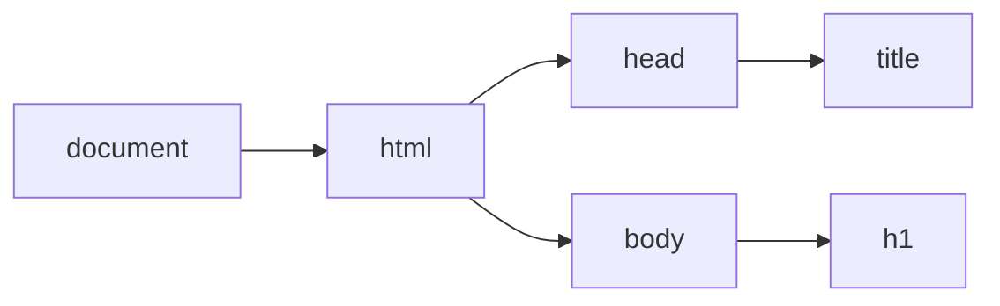

그림은 예제 10-1에서 요소 사이의 연결 일부만 추린 것입니다.
`meta`, `link`, `script` 요소와 글자 노드는 생략했습니다.
브라우저는 이 구조를 만들고 각 요소의 내용과 CSS를 바탕으로 화면을 표시합니다.

### DOM은 왜 필요할까?

JavaScript가 화면의 특정 부분을 찾아 읽거나 바꾸기 위해 필요합니다.

페이지 제목을 HTML에만 적어 두면 JavaScript의 변수처럼 이름으로 읽을 수 없습니다.
문서가 객체로 준비되어 있어야 현재 제목을 읽고 화면에 있는 요소도 골라 바꿀 수 있습니다.

브라우저는 HTML을 읽어 `document`를 준비합니다.
`document.title`로 `<title>`의 글자를 읽어 출력하면 HTML에 적은 페이지 제목이 콘솔에도 나옵니다.

### script의 위치와 defer

브라우저는 HTML을 위에서 아래로 읽으며 DOM을 만듭니다.
1장의 `<script>`를 `</body>` 바로 앞에 둔 이유는 그 위의 화면 요소를 먼저 읽게 하기 위해서입니다.
`head`에 둔 스크립트에서 요소를 다루려면 HTML을 다 읽은 뒤에 실행할 방법이 필요합니다.

`src`는 실행할 JavaScript 파일의 경로입니다.
`defer`는 `src`로 연결한 외부 스크립트를 HTML을 다 읽은 뒤에 실행하도록 지정하는 속성입니다.
태그 사이에 코드를 직접 쓰는 **인라인 스크립트**(inline script)에는 `defer`가 적용되지 않습니다.
이 차이는 [MDN의 script 설명](https://developer.mozilla.org/en-US/docs/Web/HTML/Reference/Elements/script)에도 나와 있습니다.

**특징**

- 외부 스크립트에 `defer`를 쓰면 HTML을 읽는 동안 파일을 내려받습니다.
- 내려받은 코드는 HTML을 다 읽은 뒤 실행합니다.
- 인라인 스크립트에 `defer`만 붙여도 실행 시점은 늦춰지지 않습니다.

**비교 — body 끝의 script와 head의 외부 defer script**

| 비교 항목 | body 끝의 script | head의 외부 defer script |
|---|---|---|
| 위치 | `</body>` 바로 앞 | `head` 안 |
| 실행 시점 | 그 위치까지 HTML을 읽었을 때 | HTML을 다 읽은 뒤 |
| 코드 작성 | 태그 안에 직접 쓸 수 있다 | `src`로 파일을 연결한다 |

**기본 문법**

```html
<script src="파일명.js" defer></script>
```

위 문법은 `head`에서 외부 JavaScript 파일을 연결할 때 쓰는 형태입니다.
이 책의 예제는 HTML 파일 하나에 코드를 직접 쓰므로 `defer`를 붙이지 않고 `<script>`를 `</body>` 바로 앞에 둡니다.
브라우저가 화면 요소를 먼저 읽으므로 그 아래의 JavaScript에서 요소를 바로 다룰 수 있습니다.

**예제 10-1** `dom.html`

```html
<!DOCTYPE html>
<html lang="ko">
<head>
  <meta charset="UTF-8">
  <title>DOM 첫 페이지</title>
  <link rel="stylesheet" href="../css/common.css">
</head>
<body>
  <h1 class="page">DOM 첫 페이지</h1>

  <script>
    console.log(document.title);
  </script>
</body>
</html>
```

**실행 결과**

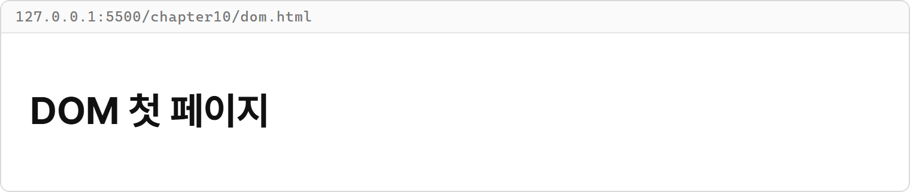

Console 탭에는 다음이 출력됩니다.

```text
DOM 첫 페이지
```

- `document.title`은 문서 객체가 가진 `title` 속성을 읽습니다. 2장에서 배운 점 표기법과 같은 모양입니다.
- 브라우저가 `<script>`에 도착하면 `console.log(document.title);`를 바로 실행합니다. 그 위의 제목 요소는 이미 DOM에 만들어져 있습니다.
- DOM은 브라우저가 만드는 문서 구조이므로 이 예제는 `node` 명령이 아니라 Live Server로 엽니다.

**시각자료 — 단일 HTML 예제가 실행되는 순서**

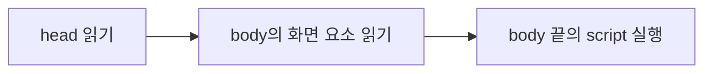

브라우저는 화면 요소를 읽은 뒤 그 아래의 `<script>`에 도착해 JavaScript를 실행합니다.
각 예제의 JavaScript는 그 위에 적힌 화면 요소를 찾아 사용합니다.

## 10-2 요소 찾기

문서 전체를 가리키는 `document`에서 원하는 요소를 골라 봅니다.
HTML·CSS에서 사용한 선택자를 문자열로 넘기면 같은 기준으로 요소를 찾을 수 있습니다.

### querySelector로 하나 찾기

`document.querySelector()`는 CSS 선택자에 맞는 첫 번째 요소를 돌려주는 메서드입니다.
찾은 요소를 변수에 담아 두면 그 변수로 같은 요소를 다시 다룰 수 있습니다.

**특징**

- 선택자는 `"#message"`, `".notice"`, `"h1"`처럼 문자열로 씁니다.
- 여러 요소가 맞아도 문서 순서상 첫 번째 요소 하나만 돌려줍니다.
- 선택자에 맞는 요소가 없으면 `null`을 돌려줍니다.

| 선택자 | 찾는 기준 |
|---|---|
| `"#message"` | `id="message"`인 요소 |
| `".notice"` | `notice` 클래스가 있는 요소 |
| `"h1"` | `h1` 태그인 요소 |

6장의 이름표 비유로 보면, 요소를 찾은 변수는 DOM 객체에 붙인 이름표입니다.
`message`와 `heading`이 같은 요소를 찾으면 이름표는 둘이지만 가리키는 요소는 하나입니다.

**시각자료 — 두 변수가 가리키는 같은 요소**

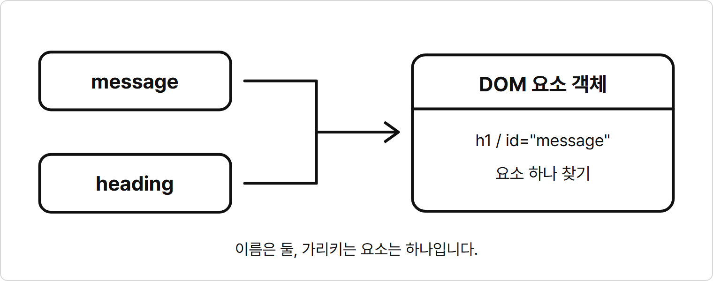

두 변수에 HTML을 복사한 것이 아닙니다.
같은 DOM 객체를 가리키므로 `message === heading`의 결과가 `true`입니다.

**기본 문법**

```javascript
const 요소 변수 = document.querySelector("선택자");
```

**예제 10-2** `query-selector.html`

```html
<!DOCTYPE html>
<html lang="ko">
<head>
  <meta charset="UTF-8">
  <title>요소 하나 찾기</title>
  <link rel="stylesheet" href="../css/common.css">
</head>
<body>
  <main class="page">
    <h1 id="message">요소 하나 찾기</h1>
    <p id="guide" class="notice">첫 번째 안내입니다.</p>
    <p class="notice">두 번째 안내입니다.</p>
  </main>

  <script>
    const message = document.querySelector("#message");
    const heading = document.querySelector("h1");
    const firstNotice = document.querySelector(".notice");
    const guide = document.querySelector("#guide");
    const missing = document.querySelector("#missing");

    console.log("같은 제목 요소:", message === heading);
    console.log("첫 안내 요소:", firstNotice === guide);
    console.log("없는 요소:", missing);
  </script>
</body>
</html>
```

**실행 결과**

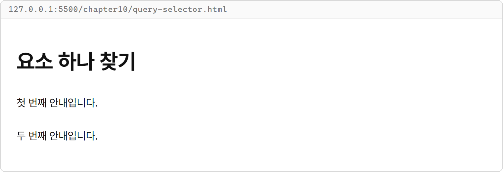

Console 탭에는 다음이 출력됩니다.

```text
같은 제목 요소: true
첫 안내 요소: true
없는 요소: null
```

- `"#message"`와 `"h1"`은 이 문서에서 같은 제목 요소를 찾습니다. 객체의 참조를 비교하므로 `===`는 `true`입니다.
- `".notice"`에 맞는 문단은 두 개지만 `firstNotice`에는 첫 번째 문단만 담깁니다.
- `id="missing"`인 요소는 없으므로 `missing`은 `null`입니다. 없는 요소를 확인할 때는 `요소 변수 === null`로 비교하면 됩니다.

### querySelectorAll로 여러 개 찾기

`document.querySelectorAll()`은 선택자에 맞는 모든 요소를 모아 돌려주는 메서드입니다.
그 결과인 **NodeList**는 노드들을 순서대로 담은 목록입니다.
배열 자체는 아니지만 인덱스, `length`, `forEach()`를 사용할 수 있습니다.

**특징**

- 요소는 문서에 나온 순서대로 담깁니다.
- 첫 요소는 `[0]`, 세 번째 요소는 `[2]`로 꺼냅니다.
- 맞는 요소가 없으면 `length`가 `0`인 목록을 돌려줍니다.
- `forEach()`의 첫 매개변수에는 요소 하나가, 두 번째에는 인덱스가 담깁니다.

**비교 — querySelector와 querySelectorAll**

| 비교 항목 | querySelector | querySelectorAll |
|---|---|---|
| 찾는 수 | 첫 요소 하나 | 맞는 요소 모두 |
| 반환값 | 요소 객체 | NodeList |
| 못 찾았을 때 | `null` | 빈 NodeList |
| 다루는 방법 | 요소 변수로 직접 접근 | 인덱스 또는 `forEach()` |

**기본 문법**

```javascript
const 요소 목록 = document.querySelectorAll("선택자");
요소 목록.forEach((요소, index) => {
  요소마다 실행할 코드
});
```

**예제 10-3** `query-all.html`

```html
<!DOCTYPE html>
<html lang="ko">
<head>
  <meta charset="UTF-8">
  <title>요소 여러 개 찾기</title>
  <link rel="stylesheet" href="../css/common.css">
</head>
<body>
  <main class="page">
    <h1>상품 목록</h1>
    <ul id="productList">
      <li>무선 마우스</li>
      <li>기계식 키보드</li>
      <li>모니터</li>
    </ul>
  </main>

  <script>
    const items = document.querySelectorAll("#productList li");
    const missingItems = document.querySelectorAll(".missing");

    console.log("찾은 항목:", items.length);
    items.forEach((item, index) => {
      console.log(`항목 ${index + 1}: 찾았습니다.`);
    });
    console.log("없는 목록의 길이:", missingItems.length);
  </script>
</body>
</html>
```

**실행 결과**

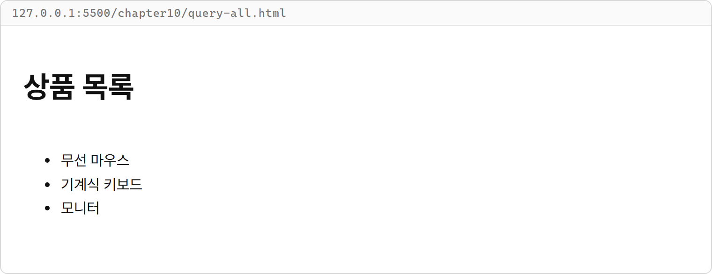

Console 탭에는 다음이 출력됩니다.

```text
찾은 항목: 3
항목 1: 찾았습니다.
항목 2: 찾았습니다.
항목 3: 찾았습니다.
없는 목록의 길이: 0
```

- `"#productList li"`는 `productList` 안의 `li` 요소들을 찾는 CSS 선택자입니다.
- 7장의 배열 `forEach()`처럼 콜백을 넘깁니다. `item`에는 찾은 요소가 담기고 여기서는 `index`로 안내 번호만 출력합니다.
- 빈 NodeList는 `null`이 아닙니다. 요소 수가 `0`이므로 `forEach()`로 처리할 항목도 없습니다.
- NodeList를 배열이라고 생각해 `map()`이나 `filter()`를 바로 호출하지 않습니다. 이 장에서는 `forEach()`로 다룹니다.

## 10-3 내용과 값 바꾸기

요소를 찾았으니 그 안에 넣을 내용을 정해 봅니다.
글자를 넣을 때와 HTML 태그를 해석해 넣을 때는 사용하는 속성이 다릅니다.
입력칸에 들어 있는 값은 또 다른 속성으로 다룹니다.

### textContent와 innerHTML

`textContent`는 요소 안의 글자 내용을 읽거나 바꾸는 속성입니다.
문자열에 `<strong>` 같은 태그가 있어도 글자로 표시합니다.
`innerHTML`은 요소 안의 HTML 내용을 읽거나 바꾸는 속성입니다.
태그가 담긴 문자열을 할당하면 그 태그를 해석해 요소 안을 채웁니다.

**특징**

- 두 속성은 `=`로 새 내용을 할당합니다.
- 할당하면 기존의 안쪽 내용 전체가 새 내용으로 바뀝니다.
- 선택한 요소 자체는 남고 그 안의 내용이 바뀝니다.
- 바뀌는 것은 현재 페이지의 DOM이며 저장된 HTML 파일의 내용은 그대로입니다.

**비교 — textContent와 innerHTML**

| 비교 항목 | textContent | innerHTML |
|---|---|---|
| 읽는 내용 | 안쪽의 글자 | 안쪽의 HTML 문자열 |
| 태그 문자열 할당 | 태그를 글자로 표시 | 태그를 해석해 표시 |
| 이 장에서 쓰는 때 | 태그 자체를 글자로 보여 줄 때 | 있는 요소의 내용을 채울 때 |

**기본 문법**

```javascript
요소 변수.textContent = "글자";
요소 변수.innerHTML = "HTML 문자열";
```

**예제 10-4** `content.html`

```html
<!DOCTYPE html>
<html lang="ko">
<head>
  <meta charset="UTF-8">
  <title>글자와 HTML 비교</title>
  <link rel="stylesheet" href="../css/common.css">
</head>
<body>
  <main class="page">
    <h1>글자와 HTML 비교</h1>
    <section class="card">
      <p class="label">textContent</p>
      <p id="textResult">대기 중입니다.</p>
      <p class="label">innerHTML</p>
      <p id="htmlResult">대기 중입니다.</p>
    </section>
  </main>

  <script>
    const textResult = document.querySelector("#textResult");
    const htmlResult = document.querySelector("#htmlResult");
    const content = "<strong>골드 회원</strong>입니다.";

    textResult.textContent = content;
    htmlResult.innerHTML = content;

    console.log("HTML 쪽 글자:", htmlResult.textContent);
    console.log("HTML 쪽 태그:", htmlResult.innerHTML);
  </script>
</body>
</html>
```

**실행 결과**

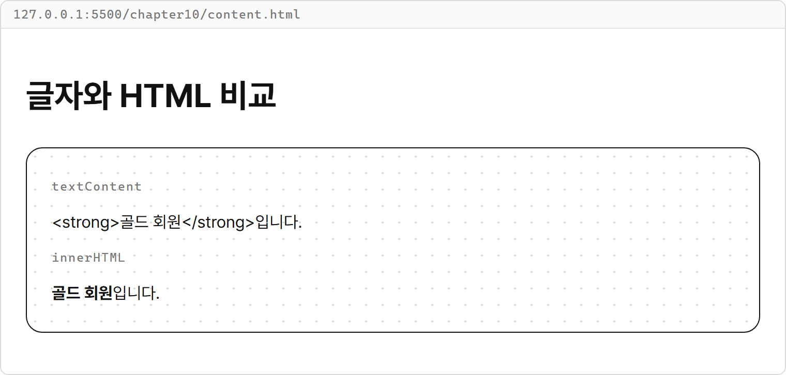

Console 탭에는 다음이 출력됩니다.

```text
HTML 쪽 글자: 골드 회원입니다.
HTML 쪽 태그: <strong>골드 회원</strong>입니다.
```

- 같은 `content`를 넣었지만 `textContent` 쪽에는 태그 글자까지 나오고, `innerHTML` 쪽에는 굵은 글자로 골드 회원이 표시됩니다.
- `htmlResult.textContent`로 읽으면 태그 없이 글자만 얻습니다. `htmlResult.innerHTML`로 읽으면 `<strong>` 태그까지 문자열에 들어 있습니다.
- 두 `<p>` 자체는 남고 안에 있던 `대기 중입니다.`만 새 내용으로 바뀝니다.
- VS Code에서 `content.html`을 보면 두 문단에는 여전히 `대기 중입니다.`가 적혀 있습니다. JavaScript가 바꾼 것은 페이지를 열 때 만든 DOM이기 때문입니다.

### value로 입력칸 값 다루기

`value`는 입력 요소의 현재 값을 읽거나 바꾸는 속성입니다.
`input`에 적힌 글자를 읽거나 미리 채울 값을 넣을 때 사용합니다.
`type="text"`인 입력칸의 값은 문자열입니다.

**특징**

- `입력 요소.value`로 현재 값을 읽습니다.
- `입력 요소.value = "문자열";`로 입력칸을 채웁니다.
- 빈 문자열 `""`을 할당하면 입력칸이 비워집니다.
- `input`의 입력값은 `textContent`나 `innerHTML`로 바꾸지 않습니다.

**비교 — 일반 요소의 내용과 입력칸의 값**

| 비교 항목 | 일반 요소 | 텍스트 입력칸 |
|---|---|---|
| 예 | `p`, `h1`, `section` | `input type="text"` |
| 채울 위치 | 시작 태그와 끝 태그 사이 | 입력칸의 현재 값 |
| 사용할 속성 | `innerHTML`, `textContent` | `value` |

**기본 문법**

```javascript
const 현재 값 = 입력 요소.value;
입력 요소.value = "새 값";
입력 요소.value = "";
```

**예제 10-5** `value.html`

```html
<!DOCTYPE html>
<html lang="ko">
<head>
  <meta charset="UTF-8">
  <title>입력칸 값 바꾸기</title>
  <link rel="stylesheet" href="../css/common.css">
</head>
<body>
  <main class="page">
    <h1>입력칸 값 바꾸기</h1>
    <label class="form">
      <span class="label">이름 / NAME</span>
      <input id="nameInput" class="input" type="text" value="김코딩">
    </label>
    <label class="form">
      <span class="label">메모 / MEMO</span>
      <input id="memoInput" class="input" type="text" value="배송 전에 연락해 주세요.">
    </label>
  </main>

  <script>
    const nameInput = document.querySelector("#nameInput");
    const memoInput = document.querySelector("#memoInput");

    console.log("처음 이름:", nameInput.value);
    nameInput.value = "이자바";
    memoInput.value = "";
    console.log("바꾼 이름:", nameInput.value);
    console.log("메모가 비었는가:", memoInput.value === "");
    console.log("이름 값의 자료형:", typeof nameInput.value);
  </script>
</body>
</html>
```

**실행 결과**

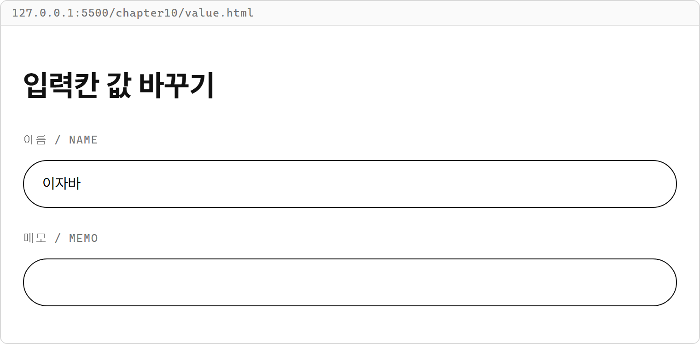

Console 탭에는 다음이 출력됩니다.

```text
처음 이름: 김코딩
바꾼 이름: 이자바
메모가 비었는가: true
이름 값의 자료형: string
```

- HTML의 `value="김코딩"`은 처음 채울 값입니다. JavaScript의 `nameInput.value = "이자바";`는 현재 값을 바꿉니다.
- `memoInput.value = "";`로 메모 입력칸을 비웠습니다. 따옴표 안에 공백도 넣지 않습니다.
- 페이지에서 이름을 직접 고친 뒤 Console 탭에 `document.querySelector("#nameInput").value`를 입력하면 현재 적힌 글자를 읽을 수 있습니다.

## 10-4 클래스와 스타일 바꾸기

내용뿐 아니라 요소에 적용된 모양도 바꿀 수 있습니다.
1장의 공통 CSS에는 `btn` 버튼과 선택 상태인 `btn.selected`의 모양이 이미 있습니다.
선택할 때 `selected` 클래스를 붙이면 CSS에 정한 검정 바탕과 흰 글자가 적용됩니다.

### classList로 클래스 다루기

`classList`는 요소에 붙은 클래스 이름들을 다루는 객체입니다.
전체 `class`를 다시 적지 않고 필요한 클래스 하나만 넣거나 뺄 수 있습니다.
9장에서 배운 토글처럼 클래스를 붙은 상태와 빠진 상태 사이에서 바꿀 수도 있습니다.

**특징**

- `add()`는 지정한 클래스를 추가하고 이미 있으면 그대로 둡니다.
- `remove()`는 지정한 클래스를 빼고 없으면 그대로 둡니다.
- `toggle()`은 클래스가 있으면 빼고 없으면 추가합니다.
- `contains()`는 클래스가 있는지 `true`나 `false`로 알려 줍니다.
- 클래스 이름은 점 없이 `"selected"`처럼 씁니다.

**기본 문법**

```javascript
요소 변수.classList.add("클래스명");
요소 변수.classList.remove("클래스명");
요소 변수.classList.toggle("클래스명");
요소 변수.classList.contains("클래스명");
```

**예제 10-6** `class-list.html`

```html
<!DOCTYPE html>
<html lang="ko">
<head>
  <meta charset="UTF-8">
  <title>클래스 바꾸기</title>
  <link rel="stylesheet" href="../css/common.css">
</head>
<body>
  <main class="page">
    <h1>클래스 바꾸기</h1>
    <div class="button-group">
      <button id="allButton" class="btn selected" type="button">전체</button>
      <button id="activeButton" class="btn" type="button">진행</button>
    </div>
  </main>

  <script>
    const allButton = document.querySelector("#allButton");
    const activeButton = document.querySelector("#activeButton");

    allButton.classList.remove("selected");
    activeButton.classList.add("selected");
    console.log("진행 선택:", activeButton.classList.contains("selected"));
    activeButton.classList.toggle("selected");
    console.log("한 번 토글:", activeButton.classList.contains("selected"));
    activeButton.classList.toggle("selected");
    console.log("두 번 토글:", activeButton.classList.contains("selected"));
  </script>
</body>
</html>
```

**실행 결과**

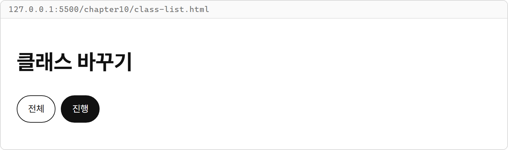

Console 탭에는 다음이 출력됩니다.

```text
진행 선택: true
한 번 토글: false
두 번 토글: true
```

- `allButton.classList.remove("selected");`는 `selected`만 빼므로 버튼의 기본 클래스 `btn`은 유지됩니다.
- `activeButton.classList.add("selected");`는 진행 버튼에 선택 모양을 적용합니다. `classList` 뒤의 점으로 그 객체의 메서드를 호출합니다.
- 토글 두 번으로 선택 → 해제 → 선택이 됩니다. 코드가 연속으로 실행되므로 화면 캡처에는 마지막 선택 상태가 나타납니다.
- 클래스를 더해도 그 이름에 맞는 CSS가 없으면 모양은 바뀌지 않습니다. `selected`의 모양은 연결한 `common.css`에 있습니다.

### style로 값 하나 지정하기

`style`은 요소에 직접 지정하는 CSS 속성을 다루는 객체입니다.
진행률처럼 값에 따라 폭이 달라지는 경우 `style.width`에 계산한 폭을 넣으면 됩니다.
선택 여부처럼 정해진 모양을 바꿀 때는 클래스를 사용합니다.

**특징**

- `width` 같은 CSS 속성을 점 뒤에 씁니다.
- `"60%"`, `"20px"`처럼 필요한 단위를 포함한 문자열을 할당합니다.
- `background-color`처럼 하이픈이 있는 CSS 이름은 `backgroundColor`처럼 카멜 표기법으로 씁니다.
- `style`은 요소에 직접 지정한 값만 다루며 CSS 파일에 적은 값은 읽어 오지 않습니다.

**비교 — classList와 style**

| 비교 항목 | classList | style |
|---|---|---|
| 바꾸는 것 | 클래스 이름 | 개별 CSS 값 |
| 모양을 정하는 곳 | CSS에 정의한 클래스 | JavaScript에서 넣는 값 |
| 쓰는 곳 | 선택 상태, 강조 상태 | 진행률에 따른 폭 |

**기본 문법**

```javascript
요소 변수.style.width = "폭과 단위";
요소 변수.style.backgroundColor = "색상";
```

**예제 10-7** `style.html`

```html
<!DOCTYPE html>
<html lang="ko">
<head>
  <meta charset="UTF-8">
  <title>진행 막대 폭 바꾸기</title>
  <link rel="stylesheet" href="../css/common.css">
</head>
<body>
  <main class="page">
    <h1>진행 막대</h1>
    <p id="progressText">진행률: 0%</p>
    <div class="progress">
      <div id="progressBar" class="progress-bar"></div>
    </div>
  </main>

  <script>
    const progressBar = document.querySelector("#progressBar");
    const progressText = document.querySelector("#progressText");
    const progress = 60;

    progressBar.style.width = `${progress}%`;
    progressText.innerHTML = `진행률: ${progress}%`;
    console.log("지정한 폭:", progressBar.style.width);
  </script>
</body>
</html>
```

**실행 결과**

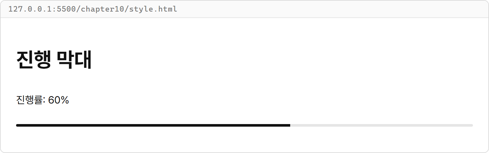

Console 탭에는 다음이 출력됩니다.

```text
지정한 폭: 60%
```

- `progress`는 숫자 `60`입니다. 템플릿 리터럴로 퍼센트 기호를 붙여 CSS에 넣을 문자열 `"60%"`를 만듭니다.
- `progress-bar`의 검정색과 높이는 공통 CSS를 사용합니다. JavaScript는 값마다 달라지는 폭만 지정합니다.
- 표시 문구와 폭 모두 같은 `progress`에서 값을 가져오므로 숫자 한 곳을 바꾸면 두 결과가 함께 바뀝니다.

## 따라하기 실습 — 버튼 선택 상태 표시

**실습 목표**

- 버튼 목록의 선택 클래스를 지운 뒤 지정한 버튼 하나에만 붙입니다.
- 선택 상태를 바꾸는 코드를 함수로 묶고 다른 버튼에도 사용합니다.
- 선택한 버튼의 내용으로 안내 문구를 채웁니다.

이 실습은 함수를 호출해 선택 모양을 바꿉니다.
버튼을 눌렀을 때 반응하는 코드는 넣지 않고 선택할 버튼을 호출의 인수로 정합니다.
여기서 바꾸는 것은 선택 표시뿐이고 목록을 거르는 기능은 없습니다.

**준비**

1. `chapter10` 폴더 안에 `button-select.html` 파일을 만듭니다.
2. 공통 CSS는 그대로 두고 다음 전체 코드를 파일에 입력합니다.

**실습 코드**

`chapter10/button-select.html`

```html
<!DOCTYPE html>
<html lang="ko">
<head>
  <meta charset="UTF-8">
  <title>버튼 선택 상태</title>
  <link rel="stylesheet" href="../css/common.css">
</head>
<body>
  <main class="page">
    <p class="label">선택 상태 / SELECTION</p>
    <h1>할 일 보기</h1>
    <div class="button-group">
      <button id="allButton" class="btn filter-button selected" type="button">전체</button>
      <button id="activeButton" class="btn filter-button" type="button">진행</button>
      <button id="doneButton" class="btn filter-button" type="button">완료</button>
    </div>
    <p id="selectionText">선택: 전체</p>
  </main>

  <script>
    function selectButton(buttonSelector) {
      const buttons = document.querySelectorAll(".filter-button");
      const selectedButton = document.querySelector(buttonSelector);
      const selectionText = document.querySelector("#selectionText");

      buttons.forEach((button) => {
        button.classList.remove("selected");
      });
      selectedButton.classList.add("selected");
      selectionText.innerHTML = `선택: ${selectedButton.innerHTML}`;
    }

    selectButton("#activeButton");
  </script>
</body>
</html>
```

**실행 방법**

1. `button-select.html`을 저장하고 Live Server로 엽니다.
2. 진행 버튼 하나에 선택 모양이 적용되는지 확인합니다.
3. Console 탭에 `selectButton("#doneButton")`을 입력하고 Enter 키를 누릅니다.
4. 같은 호출을 한 번 더 입력해 완료 버튼만 선택된 상태가 유지되는지 확인합니다.

**실행 결과**

페이지를 연 상태에서 Console 탭의 `selectButton("#doneButton")` 호출로 선택을 바꿉니다.

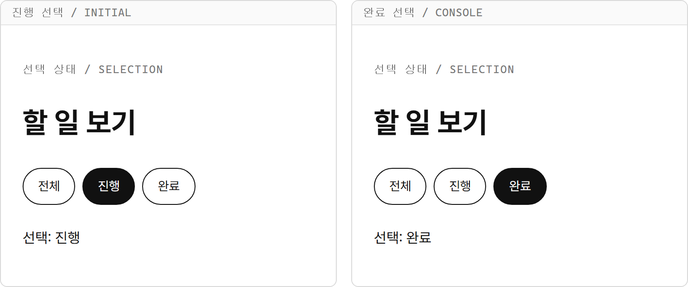

Console 탭은 값을 반환하지 않는 함수 호출의 결과로 `undefined`를 표시합니다.
이것은 `console.log()`로 출력한 안내가 아닙니다.

**시각자료 — 선택된 버튼을 하나로 정하기**

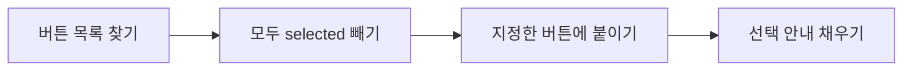

먼저 이전 선택을 지운 다음 새 선택을 붙입니다.
같은 버튼을 다시 선택해도 마지막에는 하나만 선택된 상태입니다.

**코드 설명**

- `filter-button`은 세 버튼을 한꺼번에 찾는 이름이고, 기본 모양은 `btn`이 담당합니다.
- `buttons.forEach(...)`는 세 버튼 각각에서 `selected`를 뺍니다. `btn`과 `filter-button`은 그대로 남습니다.
- `document.querySelector(buttonSelector)`에는 변수에 담긴 선택자를 넘깁니다. `buttonSelector`에는 `"#activeButton"`처럼 이 파일에 있는 버튼의 id 선택자를 넣습니다.
- `selectedButton.classList.add("selected");`가 새 선택을 붙입니다. `toggle()`은 현재 상태에 따라 붙이기도 하고 빼기도 하므로 반드시 붙여야 하는 이 자리에는 `add()`를 씁니다.
- 버튼 안에는 글자만 있으므로 `selectedButton.innerHTML`로 읽은 이름을 안내 문구에 넣습니다.
- `selectButton()`은 `<script>` 안에 함수 선언문으로 만듭니다. 그 아래의 `selectButton("#activeButton");`이 처음 선택을 정하고, Console 탭에서도 같은 함수를 호출할 수 있습니다.

**바꿔 보기 1**

페이지를 열었을 때 완료 버튼을 선택하도록 바꿔 봅니다.
`<script>` 맨 아래의 `selectButton("#activeButton");` 줄을 다음처럼 바꿉니다.

```javascript
selectButton("#doneButton");
```

저장하면 처음부터 완료 버튼만 선택되고 안내는 `선택: 완료`가 됩니다.
전체 버튼에 처음 적힌 `selected`도 함수가 지웁니다.

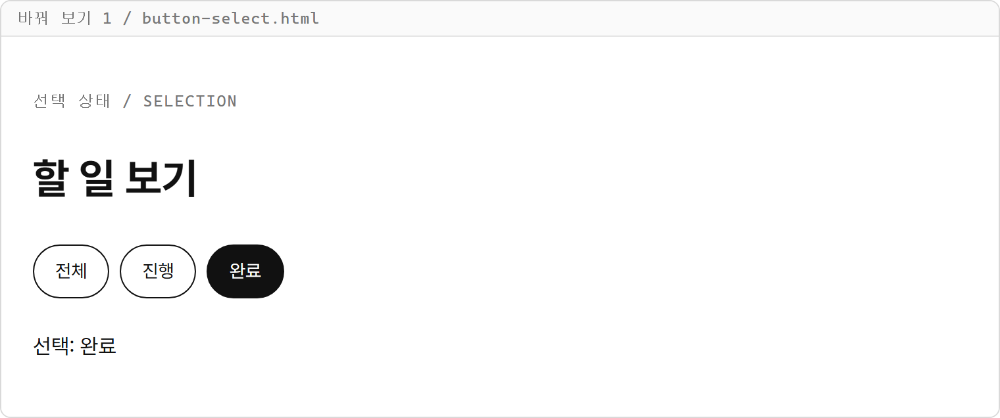

**바꿔 보기 2**

원래 실습 코드로 되돌리고 선택을 두 번 바꿔 봅니다.
`<script>` 맨 아래의 `selectButton("#activeButton");` 아래에 다음 줄을 추가합니다.

```javascript
selectButton("#allButton");
```

처음 호출이 진행을 선택하고 다음 호출이 전체를 선택합니다.
페이지 화면에는 마지막 결과인 전체 버튼의 선택 모양과 `선택: 전체`가 남습니다.

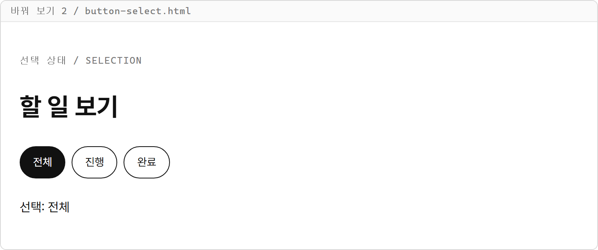

## 연습문제

### 연습문제 1 — 프로필 카드 내용 바꾸기

**요구사항**

1. `chapter10` 폴더에 `profile.html` 파일을 만들고 공통 CSS를 연결합니다.
2. `card` 클래스의 프로필 카드 안에 이름 `김코딩`, 등급 `실버`, 이메일 `coding@example.com`을 표시합니다. 이름과 등급에는 각각 `profileName`, `profileGrade` id를 붙입니다.
3. 카드 밖에는 `nicknameInput` id인 텍스트 입력칸을 두고 처음 값은 `김코딩`으로 채웁니다.
4. `</body>` 바로 앞의 `<script>`에서 이름을 `이자바`로, 등급을 굵은 글자 `골드`로 바꿉니다. 기존 요소를 찾고 `innerHTML`로 채웁니다.
5. 입력칸의 현재 값도 `이자바`로 바꾸고 이메일은 그대로 둡니다.

**완료 조건**

- 페이지에 이름 `이자바`와 굵은 글자 등급 `골드`가 표시됩니다.
- 입력칸에도 `이자바`가 채워집니다.
- 이메일 `coding@example.com`과 카드의 기본 모양은 유지됩니다.
- HTML에 적은 처음 값을 JavaScript로 바꿉니다.

### 연습문제 2 — 목록에서 세 번째 항목만 강조하기

**요구사항**

1. `chapter10` 폴더에 `highlight-third.html` 파일을 만들고 공통 CSS를 연결합니다.
2. `menuList` id인 목록 안에 `입문`, `기초`, `응용`, `실전` 네 항목을 이 순서로 만듭니다.
3. 각 항목에는 `btn` 클래스를 붙이고 첫 번째 항목에는 처음부터 `selected`도 붙입니다.
4. `</body>` 바로 앞의 `<script>`에서 `querySelectorAll()`로 네 항목을 찾습니다.
5. `forEach()`로 모든 항목에서 `selected`를 뺀 뒤 인덱스로 세 번째 항목을 꺼내 `selected`를 붙입니다.

**완료 조건**

- 응용 항목 하나만 검정 바탕과 흰 글자로 강조됩니다.
- 처음에 강조한 입문 항목은 기본 모양으로 돌아옵니다.
- 항목의 글자와 순서는 그대로입니다.
- 세 번째 항목의 인덱스로 `2`를 사용합니다.

## 정답과 해설

### 연습문제 1 — 프로필 카드 내용 바꾸기

`profile.html`

```html
<!DOCTYPE html>
<html lang="ko">
<head>
  <meta charset="UTF-8">
  <title>프로필 카드</title>
  <link rel="stylesheet" href="../css/common.css">
</head>
<body>
  <main class="page">
    <h1>프로필 카드</h1>
    <section class="card">
      <p class="label">회원 / MEMBER</p>
      <h2 id="profileName">김코딩</h2>
      <p>등급: <span id="profileGrade">실버</span></p>
      <p>이메일: coding@example.com</p>
    </section>
    <label class="form">
      <span class="label">표시 이름 / NAME</span>
      <input id="nicknameInput" class="input" type="text" value="김코딩">
    </label>
  </main>

  <script>
    const profileName = document.querySelector("#profileName");
    const profileGrade = document.querySelector("#profileGrade");
    const nicknameInput = document.querySelector("#nicknameInput");

    profileName.innerHTML = "이자바";
    profileGrade.innerHTML = "<strong>골드</strong>";
    nicknameInput.value = "이자바";
  </script>
</body>
</html>
```

**실행 결과**

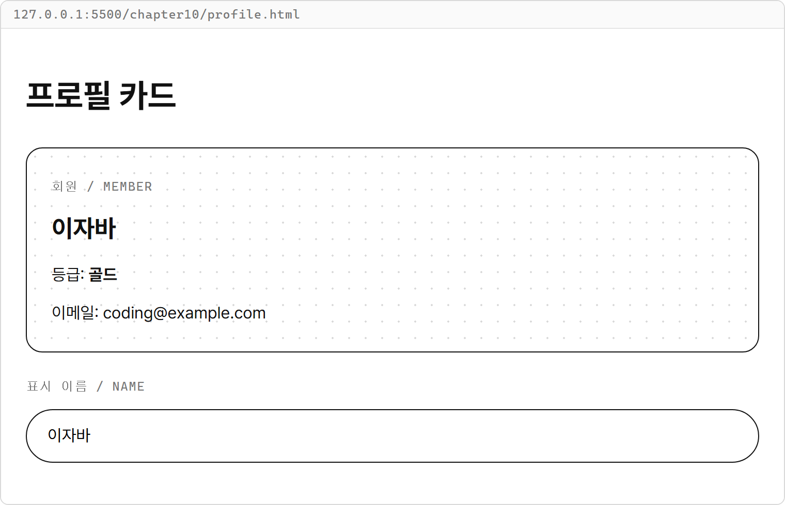

**해설**

- 이름과 등급 요소를 따로 찾았습니다. 카드 전체를 덮어쓰지 않으므로 이메일과 카드의 모양이 유지됩니다.
- `profileGrade.innerHTML = "<strong>골드</strong>";`는 태그를 해석하므로 등급을 굵은 글자로 표시합니다.
- 입력칸은 `innerHTML` 대신 `nicknameInput.value`를 바꿉니다. 화면의 이름과 입력칸은 서로 다른 요소라서 각각 값을 넣어야 합니다.

### 연습문제 2 — 목록에서 세 번째 항목만 강조하기

`highlight-third.html`

```html
<!DOCTYPE html>
<html lang="ko">
<head>
  <meta charset="UTF-8">
  <title>세 번째 항목 강조</title>
  <link rel="stylesheet" href="../css/common.css">
</head>
<body>
  <main class="page">
    <h1>단계 목록</h1>
    <div id="menuList" class="form">
      <p class="btn selected">입문</p>
      <p class="btn">기초</p>
      <p class="btn">응용</p>
      <p class="btn">실전</p>
    </div>
  </main>

  <script>
    const items = document.querySelectorAll("#menuList p");

    items.forEach((item) => {
      item.classList.remove("selected");
    });
    items[2].classList.add("selected");
  </script>
</body>
</html>
```

**실행 결과**

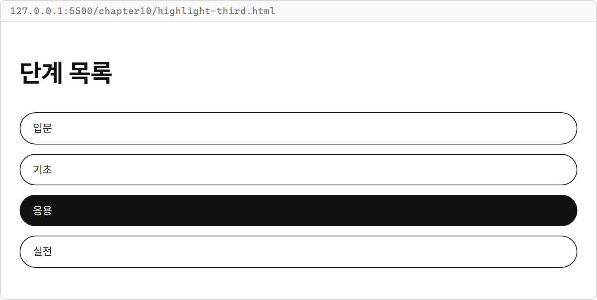

**해설**

- `forEach()`가 모든 항목의 이전 강조를 지웁니다. 첫 항목에 있던 `selected`도 이때 빠집니다.
- NodeList의 인덱스는 0부터 시작하므로 세 번째 항목은 `items[2]`입니다.
- `classList.add("selected")`는 `btn`을 유지하면서 선택 모양만 더합니다. 내용이나 순서를 바꾸는 코드는 없습니다.
- 항목은 `<p>`로 만들어 글머리 기호가 붙지 않게 했습니다. `<ul>`과 `<li>`로 만들었다면 선택자를 `"#menuList li"`로 바꾸면 됩니다.
- 콜백의 두 번째 매개변수 `index`로 `index === 2`일 때만 클래스를 붙이는 방법도 가능합니다.
