# 12장. 이벤트 처리

**학습목표**

- `addEventListener()`로 클릭, 입력, 폼 제출에 반응하는 함수를 등록할 수 있습니다.
- 이벤트 객체에서 입력한 요소의 이름과 값을 읽고 폼의 기본 동작을 막을 수 있습니다.
- 버블링으로 같은 클릭이 부모 요소에도 전달되는 흐름을 설명할 수 있습니다.
- 부모 요소에 이벤트를 위임하고 `data-action`과 `data-id`로 누른 버튼을 구분할 수 있습니다.

## 12-1 addEventListener

10장과 11장에서는 요소를 찾고 내용을 바꾸거나 새 요소를 붙였습니다.
이 장에서는 그 동작을 사용자의 클릭이나 입력에 연결합니다.
1장 예제 1-1에서 버튼을 누르면 인사말이 바뀌던 코드도 이 방법을 사용했습니다.

예제는 `js-course/chapter12` 폴더에 만들고 공통 CSS `../css/common.css`를 연결합니다.
파일을 여는 방법은 1-3을 따릅니다.
각 HTML 파일은 JavaScript까지 담은 완결된 파일입니다.

### 이벤트와 이벤트 처리 함수

**이벤트**(event)는 클릭이나 입력처럼 브라우저에서 일어나는 일을 알리는 신호입니다.
이벤트가 일어났을 때 실행하는 함수를 **이벤트 처리 함수**(event handler)라고 합니다.
버튼을 찾는 코드만으로는 클릭에 반응하지 않으므로, 어떤 이벤트에 어떤 함수를 실행할지 연결해야 합니다.

`addEventListener()`는 요소에 이벤트 처리 함수를 등록하는 메서드입니다.
5장에서 콜백 함수를 이름만 써서 넘긴 것처럼 처리할 함수의 이름을 두 번째 인수로 넘깁니다.
브라우저는 해당 이벤트가 일어날 때 그 함수를 호출합니다.

**특징**

- 첫 번째 인수는 `"click"`처럼 이벤트 종류를 나타내는 문자열입니다.
- 두 번째 인수는 실행할 함수이며 함수 이름 뒤에 호출 괄호를 붙이지 않습니다.
- 등록한 함수는 이벤트가 일어날 때마다 실행됩니다.
- 한 요소에 여러 처리 함수를 등록할 수 있습니다.

이벤트와 처리 함수의 관계는 초인종에 빗댈 수 있습니다.
누군가 초인종 버튼을 누르면 미리 전선으로 이어 둔 벨이 집 안에서 울립니다.
버튼을 누르기 전에 연결은 이미 되어 있어야 합니다.

**시각자료 — 버튼을 누르면 울리는 초인종**

```text
[생성 이미지: images/12/event-doorbell.png]
장면: 왼쪽은 현관문 옆 벽의 초인종 버튼을 손가락이 누르는 모습이다. 버튼에서 전선 한 줄이 벽을 따라 오른쪽 집 안으로 이어지고, 집 안 벽에 달린 종 모양 벨이 흔들리며 울린다. 벨 옆에 짧은 진동 선 몇 개가 있다.
비율: 가로 3:2
스타일: 굵기가 일정한 검정 외곽선의 단순한 선 그림. 흰 배경. 그림자와 그라데이션 없음. 채움 색은 노랑(벨) 한 가지. 글자, 숫자, 기호는 넣지 않는다.
참고 그림: book-manuscript/assets/style-ref/line-art-shark.png
```

버튼을 누르는 일이 `click` 이벤트, 울리는 벨이 처리 함수입니다.
전선을 잇는 일이 `addEventListener()`로 등록하는 코드입니다.

**기본 문법**

```javascript
function 처리 함수명() {
  이벤트가 일어나면 실행할 코드
}

요소명.addEventListener("이벤트 종류", 처리 함수명);
```

### click으로 버튼에 반응하기

`click`은 버튼 같은 요소를 클릭했을 때 발생하는 이벤트입니다.
버튼을 키보드로 눌러 실행해도 클릭 이벤트로 처리할 수 있습니다.
처리 함수는 `function handleClick() { ... }`처럼 선언하고 `handleClick` 이름을 넘깁니다.

10장과 같이 HTML 예제의 `<script>`는 `</body>` 바로 앞에 둡니다.
브라우저가 위에 있는 제목과 버튼을 먼저 읽으므로, 스크립트에서 요소를 바로 찾고 이벤트를 등록할 수 있습니다.

**예제 12-1** `click.html`

```html
<!DOCTYPE html>
<html lang="ko">
<head>
  <meta charset="UTF-8">
  <title>클릭으로 인사 바꾸기</title>
  <link rel="stylesheet" href="../css/common.css">
</head>
<body>
  <main class="page">
    <p class="label">클릭 / CLICK</p>
    <h1 id="message">안녕하세요</h1>
    <div class="button-group">
      <button id="changeButton" class="btn" type="button">인사 바꾸기</button>
    </div>
  </main>

  <script>
    const message = document.querySelector("#message");
    const changeButton = document.querySelector("#changeButton");

    function handleClick() {
      message.innerHTML = "반갑습니다";
    }

    changeButton.addEventListener("click", handleClick);
  </script>
</body>
</html>
```

**실행 결과**

인사 바꾸기 버튼을 한 번 클릭합니다.

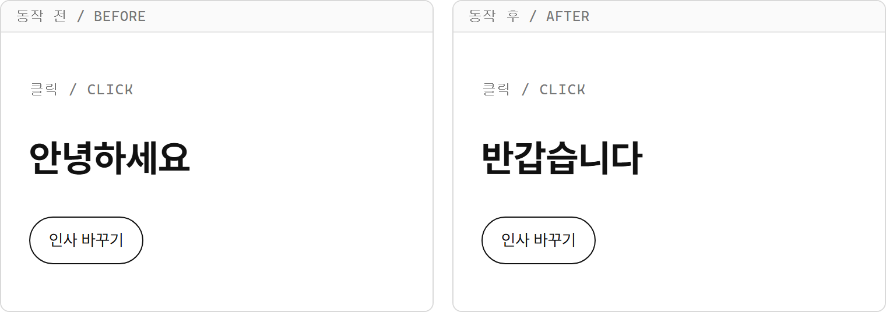

- `handleClick()`은 선언하는 순간에는 실행되지 않습니다. 버튼을 클릭할 때 실행됩니다.
- `addEventListener("click", handleClick)`에서 `handleClick`은 함수 자체입니다. `handleClick()`은 그 자리에서 실행하는 호출이므로 등록할 때 쓰지 않습니다.
- `message.innerHTML`은 이미 있는 제목 요소의 내용을 바꿉니다. 같은 버튼을 다시 눌러도 제목은 `반갑습니다`로 표시됩니다.

**시각자료 — 등록과 실행은 서로 다른 순간**

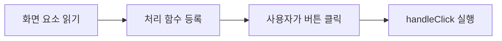

이벤트를 등록하는 줄은 먼저 실행됩니다.
등록한 함수의 블록은 사용자가 버튼을 클릭할 때 실행됩니다.

### input과 submit

버튼뿐 아니라 입력칸과 폼에도 이벤트를 등록할 수 있습니다.
`input`은 사용자가 입력칸의 값을 바꿀 때 발생하는 이벤트입니다.
`submit`은 폼을 제출할 때 폼 요소에서 발생하는 이벤트입니다.

**비교 — click, input, submit**

| 비교 항목 | click | input | submit |
|---|---|---|---|
| 발생하는 일 | 요소 클릭 | 사용자가 입력값 변경 | 폼 제출 |
| 등록할 요소의 예 | 버튼 | 입력칸 | 폼 |
| 처리 함수 이름의 예 | `handleClick` | `handleInput` | `handleSubmit` |

입력칸에는 `input`을 등록해 입력 즉시 값을 읽습니다.
JavaScript에서 `input.value = "새 값";`처럼 값을 넣는 것만으로는 `input` 이벤트가 발생하지 않습니다.

**기본 문법**

```javascript
입력칸.addEventListener("input", 입력 처리 함수명);
폼.addEventListener("submit", 제출 처리 함수명);
```

**예제 12-2** `input.html`

```html
<!DOCTYPE html>
<html lang="ko">
<head>
  <meta charset="UTF-8">
  <title>입력한 이름 표시하기</title>
  <link rel="stylesheet" href="../css/common.css">
</head>
<body>
  <main class="page">
    <p class="label">입력 / INPUT</p>
    <h1>이름 미리 보기</h1>
    <label class="form">
      이름
      <input id="nameInput" class="input" type="text" placeholder="이름을 입력하세요">
    </label>
    <p id="message">입력한 이름: </p>
  </main>

  <script>
    const nameInput = document.querySelector("#nameInput");
    const message = document.querySelector("#message");

    function handleInput() {
      message.textContent = `입력한 이름: ${nameInput.value}`;
    }

    nameInput.addEventListener("input", handleInput);
  </script>
</body>
</html>
```

**실행 결과**

입력칸에 `김코딩`을 입력합니다.

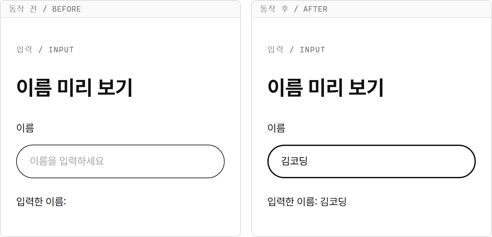

- `input` 이벤트에 `handleInput` 함수를 등록했으므로 버튼을 누르지 않아도 안내가 바뀝니다.
- `nameInput.value`는 이벤트가 발생한 순간의 입력값입니다. 글자를 지우면 지운 뒤의 값을 읽습니다.
- 사용자가 입력한 글자 자체를 표시하므로 `textContent`를 씁니다. `<b>`처럼 입력해도 태그로 해석하지 않고 글자로 표시합니다.

`submit`은 제출 버튼을 누를 때뿐 아니라 입력칸에서 Enter 키를 누를 때도 폼에서 발생합니다.
브라우저의 폼 제출 동작도 함께 일어나므로, 다음 항목에서 이벤트 객체와 함께 실행해 봅니다.

## 12-2 이벤트 객체

예제 12-2의 처리 함수는 `nameInput` 하나만 읽었습니다.
입력칸이 여러 개라면 이벤트가 발생한 칸을 구분할 정보가 필요합니다.

**이벤트 객체**(event object)는 발생한 이벤트의 정보와 관련 메서드를 담은 객체입니다.
브라우저는 처리 함수를 호출할 때 이 객체를 첫 번째 인수로 넘깁니다.
이 책에서는 그 인수를 받는 매개변수 이름을 `e`로 씁니다.

### 이벤트 객체는 왜 필요할까?

같은 함수가 여러 입력칸을 처리할 때 어느 칸에서 어떤 값이 들어왔는지 알기 위해 필요합니다.

제목 입력칸 `titleInput`과 내용 입력칸 `contentInput`에 같은 `handleInput` 함수를 등록한다고 생각해 봅시다.
함수가 언제나 `titleInput.value`만 읽으면 내용 칸에서 입력해도 제목을 읽습니다.
함수 하나에서 방금 입력한 칸의 이름과 값을 읽는 방법이 필요합니다.

이벤트 객체의 `e.target`은 이벤트가 발생한 요소를 가리킵니다.
그 요소가 입력칸이면 `e.target.name`으로 칸의 이름을, `e.target.value`로 입력한 값을 읽습니다.

### e.target, name, value

입력칸의 `name`은 HTML의 `name="title"`처럼 붙이는 이름입니다.
`id`가 요소를 찾는 기준이라면, 여기서 `name`은 어떤 입력 항목인지를 나타냅니다.
제목 칸에는 `title`, 내용 칸에는 `content`를 붙입니다.

**특징**

- 매개변수 `e`는 이벤트가 발생할 때 브라우저가 넘긴 객체를 받습니다.
- 입력칸의 `name`과 `value`는 문자열입니다.
- 같은 처리 함수라도 입력한 칸에 따라 `e.target`이 달라집니다.

이벤트 객체는 입력한 칸을 가리키는 정보표라고 생각하면 됩니다.
제목 칸에 `오늘 일정`을 적었을 때 정보표의 `target`은 그 제목 칸을 가리킵니다.
칸의 이름과 값은 가리킨 요소에서 읽습니다.

**시각자료 — 이벤트 객체가 가리키는 제목 입력칸**

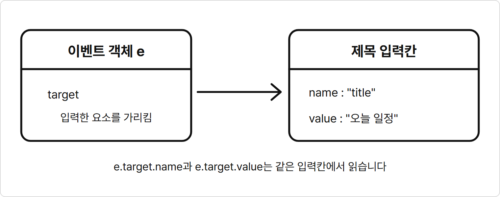

`e.target.name`과 `e.target.value`는 서로 다른 입력칸을 읽는 것이 아닙니다.
둘 다 `target`이 가리킨 같은 제목 칸의 속성입니다.

**기본 문법**

```javascript
function 입력 처리 함수명(e) {
  const 이름 = e.target.name;
  const 값 = e.target.value;
}

입력칸.addEventListener("input", 입력 처리 함수명);
```

**예제 12-3** `event-fields.html`

```html
<!DOCTYPE html>
<html lang="ko">
<head>
  <meta charset="UTF-8">
  <title>두 입력칸을 함수 하나로 처리하기</title>
  <link rel="stylesheet" href="../css/common.css">
</head>
<body>
  <main class="page">
    <p class="label">이벤트 객체 / EVENT OBJECT</p>
    <h1>바뀐 입력칸 확인</h1>
    <div class="form">
      <label for="titleInput">제목</label>
      <input id="titleInput" name="title" class="input" type="text">
      <label for="contentInput">내용</label>
      <input id="contentInput" name="content" class="input" type="text">
    </div>
    <p id="result">입력하면 칸의 이름과 값이 표시됩니다.</p>
  </main>

  <script>
    const titleInput = document.querySelector("#titleInput");
    const contentInput = document.querySelector("#contentInput");
    const result = document.querySelector("#result");

    function handleInput(e) {
      result.textContent = `바뀐 칸: ${e.target.name} / 값: ${e.target.value}`;
    }

    titleInput.addEventListener("input", handleInput);
    contentInput.addEventListener("input", handleInput);
  </script>
</body>
</html>
```

**실행 결과**

제목에 `오늘 일정`을 입력한 뒤 내용에 `교재 읽기`를 입력합니다.
캡처는 제목을 입력한 순간과 내용을 입력한 순간을 나란히 보여 줍니다.

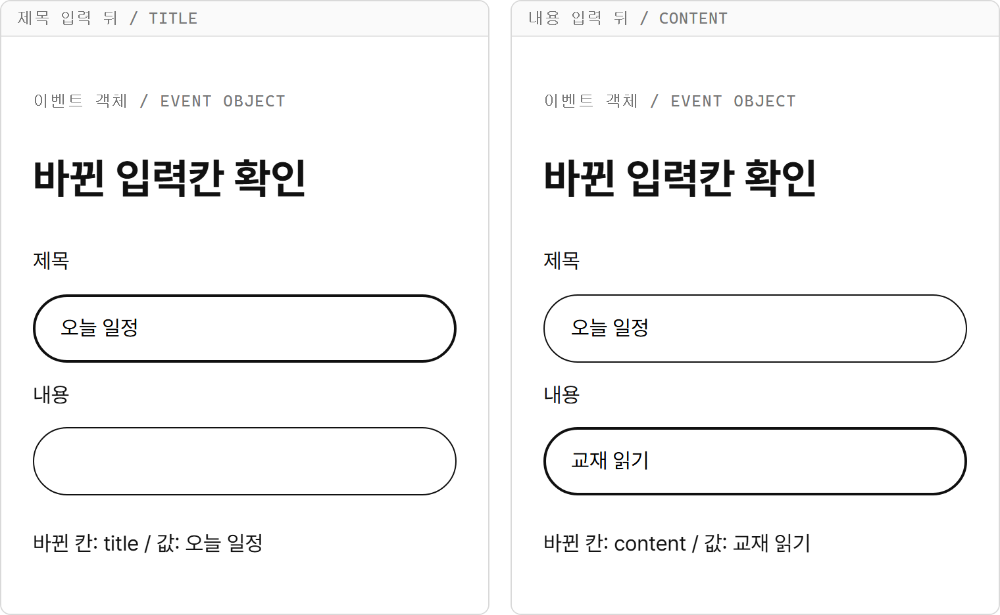

- 두 입력칸에 넘긴 함수 이름은 모두 `handleInput`입니다.
- 제목 칸에 입력하면 `e.target.name`은 `"title"`이고, 내용 칸에 입력하면 `"content"`입니다.
- 안내문에는 가장 최근에 바뀐 칸과 값이 표시됩니다. 다른 입력칸의 값은 지우지 않습니다.
- `e`는 함수를 선언할 때 받는 매개변수입니다. 이벤트를 등록할 때 `handleInput(e)`처럼 직접 호출하지 않습니다.

### e.preventDefault로 기본 동작 막기

**기본 동작**(default action)은 이벤트에 따라 브라우저가 원래 수행하는 동작입니다.
폼을 제출하면 보통 입력값을 폼에 정한 주소로 보내고 페이지를 이동합니다.
`e.preventDefault()`는 해당 이벤트의 취소 가능한 기본 동작을 막는 메서드입니다.
폼의 값을 현재 화면에서 처리하려면 제출 이벤트 안에서 이 메서드를 호출합니다.

**특징**

- `submit` 처리 함수 안에서 호출하면 폼 제출에 따른 페이지 이동을 막습니다.
- 기본 동작을 막아도 처리 함수의 나머지 코드는 계속 실행됩니다.

**기본 문법**

```javascript
function 제출 처리 함수명(e) {
  e.preventDefault();
  입력값으로 할 일
}

폼.addEventListener("submit", 제출 처리 함수명);
```

**예제 12-4** `submit.html`

```html
<!DOCTYPE html>
<html lang="ko">
<head>
  <meta charset="UTF-8">
  <title>폼 제출로 예약 확인하기</title>
  <link rel="stylesheet" href="../css/common.css">
</head>
<body>
  <main class="page">
    <p class="label">폼 제출 / SUBMIT</p>
    <h1>예약 확인</h1>
    <form id="reservationForm" class="form">
      <label for="nameInput">예약자 이름</label>
      <input id="nameInput" name="name" class="input" type="text" required>
      <div class="button-group">
        <button class="btn" type="submit">예약 확인</button>
      </div>
    </form>
    <p id="result">이름을 입력하고 제출하세요.</p>
  </main>

  <script>
    const reservationForm = document.querySelector("#reservationForm");
    const nameInput = document.querySelector("#nameInput");
    const result = document.querySelector("#result");

    function handleSubmit(e) {
      e.preventDefault();
      result.textContent = `${nameInput.value}님의 예약을 확인했습니다.`;
    }

    reservationForm.addEventListener("submit", handleSubmit);
  </script>
</body>
</html>
```

**실행 결과**

예약자 이름에 `김코딩`을 입력한 뒤 예약 확인 버튼을 누릅니다.
입력칸에서 Enter 키를 눌러 제출해도 같은 결과입니다.

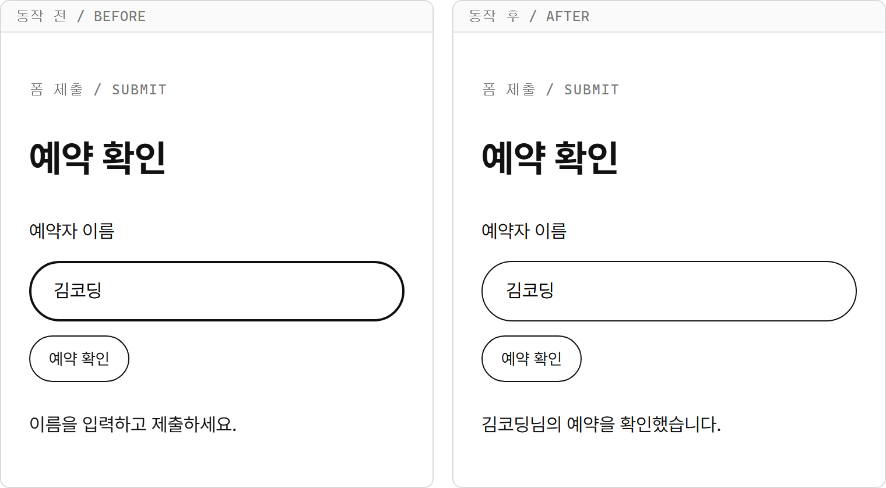

- `submit`은 `reservationForm`에 등록합니다. 버튼을 누르든 입력칸에서 Enter 키를 누르든 제출은 폼에서 일어나므로 처리 함수 하나로 두 방식을 모두 받습니다.
- `e.preventDefault()` 뒤의 줄에서 입력값을 읽고 안내를 바꿉니다. 페이지가 이동하지 않아 입력값과 결과가 화면에 남습니다.
- 이때 `e.target`은 입력칸이 아니라 제출한 폼입니다. 예약자 이름은 찾아 둔 `nameInput.value`로 읽습니다.
- HTML의 `required`는 이름을 반드시 입력하도록 합니다. 빈 값으로 제출하면 브라우저가 입력을 요구하고 `submit` 처리 함수는 실행되지 않습니다.
- 이 예제는 화면에서 예약 확인 문구만 표시합니다. 서버에 예약 정보를 보내는 코드는 없습니다.

## 12-3 버블링

버튼은 카드 안에 있고 카드는 페이지 안에 있는 것처럼 DOM 요소는 서로 포함됩니다.
버튼에서 발생한 클릭을 그 버튼뿐 아니라 바깥 요소에서도 처리할 수 있습니다.

**버블링**(bubbling)은 이벤트가 발생한 요소에서 부모 요소를 거쳐 위쪽으로 전달되는 과정입니다.
쉽게 말해 버튼에서 일어난 클릭을 그 버튼을 감싼 카드도 전달받습니다.
여기서는 별도 옵션 없이 등록한 `click` 이벤트의 전달 순서를 봅니다.

**특징**

- 버튼의 클릭 처리 다음에 부모의 클릭 처리가 실행됩니다.
- 위쪽 요소에 처리 함수를 등록하지 않았어도 이벤트는 그 요소를 거쳐 전달됩니다.
- 부모의 처리 함수에서도 `e.target`은 처음 클릭한 요소를 가리킵니다.
- 모든 이벤트가 버블링하는 것은 아니지만, 이 장의 `click`, `input`, `submit`은 버블링합니다.

**시각자료 — 버튼 클릭이 부모로 전달되는 순서**

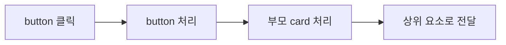

그림은 이벤트가 발생한 뒤의 버블링 흐름입니다.
처리 위치가 부모로 옮겨 가도 `e.target`은 처음 클릭한 버튼 그대로입니다.

**기본 문법**

```javascript
자식 요소.addEventListener("click", 자식 처리 함수명);
부모 요소.addEventListener("click", 부모 처리 함수명);
```

**예제 12-5** `bubbling.html`

```html
<!DOCTYPE html>
<html lang="ko">
<head>
  <meta charset="UTF-8">
  <title>버튼과 카드의 클릭 순서</title>
  <link rel="stylesheet" href="../css/common.css">
</head>
<body>
  <main class="page">
    <p class="label">버블링 / BUBBLING</p>
    <h1>클릭 처리 순서</h1>
    <section id="card" class="card">
      <h2>상품 카드</h2>
      <div class="button-group">
        <button id="selectButton" class="btn" type="button">상품 선택</button>
      </div>
    </section>
    <div id="result" class="form">상품 선택 버튼을 누르세요.</div>
  </main>

  <script>
    const card = document.querySelector("#card");
    const selectButton = document.querySelector("#selectButton");
    const result = document.querySelector("#result");

    function handleButtonClick(e) {
      result.innerHTML = `<p>버튼 처리 / target: ${e.target.id}</p>`;
      console.log("버튼 처리 / target:", e.target.id);
    }

    function handleCardClick(e) {
      result.innerHTML = `${result.innerHTML}<p>카드 처리 / target: ${e.target.id}</p>`;
      console.log("카드 처리 / target:", e.target.id);
    }

    selectButton.addEventListener("click", handleButtonClick);
    card.addEventListener("click", handleCardClick);
  </script>
</body>
</html>
```

**실행 결과**

상품 선택 버튼을 한 번 누릅니다.

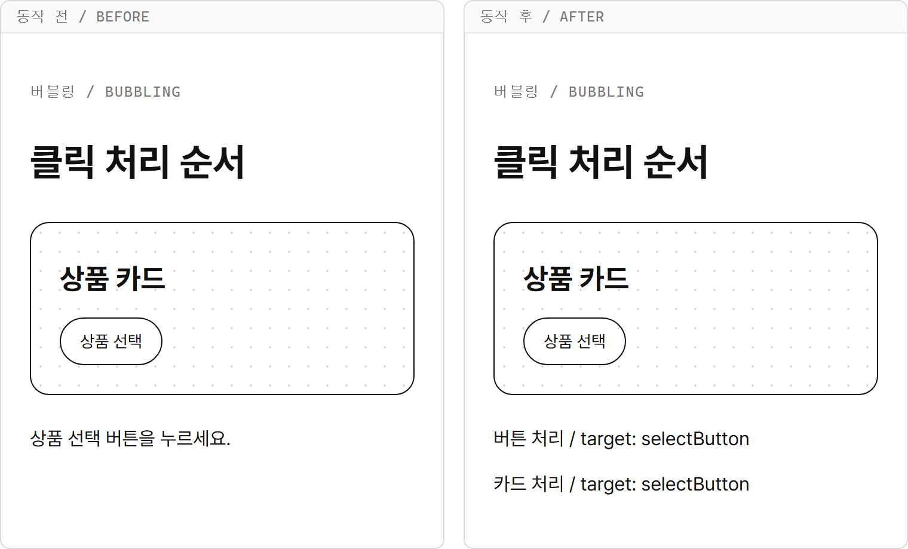

Console 탭에도 다음 두 줄이 순서대로 출력됩니다.

```text
버튼 처리 / target: selectButton
카드 처리 / target: selectButton
```

- 먼저 `handleButtonClick()`이 실행되고, 같은 클릭이 바깥으로 전달되어 `handleCardClick()`이 실행됩니다.
- 버튼과 카드 사이의 `<div>`도 전달 경로에 있습니다. 이 요소에는 처리 함수를 등록하지 않았으므로 출력이 없습니다.
- 카드의 함수에서도 `e.target.id`는 `card`가 아니라 `selectButton`입니다. `target`은 처리 함수가 어디에 있든 처음 클릭한 요소를 가리킵니다.
- 버튼을 다시 누르면 버튼의 함수가 결과를 새로 채운 뒤 카드의 함수가 다음 문단을 붙입니다. 화면에는 매번 두 줄이 남습니다.

부모는 부모 자체를 클릭할 때뿐 아니라 안쪽 요소에서 올라온 클릭도 받습니다.
또한 `preventDefault()`는 브라우저의 기본 동작을 막을 뿐, 이 전달 흐름을 막지 않습니다.

## 12-4 이벤트 위임

버블링 덕분에 부모는 안쪽 버튼에서 발생한 클릭을 받을 수 있습니다.
이를 이용하면 버튼마다 처리 함수를 등록하지 않고 부모 한 곳에서 여러 버튼을 처리할 수 있습니다.

**이벤트 위임**(event delegation)은 자식 요소에서 발생한 이벤트를 부모 요소의 처리 함수로 맡기는 방식입니다.
쉽게 말해 목록의 각 버튼에 등록할 클릭 처리를 목록 한 곳에 모읍니다.

### 이벤트 위임은 왜 필요할까?

목록에 버튼이 많거나 새 버튼이 생겨도 같은 처리 함수를 사용하기 위해 필요합니다.

할 일 목록 `todoList`에 항목마다 삭제 버튼이 있다고 생각해 봅시다.
각 버튼에 클릭 처리를 등록하면 새 항목을 추가할 때 새 버튼에도 등록해야 합니다.
처리 방법은 모두 같은데 버튼이 생길 때마다 등록 코드가 필요합니다.

`todoList`에 클릭 처리를 한 번 등록하면 안쪽 삭제 버튼의 클릭이 버블링으로 올라옵니다.
나중에 추가한 버튼의 클릭도 같은 부모에게 전달됩니다.
처리 함수에서는 어떤 버튼을 눌렀는지 확인해 해당 항목만 지우면 됩니다.

**특징**

- 처리 함수는 부모 요소에 등록합니다.
- `e.target`에서 실제 누른 요소를 읽습니다.
- 부모의 빈 곳이나 다른 요소를 누른 경우도 받으므로 처리할 대상인지 확인합니다.
- 등록 뒤에 추가한 자식의 이벤트도 부모로 전달되면 처리할 수 있습니다.

이벤트 위임은 아파트 경비실에 빗댈 수 있습니다.
택배를 집마다 따로 받지 않고 경비실 한 곳에서 받은 뒤, 상자에 붙은 송장을 보고 어느 집 것인지 가립니다.
새로 이사 온 집의 택배도 같은 경비실에서 받습니다.

**시각자료 — 모든 택배를 받는 경비실**

```text
[생성 이미지: images/12/delegation-guard.png]
장면: 아파트 입구 옆 경비실 창구에서 경비원이 택배 상자를 받는다. 창구 앞에 상자가 몇 개 쌓여 있고 상자마다 빈 송장 종이가 붙어 있다. 뒤쪽 아파트 건물에 창문이 여러 개 있다.
비율: 가로 3:2
스타일: 굵기가 일정한 검정 외곽선의 단순한 선 그림. 흰 배경. 그림자와 그라데이션 없음. 채움 색은 노랑(송장 종이) 한 가지. 글자, 숫자, 기호는 넣지 않는다.
참고 그림: book-manuscript/assets/style-ref/line-art-shark.png
```

경비실이 처리 함수를 등록한 부모 `todoList`이고, 송장을 확인하는 일이 `e.target`으로 누른 버튼을 확인하는 일입니다.

### data-action과 data-id

**데이터 속성**(data attribute)은 HTML 요소에 `data-`로 시작하는 이름을 붙여 저장하는 정보입니다.
`data-action="delete"`는 동작을, `data-id="2"`는 대상 번호를 나타내는 식으로 사용합니다.
속성 이름과 값은 개발자가 정하며 브라우저가 `delete`라는 값을 보고 자동으로 삭제하지는 않습니다.

`dataset`은 요소의 데이터 속성을 읽고 쓰는 객체입니다.
`data-action`은 `dataset.action`, `data-id`는 `dataset.id`로 읽습니다.
해당 데이터 속성이 없으면 읽은 값은 `undefined`입니다.

**기본 문법**

```html
<button type="button" data-action="동작 이름" data-id="번호">버튼 글자</button>
```

```javascript
요소명.dataset.action;
요소명.dataset.id;
```

### Number로 문자열 번호 바꾸기

`dataset`에서 읽은 값은 숫자처럼 생겨도 문자열입니다.
`Number()`는 인수를 숫자로 바꾸어 돌려주는 함수입니다.
JavaScript가 미리 만들어 두었으므로 직접 정의하지 않고 바로 호출합니다.
여기서는 `Number("2")`로 문자열 `"2"`를 숫자 `2`로 바꿉니다.

숫자 `id`와 비교하려면 자료형을 맞춰야 합니다.
3장에서 배운 것처럼 `2 === "2"`는 `false`지만 `2 === Number("2")`는 `true`입니다.

**기본 문법**

```javascript
const 번호 = Number(요소명.dataset.id);
```

**예제 12-6** `delegation.html`

```html
<!DOCTYPE html>
<html lang="ko">
<head>
  <meta charset="UTF-8">
  <title>부모에서 상품 버튼 구분하기</title>
  <link rel="stylesheet" href="../css/common.css">
</head>
<body>
  <main class="page">
    <p class="label">이벤트 위임 / DELEGATION</p>
    <h1>상품 선택</h1>
    <section id="productList" class="card">
      <h2>상품 목록</h2>
      <button class="btn" type="button" data-action="select" data-id="1">무선 마우스</button>
      <button class="btn" type="button" data-action="select" data-id="2">기계식 키보드</button>
    </section>
    <div id="result" class="form">상품 버튼을 누르세요.</div>
  </main>

  <script>
    const productList = document.querySelector("#productList");
    const result = document.querySelector("#result");

    function handleClick(e) {
      if (e.target.dataset.action !== "select") {
        return;
      }

      const idText = e.target.dataset.id;
      const id = Number(idText);
      result.innerHTML = `<p>선택 번호: ${id}</p>
        <p>변환 전: ${typeof idText} / 변환 후: ${typeof id}</p>`;
      console.log("변환 전:", idText, typeof idText);
      console.log("변환 후:", id, typeof id);
    }

    productList.addEventListener("click", handleClick);
  </script>
</body>
</html>
```

**실행 결과**

기계식 키보드 버튼을 클릭합니다.

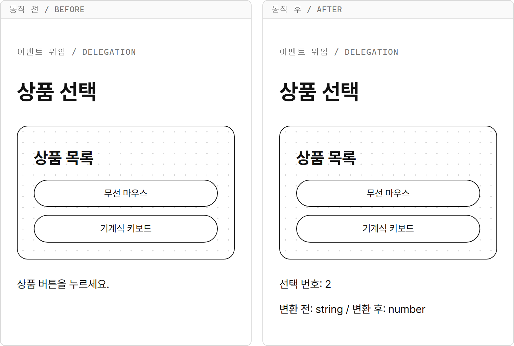

Console 탭에는 다음이 출력됩니다.

```text
변환 전: 2 string
변환 후: 2 number
```

- `productList.addEventListener(...)` 한 줄로 두 버튼을 처리합니다. 각 버튼에는 등록 코드가 없습니다.
- `data-action`이 `select`인 요소만 처리합니다. 상품 목록 제목을 클릭하면 속성이 없으므로 조건이 참이 되어 `return`으로 끝납니다.
- `idText`는 `"2"`, `id`는 `2`입니다. 콘솔에는 같은 모양으로 보이지만 `typeof` 결과로 자료형을 구분합니다.
- 버튼 안에는 글자만 넣었습니다. 버튼 안에 다른 요소가 있으면 그 요소가 `e.target`이 될 수 있으므로, 이 예제에서는 데이터 속성을 가진 버튼 자체가 클릭 대상이 되도록 구성했습니다.

## 따라하기 실습 — 목록 항목별 삭제 버튼

**실습 목표**

- 목록에 클릭 처리를 한 번 등록해 항목별 삭제 버튼을 처리합니다.
- `data-action`으로 동작을 확인하고 `data-id`로 삭제할 항목을 찾습니다.
- 새로 추가한 항목도 같은 위임 함수로 삭제합니다.

9장에서 쓴 할 일 제목 `JavaScript 복습`, `개발 환경 확인`은 처음부터 화면에 두고 `산책하기`는 버튼으로 추가합니다.
이번 실습은 배열을 바꾸는 대신 11장의 `remove()`로 화면의 항목을 직접 지웁니다.
카드의 `id="todo-2"`는 요소를 찾는 이름이고, 버튼의 `data-id="2"`는 그 카드의 번호입니다.

**준비**

1. `chapter12` 폴더 안에 `todo-delete.html` 파일을 만듭니다.
2. 공통 CSS 파일 `js-course/css/common.css`가 있는지 확인합니다.

**실습 코드**

`chapter12/todo-delete.html`

```html
<!DOCTYPE html>
<html lang="ko">
<head>
  <meta charset="UTF-8">
  <title>할 일 삭제 버튼 위임하기</title>
  <link rel="stylesheet" href="../css/common.css">
</head>
<body>
  <main class="page">
    <p class="label">할 일 / TODO</p>
    <h1>할 일 삭제</h1>
    <div class="button-group">
      <button id="addButton" class="btn" type="button">산책하기 추가</button>
    </div>
    <section id="todoList" class="form">
      <article id="todo-1" class="card">
        <h2>JavaScript 복습</h2>
        <button class="btn" type="button" data-action="delete" data-id="1">삭제</button>
      </article>
      <article id="todo-2" class="card">
        <h2>개발 환경 확인</h2>
        <button class="btn" type="button" data-action="delete" data-id="2">삭제</button>
      </article>
    </section>
    <p id="message">삭제할 할 일의 버튼을 누르세요.</p>
  </main>

  <script>
    const todoList = document.querySelector("#todoList");
    const addButton = document.querySelector("#addButton");
    const message = document.querySelector("#message");
    let nextId = 3;

    function handleListClick(e) {
      if (e.target.dataset.action !== "delete") {
        return;
      }

      const id = Number(e.target.dataset.id);
      const item = document.querySelector(`#todo-${id}`);
      item.remove();
      message.innerHTML = `${id}번 할 일을 삭제했습니다.`;
    }

    function handleAddClick() {
      const item = document.createElement("article");
      item.classList.add("card");
      item.setAttribute("id", `todo-${nextId}`);
      item.innerHTML = `<h2>산책하기</h2>
        <button class="btn" type="button" data-action="delete" data-id="${nextId}">삭제</button>`;
      todoList.append(item);
      message.innerHTML = `${nextId}번 할 일을 추가했습니다.`;
      nextId++;
    }

    todoList.addEventListener("click", handleListClick);
    addButton.addEventListener("click", handleAddClick);
  </script>
</body>
</html>
```

**실행 방법**

1. `todo-delete.html`을 저장하고 Live Server로 엽니다.
2. 개발 환경 확인 카드의 삭제 버튼을 누릅니다.
3. 산책하기 추가 버튼을 누릅니다.
4. 새 산책하기 카드의 삭제 버튼을 누릅니다.
5. JavaScript 복습 카드의 제목을 눌러 목록이 그대로인지 확인합니다.

**실행 결과**

처음 화면과 2번 할 일을 삭제한 화면을 비교합니다.

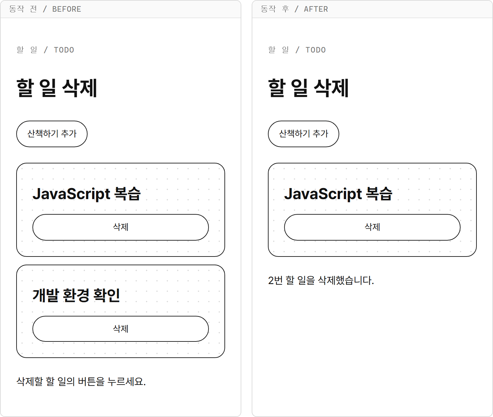

이어서 3번 할 일을 추가한 뒤 그 카드의 삭제 버튼을 누릅니다.

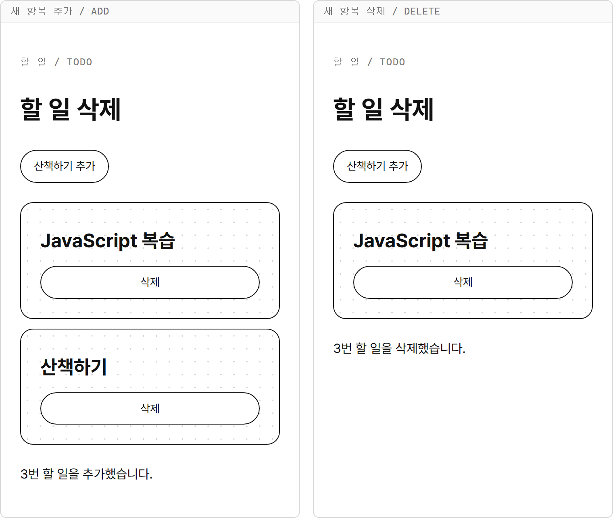

**코드 설명**

- `handleListClick()`은 처음 두 카드의 버튼뿐 아니라 추가된 카드의 버튼도 처리합니다. 부모인 `todoList`는 그대로 남기 때문입니다.
- `e.target.dataset.action !== "delete"`이면 함수를 끝냅니다. 카드 제목이나 목록의 빈 곳을 눌러도 항목을 지우지 않습니다.
- `Number(e.target.dataset.id)`로 번호를 읽습니다. `` document.querySelector(`#todo-${id}`) ``는 그 번호를 가진 카드 하나를 찾습니다.
- `item.remove()`는 클릭한 버튼만이 아니라 버튼이 속한 카드 전체를 지웁니다.
- `handleAddClick()`은 `createElement()`로 새 카드를 만들고 내용을 채운 뒤 `append()`로 목록 끝에 넣습니다. 새 삭제 버튼에 별도로 이벤트를 등록하지 않습니다.
- `nextId++`는 추가한 뒤에만 실행합니다. 삭제해도 번호를 줄이지 않아 새 카드의 번호가 기존 번호와 겹치지 않습니다.
- 목록의 마지막 항목까지 지워도 `todoList`는 남아 있으므로 다시 추가한 항목을 같은 방식으로 삭제할 수 있습니다.

**시각자료 — 부모가 받은 클릭을 처리하는 순서**

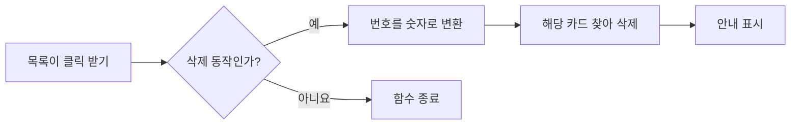

조건은 `e.target.dataset.action === "delete"`인지입니다.
삭제 동작이 아니면 번호를 읽거나 카드를 찾기 전에 끝납니다.

**바꿔 보기 1**

원래 파일에서 시작해 추가할 제목을 바꿉니다.
`handleAddClick()` 안의 `` item.innerHTML = `<h2>산책하기</h2> ``부터 닫는 백틱과 세미콜론까지를 다음처럼 바꿉니다.

```javascript
item.innerHTML = `<h2>교재 읽기</h2>
  <button class="btn" type="button" data-action="delete" data-id="${nextId}">삭제</button>`;
```

HTML의 `<button id="addButton" class="btn" type="button">산책하기 추가</button>`도 다음처럼 바꿉니다.

```html
<button id="addButton" class="btn" type="button">교재 읽기 추가</button>
```

저장한 뒤 새로 열린 화면에서 추가 버튼을 한 번 누르면 3번 교재 읽기 카드가 생깁니다.
그 카드도 삭제 버튼으로 지울 수 있습니다.

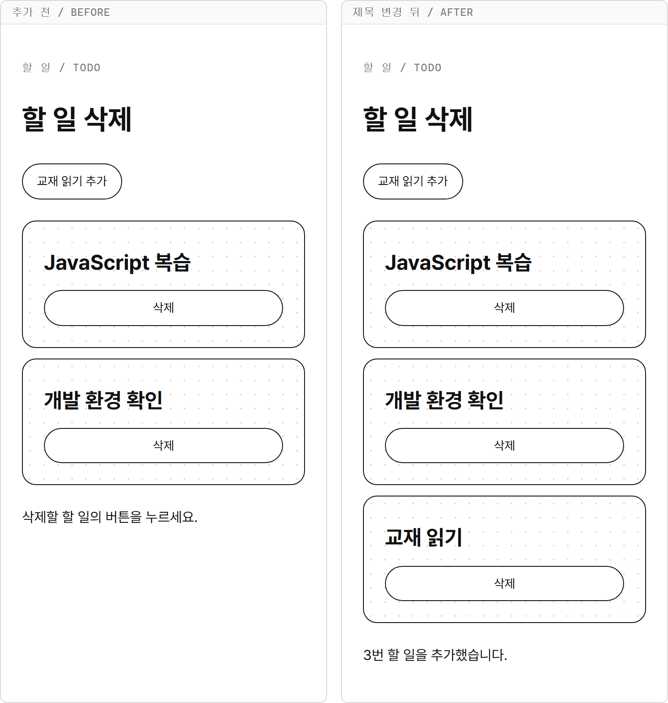

**바꿔 보기 2**

원래 파일에서 시작해 새 카드를 목록 맨 앞에 넣습니다.
`todoList.append(item);` 줄을 다음처럼 바꿉니다.

```javascript
todoList.prepend(item);
```

새 화면에서 산책하기 추가 버튼을 두 번 누르면 맨 앞부터 4번 산책하기, 3번 산책하기, 1번 JavaScript 복습, 2번 개발 환경 확인 순서가 됩니다.
맨 앞의 삭제 버튼을 누르면 4번만 지워집니다.
화면의 순서가 바뀌어도 `data-id`로 대상을 찾기 때문입니다.

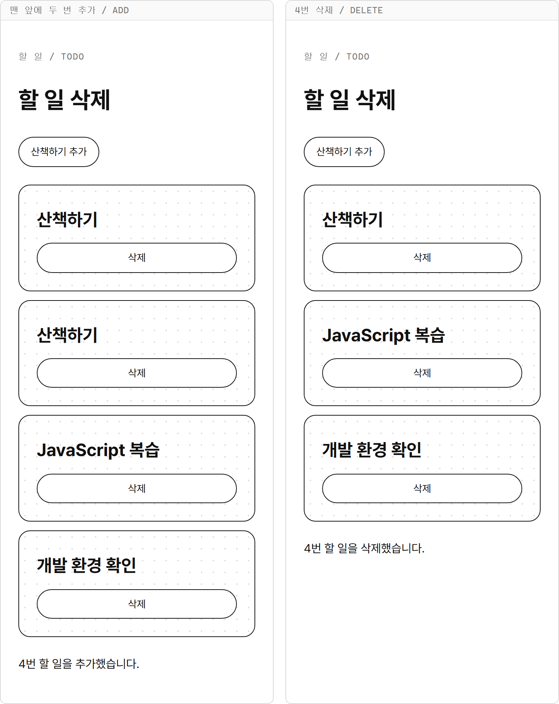

## 연습문제

### 연습문제 1 — 글자 수 세는 입력칸

**요구사항**

1. `chapter12` 폴더에 `character-count.html`을 만들고 공통 CSS를 연결합니다.
2. 제목 입력칸 하나와 글자 수 안내를 만듭니다. 처음 안내는 `글자 수: 0`입니다.
3. 함수 선언문으로 `handleInput(e)`를 만들고 입력칸의 `input` 이벤트에 등록합니다.
4. `e.target.value`의 `length`를 읽어 `글자 수: 3`처럼 표시합니다. 문자열에도 `length`가 있으며 이 문제에서는 한글 음절, 영문자, 공백이 각각 1로 계산됩니다.
5. 입력하거나 지울 때마다 안내를 갱신합니다.

**완료 조건**

- `김코딩`을 입력하면 `글자 수: 3`입니다.
- `교재 읽기`를 입력하면 공백을 포함해 `글자 수: 5`입니다.
- 입력값을 모두 지우면 `글자 수: 0`입니다.
- 별도 버튼을 누르지 않아도 글자 수가 바뀝니다.

### 연습문제 2 — 위임으로 탭 메뉴 만들기

**요구사항**

1. `chapter12` 폴더에 `tabs.html`을 만들고 공통 CSS를 연결합니다.
2. 부모 요소 `tabMenu` 안에 소개, 수업, 문의 버튼을 둡니다. 각 버튼의 글자는 다른 태그로 감싸지 않습니다.
3. 버튼에는 `data-action="tab"`과 서로 다른 `data-id` 1, 2, 3을 붙입니다. 처음에는 소개 버튼에 `selected` 클래스를 붙입니다.
4. 소개, 수업, 문의에 대응하는 내용을 객체 배열 `tabs`에 담습니다. 번호는 숫자로 넣습니다. 처음 안내는 `JavaScript를 배우는 과정입니다.`입니다.
5. 함수 선언문으로 `handleTabClick(e)`를 만들고 부모의 `click`에만 등록합니다. `data-action`이 `tab`인 경우에만 처리합니다.
6. `Number()`로 읽은 번호에 해당하는 내용을 찾아 표시하고, 선택한 버튼에만 `selected` 클래스를 남깁니다.

| 번호 | 버튼 | 표시할 내용 |
|---|---|---|
| 1 | 소개 | JavaScript를 배우는 과정입니다. |
| 2 | 수업 | 예제를 실행하고 연습문제를 풉니다. |
| 3 | 문의 | 궁금한 내용은 강사에게 질문합니다. |

**완료 조건**

- 수업 버튼을 누르면 수업 안내와 검정 버튼 표시가 함께 바뀝니다.
- 문의, 소개 버튼도 해당 내용을 표시합니다.
- 같은 버튼을 여러 번 눌러도 선택된 버튼은 하나입니다.
- 부모의 빈 곳을 클릭하면 선택과 내용이 바뀌지 않습니다.
- 개별 버튼에 `addEventListener()`를 등록하지 않습니다.

## 정답과 해설

### 연습문제 1 — 글자 수 세는 입력칸

`character-count.html`

```html
<!DOCTYPE html>
<html lang="ko">
<head>
  <meta charset="UTF-8">
  <title>입력한 글자 수 세기</title>
  <link rel="stylesheet" href="../css/common.css">
</head>
<body>
  <main class="page">
    <p class="label">글자 수 / CHARACTER COUNT</p>
    <h1>제목 길이 확인</h1>
    <label class="form">
      제목
      <input id="titleInput" name="title" class="input" type="text">
    </label>
    <p id="countMessage">글자 수: 0</p>
  </main>

  <script>
    const titleInput = document.querySelector("#titleInput");
    const countMessage = document.querySelector("#countMessage");

    function handleInput(e) {
      countMessage.innerHTML = `글자 수: ${e.target.value.length}`;
    }

    titleInput.addEventListener("input", handleInput);
  </script>
</body>
</html>
```

**실행 결과**

제목에 `교재 읽기`를 입력합니다.

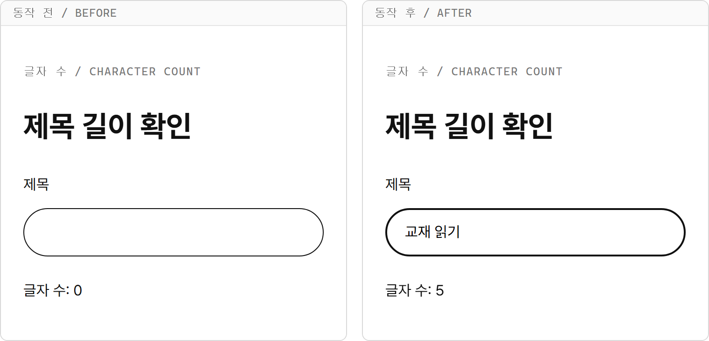

**해설**

- `e.target.value.length`는 입력한 문자열의 길이입니다. 빈 문자열의 길이는 `0`입니다.
- 공백도 문자열에 담긴 값이므로 `교재 읽기`에서는 한 칸을 포함해 `5`가 됩니다.
- 문자열의 `length`는 화면에 보이는 모든 문자의 개수와 항상 같지는 않습니다. 일부 이모지처럼 한 기호가 여러 단위로 저장되면 더 큰 수가 나올 수 있습니다.
- 값이 바뀔 때마다 `input` 처리가 실행되므로 글자를 추가할 때뿐 아니라 지울 때도 안내를 새로 표시합니다.

### 연습문제 2 — 위임으로 탭 메뉴 만들기

`tabs.html`

```html
<!DOCTYPE html>
<html lang="ko">
<head>
  <meta charset="UTF-8">
  <title>이벤트 위임으로 탭 선택하기</title>
  <link rel="stylesheet" href="../css/common.css">
</head>
<body>
  <main class="page">
    <p class="label">탭 메뉴 / TABS</p>
    <h1>과정 안내</h1>
    <div id="tabMenu" class="button-group">
      <button class="btn selected" type="button" data-action="tab" data-id="1">소개</button>
      <button class="btn" type="button" data-action="tab" data-id="2">수업</button>
      <button class="btn" type="button" data-action="tab" data-id="3">문의</button>
    </div>
    <section class="card">
      <p id="tabContent">JavaScript를 배우는 과정입니다.</p>
    </section>
  </main>

  <script>
    const tabs = [
      { id: 1, content: "JavaScript를 배우는 과정입니다." },
      { id: 2, content: "예제를 실행하고 연습문제를 풉니다." },
      { id: 3, content: "궁금한 내용은 강사에게 질문합니다." }
    ];
    const tabMenu = document.querySelector("#tabMenu");
    const tabContent = document.querySelector("#tabContent");

    function handleTabClick(e) {
      if (e.target.dataset.action !== "tab") {
        return;
      }

      const id = Number(e.target.dataset.id);
      const selectedTab = tabs.find((tab) => tab.id === id);
      const buttons = document.querySelectorAll("#tabMenu button");
      buttons.forEach((button) => {
        button.classList.remove("selected");
      });
      e.target.classList.add("selected");
      tabContent.innerHTML = selectedTab.content;
    }

    tabMenu.addEventListener("click", handleTabClick);
  </script>
</body>
</html>
```

**실행 결과**

수업 버튼을 클릭합니다.

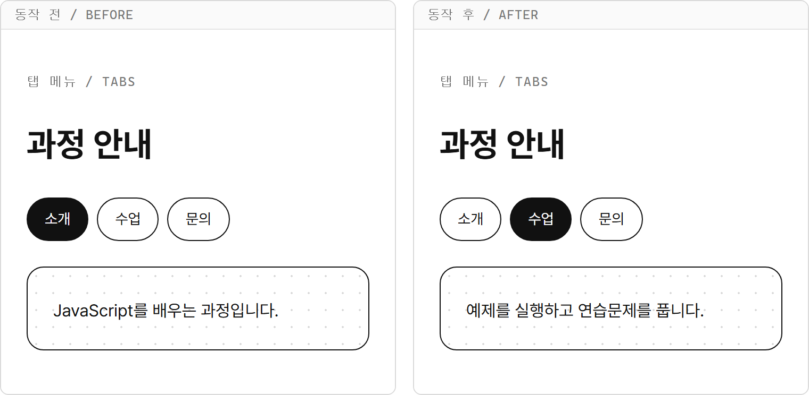

**해설**

- `handleTabClick()`은 부모의 클릭을 받지만 `e.target`은 실제 누른 버튼입니다.
- `data-action`을 먼저 확인하므로 부모의 빈 곳을 클릭하면 함수가 끝나고 기존 선택이 유지됩니다.
- `tabs`의 `id`는 숫자입니다. `Number()`로 데이터 속성을 숫자로 바꾸면 `tab.id === id`로 해당 항목을 찾을 수 있습니다.
- 모든 버튼에서 `selected`를 지운 뒤 누른 버튼에만 붙입니다. 같은 버튼을 다시 눌러도 선택 표시는 하나입니다.
- `find()`의 콜백과 `forEach()`의 콜백은 화살표 함수로 쓰고, 이벤트 처리 함수는 이름 있는 함수 선언문으로 씁니다.
- 버튼마다 서로 다른 함수를 만드는 대신 부모 한 곳에서 번호에 맞는 내용을 고릅니다.
