# 13장. 동적 UI 만들기

**학습목표**

- 상태 배열을 바꾸고 `render()`를 호출해 목록을 다시 그릴 수 있습니다.
- 제목과 내용 입력을 함수 하나로 처리하고 빈 메모의 등록을 막을 수 있습니다.
- 같은 폼에서 메모를 등록하거나 수정하고 이벤트 위임으로 삭제할 수 있습니다.
- 전개 연산자, `map()`, `filter()`로 화면과 데이터를 함께 바꿀 수 있습니다.

## 13-1 상태 배열과 render 함수

11장에서는 배열로 목록을 그렸고, 12장에서는 사용자 동작을 이벤트로 받았습니다.
이번에는 이벤트가 데이터를 바꾸고, 바뀐 데이터가 목록을 바꾸게 만듭니다.
메모 하나는 `id`, `title`, `content` 속성을 가진 객체이고, 메모 목록은 `notes` 배열에 담습니다.

예제 파일은 `js-course/chapter13` 폴더에 만듭니다.
공통 CSS는 1장에서 만든 `css/common.css`를 그대로 연결합니다.

### 상태와 렌더링

**상태**(state)는 현재 화면을 만들 때 기준으로 삼는 데이터입니다.
쉽게 말해 메모 목록에 무엇을 보여 줄지 기억해 두는 값입니다.
여기서는 `notes` 배열이 등록된 메모의 상태입니다.

**렌더링**(rendering)은 데이터를 화면의 요소로 표현하는 작업입니다.
`render()`는 현재 `notes`로 메모 목록을 채우는 함수 이름입니다.
JavaScript에 미리 들어 있는 함수가 아니라 우리가 직접 만듭니다.

상태와 렌더링은 수첩과 화이트보드에 빗댈 수 있습니다.
일정을 바꿀 때는 수첩을 먼저 고치고, 화이트보드는 지운 뒤 수첩을 보고 처음부터 다시 적습니다.

**시각자료 — 수첩을 보고 다시 적는 화이트보드**

```text
[생성 이미지: images/13/state-whiteboard.png]
장면: 왼쪽 손이 펼친 수첩을 들고 있고, 수첩에는 가로줄 세 개가 그어져 있다. 오른쪽 벽의 화이트보드는 깨끗하게 지워져 있고, 다른 손이 마커로 수첩과 같은 가로줄 세 개를 위에서부터 긋고 있다. 보드 아래 받침에 지우개가 놓여 있다.
비율: 가로 3:2
스타일: 굵기가 일정한 검정 외곽선의 단순한 선 그림. 흰 배경. 그림자와 그라데이션 없음. 흰색과 검정만 쓴다. 글자, 숫자, 기호는 넣지 않는다.
참고 그림: book-manuscript/assets/style-ref/line-art-shark.png
```

수첩이 상태 `notes`이고, 보드를 지우고 수첩대로 다시 적는 일이 `render()`입니다.

### 상태와 render 함수는 왜 필요할까?

등록·수정·삭제 뒤에도 같은 기준으로 목록을 그리기 위해 필요합니다.

등록할 때 카드만 붙이고 삭제할 때 카드만 지운다고 생각해 봅시다.
화면은 바뀌어도 `notes`에는 이전 데이터가 남을 수 있습니다.
그러면 배열에서 찾은 메모와 눈에 보이는 메모가 달라집니다.

먼저 `notes`를 바꾸고 `render()`를 호출하면 목록은 늘 현재 배열에서 만들어집니다.
등록·수정·삭제가 모두 같은 그리기 함수를 사용합니다.

**특징**

- 상태 배열은 전개 연산자, `map()`, `filter()`로 새 배열을 만들어 재할당합니다.
- `render()`는 현재 상태를 읽어 목록을 채우고 상태 자체는 바꾸지 않습니다.
- 배열을 재할당한 것만으로 화면은 바뀌지 않으므로 `render()`를 직접 호출합니다.
- 입력 폼은 그대로 두고 목록 요소의 `innerHTML`만 바꿉니다.

**시각자료 — 이벤트에서 화면까지**

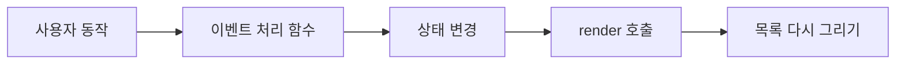

화면을 바꾸기 전에 상태를 바꿉니다.
`render()`는 바뀐 상태를 읽으므로 처음 그릴 때와 다시 그릴 때 같은 코드를 씁니다.

목록은 상태의 내용을 옮겨 보여 주는 게시판과 비슷합니다.
게시판 아래쪽의 카드만 바꿔 붙이고, 글을 적는 입력칸은 그 자리에 남겨 둡니다.

**시각자료 — 입력 폼과 다시 그릴 목록**

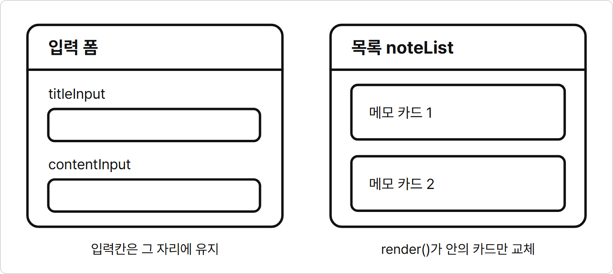

`render()`의 대상은 `noteList`입니다.
입력칸을 목록 밖에 두면 다시 그려도 입력칸의 값과 입력 위치를 유지할 수 있습니다.

**기본 문법**

```javascript
function render() {
  목록 요소.innerHTML = 상태 배열.map((항목) => 태그 문자열).join("");
}

상태 배열 = 새 배열;
render();
```

**예제 13-1** `note-state.html`

페이지를 열고 예제 메모 추가 버튼을 한 번 누릅니다.

```html
<!DOCTYPE html>
<html lang="ko">
<head>
  <meta charset="UTF-8">
  <title>상태로 그리는 메모</title>
  <link rel="stylesheet" href="../css/common.css">
</head>
<body>
  <main class="page">
    <p class="label">동적 UI / DYNAMIC UI</p>
    <h1>상태로 그리는 메모</h1>
    <button id="addButton" class="btn" type="button">예제 메모 추가</button>
    <section id="noteList" class="form"></section>
  </main>

  <script>
    let notes = [
      { id: 1, title: "JavaScript 복습", content: "배열과 함수를 정리합니다." },
      { id: 2, title: "산책 계획", content: "점심 뒤에 공원을 걷습니다." }
    ];
    let nextId = 3;
    const noteList = document.querySelector("#noteList");
    const addButton = document.querySelector("#addButton");

    function render() {
      noteList.innerHTML = notes.map((note) => `
        <article class="card">
          <h2>${note.title}</h2>
          <p>${note.content}</p>
        </article>
      `).join("") || `<p class="muted">메모가 없습니다.</p>`;
    }

    function handleClick() {
      notes = [...notes, { id: nextId, title: "함수 연습", content: "반환값을 확인합니다." }];
      nextId++;
      render();
    }

    addButton.addEventListener("click", handleClick);
    render();
  </script>
</body>
</html>
```

**실행 결과**

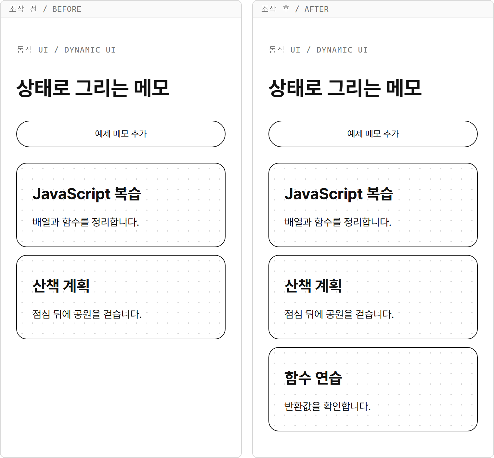

버튼을 누르면 배열 끝에 3번 메모가 들어가고 카드도 하나 더 생깁니다.

- `notes = [...notes, { ... }];`는 기존 메모와 새 메모를 담은 새 배열로 상태를 바꿉니다.
- `nextId++`는 다음 등록에 쓸 번호를 1 올립니다. 삭제로 목록 길이가 줄어도 번호는 줄이지 않습니다.
- `notes.map(...).join("")`은 카드 문자열을 하나로 이어 `noteList`에 넣습니다.
- `||` 오른쪽의 안내문은 목록이 비어 카드 문자열이 `""`일 때만 사용합니다.
- 이벤트는 한 번 연결하고 `render()`는 처음과 클릭 뒤에 각각 호출합니다.

`<script>`는 10장에서처럼 `</body>` 바로 앞에 둡니다.
본문의 HTML을 먼저 읽으므로 버튼과 목록을 바로 찾을 수 있습니다.

## 13-2 입력 받아 등록하기

예제 13-1은 미리 정한 메모를 넣었습니다.
이번에는 폼의 `submit` 이벤트에서 사용자가 적은 제목과 내용을 읽습니다.
12장에서 배운 `e.preventDefault()`로 폼 제출에 따른 페이지 이동을 막습니다.

### trim으로 빈 입력 확인하기

`trim()`은 문자열 양끝의 공백과 줄바꿈을 제거한 새 문자열을 돌려주는 메서드입니다.
원래 문자열을 바꾸지 않으며 문자열 중간의 공백은 유지합니다.
`"  배열 공부  ".trim()`은 `"배열 공부"`, `"   ".trim()`은 `""`입니다.

**특징**

- 제목과 내용을 각각 `trim()`한 뒤 빈 문자열인지 확인합니다.
- 어느 한쪽이 비어 있으면 `return`으로 등록을 끝냅니다.
- 등록에 성공한 뒤에만 번호를 올리고 두 입력칸을 비웁니다.

**기본 문법**

```javascript
const 입력값 = 입력 요소.value.trim();
if (입력값 === "") {
  return;
}
```

**예제 13-2** `note-add.html`

제목에 `  배열 공부  `, 내용에 `  map과 filter를 연습합니다.  `를 적고 등록 버튼을 누릅니다.

```html
<!DOCTYPE html>
<html lang="ko">
<head>
  <meta charset="UTF-8">
  <title>입력해서 등록하는 메모</title>
  <link rel="stylesheet" href="../css/common.css">
</head>
<body>
  <main class="page">
    <p class="label">동적 UI / DYNAMIC UI</p>
    <h1>입력해서 등록하는 메모</h1>
    <form id="noteForm" class="form">
      <label class="label" for="titleInput">제목 / TITLE</label>
      <input id="titleInput" name="title" class="title-input" placeholder="메모 제목">
      <label class="label" for="contentInput">내용 / CONTENT</label>
      <input id="contentInput" name="content" class="input" placeholder="메모 내용">
      <div class="button-group">
        <button id="submitButton" class="btn selected" type="submit">등록</button>
      </div>
    </form>
    <p id="message" class="muted"></p>
    <section id="noteList" class="form"></section>
  </main>

  <script>
    let notes = [
      { id: 1, title: "JavaScript 복습", content: "배열과 함수를 정리합니다." },
      { id: 2, title: "산책 계획", content: "점심 뒤에 공원을 걷습니다." }
    ];
    let nextId = 3;
    const noteForm = document.querySelector("#noteForm");
    const titleInput = document.querySelector("#titleInput");
    const contentInput = document.querySelector("#contentInput");
    const message = document.querySelector("#message");
    const noteList = document.querySelector("#noteList");

    function render() {
      noteList.innerHTML = notes.map((note) => `
        <article class="card">
          <h2>${note.title}</h2>
          <p>${note.content}</p>
        </article>
      `).join("") || `<p class="muted">메모가 없습니다.</p>`;
    }

    function handleSubmit(e) {
      e.preventDefault();
      const title = titleInput.value.trim();
      const content = contentInput.value.trim();

      if (title === "" || content === "") {
        message.innerHTML = "제목과 내용을 모두 입력해 주세요.";
        return;
      }

      notes = [...notes, { id: nextId, title: title, content: content }];
      nextId++;
      titleInput.value = "";
      contentInput.value = "";
      message.innerHTML = "등록했습니다.";
      render();
    }

    noteForm.addEventListener("submit", handleSubmit);
    render();
  </script>
</body>
</html>
```

**실행 결과**

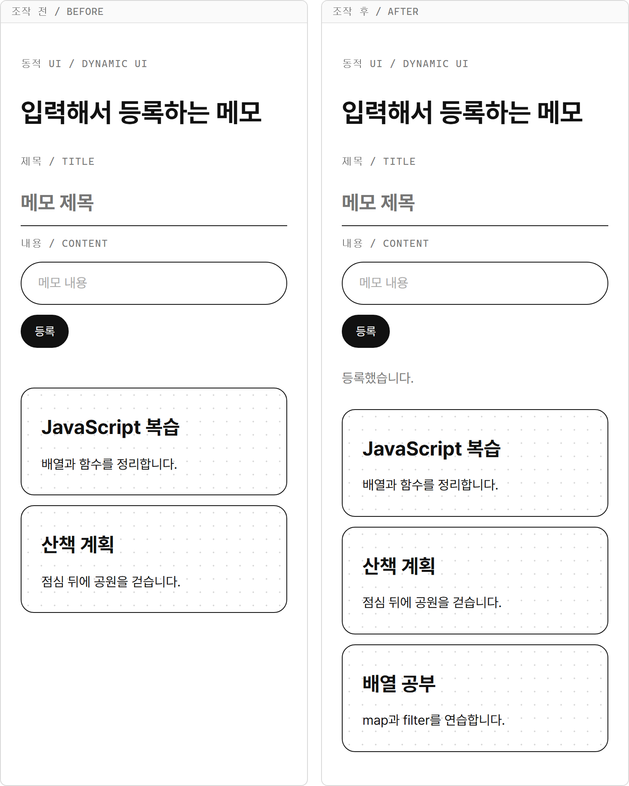

등록된 제목과 내용의 양끝 공백이 빠지고, 두 입력칸은 비워집니다.

- `titleInput.value.trim()`과 `contentInput.value.trim()`은 등록에 사용할 문자열을 만듭니다.
- `title === "" || content === ""`은 어느 한 칸이라도 비었는지 확인합니다.
- `{ id: nextId, title: title, content: content }`는 다듬은 제목과 내용을 담은 새 메모입니다.
- `titleInput.value = "";`와 `contentInput.value = "";`는 성공한 뒤 입력칸을 비웁니다.
- 안내문은 `message`에 넣고 카드 목록은 `render()`에서 채웁니다.

이어서 제목에 공백 세 칸만 적고 내용에 `내용 있음`을 적어 등록합니다.
목록은 늘지 않고 `제목과 내용을 모두 입력해 주세요.`가 표시됩니다.
입력값도 남아 있으므로 빈칸만 고쳐 다시 제출할 수 있습니다.

## 13-3 입력칸 여러 개를 함수 하나로 처리하기

예제 13-2는 제출할 때 두 입력칸의 값을 읽었습니다.
이번에는 입력할 때마다 작성 중인 값을 객체 `post`에 저장합니다.
`post`는 아직 등록하지 않은 제목·내용이고, 등록된 메모 배열 `notes`와 역할이 다릅니다.

### handleInput은 왜 필요할까?

입력칸마다 거의 같은 함수를 하나씩 만들지 않기 위해 필요합니다.

제목 입력 함수는 `title`을 바꾸고, 내용 입력 함수는 `content`를 바꾼다고 생각해 봅시다.
두 함수는 속성 이름만 다르고 나머지 코드는 같습니다.
입력칸이 늘어날 때마다 같은 모양의 함수를 더 만들어야 합니다.

입력칸에 `name="title"`, `name="content"`를 달면 `e.target.name`이 바꿀 속성 이름을 알려 줍니다.
`handleInput()` 하나가 두 입력칸에서 받은 이름과 값으로 `post`를 새로 만듭니다.

**특징**

- 입력칸의 `name`은 `post`의 속성 이름과 맞춥니다.
- 두 입력칸의 `input` 이벤트에 같은 `handleInput`을 넘깁니다.
- 객체 전개 뒤에 계산된 속성 이름을 써서 바뀐 칸의 값만 덮어씁니다.
- 입력 중에는 공백을 그대로 저장하고 제출할 때 `trim()`합니다.

**시각자료 — 입력칸 이름에 따라 바꿀 속성 고르기**

| 입력칸 | `e.target.name` | `e.target.value`의 예 | 새 객체에서 바뀌는 속성 |
|---|---|---|---|
| 제목 | `"title"` | `"배열 공부"` | `title` |
| 내용 | `"content"` | `"map 연습"` | `content` |

두 이벤트가 같은 함수로 들어와도 입력칸 이름이 다릅니다.
내용을 입력할 때는 앞서 적은 제목이 `...post`에서 옮겨지므로 그대로 남습니다.

**기본 문법**

```javascript
function handleInput(e) {
  post = { ...post, [e.target.name]: e.target.value };
  render();
}

입력 요소.addEventListener("input", handleInput);
```

**예제 13-3** `note-input.html`

제목에 `배열 공부`, 내용에 `map 연습`을 차례로 입력합니다.

```html
<!DOCTYPE html>
<html lang="ko">
<head>
  <meta charset="UTF-8">
  <title>입력 중인 메모</title>
  <link rel="stylesheet" href="../css/common.css">
</head>
<body>
  <main class="page">
    <p class="label">동적 UI / DYNAMIC UI</p>
    <h1>입력 중인 메모</h1>
    <div class="form">
      <label class="label" for="titleInput">제목 / TITLE</label>
      <input id="titleInput" name="title" class="title-input" placeholder="메모 제목">
      <label class="label" for="contentInput">내용 / CONTENT</label>
      <input id="contentInput" name="content" class="input" placeholder="메모 내용">
    </div>
    <section id="noteList" class="form"></section>
  </main>

  <script>
    let post = { title: "", content: "" };
    const titleInput = document.querySelector("#titleInput");
    const contentInput = document.querySelector("#contentInput");
    const noteList = document.querySelector("#noteList");

    function render() {
      noteList.innerHTML = `
        <article class="card">
          <h2>${post.title || "제목 입력 전"}</h2>
          <p>${post.content || "내용 입력 전"}</p>
        </article>
      `;
    }

    function handleInput(e) {
      post = { ...post, [e.target.name]: e.target.value };
      render();
    }

    titleInput.addEventListener("input", handleInput);
    contentInput.addEventListener("input", handleInput);
    render();
  </script>
</body>
</html>
```

**실행 결과**

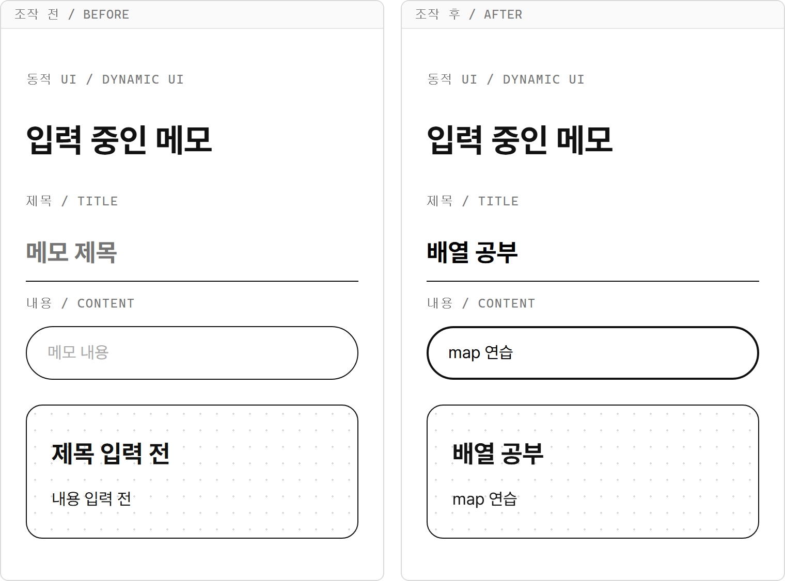

입력 중인 메모를 카드 하나로 보여 줍니다.
이 예제는 등록 기능 없이 `post`의 변경만 확인합니다.

- `[e.target.name]`은 6장의 계산된 속성 이름입니다. 제목 칸에서는 `title`, 내용 칸에서는 `content`가 됩니다.
- `...post`로 기존 두 속성을 옮기고 뒤의 속성으로 값 하나만 덮어씁니다.
- 두 `addEventListener()`에 같은 함수 이름을 넘겼으므로 처리 함수는 하나입니다.
- `render()`는 `post`를 카드로 보여 주지만 입력칸을 다시 만들지 않습니다.
- `post.title || "제목 입력 전"`은 빈 제목 대신 안내를 표시합니다. 상태 객체의 값 자체를 바꾸지는 않습니다.

## 13-4 수정하기

등록할 때 쓰던 폼을 수정할 때도 사용합니다.
**수정 대상 번호**인 `editingId`에는 수정할 메모의 `id`를 넣습니다.
수정 중인 메모가 없을 때는 `null`로 둡니다.

수정 버튼을 누르면 `find()`로 메모를 찾고, 제목과 내용을 `post`와 입력칸에 함께 채웁니다.
그다음 제출할 때는 `editingId !== null`인지 확인해 등록과 수정을 나눕니다.
`null`과 직접 비교하므로 조건만 읽어도 수정 중인지 알 수 있습니다.

**비교 — 등록과 수정**

| 비교 항목 | 등록 | 수정 |
|---|---|---|
| `editingId` | `null` | 수정할 메모의 `id` |
| 배열 변경 | 전개 연산자로 새 메모 추가 | `map()`으로 해당 메모 교체 |
| 번호 | `nextId`를 쓰고 증가 | 원래 `id` 유지 |
| 목록 개수 | 1 증가 | 그대로 |

**시각자료 — 유효한 입력을 제출한 뒤**

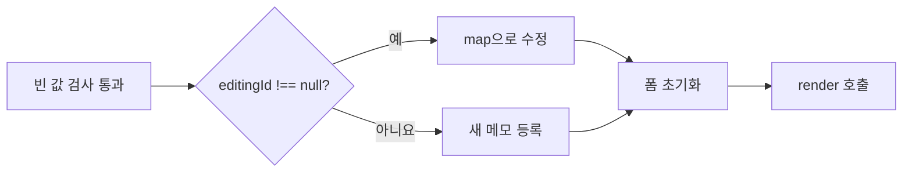

빈 값 검사를 통과한 경우의 흐름입니다.
등록과 수정 가운데 하나를 실행한 뒤 작성 상태와 입력칸을 함께 초기화합니다.

**기본 문법**

```javascript
if (editingId !== null) {
  notes = notes.map((note) => note.id === editingId ? { ...note, title: title, content: content } : note);
} else {
  notes = [...notes, { id: nextId, title: title, content: content }];
  nextId++;
}
```

**예제 13-4** `note-edit.html`

첫 카드의 수정 버튼을 누르고 제목을 `JavaScript 문제 풀기`로 바꾼 뒤 수정 저장을 누릅니다.

```html
<!DOCTYPE html>
<html lang="ko">
<head>
  <meta charset="UTF-8">
  <title>폼으로 수정하는 메모</title>
  <link rel="stylesheet" href="../css/common.css">
</head>
<body>
  <main class="page">
    <p class="label">동적 UI / DYNAMIC UI</p>
    <h1>폼으로 수정하는 메모</h1>
    <form id="noteForm" class="form">
      <label class="label" for="titleInput">제목 / TITLE</label>
      <input id="titleInput" name="title" class="title-input" placeholder="메모 제목">
      <label class="label" for="contentInput">내용 / CONTENT</label>
      <input id="contentInput" name="content" class="input" placeholder="메모 내용">
      <div class="button-group">
        <button id="submitButton" class="btn selected" type="submit">등록</button>
      </div>
    </form>
    <p id="message" class="muted"></p>
    <section id="noteList" class="form"></section>
  </main>

  <script>
    let notes = [
      { id: 1, title: "JavaScript 복습", content: "배열과 함수를 정리합니다." },
      { id: 2, title: "산책 계획", content: "점심 뒤에 공원을 걷습니다." }
    ];
    let nextId = 3;
    let post = { title: "", content: "" };
    let editingId = null;

    const noteForm = document.querySelector("#noteForm");
    const titleInput = document.querySelector("#titleInput");
    const contentInput = document.querySelector("#contentInput");
    const submitButton = document.querySelector("#submitButton");
    const message = document.querySelector("#message");
    const noteList = document.querySelector("#noteList");

    function render() {
      noteList.innerHTML = notes.map((note) => `
        <article class="card">
          <h2>${note.title}</h2>
          <p>${note.content}</p>
          <button class="btn" type="button" data-action="edit" data-id="${note.id}">수정</button>
        </article>
      `).join("") || `<p class="muted">메모가 없습니다.</p>`;
    }

    function handleInput(e) {
      post = { ...post, [e.target.name]: e.target.value };
      render();
    }

    function resetForm() {
      post = { title: "", content: "" };
      editingId = null;
      titleInput.value = "";
      contentInput.value = "";
      submitButton.innerHTML = "등록";
    }

    function handleSubmit(e) {
      e.preventDefault();
      const title = post.title.trim();
      const content = post.content.trim();

      if (title === "" || content === "") {
        message.innerHTML = "제목과 내용을 모두 입력해 주세요.";
        return;
      }

      if (editingId !== null) {
        notes = notes.map((note) => note.id === editingId ? { ...note, title: title, content: content } : note);
        message.innerHTML = "수정했습니다.";
      } else {
        notes = [...notes, { id: nextId, title: title, content: content }];
        nextId++;
        message.innerHTML = "등록했습니다.";
      }

      resetForm();
      render();
    }

    function handleListClick(e) {
      const action = e.target.dataset.action;
      const id = Number(e.target.dataset.id);
      const selectedNote = notes.find((note) => note.id === id);

      if (action === "edit" && selectedNote) {
        editingId = id;
        post = { title: selectedNote.title, content: selectedNote.content };
        titleInput.value = post.title;
        contentInput.value = post.content;
        submitButton.innerHTML = "수정 저장";
        message.innerHTML = `${id}번 메모를 수정합니다.`;
      }
    }

    titleInput.addEventListener("input", handleInput);
    contentInput.addEventListener("input", handleInput);
    noteForm.addEventListener("submit", handleSubmit);
    noteList.addEventListener("click", handleListClick);
    render();
  </script>
</body>
</html>
```

**실행 결과**

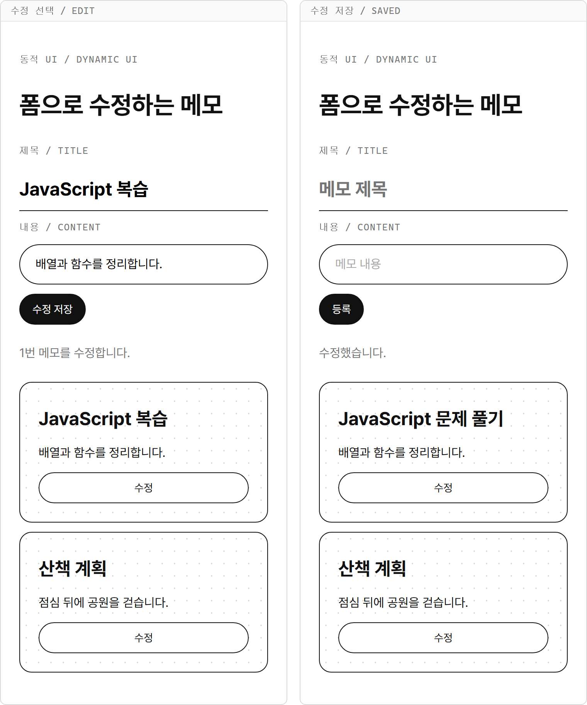

첫 카드의 제목만 바뀌고 내용과 메모 수는 유지됩니다.
저장 뒤 버튼은 다시 등록으로 바뀝니다.

- `handleListClick()`은 12장의 이벤트 위임으로 목록 안의 수정 버튼을 처리합니다.
- `Number(e.target.dataset.id)`는 버튼에 적힌 문자열 번호를 숫자로 바꿉니다.
- 수정 버튼에서 `post`와 두 `value`를 함께 채웁니다. JavaScript로 `value`를 할당하는 일은 `input` 이벤트를 발생시키지 않으므로 객체도 직접 채워야 합니다.
- `map()`은 `editingId`와 번호가 같은 메모만 `{ ...note, title: title, content: content }`로 바꿉니다.
- `resetForm()`은 `post`, `editingId`, 두 입력값과 버튼 글자를 등록 전 상태로 되돌립니다.

수정 중 내용을 지우고 제출하면 안내문이 나오고 수정 대상 번호는 유지됩니다.
내용을 다시 채워 저장하면 새 메모가 생기지 않고 원래 메모가 수정됩니다.

## 13-5 삭제하기

삭제도 화면의 카드를 직접 지우지 않고 상태 배열부터 바꿉니다.
12장에서 배운 이벤트 위임으로 `noteList` 하나에 처리 함수를 연결합니다.
버튼의 `data-action="delete"`와 `data-id`로 삭제할 메모를 고릅니다.

`filter()`에는 지울 번호와 다른 메모를 남기는 조건을 씁니다.
`render()`가 만든 새 카드의 클릭도 같은 부모 목록으로 올라오므로 버튼마다 이벤트를 다시 연결할 필요가 없습니다.
목록 안에서 버튼 밖을 누르면 삭제 동작을 건너뜁니다.

**기본 문법**

```javascript
const id = Number(e.target.dataset.id);
notes = notes.filter((note) => note.id !== id);
render();
```

**예제 13-5** `note-delete.html`

첫 카드의 삭제 버튼을 한 번 누릅니다.

```html
<!DOCTYPE html>
<html lang="ko">
<head>
  <meta charset="UTF-8">
  <title>버튼으로 삭제하는 메모</title>
  <link rel="stylesheet" href="../css/common.css">
</head>
<body>
  <main class="page">
    <p class="label">동적 UI / DYNAMIC UI</p>
    <h1>버튼으로 삭제하는 메모</h1>
    <section id="noteList" class="form"></section>
  </main>

  <script>
    let notes = [
      { id: 1, title: "JavaScript 복습", content: "배열과 함수를 정리합니다." },
      { id: 2, title: "산책 계획", content: "점심 뒤에 공원을 걷습니다." }
    ];
    const noteList = document.querySelector("#noteList");

    function render() {
      noteList.innerHTML = notes.map((note) => `
        <article class="card">
          <h2>${note.title}</h2>
          <p>${note.content}</p>
          <button class="btn" type="button" data-action="delete" data-id="${note.id}">삭제</button>
        </article>
      `).join("") || `<p class="muted">메모가 없습니다.</p>`;
    }

    function handleListClick(e) {
      if (e.target.dataset.action !== "delete") {
        return;
      }

      const id = Number(e.target.dataset.id);
      notes = notes.filter((note) => note.id !== id);
      render();
    }

    noteList.addEventListener("click", handleListClick);
    render();
  </script>
</body>
</html>
```

**실행 결과**

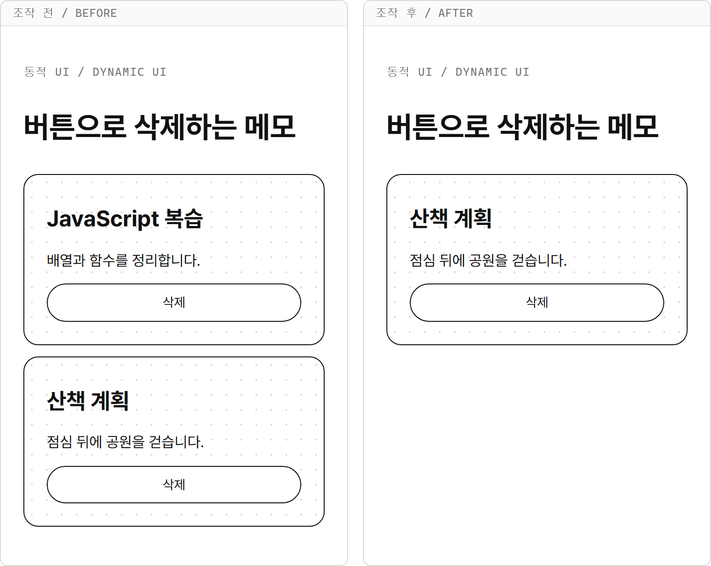

1번 메모가 빠지고 2번 메모는 그대로 남습니다.
남은 카드의 삭제 버튼을 누르면 빈 목록 안내가 나옵니다.

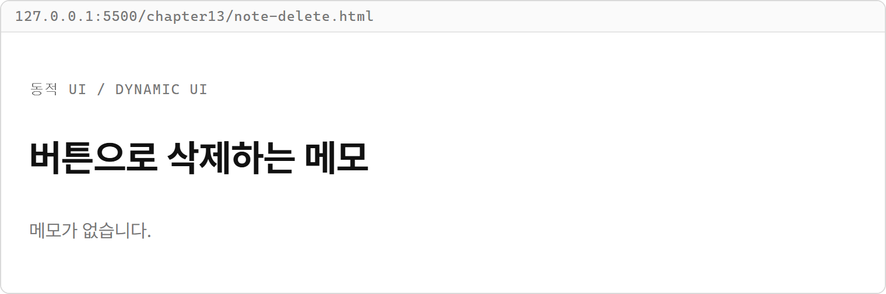

- `e.target.dataset.action !== "delete"`이면 함수를 끝내므로 카드 제목을 눌러도 삭제되지 않습니다.
- `note.id !== id`가 참인 메모만 남으므로 클릭한 번호의 메모가 새 배열에서 빠집니다.
- 이벤트를 연결한 `noteList` 자체는 그대로이고 그 안의 카드만 다시 만들어집니다.
- `notes`를 줄인 뒤 다시 그리므로 화면의 메모 수와 배열의 길이가 일치합니다.

## 따라하기 실습 — 메모 목록 등록·수정·삭제

**실습 목표**

- 제목·내용을 함수 하나로 받아 메모를 등록하고 수정합니다.
- 목록의 부모에 이벤트를 연결해 수정·삭제 버튼을 처리합니다.
- 수정 중인 메모를 삭제하면 폼도 등록 상태로 되돌립니다.

**준비**

1. `chapter13` 폴더 안에 `note-list.html` 파일을 만듭니다.
2. 아래 전체 코드를 입력하고 저장합니다.

등록된 메모는 `notes`, 작성 중인 제목·내용은 `post`, 수정 대상은 `editingId`에 둡니다.
세 값은 서로 다른 일을 맡으므로 등록된 목록과 입력 중인 값을 구분할 수 있습니다.

**실습 코드**

`chapter13/note-list.html`

```html
<!DOCTYPE html>
<html lang="ko">
<head>
  <meta charset="UTF-8">
  <title>메모 목록</title>
  <link rel="stylesheet" href="../css/common.css">
</head>
<body>
  <main class="page">
    <p class="label">동적 UI / DYNAMIC UI</p>
    <h1>메모 목록</h1>
    <form id="noteForm" class="form">
      <label class="label" for="titleInput">제목 / TITLE</label>
      <input id="titleInput" name="title" class="title-input" placeholder="메모 제목">
      <label class="label" for="contentInput">내용 / CONTENT</label>
      <input id="contentInput" name="content" class="input" placeholder="메모 내용">
      <div class="button-group">
        <button id="submitButton" class="btn selected" type="submit">등록</button>
      </div>
    </form>
    <p id="message" class="muted"></p>
    <section id="noteList" class="form"></section>
  </main>

  <script>
    let notes = [
      { id: 1, title: "JavaScript 복습", content: "배열과 함수를 정리합니다." },
      { id: 2, title: "산책 계획", content: "점심 뒤에 공원을 걷습니다." }
    ];
    let nextId = 3;
    let post = { title: "", content: "" };
    let editingId = null;

    const noteForm = document.querySelector("#noteForm");
    const titleInput = document.querySelector("#titleInput");
    const contentInput = document.querySelector("#contentInput");
    const submitButton = document.querySelector("#submitButton");
    const message = document.querySelector("#message");
    const noteList = document.querySelector("#noteList");

    function render() {
      noteList.innerHTML = notes.map((note) => `
        <article class="card">
          <h2>${note.title}</h2>
          <p>${note.content}</p>
          <div class="button-group">
            <button class="btn" type="button" data-action="edit" data-id="${note.id}">수정</button>
            <button class="btn" type="button" data-action="delete" data-id="${note.id}">삭제</button>
          </div>
        </article>
      `).join("") || `<p class="muted">메모가 없습니다.</p>`;
    }

    function handleInput(e) {
      post = { ...post, [e.target.name]: e.target.value };
      render();
    }

    function resetForm() {
      post = { title: "", content: "" };
      editingId = null;
      titleInput.value = "";
      contentInput.value = "";
      submitButton.innerHTML = "등록";
    }

    function handleSubmit(e) {
      e.preventDefault();
      const title = post.title.trim();
      const content = post.content.trim();

      if (title === "" || content === "") {
        message.innerHTML = "제목과 내용을 모두 입력해 주세요.";
        return;
      }

      if (editingId !== null) {
        notes = notes.map((note) => note.id === editingId ? { ...note, title: title, content: content } : note);
        message.innerHTML = "수정했습니다.";
      } else {
        notes = [...notes, { id: nextId, title: title, content: content }];
        nextId++;
        message.innerHTML = "등록했습니다.";
      }

      resetForm();
      render();
    }

    function handleListClick(e) {
      const action = e.target.dataset.action;
      const id = Number(e.target.dataset.id);
      const selectedNote = notes.find((note) => note.id === id);

      if (action === "edit" && selectedNote) {
        editingId = id;
        post = { title: selectedNote.title, content: selectedNote.content };
        titleInput.value = post.title;
        contentInput.value = post.content;
        submitButton.innerHTML = "수정 저장";
        message.innerHTML = `${id}번 메모를 수정합니다.`;
      }

      if (action === "delete") {
        notes = notes.filter((note) => note.id !== id);
        if (editingId === id) {
          resetForm();
        }
        message.innerHTML = "삭제했습니다.";
        render();
      }
    }

    titleInput.addEventListener("input", handleInput);
    contentInput.addEventListener("input", handleInput);
    noteForm.addEventListener("submit", handleSubmit);
    noteList.addEventListener("click", handleListClick);
    render();
  </script>
</body>
</html>
```

**실행 방법**

1. `note-list.html`을 Live Server로 엽니다.
2. 제목에 `배열 공부`, 내용에 `map과 filter를 연습합니다.`를 입력하고 등록을 누릅니다.
3. 처음 메모의 수정 버튼을 눌러 제목을 `JavaScript 문제 풀기`로 바꾸고 수정 저장을 누릅니다.
4. 산책 계획 메모의 삭제 버튼을 누릅니다.

**실행 결과**

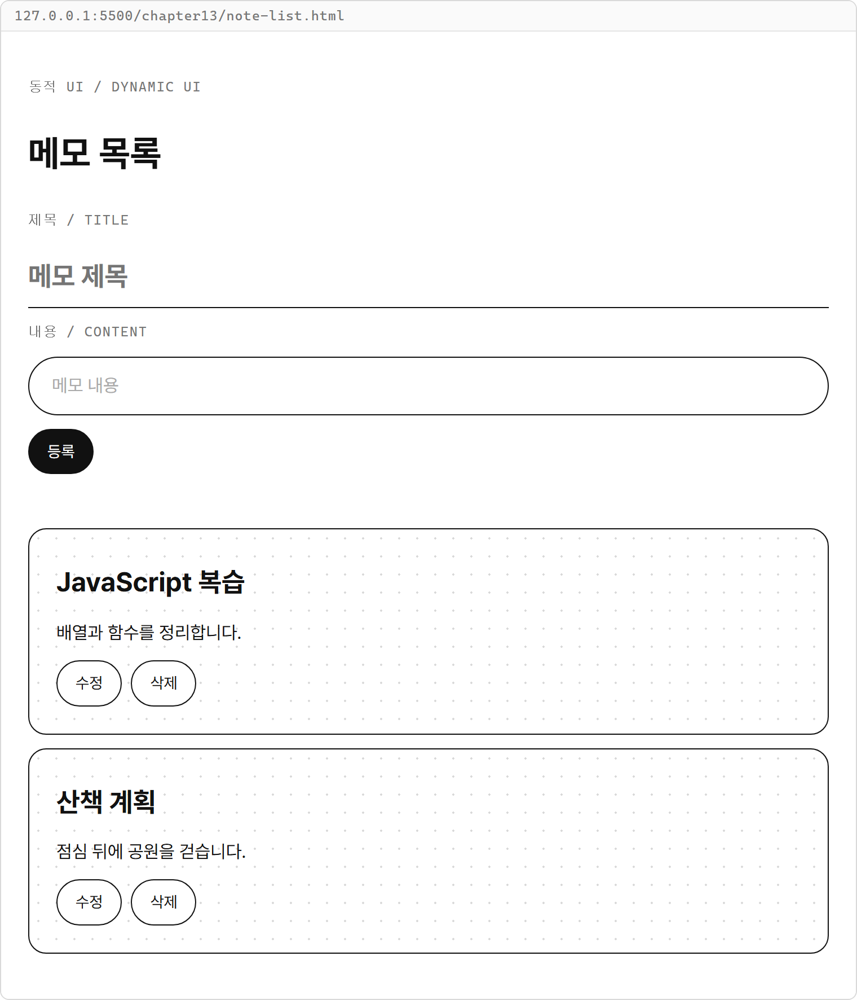

등록하고 수정한 뒤 산책 계획을 삭제하면 두 메모가 남습니다.


**코드 설명**

- `handleInput()`은 입력 때마다 `post`를 바꾸고 목록을 다시 그립니다. 아직 제출하지 않았으므로 `notes`의 메모 내용은 그대로입니다.
- `handleSubmit()`은 `post`의 두 값을 `trim()`한 뒤 등록과 수정으로 나눕니다.
- 수정 버튼은 `editingId`를 정하고 `post`와 입력값을 함께 채웁니다. 다른 메모의 수정 버튼을 누르면 대상도 그 메모로 바뀝니다.
- 삭제 분기의 `editingId === id`는 지금 작성 중인 메모를 지웠는지 확인합니다. 같은 메모면 `resetForm()`으로 남아 있는 수정 상태를 비웁니다.
- 다른 메모를 삭제하면 `resetForm()`을 부르지 않습니다. 작성 중인 제목과 내용은 그대로 이어서 쓸 수 있습니다.
- 새로 등록한 메모도 같은 부모 목록에 들어가므로 수정·삭제 버튼이 바로 동작합니다.

페이지를 새로고침하면 처음의 두 메모로 돌아옵니다.
이 실습의 상태는 열린 페이지의 변수에만 담겨 있습니다.

**바꿔 보기 1**

작성 취소 버튼을 더합니다.
`<button id="submitButton" class="btn selected" type="submit">등록</button>` 바로 아래에 다음 버튼을 넣습니다.

```html
<button id="cancelButton" class="btn" type="button">작성 취소</button>
```

`resetForm()` 선언의 닫는 중괄호 바로 아래에 다음 함수를 추가합니다.

```javascript
function handleCancel() {
  resetForm();
  message.innerHTML = "작성을 취소했습니다.";
  render();
}
```

`noteForm.addEventListener("submit", handleSubmit);` 바로 아래에 다음 줄을 넣습니다.

```javascript
document.querySelector("#cancelButton").addEventListener("click", handleCancel);
```

수정 버튼을 누르고 제목을 바꾼 뒤 작성 취소를 누르면 원래 메모는 유지됩니다.
입력칸은 비워지고 제출 버튼은 등록으로 돌아갑니다.

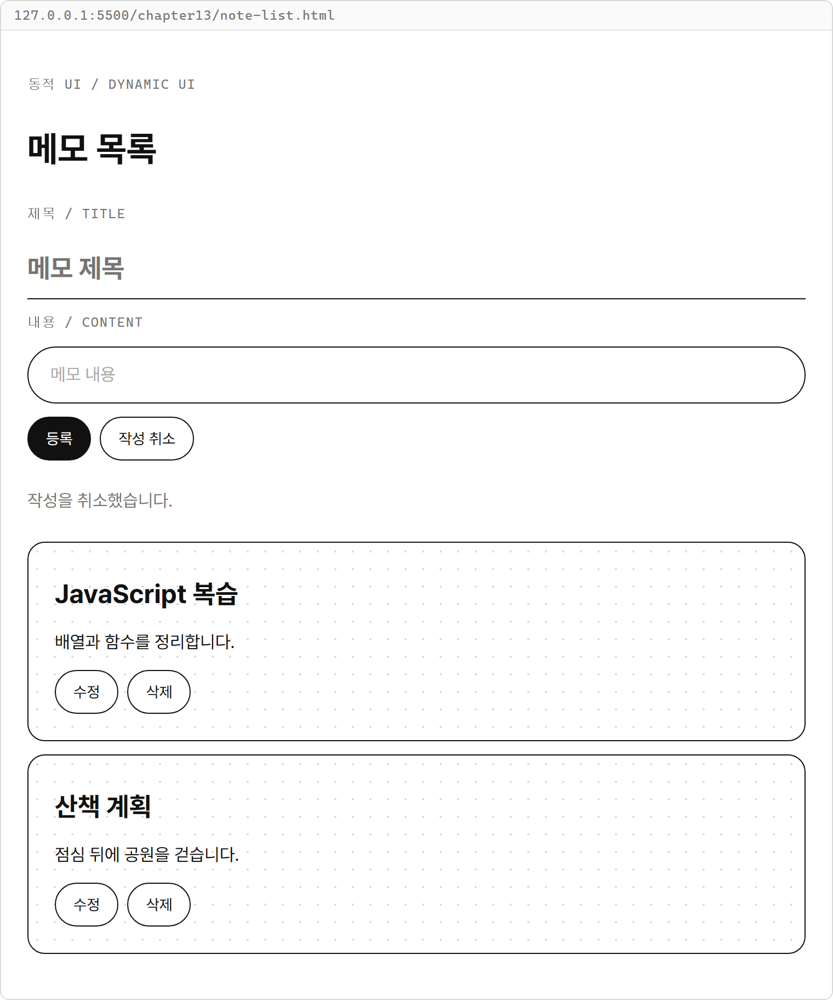

**바꿔 보기 2**

원래 실습 코드로 돌아가 새 메모를 맨 앞에 등록해 봅니다.
`notes = [...notes, { id: nextId, title: title, content: content }];` 줄을 다음처럼 바꿉니다.

```javascript
notes = [{ id: nextId, title: title, content: content }, ...notes];
```

새 메모가 첫 카드로 표시됩니다.
카드 위치가 달라져도 `id`로 대상을 찾으므로 수정·삭제는 그대로 동작합니다.

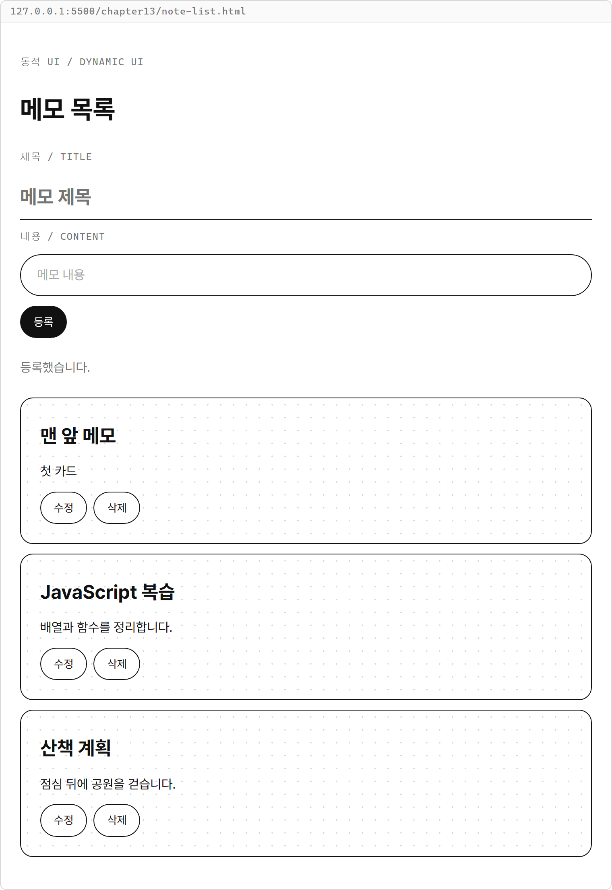

## 연습문제

### 연습문제 1 — 연락처 목록 등록·삭제

**요구사항**

1. `chapter13/contact-list.html`을 만들고 이름·전화번호 입력칸과 등록 버튼을 폼에 넣습니다.
2. 초기 `contacts`는 `{ id: 1, name: "김코딩", phone: "010-1111-2222" }` 하나로 두고 `nextId`는 2로 둡니다.
3. 제출하면 두 입력값을 `trim()`하고, 하나라도 비었으면 안내만 표시합니다.
4. 유효한 연락처는 불변 업데이트로 등록하고 번호를 올린 뒤 입력칸을 비웁니다.
5. `render()`에서 연락처 카드와 삭제 버튼을 그립니다. 카드에 이름과 전화번호를 각각 표시합니다.
6. 이벤트 위임으로 클릭한 연락처를 삭제합니다. 연락처가 없으면 `연락처가 없습니다.`를 표시합니다.

**완료 조건**

- `이자바`, `010-3333-4444`를 등록하면 두 카드가 보입니다.
- 김코딩을 삭제하면 이자바의 카드만 남습니다.
- 공백만 있는 이름은 등록되지 않으며, 모든 연락처를 삭제하면 빈 목록 안내가 보입니다.
- 카드 제목을 눌러도 삭제되지 않고, 새로 등록한 연락처도 삭제할 수 있습니다.

### 연습문제 2 — 장바구니 수량 올리기·내리기

**요구사항**

1. `chapter13/cart-quantity.html`을 만들고 `cartItems`에 무선 마우스(`id: 1`, `price: 12000`, `quantity: 1`)와 마우스 패드(`id: 2`, `price: 5000`, `quantity: 2`)를 담습니다.
2. 카드마다 상품 이름, 수량, 소계와 올리기·내리기 버튼을 표시합니다. 예: `수량: 1개 / 소계: 12000원`
3. 버튼에는 `data-action`과 `data-id`를 달고 목록 부모에 처리 함수 하나를 연결합니다.
4. 올리기는 해당 상품의 수량만 1 늘립니다. 내리기는 수량이 1보다 클 때만 1 줄입니다.
5. `map()`과 객체 전개로 새 상태를 만들고 목록을 다시 그립니다.

**완료 조건**

- 마우스의 올리기를 누르면 `수량: 2개 / 소계: 24000원`으로 바뀝니다.
- 내리기를 누르면 1개로 돌아가고 한 번 더 눌러도 1개입니다.
- 한 상품의 수량을 바꿀 때 다른 상품의 수량은 유지됩니다.
- 버튼 밖의 카드 내용을 눌러도 수량은 바뀌지 않습니다.

## 정답과 해설

### 연습문제 1 — 연락처 목록 등록·삭제

`contact-list.html`

```html
<!DOCTYPE html>
<html lang="ko">
<head>
  <meta charset="UTF-8">
  <title>연락처 목록</title>
  <link rel="stylesheet" href="../css/common.css">
</head>
<body>
  <main class="page">
    <p class="label">동적 UI / DYNAMIC UI</p>
    <h1>연락처 목록</h1>
    <form id="contactForm" class="form">
      <label class="label" for="nameInput">이름 / NAME</label>
      <input id="nameInput" class="title-input" placeholder="연락처 이름">
      <label class="label" for="phoneInput">전화번호 / PHONE</label>
      <input id="phoneInput" class="input" placeholder="010-0000-0000">
      <div class="button-group">
        <button class="btn selected" type="submit">등록</button>
      </div>
    </form>
    <p id="message" class="muted"></p>
    <section id="contactList" class="form"></section>
  </main>

  <script>
    let contacts = [
      { id: 1, name: "김코딩", phone: "010-1111-2222" }
    ];
    let nextId = 2;
    const contactForm = document.querySelector("#contactForm");
    const nameInput = document.querySelector("#nameInput");
    const phoneInput = document.querySelector("#phoneInput");
    const message = document.querySelector("#message");
    const contactList = document.querySelector("#contactList");

    function render() {
      contactList.innerHTML = contacts.map((contact) => `
        <article class="card">
          <h2>${contact.name}</h2>
          <p>${contact.phone}</p>
          <button class="btn" type="button" data-action="delete" data-id="${contact.id}">삭제</button>
        </article>
      `).join("") || `<p class="muted">연락처가 없습니다.</p>`;
    }

    function handleSubmit(e) {
      e.preventDefault();
      const name = nameInput.value.trim();
      const phone = phoneInput.value.trim();

      if (name === "" || phone === "") {
        message.innerHTML = "이름과 전화번호를 모두 입력해 주세요.";
        return;
      }

      contacts = [...contacts, { id: nextId, name: name, phone: phone }];
      nextId++;
      nameInput.value = "";
      phoneInput.value = "";
      message.innerHTML = "등록했습니다.";
      render();
    }

    function handleListClick(e) {
      if (e.target.dataset.action !== "delete") {
        return;
      }

      const id = Number(e.target.dataset.id);
      contacts = contacts.filter((contact) => contact.id !== id);
      render();
    }

    contactForm.addEventListener("submit", handleSubmit);
    contactList.addEventListener("click", handleListClick);
    render();
  </script>
</body>
</html>
```

**실행 결과**

처음에는 김코딩 한 명이 표시됩니다.

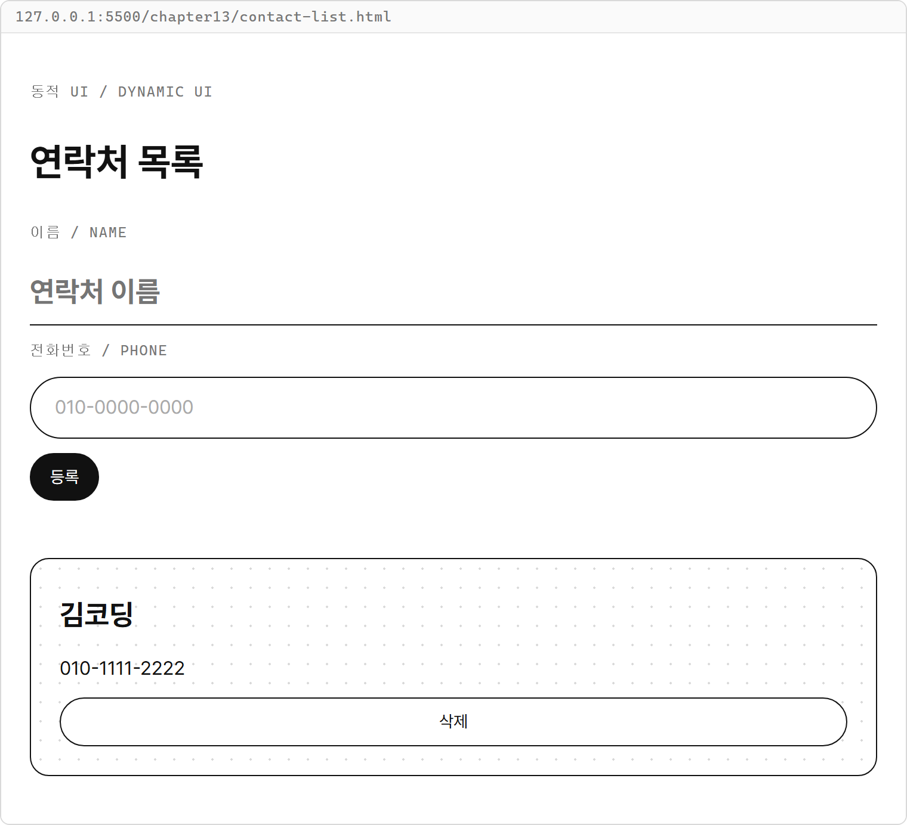

이자바를 등록하고 김코딩을 삭제합니다.

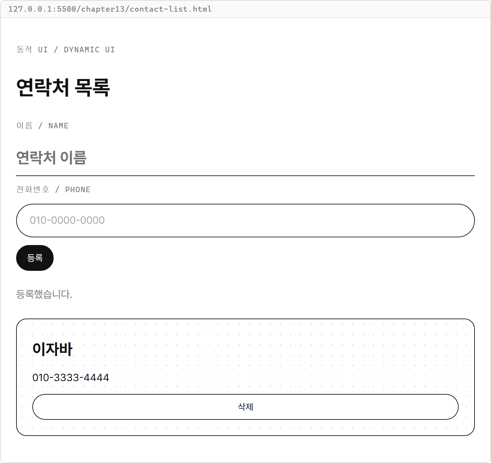

**해설**

- 제목·내용 대신 이름·전화번호를 담아도 등록과 삭제의 흐름은 같습니다.
- `contacts = [...contacts, { id: nextId, name: name, phone: phone }];`로 새 연락처를 붙이고, 등록 뒤에만 번호를 늘립니다.
- `contact.id !== id`인 연락처만 남기고 다시 그리므로 삭제된 연락처는 상태와 화면에서 함께 빠집니다.
- `||` 오른쪽의 빈 목록 안내는 마지막 연락처를 지운 뒤 표시됩니다.

작성 중인 값을 객체로 묶고 공통 입력 함수를 사용해도 같은 기능을 만들 수 있습니다.

### 연습문제 2 — 장바구니 수량 올리기·내리기

`cart-quantity.html`

```html
<!DOCTYPE html>
<html lang="ko">
<head>
  <meta charset="UTF-8">
  <title>장바구니 수량</title>
  <link rel="stylesheet" href="../css/common.css">
</head>
<body>
  <main class="page">
    <p class="label">동적 UI / DYNAMIC UI</p>
    <h1>장바구니 수량</h1>
    <section id="cartList" class="form"></section>
  </main>

  <script>
    let cartItems = [
      { id: 1, name: "무선 마우스", price: 12000, quantity: 1 },
      { id: 2, name: "마우스 패드", price: 5000, quantity: 2 }
    ];
    const cartList = document.querySelector("#cartList");

    function render() {
      cartList.innerHTML = cartItems.map((item) => `
        <article class="card">
          <h2>${item.name}</h2>
          <p>수량: ${item.quantity}개 / 소계: ${item.price * item.quantity}원</p>
          <div class="button-group">
            <button class="btn" type="button" data-action="increase" data-id="${item.id}">올리기</button>
            <button class="btn" type="button" data-action="decrease" data-id="${item.id}">내리기</button>
          </div>
        </article>
      `).join("");
    }

    function handleListClick(e) {
      const action = e.target.dataset.action;
      const id = Number(e.target.dataset.id);
      const selectedItem = cartItems.find((item) => item.id === id);

      if (!selectedItem) {
        return;
      }

      if (action === "increase") {
        cartItems = cartItems.map((item) => item.id === id ? { ...item, quantity: item.quantity + 1 } : item);
        render();
      }

      if (action === "decrease" && selectedItem.quantity > 1) {
        cartItems = cartItems.map((item) => item.id === id ? { ...item, quantity: item.quantity - 1 } : item);
        render();
      }
    }

    cartList.addEventListener("click", handleListClick);
    render();
  </script>
</body>
</html>
```

**실행 결과**


무선 마우스의 올리기를 누르면 해당 수량과 소계가 함께 바뀝니다.

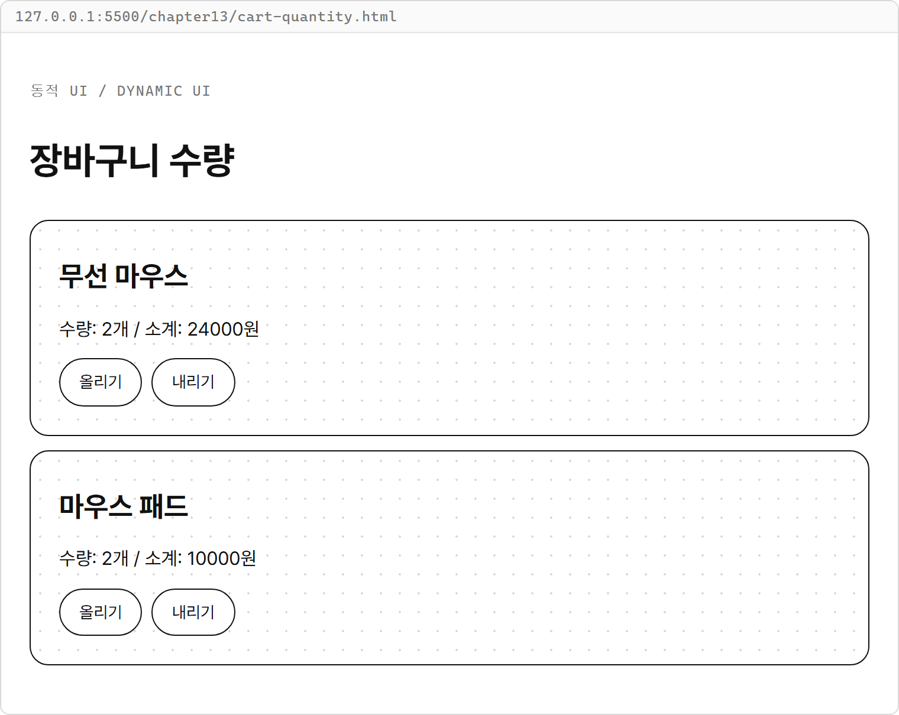

**해설**

- `find()`로 현재 상품을 읽어 내릴 수 있는 수량인지 확인합니다.
- 수정할 상품만 `{ ...item, quantity: item.quantity + 1 }`처럼 새 객체로 만들고 다른 상품은 그대로 반환합니다.
- `selectedItem.quantity > 1`이 참일 때만 내리므로 수량은 1 아래로 내려가지 않습니다.
- 소계는 `render()`에서 `price * quantity`로 계산하므로 수량을 바꾼 뒤 함께 갱신됩니다.
- 카드 제목에는 `data-id`가 없으므로 `selectedItem`이 `undefined`입니다. `return`으로 함수가 끝나 상태는 유지됩니다.

수량 변경을 함수로 묶어 처리 함수에서 호출해도 같은 결과가 나옵니다.
