# 14장. [미니프로젝트] 할 일 보드

**학습목표**

- 9장의 데이터 함수를 화면의 등록·수정·삭제·완료 버튼에 연결할 수 있습니다.
- 상태 배열을 바꾸고 `render()`로 카드 목록을 다시 그릴 수 있습니다.
- 전체·진행·완료 필터와 선택된 버튼 표시를 함께 바꿀 수 있습니다.
- 전체 할 일의 진행률을 계산해 진행 막대의 폭으로 표시할 수 있습니다.

**사용하는 장**

9~13장

**이 장에서 만드는 것**

9장에서 콘솔로 다루던 할 일을 입력칸과 카드로 관리합니다.
13장의 메모 목록처럼 상태를 먼저 바꾸고 화면을 다시 그립니다.
완성된 보드에서는 제목을 등록하고 완료 상태를 바꿀 수 있습니다.
제목 수정은 등록에 쓴 입력 폼으로 하고 삭제는 카드의 버튼으로 합니다.

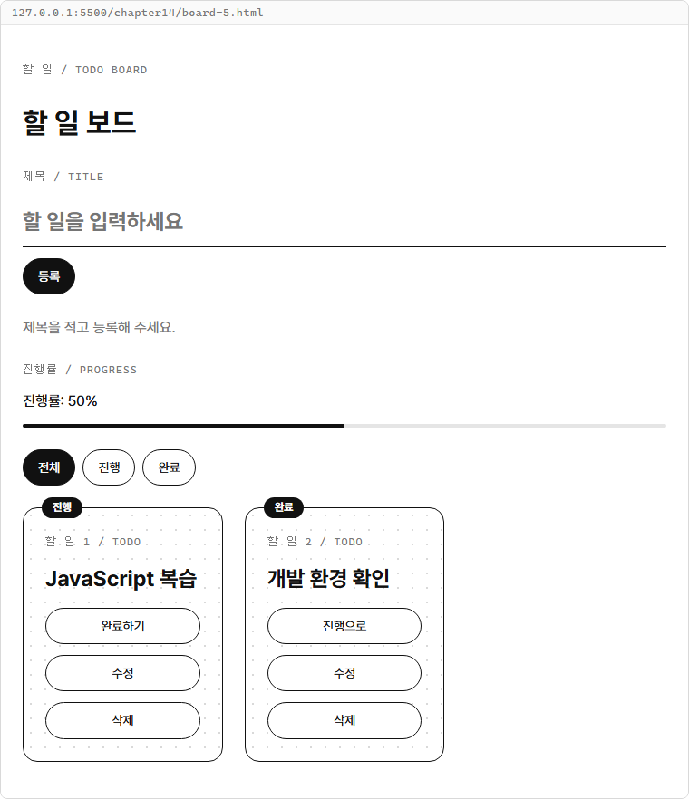

**요구사항**

| 번호 | 기능 | 가져오는 코드·기능 |
|---|---|---|
| 1 | 밑줄 입력칸과 카드 배치 | 1장의 `common.css` |
| 2 | 등록과 상태 배지 표시 | 9장의 `addTodo()`, 13장의 `render()` |
| 3 | 완료 토글·수정·삭제 | 9장의 변경 함수, 13장의 `editingId`와 이벤트 위임 |
| 4 | 전체·진행·완료 목록 선택 | 9장의 `getFilteredTodos()`, `classList` |
| 5 | 진행 막대의 폭 표시 | 9장의 `getProgress()`, `style.width` |

**준비**

1. `js-course` 안에 `chapter14` 폴더를 만듭니다.
2. 그 안에 `board-1.html`부터 `board-5.html`까지 파일 다섯 개를 만듭니다.
3. 1장에서 만든 `css/common.css`를 그대로 둡니다.

각 단계에는 앞 단계의 기능을 포함한 전체 파일을 제공합니다.
공통 CSS만 연결하며 다른 단계의 HTML이나 JavaScript 파일은 불러오지 않습니다.
실행 방법은 1-3의 Live Server 열기를 따릅니다.

**시작 코드**

14-1의 `board-1.html`이 시작 파일입니다.
각 파일의 `<script>` 맨 위에는 `todo-4.js`에서 가져온 변경 함수 네 개와 조회·진행률 함수 두 개를 그대로 둡니다.
콘솔에 출력하던 `formatTodoList()`, `printTodos()`와 시연용 함수 호출은 보드에 옮기지 않습니다.

| 함수 | 보드에서 맡는 일 |
|---|---|
| `addTodo(todos, id, title)` | 새 할 일을 끝에 등록 |
| `updateTodo(todos, id, changes)` | 기존 할 일의 제목 수정 |
| `deleteTodo(todos, id)` | 해당 번호의 할 일 삭제 |
| `toggleTodo(todos, id)` | 완료 여부 뒤집기 |
| `getFilteredTodos(todos, filter = "all")` | 표시할 목록 선택 |
| `getProgress(todos)` | 전체 목록의 완료 비율 계산 |

함수는 새 배열이나 계산 결과를 반환하고 화면 요소를 다루지 않습니다.
보드에서는 이벤트 처리 함수가 반환값을 `todos`에 할당하고 `render()`를 부릅니다.

## 14-1 화면 구성

**목표**

공통 CSS로 밑줄 제목 입력칸, 카드 두 개, 알약 모양 등록 버튼을 놓습니다.
이 단계에서는 모양만 확인하고 등록 버튼에는 아직 동작을 연결하지 않습니다.

**힌트**

- 페이지는 `page`, 입력 폼은 `form`, 입력칸은 `title-input` 클래스를 씁니다.
- 목록에는 `card-list`, 각 카드에는 `card`, 카드 위 상태에는 `badge`를 붙입니다.
- 등록 버튼의 `btn selected`는 검정 바탕과 흰 글자를 적용합니다.

`todoList` 안에는 확인용 카드 두 개를 직접 적습니다.
배지의 진행은 `isDone: false`, 완료는 `isDone: true`에 대응합니다.
입력칸은 목록 밖에 두어 카드를 다시 그릴 때도 그 자리에 남도록 합니다.

**시작 코드**

`chapter14/board-1.html`

```html
<!DOCTYPE html>
<html lang="ko">
<head>
  <meta charset="UTF-8">
  <title>할 일 보드</title>
  <link rel="stylesheet" href="../css/common.css">
</head>
<body>
  <main class="page">
    <p class="label">할 일 / TODO BOARD</p>
    <h1>할 일 보드</h1>
    <form id="todoForm" class="form">
      <label class="label" for="titleInput">제목 / TITLE</label>
      <input id="titleInput" name="title" class="title-input" placeholder="할 일을 입력하세요">
      <div class="button-group">
        <button id="submitButton" class="btn selected" type="button">등록</button>
      </div>
    </form>
    <p id="message" class="muted">화면 구성을 확인합니다.</p>
    <section id="todoList" class="card-list">
      <article class="card">
        <span class="badge">진행</span>
        <p class="label">할 일 1 / TODO</p>
        <h2>JavaScript 복습</h2>
      </article>
      <article class="card">
        <span class="badge">완료</span>
        <p class="label">할 일 2 / TODO</p>
        <h2>개발 환경 확인</h2>
      </article>
    </section>
  </main>

  <script>
    function addTodo(todos, id, title) {
      return [...todos, { id: id, title: title, isDone: false }];
    }

    function updateTodo(todos, id, changes) {
      return todos.map((todo) => todo.id === id ? { ...todo, ...changes } : todo);
    }

    function deleteTodo(todos, id) {
      return todos.filter((todo) => todo.id !== id);
    }

    function toggleTodo(todos, id) {
      return todos.map((todo) => todo.id === id ? { ...todo, isDone: !todo.isDone } : todo);
    }

    function getFilteredTodos(todos, filter = "all") {
      if (filter === "active") {
        return todos.filter((todo) => !todo.isDone);
      }

      if (filter === "done") {
        return todos.filter((todo) => todo.isDone);
      }

      return todos;
    }

    function getProgress(todos) {
      const completedCount = todos.filter((todo) => todo.isDone).length;
      return todos.length === 0 ? 0 : Math.round(completedCount / todos.length * 100);
    }
  </script>
</body>
</html>
```

**확인 방법**

`board-1.html`을 Live Server로 엽니다.
밑줄 입력칸, 검정 등록 버튼, 진행·완료 배지가 있는 카드 두 개를 확인합니다.
등록 버튼을 눌러도 아직 목록은 바뀌지 않습니다.

**실행 결과**


**코드 설명**

- `<link>`는 1장의 공통 CSS를 연결합니다. 별도 CSS를 추가하지 않고 정해진 클래스만 붙였습니다.
- `<script>`는 `</body>` 바로 앞에 있습니다. 그래서 그 위의 화면 요소가 모두 만들어진 뒤 실행됩니다.
- 함수 여섯 개는 아직 호출하지 않습니다. 다음 단계에서 연결할 코드의 이름과 모양을 먼저 준비했습니다.

## 14-2 등록과 카드 목록

**목표**

제목을 제출하면 `addTodo()`로 상태를 바꾸고 `render()`로 카드를 그립니다.
9장의 초기 데이터 두 개를 그대로 사용하고 새 번호는 `nextId = 3`에서 시작합니다.

**힌트**

- `board-1.html`의 확인용 카드를 지우고 `todoList`를 빈 요소로 둡니다.
- 등록 버튼을 `type="submit"`으로 바꾸고 폼에 `handleSubmit`을 연결합니다.
- `map()`과 `join("")`으로 카드 문자열을 이어 목록의 `innerHTML`에 넣습니다.
- 배지에는 `todo.isDone ? "완료" : "진행"`을 사용합니다.

작성 중인 제목은 13장의 `post` 이름을 이어 사용하되 `title` 속성 하나만 둡니다.
`handleInput()`은 입력을 `post`에 담고, `handleSubmit()`은 `trim()`한 제목을 등록합니다.
빈 제목이면 안내만 표시하며 번호를 늘리거나 입력칸을 비우지 않습니다.

**시각자료 — 등록된 제목이 카드가 되는 순서**

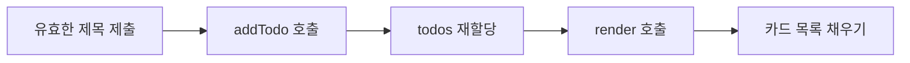

그림은 빈 값 검사를 통과한 등록의 흐름입니다.
배열만 바꿔서는 화면이 바뀌지 않으므로 마지막에 `render()`를 호출합니다.

**실습 코드**

`board-1.html`의 화면 구성과 함수 여섯 개에 상태, 그리기 함수, 입력·제출 처리를 더한 전체 파일입니다.

`chapter14/board-2.html`

```html
<!DOCTYPE html>
<html lang="ko">
<head>
  <meta charset="UTF-8">
  <title>할 일 보드</title>
  <link rel="stylesheet" href="../css/common.css">
</head>
<body>
  <main class="page">
    <p class="label">할 일 / TODO BOARD</p>
    <h1>할 일 보드</h1>
    <form id="todoForm" class="form">
      <label class="label" for="titleInput">제목 / TITLE</label>
      <input id="titleInput" name="title" class="title-input" placeholder="할 일을 입력하세요">
      <div class="button-group">
        <button id="submitButton" class="btn selected" type="submit">등록</button>
      </div>
    </form>
    <p id="message" class="muted">제목을 적고 등록해 주세요.</p>
    <section id="todoList" class="card-list"></section>
  </main>

  <script>
    function addTodo(todos, id, title) {
      return [...todos, { id: id, title: title, isDone: false }];
    }

    function updateTodo(todos, id, changes) {
      return todos.map((todo) => todo.id === id ? { ...todo, ...changes } : todo);
    }

    function deleteTodo(todos, id) {
      return todos.filter((todo) => todo.id !== id);
    }

    function toggleTodo(todos, id) {
      return todos.map((todo) => todo.id === id ? { ...todo, isDone: !todo.isDone } : todo);
    }

    function getFilteredTodos(todos, filter = "all") {
      if (filter === "active") {
        return todos.filter((todo) => !todo.isDone);
      }

      if (filter === "done") {
        return todos.filter((todo) => todo.isDone);
      }

      return todos;
    }

    function getProgress(todos) {
      const completedCount = todos.filter((todo) => todo.isDone).length;
      return todos.length === 0 ? 0 : Math.round(completedCount / todos.length * 100);
    }

    let todos = [
      { id: 1, title: "JavaScript 복습", isDone: false },
      { id: 2, title: "개발 환경 확인", isDone: true }
    ];
    let nextId = 3;
    let post = { title: "" };

    const todoForm = document.querySelector("#todoForm");
    const titleInput = document.querySelector("#titleInput");
    const submitButton = document.querySelector("#submitButton");
    const message = document.querySelector("#message");
    const todoList = document.querySelector("#todoList");

    function render() {
      todoList.innerHTML = todos.map((todo) => `
        <article class="card">
          <span class="badge">${todo.isDone ? "완료" : "진행"}</span>
          <p class="label">할 일 ${todo.id} / TODO</p>
          <h2>${todo.title}</h2>
        </article>
      `).join("") || `<p class="muted">표시할 할 일이 없습니다.</p>`;
    }

    function handleInput(e) {
      post = { ...post, [e.target.name]: e.target.value };
      render();
    }

    function resetForm() {
      post = { title: "" };
      titleInput.value = "";
      submitButton.innerHTML = "등록";
    }

    function handleSubmit(e) {
      e.preventDefault();
      const title = post.title.trim();

      if (title === "") {
        message.innerHTML = "제목을 입력해 주세요.";
        return;
      }

      todos = addTodo(todos, nextId, title);
      nextId++;
      message.innerHTML = "등록했습니다.";

      resetForm();
      render();
    }

    titleInput.addEventListener("input", handleInput);
    todoForm.addEventListener("submit", handleSubmit);
    render();
  </script>
</body>
</html>
```

**확인 방법**

1. `board-2.html`을 Live Server로 엽니다.
2. 제목 앞뒤에 공백을 두 칸씩 넣어 `산책하기`를 입력하고 등록을 누릅니다.
3. 카드가 세 개가 되고 새 카드가 3번 진행 상태인지 확인합니다.
4. 제목에 공백 세 칸만 넣고 등록을 누릅니다.

**실행 결과**

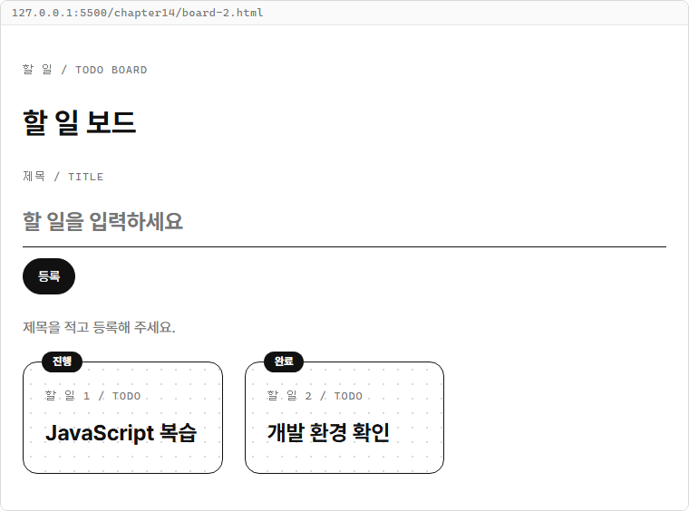

산책하기를 등록하면 양끝 공백을 뺀 제목의 카드가 목록 끝에 생깁니다.

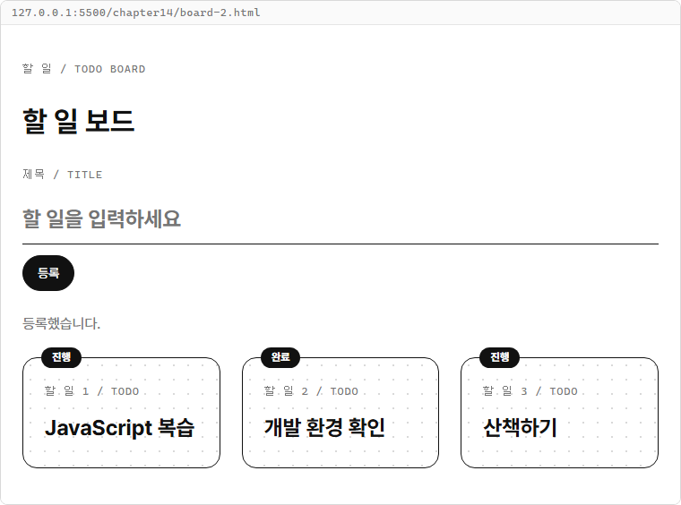

공백만 제출하면 `제목을 입력해 주세요.`가 표시되고 카드 수와 다음 번호는 그대로입니다.
입력값도 남아 있으므로 제목을 고쳐 다시 제출할 수 있습니다.

**코드 설명**

- `post`는 아직 등록하지 않은 제목이고 `todos`는 등록된 목록입니다. 입력할 때 목록을 다시 그려도 제출 전에는 카드가 늘지 않습니다.
- `todos = addTodo(todos, nextId, title);`는 9장의 함수를 그대로 호출합니다. 번호 증가는 함수 밖에서 합니다.
- `resetForm()`은 등록 뒤 `post`와 입력칸을 비우고 제출 버튼 글자를 등록으로 맞춥니다. `render()`는 입력칸을 다시 만들지 않으므로 입력칸의 `value`를 직접 비웁니다.
- `map()`의 문자열에는 배지와 제목이 함께 들어갑니다. 빈 목록이면 `||` 오른쪽 안내문을 사용합니다.

## 14-3 완료 토글·수정·삭제

**목표**

카드마다 완료 토글·수정·삭제 버튼을 넣고 `todoList`에 이벤트를 위임합니다.
13-4의 `editingId`로 같은 입력 폼을 등록과 수정에 사용합니다.

**힌트**

- 버튼에는 `data-action`과 `data-id`를 달고 글자만 넣습니다.
- `Number(e.target.dataset.id)`로 번호를 읽고 `find()`로 대상 할 일을 찾습니다.
- 완료 여부는 `toggleTodo()`, 제목은 `updateTodo()`, 삭제는 `deleteTodo()`로 바꿉니다.
- 수정 저장 뒤에는 `resetForm()`으로 `editingId`와 입력값을 비웁니다.

토글 버튼에는 진행 카드면 `완료하기`, 완료 카드면 `진행으로`가 적힙니다.
수정 버튼은 제목을 `post`와 입력칸에 채우고 제출 버튼을 수정 저장으로 바꿉니다.
수정으로는 `title`만 바꾸므로 기존 번호와 완료 여부는 유지됩니다.

**시각자료 — 유효한 제목의 등록과 수정**

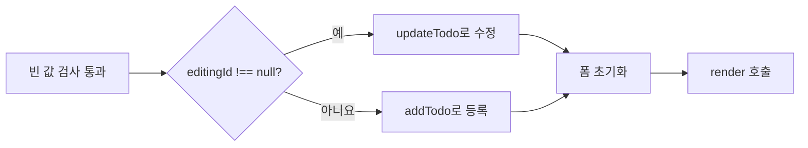

등록할 때만 `nextId++`로 번호를 올립니다.
빈 제목이면 이 분기 전에 끝내므로 수정 대상과 입력값이 남습니다.

목록의 제목이나 빈 곳을 누르면 `data-id`가 없어 `selectedTodo`를 찾지 못하므로 처리를 끝냅니다.
수정 중인 할 일을 삭제하면 폼도 등록 상태로 되돌립니다.
다른 할 일을 삭제하거나 완료 상태를 바꿀 때는 작성 중인 제목을 유지합니다.

**실습 코드**

`board-2.html`에 카드 버튼, `editingId`, 등록·수정 분기와 `handleListClick()`을 더한 전체 파일입니다.
카드 안의 버튼은 공통 `form` 클래스로 세로로 놓습니다.

`chapter14/board-3.html`

```html
<!DOCTYPE html>
<html lang="ko">
<head>
  <meta charset="UTF-8">
  <title>할 일 보드</title>
  <link rel="stylesheet" href="../css/common.css">
</head>
<body>
  <main class="page">
    <p class="label">할 일 / TODO BOARD</p>
    <h1>할 일 보드</h1>
    <form id="todoForm" class="form">
      <label class="label" for="titleInput">제목 / TITLE</label>
      <input id="titleInput" name="title" class="title-input" placeholder="할 일을 입력하세요">
      <div class="button-group">
        <button id="submitButton" class="btn selected" type="submit">등록</button>
      </div>
    </form>
    <p id="message" class="muted">제목을 적고 등록해 주세요.</p>
    <section id="todoList" class="card-list"></section>
  </main>

  <script>
    function addTodo(todos, id, title) {
      return [...todos, { id: id, title: title, isDone: false }];
    }

    function updateTodo(todos, id, changes) {
      return todos.map((todo) => todo.id === id ? { ...todo, ...changes } : todo);
    }

    function deleteTodo(todos, id) {
      return todos.filter((todo) => todo.id !== id);
    }

    function toggleTodo(todos, id) {
      return todos.map((todo) => todo.id === id ? { ...todo, isDone: !todo.isDone } : todo);
    }

    function getFilteredTodos(todos, filter = "all") {
      if (filter === "active") {
        return todos.filter((todo) => !todo.isDone);
      }

      if (filter === "done") {
        return todos.filter((todo) => todo.isDone);
      }

      return todos;
    }

    function getProgress(todos) {
      const completedCount = todos.filter((todo) => todo.isDone).length;
      return todos.length === 0 ? 0 : Math.round(completedCount / todos.length * 100);
    }

    let todos = [
      { id: 1, title: "JavaScript 복습", isDone: false },
      { id: 2, title: "개발 환경 확인", isDone: true }
    ];
    let nextId = 3;
    let post = { title: "" };
    let editingId = null;

    const todoForm = document.querySelector("#todoForm");
    const titleInput = document.querySelector("#titleInput");
    const submitButton = document.querySelector("#submitButton");
    const message = document.querySelector("#message");
    const todoList = document.querySelector("#todoList");

    function render() {
      todoList.innerHTML = todos.map((todo) => `
        <article class="card">
          <span class="badge">${todo.isDone ? "완료" : "진행"}</span>
          <p class="label">할 일 ${todo.id} / TODO</p>
          <h2>${todo.title}</h2>
          <div class="form">
            <button class="btn" type="button" data-action="toggle" data-id="${todo.id}">${todo.isDone ? "진행으로" : "완료하기"}</button>
            <button class="btn" type="button" data-action="edit" data-id="${todo.id}">수정</button>
            <button class="btn" type="button" data-action="delete" data-id="${todo.id}">삭제</button>
          </div>
        </article>
      `).join("") || `<p class="muted">표시할 할 일이 없습니다.</p>`;
    }

    function handleInput(e) {
      post = { ...post, [e.target.name]: e.target.value };
      render();
    }

    function resetForm() {
      post = { title: "" };
      editingId = null;
      titleInput.value = "";
      submitButton.innerHTML = "등록";
    }

    function handleSubmit(e) {
      e.preventDefault();
      const title = post.title.trim();

      if (title === "") {
        message.innerHTML = "제목을 입력해 주세요.";
        return;
      }

      if (editingId !== null) {
        todos = updateTodo(todos, editingId, { title: title });
        message.innerHTML = "수정했습니다.";
      } else {
        todos = addTodo(todos, nextId, title);
        nextId++;
        message.innerHTML = "등록했습니다.";
      }

      resetForm();
      render();
    }

    function handleListClick(e) {
      const action = e.target.dataset.action;
      const id = Number(e.target.dataset.id);
      const selectedTodo = todos.find((todo) => todo.id === id);

      if (!selectedTodo) {
        return;
      }

      if (action === "toggle") {
        todos = toggleTodo(todos, id);
        message.innerHTML = "완료 상태를 바꿨습니다.";
        render();
      }

      if (action === "edit") {
        editingId = id;
        post = { title: selectedTodo.title };
        titleInput.value = post.title;
        submitButton.innerHTML = "수정 저장";
        message.innerHTML = `${id}번 할 일을 수정합니다.`;
      }

      if (action === "delete") {
        todos = deleteTodo(todos, id);
        if (editingId === id) {
          resetForm();
        }
        message.innerHTML = "삭제했습니다.";
        render();
      }
    }

    titleInput.addEventListener("input", handleInput);
    todoForm.addEventListener("submit", handleSubmit);
    todoList.addEventListener("click", handleListClick);
    render();
  </script>
</body>
</html>
```

**확인 방법**

1. `board-3.html`을 열고 산책하기를 등록합니다.
2. 1번 JavaScript 복습의 완료하기를 누릅니다.
3. 1번의 수정 버튼을 누르고 제목을 `JavaScript 문제 풀기`로 바꿔 수정 저장을 누릅니다.
4. 2번 개발 환경 확인을 삭제합니다.

**실행 결과**

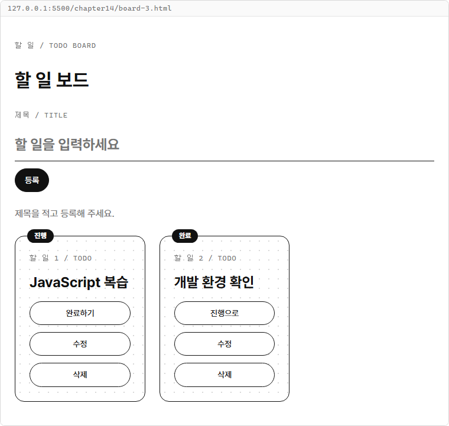

등록·토글·수정·삭제 뒤에는 1번 완료 카드와 3번 진행 카드가 남습니다.

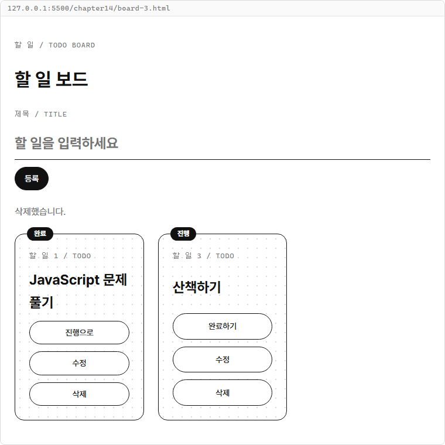

이어서 1번의 진행으로 버튼을 누르면 배지가 진행으로 돌아갑니다.
3번의 수정 버튼을 누른 뒤 그 카드를 삭제하면 입력칸이 비고 제출 버튼도 등록으로 돌아갑니다.

**코드 설명**

- `todoList`의 클릭 처리 하나가 처음 카드와 새 카드의 버튼을 모두 받습니다. `render()` 뒤에 이벤트를 다시 연결하지 않습니다.
- `find()`는 필터로 보이는 위치가 아니라 `id`로 대상을 고릅니다. 번호를 숫자로 바꾸므로 `todo.id === id`로 비교할 수 있습니다.
- `editingId !== null`이면 `updateTodo(todos, editingId, { title: title })`로 제목만 바꿉니다. 수정 저장은 번호를 늘리지 않습니다.
- 삭제 분기의 `editingId === id`가 참일 때만 `resetForm()`을 호출합니다. 그래서 다른 카드를 지울 때는 작성 중인 제목이 남습니다.

## 14-4 필터 버튼

**목표**

전체·진행·완료 버튼으로 표시할 카드를 고르고 선택된 버튼만 검정으로 표시합니다.
`currentFilter`에는 9장의 필터 값 `"all"`, `"active"`, `"done"`을 저장합니다.

**힌트**

- 필터 버튼에는 `data-action="filter"`와 `data-filter`를 붙입니다.
- `filterButtons`에 `handleFilterClick` 하나를 연결합니다.
- `render()`에서 `getFilteredTodos(todos, currentFilter)`로 표시할 목록을 구합니다.
- 모든 필터 버튼의 `selected`를 지우고 현재 값과 같은 버튼에만 붙입니다.

| 버튼 글자 | `currentFilter` | 보이는 항목 |
|---|---|---|
| 전체 | `"all"` | 모든 할 일 |
| 진행 | `"active"` | `isDone`이 `false`인 할 일 |
| 완료 | `"done"` | `isDone`이 `true`인 할 일 |

필터 결과는 `visibleTodos`에 담고 원래 `todos`는 그대로 둡니다.
진행 필터에서 완료하기를 누르면 그 카드가 보이지 않지만 전체와 완료에서는 확인할 수 있습니다.
완료 필터에서 새 항목을 등록하면 진행 상태로 들어가므로 완료 목록에는 나타나지 않습니다.

**실습 코드**

`board-3.html`에 필터 버튼과 선택 상태를 더한 전체 파일입니다.
`render()`는 필터 버튼과 입력 폼을 다시 만들지 않고 목록과 버튼의 클래스만 바꿉니다.

`chapter14/board-4.html`

```html
<!DOCTYPE html>
<html lang="ko">
<head>
  <meta charset="UTF-8">
  <title>할 일 보드</title>
  <link rel="stylesheet" href="../css/common.css">
</head>
<body>
  <main class="page">
    <p class="label">할 일 / TODO BOARD</p>
    <h1>할 일 보드</h1>
    <form id="todoForm" class="form">
      <label class="label" for="titleInput">제목 / TITLE</label>
      <input id="titleInput" name="title" class="title-input" placeholder="할 일을 입력하세요">
      <div class="button-group">
        <button id="submitButton" class="btn selected" type="submit">등록</button>
      </div>
    </form>
    <p id="message" class="muted">제목을 적고 등록해 주세요.</p>
    <div id="filterButtons" class="button-group">
      <button class="btn selected" type="button" data-action="filter" data-filter="all">전체</button>
      <button class="btn" type="button" data-action="filter" data-filter="active">진행</button>
      <button class="btn" type="button" data-action="filter" data-filter="done">완료</button>
    </div>
    <section id="todoList" class="card-list"></section>
  </main>

  <script>
    function addTodo(todos, id, title) {
      return [...todos, { id: id, title: title, isDone: false }];
    }

    function updateTodo(todos, id, changes) {
      return todos.map((todo) => todo.id === id ? { ...todo, ...changes } : todo);
    }

    function deleteTodo(todos, id) {
      return todos.filter((todo) => todo.id !== id);
    }

    function toggleTodo(todos, id) {
      return todos.map((todo) => todo.id === id ? { ...todo, isDone: !todo.isDone } : todo);
    }

    function getFilteredTodos(todos, filter = "all") {
      if (filter === "active") {
        return todos.filter((todo) => !todo.isDone);
      }

      if (filter === "done") {
        return todos.filter((todo) => todo.isDone);
      }

      return todos;
    }

    function getProgress(todos) {
      const completedCount = todos.filter((todo) => todo.isDone).length;
      return todos.length === 0 ? 0 : Math.round(completedCount / todos.length * 100);
    }

    let todos = [
      { id: 1, title: "JavaScript 복습", isDone: false },
      { id: 2, title: "개발 환경 확인", isDone: true }
    ];
    let nextId = 3;
    let post = { title: "" };
    let editingId = null;
    let currentFilter = "all";

    const todoForm = document.querySelector("#todoForm");
    const titleInput = document.querySelector("#titleInput");
    const submitButton = document.querySelector("#submitButton");
    const message = document.querySelector("#message");
    const todoList = document.querySelector("#todoList");
    const filterButtons = document.querySelector("#filterButtons");

    function render() {
      const visibleTodos = getFilteredTodos(todos, currentFilter);
      todoList.innerHTML = visibleTodos.map((todo) => `
        <article class="card">
          <span class="badge">${todo.isDone ? "완료" : "진행"}</span>
          <p class="label">할 일 ${todo.id} / TODO</p>
          <h2>${todo.title}</h2>
          <div class="form">
            <button class="btn" type="button" data-action="toggle" data-id="${todo.id}">${todo.isDone ? "진행으로" : "완료하기"}</button>
            <button class="btn" type="button" data-action="edit" data-id="${todo.id}">수정</button>
            <button class="btn" type="button" data-action="delete" data-id="${todo.id}">삭제</button>
          </div>
        </article>
      `).join("") || `<p class="muted">표시할 할 일이 없습니다.</p>`;

      const buttons = document.querySelectorAll("#filterButtons button");
      buttons.forEach((button) => {
        button.classList.remove("selected");
        if (button.dataset.filter === currentFilter) {
          button.classList.add("selected");
        }
      });
    }

    function handleInput(e) {
      post = { ...post, [e.target.name]: e.target.value };
      render();
    }

    function resetForm() {
      post = { title: "" };
      editingId = null;
      titleInput.value = "";
      submitButton.innerHTML = "등록";
    }

    function handleSubmit(e) {
      e.preventDefault();
      const title = post.title.trim();

      if (title === "") {
        message.innerHTML = "제목을 입력해 주세요.";
        return;
      }

      if (editingId !== null) {
        todos = updateTodo(todos, editingId, { title: title });
        message.innerHTML = "수정했습니다.";
      } else {
        todos = addTodo(todos, nextId, title);
        nextId++;
        message.innerHTML = "등록했습니다.";
      }

      resetForm();
      render();
    }

    function handleListClick(e) {
      const action = e.target.dataset.action;
      const id = Number(e.target.dataset.id);
      const selectedTodo = todos.find((todo) => todo.id === id);

      if (!selectedTodo) {
        return;
      }

      if (action === "toggle") {
        todos = toggleTodo(todos, id);
        message.innerHTML = "완료 상태를 바꿨습니다.";
        render();
      }

      if (action === "edit") {
        editingId = id;
        post = { title: selectedTodo.title };
        titleInput.value = post.title;
        submitButton.innerHTML = "수정 저장";
        message.innerHTML = `${id}번 할 일을 수정합니다.`;
      }

      if (action === "delete") {
        todos = deleteTodo(todos, id);
        if (editingId === id) {
          resetForm();
        }
        message.innerHTML = "삭제했습니다.";
        render();
      }
    }

    function handleFilterClick(e) {
      if (e.target.dataset.action !== "filter") {
        return;
      }

      currentFilter = e.target.dataset.filter;
      render();
    }

    titleInput.addEventListener("input", handleInput);
    todoForm.addEventListener("submit", handleSubmit);
    todoList.addEventListener("click", handleListClick);
    filterButtons.addEventListener("click", handleFilterClick);
    render();
  </script>
</body>
</html>
```

**확인 방법**

1. `board-4.html`을 열고 진행 버튼을 누릅니다.
2. JavaScript 복습 카드만 보이는지 확인하고 완료하기를 누릅니다.
3. 진행 목록의 `표시할 할 일이 없습니다.` 안내를 확인한 뒤 완료 버튼을 누릅니다.
4. 두 완료 카드가 보이면 전체 버튼을 누릅니다.

**실행 결과**

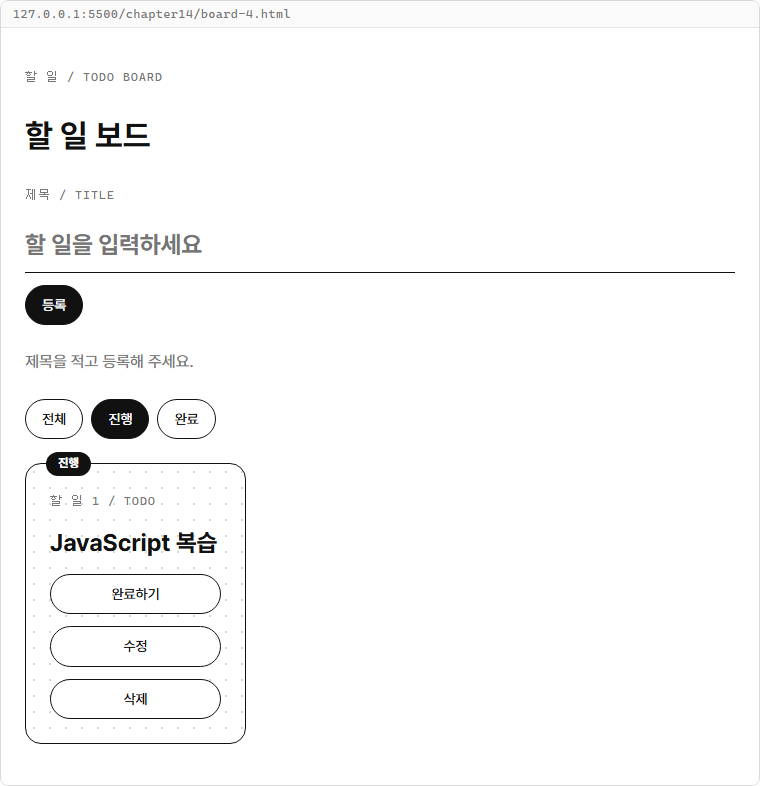

진행 카드의 완료하기를 누르면 진행 목록에서 빠집니다.
완료를 선택하면 사라졌던 카드와 원래 완료 카드가 함께 보입니다.

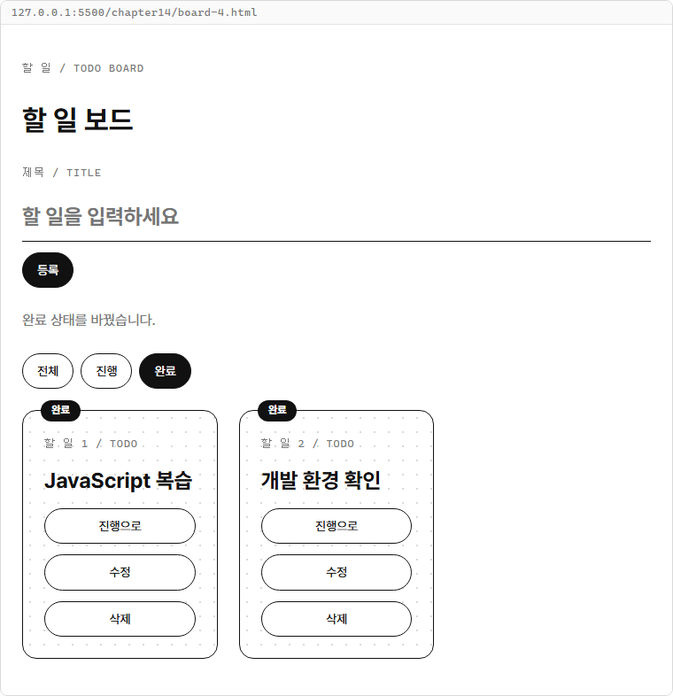

전체로 돌아오면 두 카드가 그대로 있습니다.
필터는 항목을 삭제하지 않으며 선택된 필터 버튼만 검정으로 표시됩니다.

**코드 설명**

- `visibleTodos`는 보여 줄 배열이고 `todos`는 저장된 전체 배열입니다. 필터 결과를 `todos`에 재할당하지 않습니다.
- `getFilteredTodos()`는 9장과 같은 함수입니다. 화면의 진행 버튼을 함수가 받는 `"active"` 값에 연결했습니다.
- `classList.remove("selected")` 뒤 현재 필터의 버튼에만 `add("selected")`를 합니다. 같은 버튼을 다시 눌러도 선택은 하나입니다.
- `handleFilterClick()`은 필터 동작인 경우에만 `currentFilter`를 바꾸므로 부모의 빈 곳을 눌러도 선택은 유지됩니다.

## 14-5 진행 막대

**목표**

9-4의 `getProgress()`를 사용해 진행률 문구와 검정 막대의 폭을 함께 바꿉니다.
필터 결과가 아니라 전체 `todos`를 기준으로 계산합니다.

**힌트**

- 바깥 막대는 `progress`, 안쪽 막대는 `progress-bar` 클래스를 씁니다.
- `render()`에서 `const progress = getProgress(todos);`로 비율을 구합니다.
- `progressBar.style.width`에는 숫자에 `%`를 붙인 문자열을 넣습니다.
- 같은 `progress`로 문구를 채워 숫자와 막대가 같은 비율을 보여 주게 합니다.

전체 두 개 가운데 하나가 완료면 진행률은 `50%`입니다.
완료 필터에서 카드 하나만 보여도 전체 기준의 `50%`를 유지합니다.
표시할 카드가 없는 경우와 전체 할 일이 없는 경우를 구분합니다.

**시각자료 — 표시할 목록과 진행률의 기준**

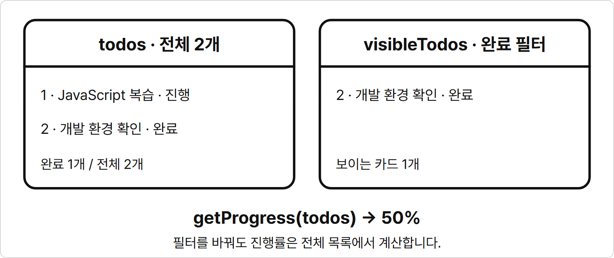

완료 필터는 오른쪽 카드만 보여 주지만 진행률은 왼쪽 전체 목록에서 계산합니다.
전체가 비면 `getProgress([])`는 `0`이므로 막대 폭도 `0%`가 됩니다.

## 완성 코드와 해설

`board-4.html`에 진행률 영역과 `render()`의 진행률 갱신을 더한 전체 파일입니다.
아래 코드를 `board-5.html`에 저장하면 다섯 단계의 기능이 모두 들어 있습니다.

**완성 코드**

`chapter14/board-5.html`

```html
<!DOCTYPE html>
<html lang="ko">
<head>
  <meta charset="UTF-8">
  <title>할 일 보드</title>
  <link rel="stylesheet" href="../css/common.css">
</head>
<body>
  <main class="page">
    <p class="label">할 일 / TODO BOARD</p>
    <h1>할 일 보드</h1>
    <form id="todoForm" class="form">
      <label class="label" for="titleInput">제목 / TITLE</label>
      <input id="titleInput" name="title" class="title-input" placeholder="할 일을 입력하세요">
      <div class="button-group">
        <button id="submitButton" class="btn selected" type="submit">등록</button>
      </div>
    </form>
    <p id="message" class="muted">제목을 적고 등록해 주세요.</p>
    <section class="form">
      <p class="label">진행률 / PROGRESS</p>
      <p id="progressText">진행률: 0%</p>
      <div class="progress">
        <div id="progressBar" class="progress-bar"></div>
      </div>
    </section>
    <div id="filterButtons" class="button-group">
      <button class="btn selected" type="button" data-action="filter" data-filter="all">전체</button>
      <button class="btn" type="button" data-action="filter" data-filter="active">진행</button>
      <button class="btn" type="button" data-action="filter" data-filter="done">완료</button>
    </div>
    <section id="todoList" class="card-list"></section>
  </main>

  <script>
    function addTodo(todos, id, title) {
      return [...todos, { id: id, title: title, isDone: false }];
    }

    function updateTodo(todos, id, changes) {
      return todos.map((todo) => todo.id === id ? { ...todo, ...changes } : todo);
    }

    function deleteTodo(todos, id) {
      return todos.filter((todo) => todo.id !== id);
    }

    function toggleTodo(todos, id) {
      return todos.map((todo) => todo.id === id ? { ...todo, isDone: !todo.isDone } : todo);
    }

    function getFilteredTodos(todos, filter = "all") {
      if (filter === "active") {
        return todos.filter((todo) => !todo.isDone);
      }

      if (filter === "done") {
        return todos.filter((todo) => todo.isDone);
      }

      return todos;
    }

    function getProgress(todos) {
      const completedCount = todos.filter((todo) => todo.isDone).length;
      return todos.length === 0 ? 0 : Math.round(completedCount / todos.length * 100);
    }

    let todos = [
      { id: 1, title: "JavaScript 복습", isDone: false },
      { id: 2, title: "개발 환경 확인", isDone: true }
    ];
    let nextId = 3;
    let post = { title: "" };
    let editingId = null;
    let currentFilter = "all";

    const todoForm = document.querySelector("#todoForm");
    const titleInput = document.querySelector("#titleInput");
    const submitButton = document.querySelector("#submitButton");
    const message = document.querySelector("#message");
    const todoList = document.querySelector("#todoList");
    const filterButtons = document.querySelector("#filterButtons");
    const progressText = document.querySelector("#progressText");
    const progressBar = document.querySelector("#progressBar");

    function render() {
      const visibleTodos = getFilteredTodos(todos, currentFilter);
      todoList.innerHTML = visibleTodos.map((todo) => `
        <article class="card">
          <span class="badge">${todo.isDone ? "완료" : "진행"}</span>
          <p class="label">할 일 ${todo.id} / TODO</p>
          <h2>${todo.title}</h2>
          <div class="form">
            <button class="btn" type="button" data-action="toggle" data-id="${todo.id}">${todo.isDone ? "진행으로" : "완료하기"}</button>
            <button class="btn" type="button" data-action="edit" data-id="${todo.id}">수정</button>
            <button class="btn" type="button" data-action="delete" data-id="${todo.id}">삭제</button>
          </div>
        </article>
      `).join("") || `<p class="muted">표시할 할 일이 없습니다.</p>`;

      const buttons = document.querySelectorAll("#filterButtons button");
      buttons.forEach((button) => {
        button.classList.remove("selected");
        if (button.dataset.filter === currentFilter) {
          button.classList.add("selected");
        }
      });

      const progress = getProgress(todos);
      progressText.innerHTML = `진행률: ${progress}%`;
      progressBar.style.width = `${progress}%`;
    }

    function handleInput(e) {
      post = { ...post, [e.target.name]: e.target.value };
      render();
    }

    function resetForm() {
      post = { title: "" };
      editingId = null;
      titleInput.value = "";
      submitButton.innerHTML = "등록";
    }

    function handleSubmit(e) {
      e.preventDefault();
      const title = post.title.trim();

      if (title === "") {
        message.innerHTML = "제목을 입력해 주세요.";
        return;
      }

      if (editingId !== null) {
        todos = updateTodo(todos, editingId, { title: title });
        message.innerHTML = "수정했습니다.";
      } else {
        todos = addTodo(todos, nextId, title);
        nextId++;
        message.innerHTML = "등록했습니다.";
      }

      resetForm();
      render();
    }

    function handleListClick(e) {
      const action = e.target.dataset.action;
      const id = Number(e.target.dataset.id);
      const selectedTodo = todos.find((todo) => todo.id === id);

      if (!selectedTodo) {
        return;
      }

      if (action === "toggle") {
        todos = toggleTodo(todos, id);
        message.innerHTML = "완료 상태를 바꿨습니다.";
        render();
      }

      if (action === "edit") {
        editingId = id;
        post = { title: selectedTodo.title };
        titleInput.value = post.title;
        submitButton.innerHTML = "수정 저장";
        message.innerHTML = `${id}번 할 일을 수정합니다.`;
      }

      if (action === "delete") {
        todos = deleteTodo(todos, id);
        if (editingId === id) {
          resetForm();
        }
        message.innerHTML = "삭제했습니다.";
        render();
      }
    }

    function handleFilterClick(e) {
      if (e.target.dataset.action !== "filter") {
        return;
      }

      currentFilter = e.target.dataset.filter;
      render();
    }

    titleInput.addEventListener("input", handleInput);
    todoForm.addEventListener("submit", handleSubmit);
    todoList.addEventListener("click", handleListClick);
    filterButtons.addEventListener("click", handleFilterClick);
    render();
  </script>
</body>
</html>
```

**실행 방법**

1. `board-5.html`을 Live Server로 엽니다.
2. 처음 진행률이 `50%`인지 확인한 뒤 산책하기를 등록합니다.
3. 진행률이 `33%`가 되면 1번 JavaScript 복습의 완료하기를 누릅니다.
4. 진행률이 `67%`가 되면 완료 필터를 눌러 카드 두 개와 같은 진행률을 확인합니다.
5. 전체를 눌러 1번 제목을 `JavaScript 문제 풀기`로 수정하고 2번 개발 환경 확인을 삭제합니다.

**실행 결과**


산책하기 등록 후 1번을 완료하고 완료 필터를 고르면, 전체 세 개 중 두 개를 완료한 `67%`를 보여 줍니다.

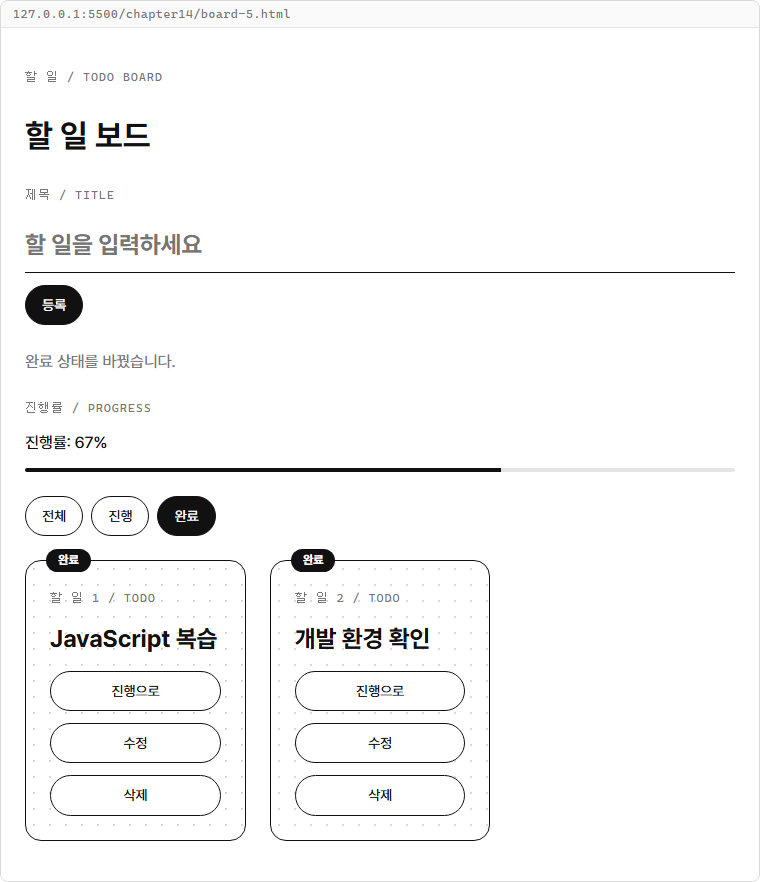

전체로 돌아가 제목을 수정하고 2번을 삭제하면 1번 완료와 3번 진행이 남아 `50%`가 됩니다.
9장 콘솔 프로젝트의 마지막 목록과 같은 데이터입니다.

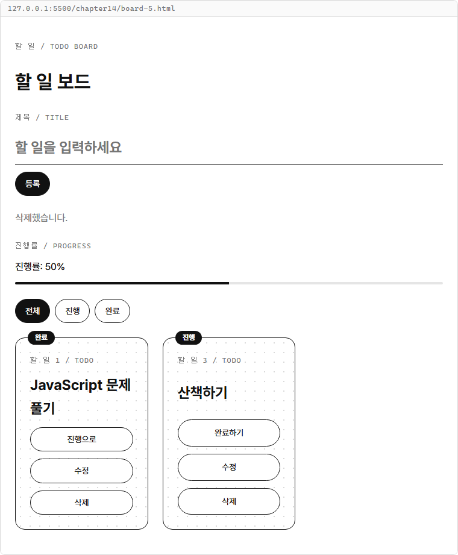

**해설**

- `<script>` 맨 위의 여섯 함수는 `todo-4.js`와 같습니다. 콘솔 프로젝트에서 만든 데이터 처리에 DOM 코드를 섞지 않고 다시 사용했습니다.
- `handleSubmit()`은 등록과 수정에서 서로 다른 데이터 함수를 사용한 뒤 `resetForm()`과 `render()`로 마무리합니다.
- `handleListClick()`은 토글과 삭제 뒤 목록을 다시 그립니다. 수정 버튼은 입력 폼만 채우고 배열은 제출할 때 바꿉니다.
- `render()`는 필터 카드, 선택된 버튼, 진행률 문구와 막대를 같은 상태에서 갱신합니다. 입력 폼은 다시 만들지 않습니다.
- `getProgress(todos)`에는 전체 목록을 넘깁니다. `getProgress(visibleTodos)`로 계산하면 완료 필터에서 `100%`가 되어 전체 진행 상황과 달라집니다.
- `style.width`에 넣는 `${progress}%`는 단위를 포함한 문자열입니다. 막대 색과 높이는 공통 CSS에 있는 값을 사용합니다.

페이지를 새로고침하면 처음의 두 할 일로 돌아옵니다.
변경한 목록은 열린 페이지의 변수에만 담겨 있습니다.

**바꿔 보기 1**

처음부터 진행 목록을 선택해 봅니다.
원래 `board-5.html`에서 `let currentFilter = "all";` 줄을 다음처럼 바꿉니다.

```javascript
let currentFilter = "active";
```

페이지를 다시 열면 JavaScript 복습 카드 하나와 검정 진행 버튼이 보입니다.
진행률은 전체 두 개를 기준으로 하므로 `50%`이며, 전체를 누르면 두 카드가 보입니다.

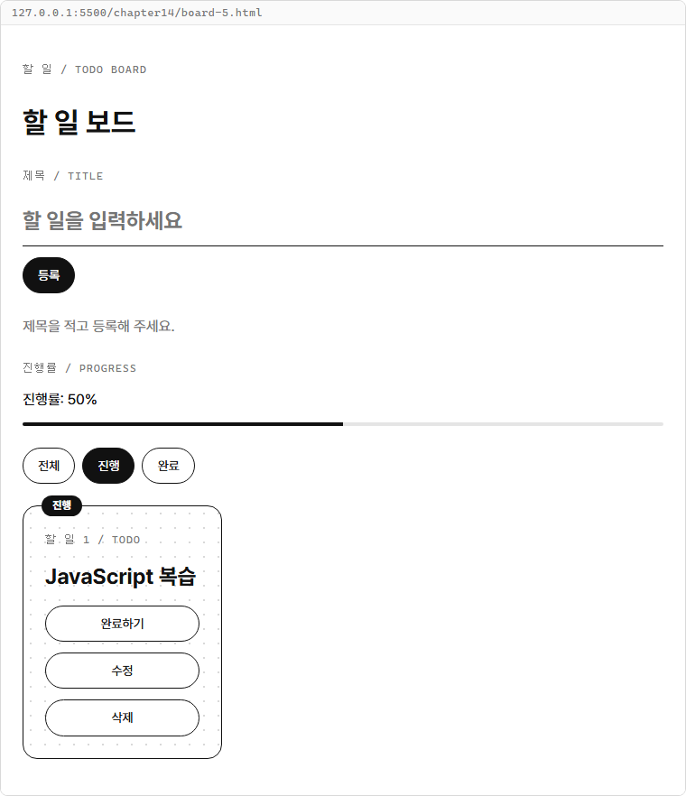

**바꿔 보기 2**

원래 `board-5.html`로 돌아가 빈 목록에서 시작해 봅니다.
`let todos = [`부터 배열을 닫는 `];`까지를 `let todos = [];`로 바꾸고 `let nextId = 3;`도 아래처럼 바꿉니다.

```javascript
let todos = [];
let nextId = 1;
```

첫 화면에는 `표시할 할 일이 없습니다.`와 `진행률: 0%`가 보입니다.
산책하기를 등록하면 1번 진행 카드가 생기고 완료하기를 누르면 진행률과 막대 폭이 `100%`가 됩니다.
그 카드를 삭제하면 다시 빈 목록과 `0%`가 됩니다.

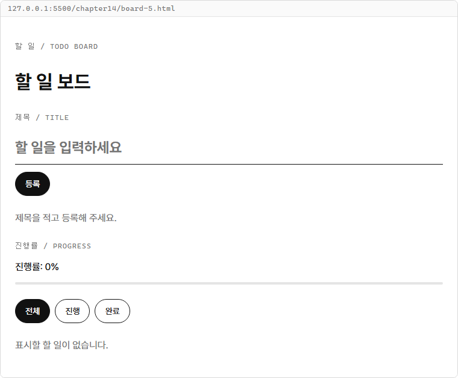

**완료 조건**

- 제목 양끝 공백은 등록·수정할 때 제거하며 공백만 있는 제목은 저장하지 않습니다.
- 등록할 때만 새 번호를 쓰고 수정·삭제·필터 선택에서는 번호를 유지합니다.
- 완료 토글은 두 방향으로 동작하고 수정은 번호와 완료 여부를 유지합니다.
- 수정 중인 항목을 삭제하면 폼이 등록 상태로 돌아갑니다.
- 필터는 표시할 카드만 고르고 전체 상태 배열과 작성 중인 입력값을 유지합니다.
- 진행률은 전체 목록 기준의 정수 퍼센트이며 전체가 비면 `0%`입니다.
