# 15장. CSS Grid

**학습목표**

- Grid 컨테이너에 열의 크기와 칸 사이 간격을 지정할 수 있습니다.
- `repeat()`로 같은 크기의 카드 세 열을 만들 수 있습니다.
- `grid-column`으로 입력 영역을 한 줄 전체에 펼칠 수 있습니다.
- `common.css`의 Grid 배치 규칙을 읽고 화면의 어느 부분에 적용되는지 설명할 수 있습니다.

## 15-1 Grid 컨테이너와 트랙

지금까지 HTML에 `page`, `form`, `card-list` 같은 클래스를 붙여 화면을 배치했습니다.
이 장에서는 그 배치를 만드는 CSS Grid를 직접 읽고 바꿉니다.
예제 파일은 `js-course/chapter15`에 만들고, 1장에서 만든 `../css/common.css`를 연결합니다.
파일을 여는 방법은 1-3을 따릅니다.

### Grid 컨테이너와 아이템

**CSS Grid**는 요소를 행과 열로 나누어 배치하는 CSS 방식입니다.
쉽게 말해 화면에 칸을 만들고 그 칸에 요소를 놓습니다.
`display: grid;`를 지정한 요소를 **Grid 컨테이너**(grid container)라고 합니다.

**특징**

- `display: grid;`는 배치할 요소들을 감싼 부모에 씁니다.
- 열 크기를 지정하지 않은 이 예제에서는 자식들이 한 열에 위에서 아래로 놓입니다.

**기본 문법**

```css
.컨테이너 {
  display: grid;
}
```

**예제 15-1** `grid-container.html`

```html
<!DOCTYPE html>
<html lang="ko">
<head>
  <meta charset="UTF-8">
  <title>Grid 컨테이너 만들기</title>
  <link rel="stylesheet" href="../css/common.css">
  <style>
    .product-grid {
      display: grid;
    }
  </style>
</head>
<body>
  <main class="page">
    <p class="label">컨테이너 / CONTAINER</p>
    <h1>Grid 컨테이너 만들기</h1>
    <section class="product-grid">
      <article class="card"><h2>마우스</h2></article>
      <article class="card"><h2>키보드</h2></article>
    </section>
  </main>
</body>
</html>
```

**실행 결과**

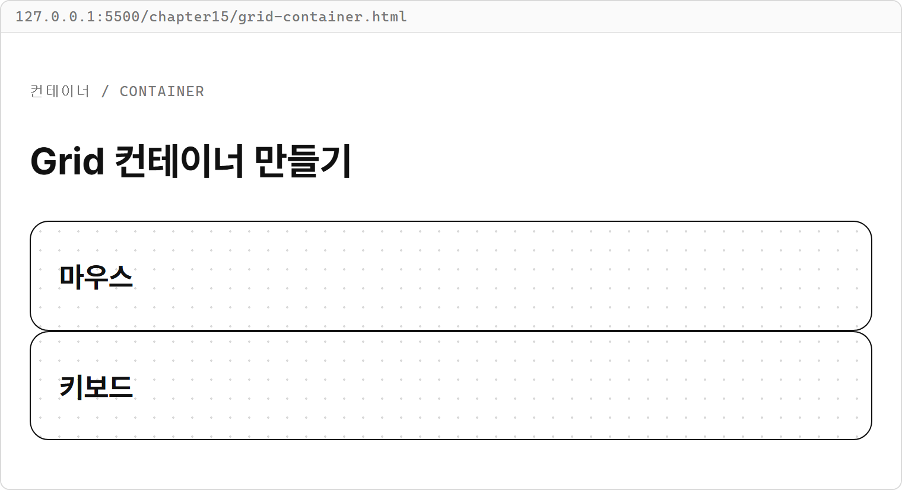

- `.product-grid`에 `display: grid;`를 지정해 카드들을 감싼 요소를 컨테이너로 만듭니다.
- `display: grid;`만으로 가로 열 여러 개가 만들어지는 것은 아닙니다. 여러 열을 만들려면 열 크기도 지정합니다.

그 컨테이너의 바로 아래에 있는 자식 요소가 **Grid 아이템**(grid item)입니다.
예를 들어 카드들을 감싼 `<section>`이 컨테이너라면, 그 안의 `<article>` 카드들이 아이템입니다.
카드 안의 제목은 카드 목록 컨테이너의 아이템이 아닙니다.

### Grid는 왜 필요할까?

여러 요소의 가로 위치와 세로 위치를 같은 칸 기준에 맞추기 위해 필요합니다.

상품 카드 네 개를 두 열로 놓는다고 생각해 봅시다.
카드마다 너비와 위치를 따로 정하면 두 번째 줄도 첫 번째 줄과 맞춰야 합니다.
카드가 늘면 다음 카드의 위치도 다시 정해야 합니다.

부모인 `.product-grid`에 두 열을 지정하면 자식 카드들이 그 칸에 순서대로 들어갑니다.
세 번째 카드는 다음 행의 첫 열에 놓이므로 카드마다 위치를 적지 않아도 됩니다.

Grid는 칸막이가 있는 정리함에 빗댈 수 있습니다.
칸을 먼저 나눠 두면 물건을 넣는 순서대로 다음 칸에 들어가고, 한 줄이 차면 아랫줄 첫 칸으로 갑니다.

**시각자료 — 순서대로 채우는 두 줄 정리함**

```text
[생성 이미지: images/15/grid-organizer.png]
장면: 위에서 내려다본 직사각형 정리함이 칸막이로 두 열 두 행, 모두 네 칸으로 나뉘어 있다. 윗줄 두 칸에는 같은 모양의 카드가 하나씩 들어 있고, 손이 세 번째 카드를 아랫줄 왼쪽 칸에 넣고 있다. 아랫줄 오른쪽 칸은 비어 있다.
비율: 가로 3:2
스타일: 굵기가 일정한 검정 외곽선의 단순한 선 그림. 흰 배경. 그림자와 그라데이션 없음. 채움 색은 파랑(카드) 한 가지. 글자, 숫자, 기호는 넣지 않는다.
참고 그림: book-manuscript/assets/style-ref/line-art-shark.png
```

칸막이로 나누는 일이 `.product-grid`에 두 열을 지정하는 일입니다.
카드는 위치를 따로 적지 않아도 순서대로 칸을 채웁니다.

### 열의 크기와 트랙

**트랙**(track)은 Grid의 행 하나 또는 열 하나가 차지하는 공간입니다.
`grid-template-columns`는 열 트랙의 개수와 너비를 정하는 속성입니다.
`200px 300px`처럼 너비를 공백으로 나열하면 두 열을 만듭니다.

**특징**

- `display: grid;`와 `grid-template-columns`는 부모 컨테이너에 씁니다.
- `grid-template-columns`에 나열한 너비의 개수만큼 열이 생깁니다.
- 별도로 위치를 지정하지 않은 아이템은 이 예제에서 왼쪽부터 오른쪽으로 들어갑니다.
- 한 행이 차면 다음 행이 생겨 나머지 아이템이 들어갑니다.

**기본 문법**

```css
.컨테이너 {
  display: grid;
  grid-template-columns: 너비 너비;
}
```

**예제 15-2** `grid-columns.html`

```html
<!DOCTYPE html>
<html lang="ko">
<head>
  <meta charset="UTF-8">
  <title>두 열의 상품 카드</title>
  <link rel="stylesheet" href="../css/common.css">
  <style>
    .product-grid {
      display: grid;
      grid-template-columns: 200px 300px;
    }
  </style>
</head>
<body>
  <main class="page">
    <p class="label">열 크기 / COLUMNS</p>
    <h1>두 열의 상품 카드</h1>
    <section class="product-grid">
      <article class="card"><h2>무선 마우스</h2><p>12000원</p></article>
      <article class="card"><h2>키보드</h2><p>89000원</p></article>
      <article class="card"><h2>모니터</h2><p>230000원</p></article>
      <article class="card"><h2>마우스 패드</h2><p>5000원</p></article>
    </section>
  </main>
</body>
</html>
```

**실행 결과**

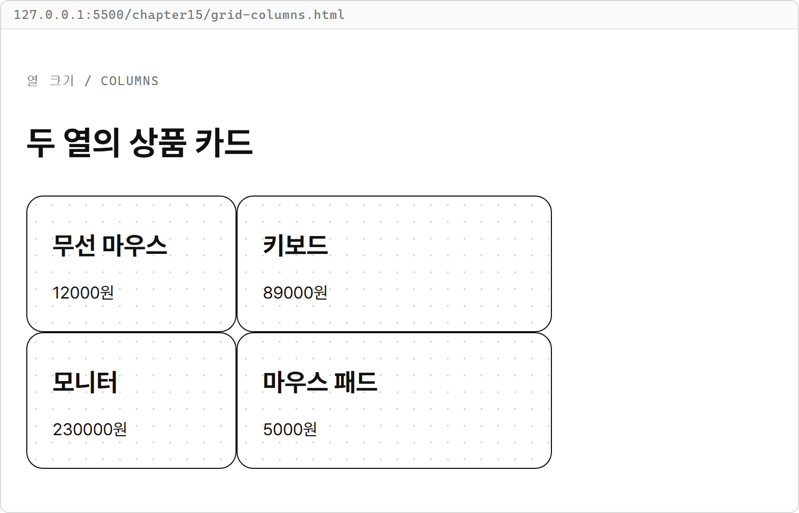

- `.product-grid`가 컨테이너이고 바로 아래의 카드 네 개가 아이템입니다.
- `200px 300px`는 첫 열을 200px, 둘째 열을 300px로 만듭니다.
- 카드 네 개가 두 열에 들어가므로 행이 두 개 생깁니다.
- 카드 안의 제목과 가격은 카드 목록의 열을 만드는 데 참여하지 않습니다.

### fr과 gap

`fr`은 열 크기를 정할 때 남는 공간을 나누는 비율 단위입니다.
`1fr 2fr`은 남는 공간을 세 몫으로 나누어 첫 열에 한 몫, 둘째 열에 두 몫을 줍니다.
`gap`은 행 사이와 열 사이의 간격을 정하는 속성입니다.
값을 하나 쓰면 두 방향에 같은 간격을 적용합니다.

**특징**

- `fr`은 고정 너비와 간격을 제외하고 남은 공간을 나눕니다.
- `1fr 1fr`은 내용이 칸 안에 들어갈 때 두 열을 같은 너비로 만듭니다.
- `gap`은 칸 사이에만 간격을 만들며 컨테이너 바깥에는 간격을 만들지 않습니다.
- 칸 안의 내용이 너무 넓으면 내용의 최소 너비 때문에 `fr`의 비율대로 보이지 않을 수 있습니다.

**비교 — px과 fr**

| 비교 항목 | px | fr |
|---|---|---|
| 정하는 것 | 고정 너비 | 남는 공간을 나눌 비율 |
| 예 | `200px 300px` | `1fr 2fr` |
| 컨테이너 너비가 바뀌면 | 지정한 너비 유지 | 나눌 공간에 따라 너비 변경 |

**기본 문법**

```css
.컨테이너 {
  display: grid;
  grid-template-columns: 숫자fr 숫자fr;
  gap: 간격;
}
```

**예제 15-3** `grid-fr.html`

```html
<!DOCTYPE html>
<html lang="ko">
<head>
  <meta charset="UTF-8">
  <title>남는 공간 나누기</title>
  <link rel="stylesheet" href="../css/common.css">
  <style>
    .product-grid {
      display: grid;
      grid-template-columns: 1fr 2fr;
      gap: 24px;
    }
  </style>
</head>
<body>
  <main class="page">
    <p class="label">비율과 간격 / FR AND GAP</p>
    <h1>남는 공간 나누기</h1>
    <section class="product-grid">
      <article class="card"><h2>무선 마우스</h2><p>12000원</p></article>
      <article class="card"><h2>키보드</h2><p>89000원</p></article>
      <article class="card"><h2>모니터</h2><p>230000원</p></article>
      <article class="card"><h2>마우스 패드</h2><p>5000원</p></article>
    </section>
  </main>
</body>
</html>
```

**실행 결과**

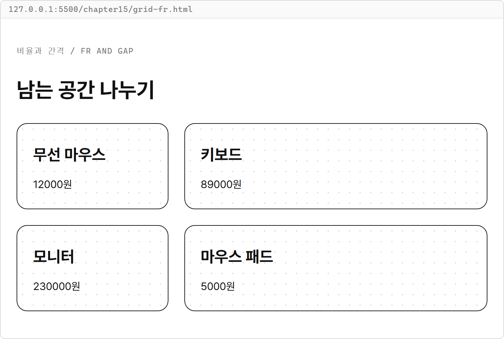

- `gap: 24px;`는 열 사이와 행 사이에 24px을 둡니다.
- 이 화면의 카드 목록 너비는 710px입니다. 열 사이 간격 24px을 빼면 나눌 공간은 686px입니다.
- `1fr 2fr`은 그 공간을 약 228.7px과 457.3px로 나눕니다. 각 열의 `fr` 숫자가 비율이 됩니다.
- 간격을 뺀 뒤 나누므로 두 열의 너비를 단순히 컨테이너 너비의 3분의 1, 3분의 2로 계산하지 않습니다.

## 15-2 repeat로 카드 목록 배치

`repeat()`는 같은 트랙 크기를 정한 횟수만큼 반복하는 CSS 함수입니다.
`repeat(3, 1fr)`은 `1fr 1fr 1fr`을 줄여 쓴 모양입니다.
JavaScript 반복문이 아니라 CSS에 열 크기를 적는 문법입니다.

**특징**

- 첫째 값은 반복 횟수이고 둘째 값은 반복할 트랙 크기입니다.
- 두 값은 쉼표로 나눕니다.
- `repeat(3, 1fr)`은 열을 세 개 만들며 카드 개수가 늘어도 열 개수는 세 개입니다.

**비교 — 직접 나열하기와 repeat**

| 비교 항목 | 직접 나열하기 | repeat |
|---|---|---|
| 세 열을 쓰는 모양 | `1fr 1fr 1fr` | `repeat(3, 1fr)` |
| 열을 네 개로 바꾸기 | `1fr` 하나 추가 | 횟수를 `4`로 변경 |
| 반복한 열의 크기 | 모두 `1fr` | 모두 `1fr` |

**기본 문법**

```css
.컨테이너 {
  display: grid;
  grid-template-columns: repeat(반복 횟수, 트랙 크기);
  gap: 간격;
}
```

**예제 15-4** `repeat-cards.html`

```html
<!DOCTYPE html>
<html lang="ko">
<head>
  <meta charset="UTF-8">
  <title>카드 세 열 만들기</title>
  <link rel="stylesheet" href="../css/common.css">
  <style>
    .product-grid {
      display: grid;
      grid-template-columns: repeat(3, 1fr);
      gap: 24px;
    }
  </style>
</head>
<body>
  <main class="page">
    <p class="label">반복한 열 / REPEAT</p>
    <h1>카드 세 열 만들기</h1>
    <section class="product-grid">
      <article class="card"><h2>마우스</h2><p>12000원</p></article>
      <article class="card"><h2>키보드</h2><p>89000원</p></article>
      <article class="card"><h2>모니터</h2><p>230000원</p></article>
      <article class="card"><h2>패드</h2><p>5000원</p></article>
    </section>
  </main>
</body>
</html>
```

**실행 결과**

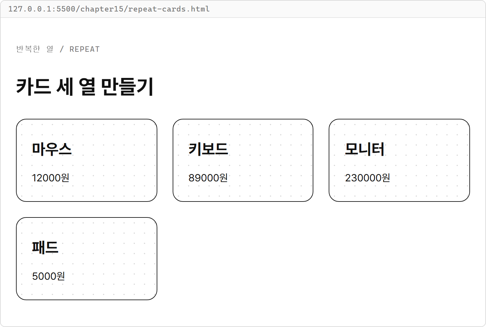

- `.product-grid`에 지정한 `repeat(3, 1fr)`이 같은 너비의 열 세 개를 만듭니다.
- 첫 행에 카드 세 개가 들어가고 네 번째 카드는 다음 행의 첫 열에 들어갑니다.
- 마지막 행에 카드가 하나만 있어도 그 카드가 세 열 전체로 넓어지지는 않습니다.

**시각자료 — 네 카드가 세 열에 들어가는 위치**

```text
         1fr        1fr        1fr
      +---------+---------+---------+
      |    A    |    B    |    C    |
      +---------+---------+---------+
      |    D    |         |         |
      +---------+---------+---------+
```

`A`, `B`, `C`, `D`는 HTML에 쓴 카드 순서입니다.
그림에서는 칸 사이 간격을 생략했습니다.

## 따라하기 실습 — 카드 3열 배치

**실습 목표**

- 상품 배열로 만든 카드들을 같은 너비의 세 열에 배치합니다.
- 열 개수와 간격을 바꾸어 같은 목록의 배치를 비교합니다.

**준비**

1. `js-course/chapter15` 안에 `cards-three-columns.html` 파일을 만듭니다.
2. 1장에서 만든 `css/common.css`는 그대로 두고 이 HTML에만 배치 규칙을 추가합니다.

**실습 코드**

`chapter15/cards-three-columns.html`

```html
<!DOCTYPE html>
<html lang="ko">
<head>
  <meta charset="UTF-8">
  <title>상품 카드 3열 배치</title>
  <link rel="stylesheet" href="../css/common.css">
  <style>
    .product-grid {
      display: grid;
      grid-template-columns: repeat(3, 1fr);
      gap: 24px;
    }
  </style>
</head>
<body>
  <main class="page">
    <p class="label">상품 안내 / PRODUCTS</p>
    <h1>상품 카드 3열 배치</h1>
    <section id="productList" class="product-grid"></section>
  </main>

  <script>
    const products = [
      { id: 1, name: "마우스", price: 12000, stock: 5 },
      { id: 2, name: "키보드", price: 89000, stock: 0 },
      { id: 3, name: "모니터", price: 230000, stock: 2 },
      { id: 4, name: "패드", price: 5000, stock: 8 },
      { id: 5, name: "USB 허브", price: 18000, stock: 3 },
      { id: 6, name: "스피커", price: 35000, stock: 4 }
    ];
    const productList = document.querySelector("#productList");

    function renderProducts() {
      productList.innerHTML = products.map((product) => `
        <article class="card">
          <span class="badge">${product.stock > 0 ? "판매 중" : "품절"}</span>
          <h2>${product.name}</h2>
          <p>${product.price}원</p>
        </article>
      `).join("");
    }

    renderProducts();
  </script>
</body>
</html>
```

**실행 방법**

1. 전체 코드를 입력하고 저장합니다.
2. `cards-three-columns.html`을 Live Server로 엽니다.
3. 첫 행의 마우스·키보드·모니터와 둘째 행의 패드·USB 허브·스피커가 같은 열 기준에 맞는지 확인합니다.

**실행 결과**

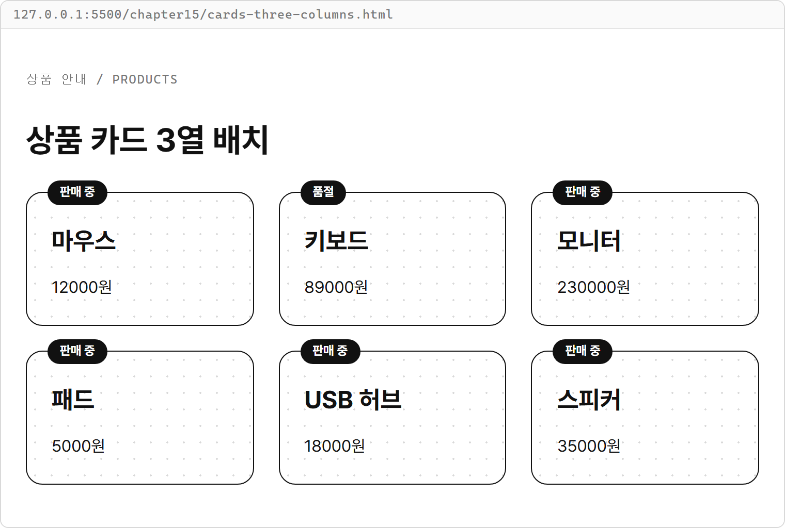

**코드 설명**

- `products`의 `id`, `name`, `price`, `stock`과 `renderProducts()` 이름은 11장 상품 카드 실습에서 쓴 모양을 이어 씁니다.
- `map()`·`join()`·`innerHTML`이 카드 여섯 개를 만들고, CSS가 그 카드들의 위치를 정합니다.
- 열을 정하는 `.product-grid`는 목록 부모에 붙이고, 카드 모양인 `.card`는 각 자식에 붙입니다.
- `repeat(3, 1fr)`은 세 열, `gap: 24px;`는 두 방향의 간격을 맡습니다.
- 상품 데이터나 그리는 함수를 고치지 않고 CSS만 바꾸어 배치를 바꿀 수 있습니다.

**바꿔 보기 1**

상품을 두 열로 배치해 봅니다.
`grid-template-columns: repeat(3, 1fr);` 줄을 다음처럼 바꿉니다.

```css
grid-template-columns: repeat(2, 1fr);
```

카드 여섯 개가 두 열, 세 행에 배치됩니다.
상품 순서와 카드 개수는 그대로입니다.

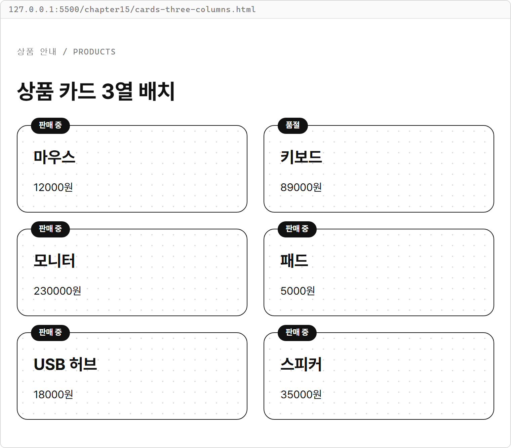

**바꿔 보기 2**

열 개수를 원래의 `repeat(3, 1fr)`로 되돌리고 간격을 줄여 봅니다.
`.product-grid`의 `gap: 24px;` 줄을 다음처럼 바꿉니다.

```css
gap: 12px;
```

행 사이와 열 사이의 간격이 모두 12px로 줄어듭니다.
같은 컨테이너 안에서 간격이 줄어든 만큼 각 열에 나눌 공간은 늘어납니다.

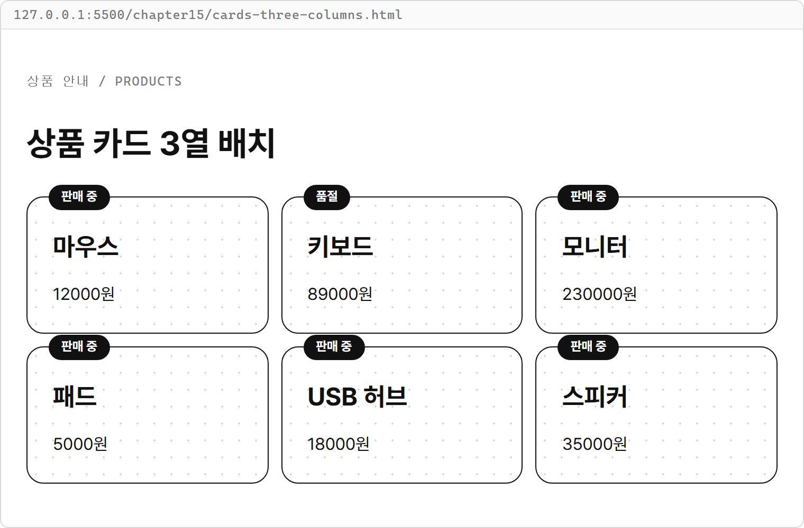

## 15-3 grid-column으로 칸 넓히기

지금까지 아이템 하나는 열 하나를 차지했습니다.
입력 영역처럼 한 줄 전체를 차지해야 하는 아이템은 `grid-column`으로 시작과 끝 위치를 정합니다.
`grid-column`은 열 방향에서 아이템이 차지할 범위를 지정하는 속성입니다.
부모가 아니라 넓힐 자식 아이템에 씁니다.

### 선 번호로 범위 지정하기

**Grid 선**(grid line)은 행이나 열을 나누는 경계입니다.
이 예제의 열 선 번호는 왼쪽에서 1부터 시작합니다.
열이 세 개면 경계선은 네 개이므로 마지막 선 번호는 4입니다.
`grid-column: 1 / 4;`는 1번 선에서 시작해 4번 선에서 끝나게 합니다.

`/` 왼쪽은 시작 선, 오른쪽은 끝 선입니다.
끝 선 자체가 열 하나를 뜻하는 것은 아닙니다.
`1 / 4`는 세 열을 차지하는 범위입니다.

**특징**

- `grid-column`은 컨테이너 바로 아래의 아이템에 지정합니다.
- `1 / -1`의 `-1`은 `grid-template-columns`로 지정한 열들의 마지막 선입니다.
- `1 / -1`은 지정한 열 개수가 바뀌어도 첫 선부터 마지막 선까지 차지합니다.

입력 영역을 세 칸 위에 길게 놓인 상자라고 생각하면 됩니다.
상자의 왼쪽은 1번 선에, 오른쪽은 마지막 선에 맞춥니다.

**시각자료 — 세 열과 네 개의 경계선**

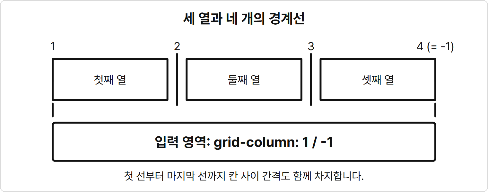

열 번호와 경계선 번호를 구분합니다.
`1 / -1`은 칸 사이 간격까지 포함해 첫 선과 마지막 선 사이를 차지합니다.

**기본 문법**

```css
.아이템 {
  grid-column: 시작 선 / 끝 선;
}
```

**예제 15-5** `column-span.html`

```html
<!DOCTYPE html>
<html lang="ko">
<head>
  <meta charset="UTF-8">
  <title>입력 영역을 전체 폭으로</title>
  <link rel="stylesheet" href="../css/common.css">
  <style>
    .board-grid {
      display: grid;
      grid-template-columns: repeat(3, 1fr);
      gap: 24px;
    }

    .entry-form {
      grid-column: 1 / -1;
    }
  </style>
</head>
<body>
  <main class="page">
    <p class="label">칸 넓히기 / GRID COLUMN</p>
    <h1>입력 영역을 전체 폭으로</h1>
    <section class="board-grid">
      <form class="form entry-form">
        <label class="label" for="todoTitle">할 일 / TODO</label>
        <input id="todoTitle" class="title-input" placeholder="할 일을 적으세요">
      </form>
      <article class="card"><h2>공부하기</h2><p>배열 복습</p></article>
      <article class="card"><h2>산책하기</h2><p>공원 한 바퀴</p></article>
      <article class="card"><h2>장보기</h2><p>우유와 빵</p></article>
    </section>
  </main>
</body>
</html>
```

**실행 결과**

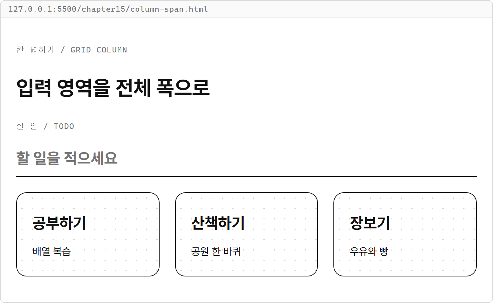

- `.board-grid`가 열 세 개를 만들고 `.entry-form`이 그 열 전체를 차지합니다.
- `<form>`은 `.board-grid`의 바로 아래 자식이므로 `grid-column`을 적용할 수 있습니다.
- 입력 영역이 첫 행을 채웠으므로 카드 세 개는 다음 행에 놓입니다.
- `.form`은 입력 영역 내부의 배치를 맡습니다. 바깥에서 세 열을 차지하는 것과 안쪽에서 입력칸을 배치하는 것은 별개입니다.

예제 15-5의 `grid-column: 1 / -1;` 줄을 다음처럼 바꾸어도 세 열에서는 같은 화면이 나옵니다.

```css
grid-column: 1 / 4;
```

단, 열 개수를 바꾸면 마지막 선 번호도 달라지므로 전체 폭이 목적일 때는 `1 / -1`이 편합니다.

## 15-4 공통 CSS의 Grid 풀어 보기

1장의 `css/common.css`에는 처음부터 Grid 배치 규칙이 들어 있었습니다.
여기서는 그 파일을 고치지 않고 Grid에 해당하는 선언만 골라 읽습니다.
글자, 테두리, 배경, 입력칸 모양을 정하는 선언은 그대로 사용합니다.

### page와 form

공통 CSS의 `.page`와 `.form`에서 Grid에 해당하는 부분은 다음과 같습니다.
새 파일에 덧붙일 코드가 아니라 1장 공통 CSS의 일부입니다.

```css
.page {
  display: grid;
  gap: 24px;
}

.form {
  display: grid;
  gap: 12px;
}
```

- 두 클래스에는 `grid-template-columns`가 없습니다. 이 공통 CSS의 기본 배치에서는 자식이 한 열에 위에서 아래로 놓입니다.
- `.page`는 제목, 폼, 목록처럼 페이지의 큰 덩어리 사이에 24px을 둡니다.
- `.form`은 라벨, 입력칸, 버튼 묶음 같은 폼 내부 아이템 사이에 12px을 둡니다.
- `.form`이 `.page`의 아이템이면서 동시에 자기 자식의 컨테이너가 될 수 있습니다.

### button-group

세로로 놓는 폼과 달리 버튼 묶음은 버튼들을 가로로 놓습니다.
`grid-auto-flow`는 위치를 직접 지정하지 않은 아이템을 어떤 방향으로 채울지 정합니다.
`column`으로 쓰면 이 버튼 묶음처럼 한 행에 버튼을 놓으면서 열을 더 만듭니다.

```css
.button-group {
  display: grid;
  grid-auto-flow: column;
  justify-content: start;
  gap: 8px;
}
```

- `grid-auto-flow: column;`은 버튼이 추가될 때 오른쪽에 새 열을 만듭니다.
- `justify-content`는 컨테이너 안에서 열 묶음 전체의 가로 위치를 정합니다. `start`는 열들을 컨테이너의 왼쪽 끝에 모읍니다.
- 여기서는 내용에 맞는 버튼 열들이 왼쪽에 모이고 나머지 공간은 오른쪽에 남습니다.
- `gap: 8px;`는 나란한 버튼 사이에 8px을 둡니다.

### card-list와 card

카드 목록과 카드 내부도 각각 Grid 컨테이너입니다.
공통 CSS에서 Grid 선언만 추리면 다음과 같습니다.

```css
.card-list {
  display: grid;
  grid-template-columns: repeat(3, 1fr);
  gap: 24px;
}

.card {
  display: grid;
  gap: 12px;
}
```

- `.card-list`는 이 장에서 직접 쓴 세 열 배치를 이미 제공합니다.
- `.card`는 제목과 본문 같은 카드 내부의 자식들을 한 열에 놓고 12px 간격을 둡니다.
- 목록의 `gap`은 카드 사이 간격이고 카드의 `gap`은 카드 내부 내용 사이 간격입니다.

### badge와 justify-self

`justify-self`는 Grid 아이템 하나가 자기 칸 안에서 가로로 어디에 놓일지 정합니다.
`start`는 아이템을 칸의 왼쪽에 놓고 칸 너비 전체로 늘어나지 않게 합니다.
공통 CSS의 `.badge`에는 다음 선언이 들어 있습니다.

```css
.badge {
  justify-self: start;
}
```

예제 15-6에서는 `.form`의 바로 아래에 둔 배지로 이 선언을 확인합니다.
단, `.card` 바로 아래의 배지는 공통 CSS에 있는 별도의 위치 지정 규칙으로 카드 위에 놓입니다.
그 배지는 일반 Grid 아이템 배치에 참여하지 않으므로 `justify-self`의 효과를 확인할 대상으로 쓰지 않습니다.

**비교 — justify-content와 justify-self**

| 비교 항목 | justify-content | justify-self |
|---|---|---|
| 지정하는 곳 | Grid 컨테이너 | Grid 아이템 |
| 움직이는 대상 | 열 묶음 전체 | 자기 칸 안의 아이템 하나 |
| 공통 CSS에서 | `.button-group` | `.badge` |
| `start`의 결과 | 버튼 열들을 왼쪽에 모음 | 배지를 자기 칸 왼쪽에 놓음 |

**예제 15-6** `common-grid.html`

이 파일에는 새 `<style>`을 추가하지 않습니다.
공통 클래스만으로 큰 덩어리, 버튼, 카드 목록, 배지의 배치를 확인합니다.

```html
<!DOCTYPE html>
<html lang="ko">
<head>
  <meta charset="UTF-8">
  <title>공통 CSS의 Grid</title>
  <link rel="stylesheet" href="../css/common.css">
</head>
<body>
  <main class="page">
    <h1>공통 CSS의 Grid</h1>
    <section class="form">
      <span class="badge">상품 안내</span>
      <p>배지는 자기 칸 왼쪽에 놓입니다.</p>
      <div class="button-group">
        <button class="btn selected" type="button">전체</button>
        <button class="btn" type="button">판매 중</button>
        <button class="btn" type="button">품절</button>
      </div>
    </section>
    <section class="card-list">
      <article class="card"><h2>마우스</h2><p>12000원</p></article>
      <article class="card"><h2>키보드</h2><p>89000원</p></article>
      <article class="card"><h2>모니터</h2><p>230000원</p></article>
    </section>
  </main>
</body>
</html>
```

**실행 결과**

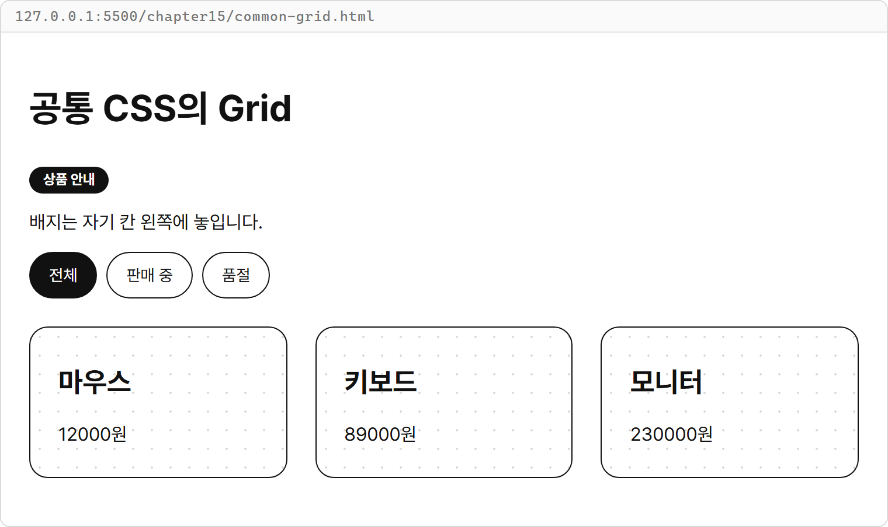

- `.page`의 아이템은 제목, 안내 영역, 카드 목록 세 개입니다.
- `.form` 안의 배지, 문단, 버튼 묶음은 세로로 놓입니다.
- `.button-group` 안의 버튼 세 개는 가로로 놓이고 왼쪽에 모입니다.
- `.card-list`는 세 열을 만들고 각 `.card`는 내부의 제목과 가격을 세로로 놓습니다.
- 배지에는 `justify-self: start;`가 적용되어 안내 영역 너비 전체로 늘어나지 않습니다.

**시각자료 — 부모 배치와 내부 배치의 관계**

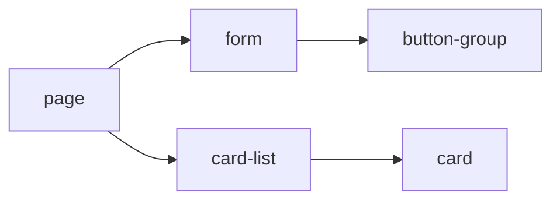

화살표는 실행 순서가 아니라 예제 15-6의 부모에서 자식으로 이어지는 포함 관계입니다.
자식이 부모의 아이템이면서 자기 내부를 배치하는 컨테이너일 수 있습니다.

Grid 선언의 정확한 의미는 [W3C CSS Grid 명세](https://www.w3.org/TR/css-grid-1/#grid-model)에서도 확인할 수 있습니다.
실습에서는 부모의 열과 간격을 먼저 보고, 특정 아이템을 넓히거나 정렬하는 선언을 그다음에 읽습니다.

## 연습문제

### 연습문제 1 — 사진 갤러리 3열 배치

**요구사항**

1. `chapter15/gallery.html` 파일을 만들고 공통 CSS를 연결합니다.
2. 사진 카드 여섯 개를 하나의 목록 부모 안에 넣습니다. 직접 준비한 사진 파일을 쓰거나 사진 자리에 간단한 그림을 써도 됩니다.
3. 부모에 Grid를 적용하고 같은 너비의 세 열과 16px 간격을 지정합니다.
4. 사진마다 제목을 붙여 첫 행은 산·바다·숲, 둘째 행은 길·호수·도시 순서로 배치합니다.
5. 사진은 자기 카드 너비 안에 들어가게 합니다.

**완료 조건**

- 여섯 사진 카드가 세 열, 두 행에 배치됩니다.
- 같은 열의 카드 왼쪽 경계가 맞고 행 사이와 열 사이 간격이 16px입니다.
- 사진이 자기 카드 너비를 넘지 않습니다.

### 연습문제 2 — 머리말이 전체 폭을 차지하는 대시보드 배치

**요구사항**

1. `chapter15/dashboard.html` 파일을 만들고 공통 CSS를 연결합니다.
2. 대시보드 부모 안에 머리말 하나와 요약 카드 세 개를 순서대로 넣습니다.
3. 부모는 같은 너비의 세 열과 24px 간격을 갖게 합니다.
4. 머리말은 `grid-column`으로 첫 선에서 마지막 선까지 차지하게 합니다.
5. 카드에는 각각 방문자 120명, 주문 8건, 문의 3건을 표시합니다.

**완료 조건**

- 머리말이 첫 행 전체를 차지하고 세 카드가 둘째 행에 나란히 놓입니다.
- 열 개수를 두 개로 바꾸어도 머리말이 지정한 열 전체를 차지합니다.

## 정답과 해설

### 연습문제 1 — 사진 갤러리 3열 배치

다음 정답은 여섯 사진 자리에 같은 산 그림을 씁니다.
실제 사진을 쓰려면 `src`를 직접 준비한 이미지 파일 경로로 바꿉니다.

**SVG**(Scalable Vector Graphics)는 선과 도형으로 표현한 이미지 형식입니다.
**데이터 URL**(data URL)은 `data:` 뒤에 파일 내용을 담아 별도 파일 없이 사용하는 주소입니다.
아래의 긴 문자열은 SVG 그림을 이런 주소로 만든 것입니다.
`%3C`처럼 바꾼 글자는 주소 안에서 `<` 같은 기호를 표현합니다.

`gallery.html`

```html
<!DOCTYPE html>
<html lang="ko">
<head>
  <meta charset="UTF-8">
  <title>사진 갤러리</title>
  <link rel="stylesheet" href="../css/common.css">
  <style>
    .gallery-grid {
      display: grid;
      grid-template-columns: repeat(3, 1fr);
      gap: 16px;
    }

    .photo {
      width: 100%;
    }
  </style>
</head>
<body>
  <main class="page">
    <p class="label">사진 목록 / GALLERY</p>
    <h1>사진 갤러리</h1>
    <section id="photoList" class="gallery-grid"></section>
  </main>

  <script>
    const photos = ["산", "바다", "숲", "길", "호수", "도시"];
    const photoList = document.querySelector("#photoList");
    const photoSource = "data:image/svg+xml,%3Csvg xmlns='http://www.w3.org/2000/svg' width='240' height='140' viewBox='0 0 240 140'%3E%3Crect width='240' height='140' fill='white'/%3E%3Cpath d='M0 140 L80 40 L140 110 L180 60 L240 140 Z' fill='none' stroke='black' stroke-width='3'/%3E%3C/svg%3E";

    function renderPhotos() {
      photoList.innerHTML = photos.map((photo) => `
        <article class="card">
          
          <h2>${photo}</h2>
        </article>
      `).join("");
    }

    renderPhotos();
  </script>
</body>
</html>
```

**실행 결과**

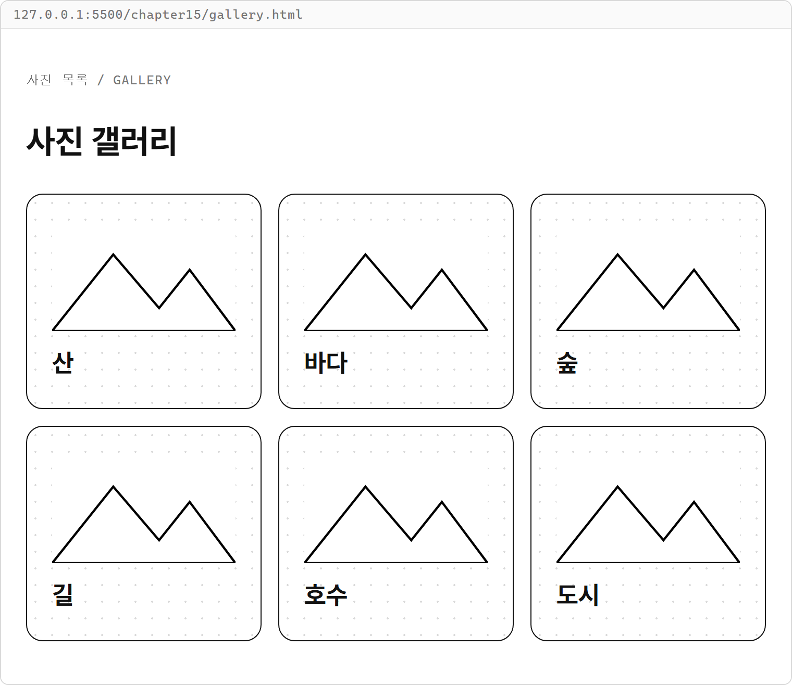

**해설**

- `.gallery-grid`의 `repeat(3, 1fr)`이 카드 세 열을 만들고 `gap: 16px;`가 두 방향 간격을 만듭니다.
- `photos`를 카드 문자열로 바꾸고 하나로 이어 기존 `photoList`를 채웁니다.
- `photoSource`는 작은 산 그림을 담은 데이터 URL입니다. 이미지가 HTML 안에 있으므로 별도의 사진 다운로드가 필요하지 않습니다.
- `.photo`의 `width: 100%;`는 사진이 카드 내부 너비에 맞게 들어가도록 합니다.
- 카드 여섯 개를 HTML에 직접 적는 방법도 같은 Grid 배치를 만듭니다.

### 연습문제 2 — 머리말이 전체 폭을 차지하는 대시보드 배치

`dashboard.html`

```html
<!DOCTYPE html>
<html lang="ko">
<head>
  <meta charset="UTF-8">
  <title>요약 대시보드</title>
  <link rel="stylesheet" href="../css/common.css">
  <style>
    .dashboard-grid {
      display: grid;
      grid-template-columns: repeat(3, 1fr);
      gap: 24px;
    }

    .dashboard-header {
      grid-column: 1 / -1;
    }
  </style>
</head>
<body>
  <main class="page">
    <section class="dashboard-grid">
      <header class="card dashboard-header">
        <p class="label">오늘의 현황 / DASHBOARD</p>
        <h1>요약 대시보드</h1>
      </header>
      <article class="card"><h2>방문자</h2><p>120명</p></article>
      <article class="card"><h2>주문</h2><p>8건</p></article>
      <article class="card"><h2>문의</h2><p>3건</p></article>
    </section>
  </main>
</body>
</html>
```

**실행 결과**

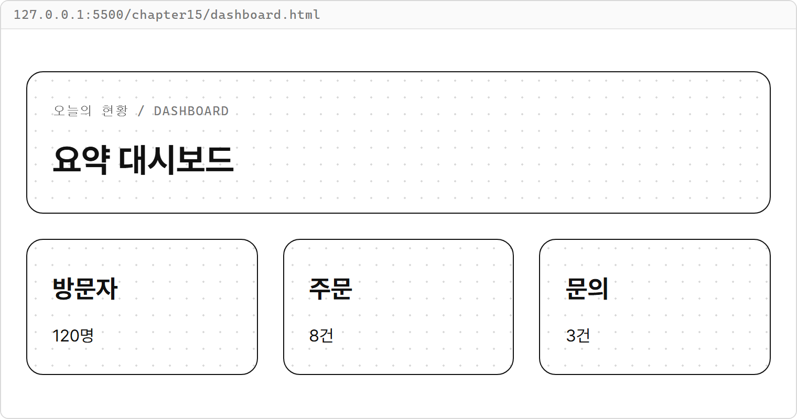

`repeat(3, 1fr)`을 `repeat(2, 1fr)`로 바꾸어 완료 조건도 확인합니다.

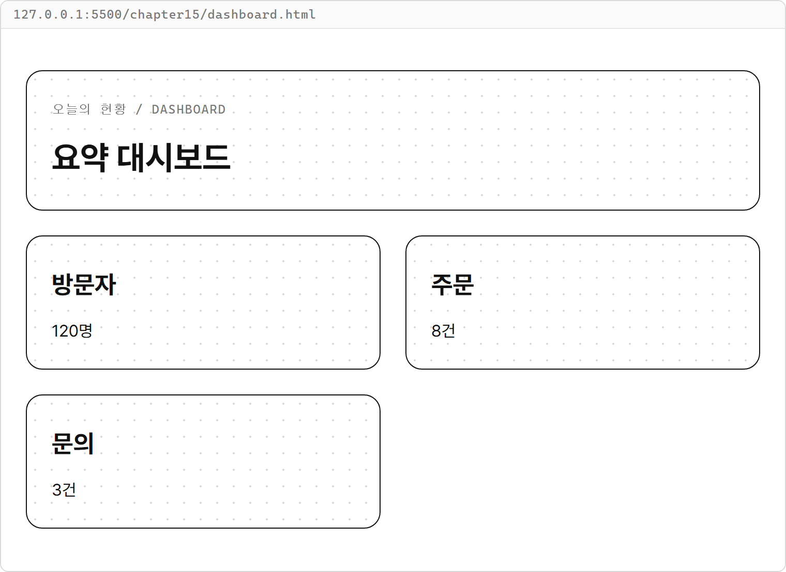

**해설**

- `.dashboard-grid`는 머리말과 카드들의 부모이므로 열의 개수와 간격을 지정합니다.
- `.dashboard-header`는 그 부모의 아이템이므로 `grid-column: 1 / -1;`로 전체 폭을 차지합니다.
- 머리말이 첫 행을 채우고 요약 카드 세 개는 다음 행에 들어갑니다.
- `repeat(3, 1fr)`을 `repeat(2, 1fr)`로 바꾸면 머리말은 두 열 전체를 차지합니다. 방문자·주문은 그 아래 행, 문의는 마지막 행의 첫 열에 놓입니다.
- 세 열만 쓸 경우 `grid-column: 1 / 4;`도 가능하지만, 열 개수를 바꾸는 완료 조건에는 `1 / -1`이 맞습니다.
