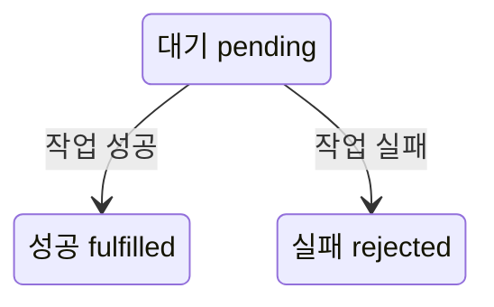
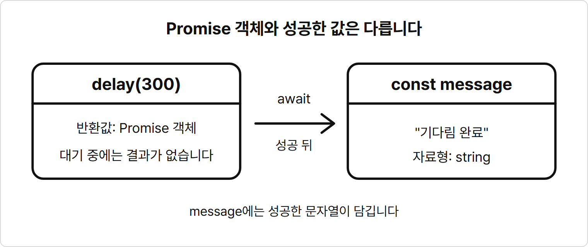
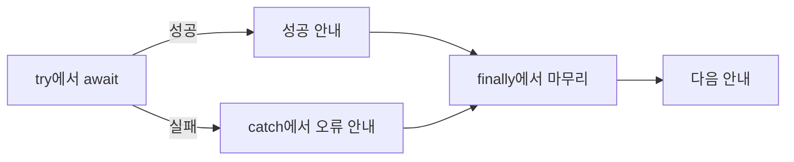

# 17장. 비동기 처리

**학습목표**

- 순서가 있는 비동기 작업에서 콜백이 중첩되는 이유를 설명할 수 있습니다.
- Promise의 대기·성공·실패 상태를 구분할 수 있습니다.
- `async` 함수 안에서 `await`로 작업을 차례로 기다릴 수 있습니다.
- `try`·`catch`·`finally`로 실패를 알리고 마무리 코드를 실행할 수 있습니다.

## 17-1 콜백의 한계

16장에서는 `setTimeout()`에 넘긴 콜백이 나중에 실행되는 순서를 보았습니다.
이번에는 주문이 끝나야 결제를 시작하고, 결제가 끝나야 배송을 시작하는 작업을 생각해 봅니다.
각 작업이 끝난 뒤에 다음 작업을 시작해야 하므로, 호출한 순서뿐 아니라 완료되는 순서도 맞춰야 합니다.

### 완료 뒤에 다음 작업 시작하기

5장 `arrow-callback.js`의 `placeOrder(productName, onComplete)`는 주문 안내를 출력한 뒤 `onComplete?.()`를 바로 호출했습니다.
이제 함수 이름과 매개변수를 그대로 두고, `setTimeout()`으로 잠시 기다린 뒤 콜백을 호출하게 바꿉니다.
주문·결제·배송은 실제 서버 작업 대신 시간 지연으로 흉내 냅니다.

함수에 콜백을 넘겼다고 해서 콜백이 반드시 나중에 실행되지는 않습니다.
5장의 주문 콜백은 바로 실행되었고, 다음 예제의 주문 콜백은 타이머 콜백 안에서 나중에 실행됩니다.
어느 쪽인지는 콜백을 받은 함수가 언제 호출하는지에 달려 있습니다.

**기본 문법**

```javascript
첫 작업(값, () => {
  다음 작업(값, () => {
    마지막 작업(값, () => {
      마무리 코드
    });
  });
});
```

**예제 17-1** `order-callback.js`

```javascript
function placeOrder(productName, onComplete) {
  setTimeout(() => {
    console.log(`${productName} 주문을 접수했습니다.`);
    onComplete?.();
  }, 300);
}

function processPayment(productName, onComplete) {
  setTimeout(() => {
    console.log(`${productName} 결제를 완료했습니다.`);
    onComplete?.();
  }, 300);
}

function shipOrder(productName, onComplete) {
  setTimeout(() => {
    console.log(`${productName} 배송을 시작했습니다.`);
    onComplete?.();
  }, 300);
}

const productName = "무선 마우스";

placeOrder(productName, () => {
  processPayment(productName, () => {
    shipOrder(productName, () => {
      console.log("주문 처리를 마쳤습니다.");
    });
  });
});

console.log("주문 요청을 보냈습니다.");
```

**실행 결과**

```text
주문 요청을 보냈습니다.
무선 마우스 주문을 접수했습니다.
무선 마우스 결제를 완료했습니다.
무선 마우스 배송을 시작했습니다.
주문 처리를 마쳤습니다.
```

- `placeOrder()`는 타이머를 등록하고 돌아옵니다. 주문 완료를 기다리지 않으므로 파일 맨 아래의 `주문 요청을 보냈습니다.`가 먼저 출력됩니다.
- 주문 타이머의 콜백이 실행되어 `onComplete?.()`를 호출하면 그 안에서 `processPayment()`가 시작됩니다.
- 배송도 결제 완료 콜백 안에서 시작합니다. 타이머 세 개를 처음부터 한꺼번에 등록한 코드와 다릅니다.
- `300`은 밀리초 단위의 지연 시간입니다. 세 작업을 차례로 기다리므로 마지막 안내는 대략 0.9초 뒤에 나오며, 실행 상황에 따라 더 늦어질 수 있습니다.

**시각자료 — 완료 콜백으로 이어지는 세 작업**


다음 작업의 시작은 앞 작업의 완료 콜백 안에 있습니다.
그래서 결제는 주문 완료 뒤에, 배송은 결제 완료 뒤에 시작됩니다.

### 중첩이 깊어질 때

이 코드의 출력 순서는 맞습니다.
하지만 다음 작업을 콜백 안에 넣을 때마다 들여쓰기가 한 단계 깊어집니다.
포인트 적립이나 문자 전송을 더하면 마무리 코드는 더 안쪽으로 들어갑니다.

이처럼 여러 콜백이 깊게 겹쳐 흐름을 읽고 고치기 어려운 모양을 **콜백 지옥**(callback hell)이라고 부릅니다.
예제 17-1에서는 마지막 `console.log()`가 어느 작업 안에 있는지 중괄호를 거슬러 올라가 확인해야 합니다.
콜백 자체를 없애기보다, 여러 비동기 작업을 연결하는 코드를 읽기 쉽게 쓸 방법이 필요합니다.

## 17-2 Promise 개념

**Promise**는 비동기 작업의 상태와 완료 결과를 나타내는 객체입니다.
쉽게 말해 작업을 시작한 지금은 결과 대신 Promise를 받고, 작업이 끝난 뒤에 결과를 꺼내 쓰는 것입니다.
Promise를 반환하는 함수에서는 콜백을 인수로 넘기지 않아도 반환받은 객체를 통해 완료 결과를 다룰 수 있습니다.

### Promise의 세 상태

Promise에는 대기·성공·실패 세 상태가 있습니다.
영어 상태 이름도 함께 알아 둡니다.

| 상태 | 영어 이름 | 뜻 | 완료 결과 |
|---|---|---|---|
| 대기 | `pending` | 작업 결과가 아직 정해지지 않음 | 아직 없음 |
| 성공 | `fulfilled` | 작업이 성공으로 끝남 | 성공한 값 |
| 실패 | `rejected` | 작업이 실패로 끝남 | 실패한 이유 |

**특징**

- 대기 상태는 성공이나 실패 상태로 바뀔 수 있습니다.
- 성공이나 실패로 끝난 Promise의 상태는 다시 바뀌지 않습니다.
- 성공한 Promise에서 받은 값과 Promise 객체 자체는 서로 다릅니다.
- 실패한 Promise에서는 성공한 값 대신 실패한 이유를 처리합니다.

**시각자료 — Promise의 상태 변화**



대기 상태에서 성공과 실패 가운데 한 갈래로 끝납니다.
성공한 뒤에 실패로 바뀌거나, 실패한 뒤에 대기로 돌아가는 화살표는 없습니다.

### 콜백과 Promise로 완료 결과 받기

예제 17-1의 `placeOrder()`는 완료 뒤에 실행할 함수를 `onComplete`로 받습니다.
Promise를 반환하는 함수는 완료 상태와 결과를 객체로 돌려줍니다.
두 방식은 다음 작업을 연결하는 자리가 다릅니다.

**비교 — 완료 콜백과 Promise**

| 비교 항목 | 완료 콜백 | Promise |
|---|---|---|
| 완료를 다루는 방법 | 실행할 함수를 인수로 넘김 | 반환된 객체를 받음 |
| 다음 작업을 쓰는 곳 | 완료 콜백 안 | 반환된 객체로 완료를 확인한 뒤 |
| 호출한 쪽이 돌려받는 것 | 없음 | 완료 상태와 결과를 나타내는 객체 |

Promise는 카페의 진동벨에 빗댈 수 있습니다.
주문하면 음료 대신 진동벨을 먼저 받고, 음료가 준비되면 벨이 울려 음료를 받으러 갑니다.

**시각자료 — 음료 대신 받은 진동벨**

```text
[생성 이미지: images/17/promise-pager.png]
장면: 카페 계산대 앞에서 손님의 손이 직원에게 네모난 진동벨을 받는다. 계산대 뒤에서는 다른 직원이 컵에 음료를 따르고 있다.
비율: 가로 3:2
스타일: 굵기가 일정한 검정 외곽선의 단순한 선 그림. 흰 배경. 그림자와 그라데이션 없음. 채움 색은 빨강(진동벨의 불빛 부분) 한 가지. 글자, 숫자, 기호는 넣지 않는다.
참고 그림: book-manuscript/assets/style-ref/line-art-shark.png
```

지금 받은 진동벨이 Promise 객체이고, 나중에 받을 음료가 성공한 값입니다.
진동벨을 받았다고 음료가 바로 손에 들어오지는 않습니다.

Promise를 반환받았다고 해서 다음 줄이 저절로 작업 완료를 기다리지는 않습니다.
작업이 끝날 때까지 기다린 뒤 다음 줄로 넘어가는 방법을 이어서 봅니다.

## 17-3 async·await

### async 함수

`async`는 함수를 호출했을 때 Promise를 반환하게 만드는 단어입니다.
이 책에서는 이름 있는 함수를 `async function 함수명()` 형태로 선언합니다.
함수 안에서 `return`으로 돌려준 값은 반환된 Promise의 성공한 값이 됩니다.

`await`는 Promise가 끝날 때까지 현재 `async` 함수의 진행을 잠시 멈추는 문법입니다.
성공하면 그 값을 받아 다음 줄을 이어서 실행합니다.
이 책의 `.js` 예제에서는 `await`를 `async` 함수 안에만 쓰고, 시작 함수인 `main()`을 파일 맨 아래에서 호출합니다.

**특징**

- `async` 함수의 호출 결과는 언제나 Promise입니다.
- `await`로 성공한 Promise를 기다리면 그 안의 성공한 값을 얻습니다.
- `await`는 현재 함수의 진행을 멈추며, 프로그램 전체를 멈추지는 않습니다.
- 작업 함수 호출 앞에 `await`를 차례로 쓰면 앞 작업이 끝난 뒤 다음 작업을 시작합니다.

**기본 문법**

```javascript
async function 작업 함수명() {
  return 성공한 값;
}

async function main() {
  const 결과 = await 작업 함수명();
  결과를 쓰는 코드
}

main();
```

**예제 17-2** `async-return.js`

```javascript
async function getOrderMessage(productName) {
  return `${productName} 주문을 접수했습니다.`;
}

async function main() {
  const message = await getOrderMessage("무선 마우스");
  console.log(message);
}

main();
```

**실행 결과**

```text
무선 마우스 주문을 접수했습니다.
```

- `getOrderMessage()`의 `return` 뒤에는 문자열이 있습니다. 호출한 곳에는 이 문자열을 성공한 값으로 가진 Promise가 반환됩니다.
- `await getOrderMessage("무선 마우스")`는 그 Promise에서 성공한 문자열을 받아 `message`에 할당합니다.
- `async`를 붙였다고 함수 안의 모든 일이 자동으로 오래 걸리는 작업이 되지는 않습니다. 이 함수는 문자열을 바로 만들지만 반환하는 모양은 Promise입니다.
- `main();`이 시작점입니다. `await`는 `main()` 안에 있고 함수 바깥에는 없습니다.

### 시간이 걸리는 작업 기다리기

반환값을 받는 모양을 보았으니, 이번에는 잠시 시간이 걸리는 작업을 기다립니다.
다음 예제부터 쓰는 `delay(ms, shouldFail)`은 연습을 위해 제공하는 함수입니다.
`ms`는 기다릴 밀리초입니다.
`shouldFail`을 생략하거나 `false`로 넘기면 `"기다림 완료"`를 성공한 값으로 주고, `true`로 넘기면 실패합니다.

`delay()` 안의 `new Promise` 부분은 지금은 그대로 입력합니다.
이 장에서는 이 함수를 만드는 원리 대신, 반환된 Promise를 기다리고 성공·실패를 처리하는 사용법에 집중합니다.

**시각자료 — Promise와 await로 받은 값**



`delay(300)`의 호출 결과는 Promise 객체입니다.
`await delay(300)`이 성공으로 끝나면 `message`에는 Promise가 아니라 문자열 `"기다림 완료"`가 들어갑니다.

**기본 문법**

```javascript
async function main() {
  const 결과 = await Promise를 반환하는 함수(인수);
  결과를 쓰는 코드
}

main();
```

**예제 17-3** `await-delay.js`

```javascript
function delay(ms, shouldFail = false) {
  return new Promise((resolve, reject) => {
    setTimeout(() => {
      if (shouldFail) {
        reject(new Error("작업에 실패했습니다."));
      } else {
        resolve("기다림 완료");
      }
    }, ms);
  });
}

async function main() {
  console.log("작업을 시작합니다.");
  const message = await delay(300);
  console.log(message);
  console.log("작업을 마쳤습니다.");
}

main();
console.log("함수 밖의 코드는 계속 실행됩니다.");
```

**실행 결과**

```text
작업을 시작합니다.
함수 밖의 코드는 계속 실행됩니다.
기다림 완료
작업을 마쳤습니다.
```

- `main()`은 `작업을 시작합니다.`를 먼저 출력하고 `await delay(300)`에서 기다립니다.
- `main();` 아래의 출력은 그 기다림에 묶이지 않습니다. 그래서 `함수 밖의 코드는 계속 실행됩니다.`가 두 번째로 나옵니다.
- 타이머가 실행되어 Promise가 성공하면 `message`에 `"기다림 완료"`가 담기고 `main()`의 남은 두 줄을 실행합니다.
- 16장의 긴 반복문과 달리, `await`로 기다리는 동안 JavaScript는 반복 계산으로 시간을 채우지 않습니다.

### 순서가 있는 작업 적기

`await`로 기다린 줄 아래에 다음 작업을 쓰면 완료 순서대로 읽을 수 있습니다.
예제 17-1의 주문·결제·배송 순서를 같은 시간 지연으로 표현해 봅니다.

**예제 17-4** `order-await.js`

```javascript
function delay(ms, shouldFail = false) {
  return new Promise((resolve, reject) => {
    setTimeout(() => {
      if (shouldFail) {
        reject(new Error("작업에 실패했습니다."));
      } else {
        resolve("기다림 완료");
      }
    }, ms);
  });
}

async function main() {
  const productName = "무선 마우스";

  await delay(300);
  console.log(`${productName} 주문을 접수했습니다.`);

  await delay(300);
  console.log(`${productName} 결제를 완료했습니다.`);

  await delay(300);
  console.log(`${productName} 배송을 시작했습니다.`);
  console.log("주문 처리를 마쳤습니다.");
}

main();
console.log("주문 요청을 보냈습니다.");
```

**실행 결과**

```text
주문 요청을 보냈습니다.
무선 마우스 주문을 접수했습니다.
무선 마우스 결제를 완료했습니다.
무선 마우스 배송을 시작했습니다.
주문 처리를 마쳤습니다.
```

- 첫 번째 `await delay(300);`이 끝나야 주문 안내를 출력하고 두 번째 `delay(300)`을 호출합니다.
- 예제 17-1과 출력 순서는 같지만, 다음 작업을 콜백 안에 넣지 않고 아래에 나란히 썼습니다.
- 이 예제는 `delay()`가 주는 문자열이 필요 없으므로 변수에 받지 않고 `await delay(300);`만 씁니다.
- `await`를 빼면 그 자리에서 기다리지 않습니다. 작업을 순서대로 시작하려면 기다릴 호출마다 붙여야 합니다.

## 17-4 try·catch·finally

지금까지는 작업이 성공했을 때의 순서를 보았습니다.
이번에는 제공된 `delay()`를 실패하게 호출해, 성공한 값을 받을 수 없는 상황을 처리합니다.

### 처리하지 않은 실패

실패한 Promise를 `await`하면 그 자리에서 에러가 발생합니다.
이 에러를 다루지 않으면 함수의 다음 줄로 진행하지 못합니다.
다음 예제는 실패 처리가 왜 필요한지 확인하기 위해 일부러 실패를 처리하지 않습니다.

**예제 17-5** `delay-error.js`

```javascript
function delay(ms, shouldFail = false) {
  return new Promise((resolve, reject) => {
    setTimeout(() => {
      if (shouldFail) {
        reject(new Error("작업에 실패했습니다."));
      } else {
        resolve("기다림 완료");
      }
    }, ms);
  });
}

async function main() {
  console.log("작업을 시작합니다.");
  await delay(300, true);
  console.log("작업을 마쳤습니다.");
}

main();
```

**실행 결과**

```text
작업을 시작합니다.
...\js-course\chapter17\delay-error.js:5
        reject(new Error("작업에 실패했습니다."));
               ^

Error: 작업에 실패했습니다.
```

컴퓨터마다 다른 앞쪽 폴더 경로와 `at`으로 시작하는 아래 줄, Node.js 버전 줄은 생략했습니다.
출력은 `node delay-error.js`로 실행했을 때의 결과입니다.

- `delay(300, true)`는 실패하는 Promise를 반환합니다. `main()`은 `await` 자리에서 에러를 처리하지 못하고 끝납니다.
- `delay-error.js:5`와 `^`는 제공된 함수가 에러 객체를 만든 위치를 가리킵니다. 실패를 받아 진행이 중단된 줄은 `await delay(300, true);`입니다.
- `Error`는 에러의 이름이고 `작업에 실패했습니다.`는 실패 이유를 적은 메시지입니다.
- 처리되지 않은 실패를 Node.js가 에러로 출력하고 종료하므로 `작업을 마쳤습니다.`는 출력되지 않습니다.

### try와 catch로 실패 처리하기

`try`는 에러가 날 수 있는 코드를 실행하는 블록입니다.
`catch`는 그 실행 중에 발생한 에러를 받아 처리하는 블록입니다.
쉽게 말해 정상 작업은 `try`에, 실패했을 때 알릴 내용은 `catch`에 씁니다.
`catch (error)`의 `error`에는 받은 에러가 담깁니다.

`finally`는 `try`와 `catch`의 처리가 끝난 뒤 마무리 코드를 실행하는 블록입니다.
성공해서 `catch`를 건너뛰어도, 실패해서 `catch`를 실행해도 이어서 실행됩니다.

**특징**

- `try`에서 에러가 발생하면 그 블록의 남은 줄을 건너뛰고 `catch`로 갑니다.
- `try`가 에러 없이 끝나면 `catch`를 건너뜁니다.
- 기다리는 작업의 실패를 잡으려면 그 호출의 `await`를 `try` 안에 둡니다.
- `finally`에는 성공 여부와 관계없이 실행할 마무리 코드를 둡니다.

**기본 문법**

```javascript
async function main() {
  try {
    const 결과 = await 작업 함수명();
    성공했을 때 실행할 코드
  } catch (error) {
    실패했을 때 실행할 코드
  } finally {
    마무리 코드
  }
}

main();
```

예제 17-5와 같은 실패를 이번에는 처리합니다.
제공된 `delay()`는 그대로 두고, `main()`의 작업을 `try`·`catch`·`finally`로 감쌉니다.

**예제 17-6** `try-catch.js`

```javascript
function delay(ms, shouldFail = false) {
  return new Promise((resolve, reject) => {
    setTimeout(() => {
      if (shouldFail) {
        reject(new Error("작업에 실패했습니다."));
      } else {
        resolve("기다림 완료");
      }
    }, ms);
  });
}

async function main() {
  console.log("작업을 시작합니다.");

  try {
    const message = await delay(300, true);
    console.log(message);
    console.log("작업을 마쳤습니다.");
  } catch (error) {
    console.log(`오류 이름: ${error.name}`);
    console.log(`오류 메시지: ${error.message}`);
  } finally {
    console.log("작업 처리를 종료합니다.");
  }

  console.log("다음 안내를 출력합니다.");
}

main();
```

**실행 결과**

```text
작업을 시작합니다.
오류 이름: Error
오류 메시지: 작업에 실패했습니다.
작업 처리를 종료합니다.
다음 안내를 출력합니다.
```

- `await delay(300, true)`에서 에러를 받으면 `message`를 할당하지 못하고 `catch`로 갑니다. `기다림 완료`와 `작업을 마쳤습니다.`는 출력되지 않습니다.
- `catch (error)`가 받은 에러 객체의 `name` 속성에는 에러 이름, `message` 속성에는 실패 이유가 들어 있습니다. 두 속성을 읽어 두 줄로 출력합니다.
- `finally`에서 `작업 처리를 종료합니다.`를 출력합니다. 실패를 처리했으므로 블록 아래의 `다음 안내를 출력합니다.`까지 실행됩니다.
- 에러 이름과 메시지를 `console.log()`로 알렸으므로 예제 17-5의 코드 위치와 `^` 표시는 나오지 않습니다. `error.message`를 출력하면 긴 에러 출력 대신 사용자에게 필요한 이유를 알릴 수 있습니다.

**시각자료 — 성공과 실패 뒤의 마무리**



성공하면 `try`의 남은 줄을 실행하고, 실패하면 그 줄을 건너뛰어 `catch`로 갑니다.
이 예제에서는 두 갈래 모두 `finally`를 거쳐 다음 안내로 이어집니다.

## 따라하기 실습 — 기다리는 작업의 성공·실패 처리

**실습 목표**

- 같은 작업 함수를 성공과 실패 두 경우로 실행합니다.
- `await`를 `try` 안에 두고 실패 이유를 출력합니다.
- 두 경우 모두 `finally`에서 마무리 안내를 출력합니다.

**준비**

1. `js-course` 안에 `chapter17` 폴더를 만들고 `task-result.js` 파일을 만듭니다.
2. 아래 전체 코드를 입력합니다. `delay()`는 예제에서 제공한 함수와 같습니다.

**실습 코드**

`chapter17/task-result.js`

```javascript
function delay(ms, shouldFail = false) {
  return new Promise((resolve, reject) => {
    setTimeout(() => {
      if (shouldFail) {
        reject(new Error("작업에 실패했습니다."));
      } else {
        resolve("기다림 완료");
      }
    }, ms);
  });
}

async function runTask(label, shouldFail) {
  console.log(`[${label}] 시작`);

  try {
    const message = await delay(300, shouldFail);
    console.log(`[${label}] 성공: ${message}`);
  } catch (error) {
    console.log(`[${label}] 오류: ${error.message}`);
  } finally {
    console.log(`[${label}] 마무리`);
  }
}

async function main() {
  await runTask("성공 작업", false);
  await runTask("실패 작업", true);
  console.log("모든 작업 처리를 마쳤습니다.");
}

main();
```

**실행 방법**

1. 코드를 저장하고 터미널의 현재 위치를 `chapter17`로 옮깁니다.
2. 다음 명령을 입력합니다.
   ```bash
   node task-result.js
   ```
3. 두 작업의 안내가 섞이지 않고 순서대로 나오는지 확인합니다.

**실행 결과**

```text
[성공 작업] 시작
[성공 작업] 성공: 기다림 완료
[성공 작업] 마무리
[실패 작업] 시작
[실패 작업] 오류: 작업에 실패했습니다.
[실패 작업] 마무리
모든 작업 처리를 마쳤습니다.
```

**코드 설명**

- `runTask()`는 작업 이름 `label`과 실패 여부 `shouldFail`을 받습니다. 두 호출은 같은 함수를 쓰고 인수만 다릅니다.
- `false`로 호출한 작업은 성공 안내를 출력하고 `catch`를 건너뜁니다. `true`로 호출한 작업은 `catch`에서 오류 안내를 출력합니다.
- 두 작업 모두 `finally`의 마무리 안내를 출력합니다.
- `runTask()`는 `async` 함수이므로 Promise를 반환합니다. `main()`의 첫 번째 `await`는 첫 작업의 마무리까지 끝나기를 기다린 뒤 두 번째 작업을 시작합니다.
- 실패 작업은 `catch`에서 실패를 처리하고 정상적으로 함수 끝에 도달합니다. 그래서 `main()`도 마지막 전체 안내까지 실행됩니다.

**바꿔 보기 1**

두 번째 작업도 성공하게 바꿔 봅니다.
`await runTask("실패 작업", true);` 줄을 다음처럼 바꿉니다.

```javascript
await runTask("두 번째 작업", false);
```

두 번째 묶음이 `[두 번째 작업] 시작`, `[두 번째 작업] 성공: 기다림 완료`, `[두 번째 작업] 마무리`로 바뀝니다.
오류 안내는 나오지 않고 마지막 전체 안내는 그대로 나옵니다.

**바꿔 보기 2**

기본 실습 코드로 돌아와 성공한 작업에만 완료 안내를 하나 더 붙여 봅니다.
`` console.log(`[${label}] 성공: ${message}`); `` 바로 아래에 다음 줄을 추가합니다.

```javascript
console.log(`[${label}] 완료 안내를 보냈습니다.`);
```

성공 작업의 성공 안내와 마무리 사이에 `[성공 작업] 완료 안내를 보냈습니다.`가 추가됩니다.
실패 작업은 `await`에서 `catch`로 가므로 이 추가 줄을 실행하지 않으며, 마무리는 여전히 출력합니다.

## 연습문제

### 연습문제 1 — 순서대로 기다리는 세 단계 작업

**요구사항**

1. `chapter17` 폴더에 `three-steps.js` 파일을 만듭니다.
2. 제공된 `delay(ms, shouldFail)` 함수를 실습 코드에서 복사합니다. 함수 안의 코드는 고치지 않습니다.
3. `async function main()` 안에 자료 확인·내용 정리·결과 저장 세 단계를 씁니다.
4. 각 단계는 `delay(300)`을 `await`로 기다린 뒤 완료 메시지를 출력합니다. 예: `1단계: 자료 확인 완료`
5. 세 단계가 끝나면 `전체 작업 완료`를 출력합니다.
6. 파일 맨 아래에서 `main()`을 호출합니다.

**완료 조건**

- `1단계: 자료 확인 완료`, `2단계: 내용 정리 완료`, `3단계: 결과 저장 완료`, `전체 작업 완료` 순서로 출력됩니다.
- 다음 단계의 `delay()` 호출은 앞 단계의 완료 메시지를 출력한 뒤에 있습니다.
- 전체 안내는 세 단계가 모두 끝난 뒤 한 번만 출력됩니다.

### 연습문제 2 — 실패하면 오류 메시지를 찍고 끝에 늘 마무리 메시지를 찍는 함수

**요구사항**

1. `chapter17` 폴더에 `save-result.js` 파일을 만듭니다.
2. 제공된 `delay(ms, shouldFail)` 함수를 실습 코드에서 복사합니다.
3. `async function saveResult(shouldFail)`을 만듭니다.
4. `try` 안에서 `delay(300, shouldFail)`을 `await`로 기다리고, 성공하면 `저장 완료`를 출력합니다.
5. 실패하면 `catch`에서 `오류: 메시지` 형태로 에러의 메시지를 출력합니다. 예: `오류: 작업에 실패했습니다.`
6. `finally`에서 `저장 처리 종료`를 출력합니다.
7. `async function main()` 안에서 `saveResult(false)`와 `saveResult(true)`를 차례로 기다립니다. 파일 맨 아래에서 `main()`을 호출합니다.

**완료 조건**

- 첫 호출은 `저장 완료`와 `저장 처리 종료`를 출력합니다.
- 두 번째 호출은 `오류: 작업에 실패했습니다.`와 `저장 처리 종료`를 출력합니다.
- 실패한 호출에서는 `저장 완료`가 출력되지 않습니다.
- 마무리 메시지는 호출마다 한 번씩 모두 두 번 출력됩니다.

## 정답과 해설

### 연습문제 1 — 순서대로 기다리는 세 단계 작업

`three-steps.js`

```javascript
function delay(ms, shouldFail = false) {
  return new Promise((resolve, reject) => {
    setTimeout(() => {
      if (shouldFail) {
        reject(new Error("작업에 실패했습니다."));
      } else {
        resolve("기다림 완료");
      }
    }, ms);
  });
}

async function main() {
  await delay(300);
  console.log("1단계: 자료 확인 완료");

  await delay(300);
  console.log("2단계: 내용 정리 완료");

  await delay(300);
  console.log("3단계: 결과 저장 완료");
  console.log("전체 작업 완료");
}

main();
```

**실행 결과**

```text
1단계: 자료 확인 완료
2단계: 내용 정리 완료
3단계: 결과 저장 완료
전체 작업 완료
```

**해설**

- 각 `await delay(300)`에서 현재 단계의 기다림이 끝나야 아래의 완료 메시지를 출력합니다.
- 다음 `delay()` 호출을 완료 메시지 아래에 두었으므로 세 기다림을 차례로 시작합니다.
- `delay()`가 돌려주는 문자열 대신 단계별 안내를 출력하므로 반환값을 변수에 받지 않았습니다.
- `전체 작업 완료`는 세 번째 기다림과 완료 안내 뒤에 있으므로 마지막에 한 번 나옵니다.
- 단계별 안내와 기다림을 별도 `async` 함수로 묶은 뒤 `main()`에서 차례로 기다리는 방법도 있습니다.

### 연습문제 2 — 실패하면 오류 메시지를 찍고 끝에 늘 마무리 메시지를 찍는 함수

`save-result.js`

```javascript
function delay(ms, shouldFail = false) {
  return new Promise((resolve, reject) => {
    setTimeout(() => {
      if (shouldFail) {
        reject(new Error("작업에 실패했습니다."));
      } else {
        resolve("기다림 완료");
      }
    }, ms);
  });
}

async function saveResult(shouldFail) {
  try {
    await delay(300, shouldFail);
    console.log("저장 완료");
  } catch (error) {
    console.log(`오류: ${error.message}`);
  } finally {
    console.log("저장 처리 종료");
  }
}

async function main() {
  await saveResult(false);
  await saveResult(true);
}

main();
```

**실행 결과**

```text
저장 완료
저장 처리 종료
오류: 작업에 실패했습니다.
저장 처리 종료
```

**해설**

- `shouldFail`을 `delay()`의 두 번째 인수로 넘겨 같은 함수가 성공과 실패 두 경우를 처리하게 했습니다.
- `저장 완료`는 `await` 바로 다음에 있으므로 기다림이 성공했을 때만 출력합니다.
- 실패하면 `try`의 남은 줄을 건너뛰고 `catch`에서 에러 메시지를 출력합니다.
- 두 경우에 공통인 종료 안내는 `finally`에 한 번만 썼습니다. 호출할 때마다 실행되므로 두 번 출력됩니다.
- `main()`에서 첫 호출을 기다린 뒤 두 번째 호출을 시작하므로 각 호출의 안내가 섞이지 않습니다.
