# 19장. JSONPlaceholder로 CRUD 통신

**학습목표**

- 목록과 단건을 조회하는 주소를 구분해 요청할 수 있습니다.
- POST·PUT·DELETE 요청을 보내고 응답 상태와 본문을 확인할 수 있습니다.
- 서버 응답을 상태 배열에 반영하고 화면을 다시 그릴 수 있습니다.
- 요청에 실패하면 화면에 오류 메시지를 표시할 수 있습니다.

18장에서는 `fetch()`로 목록을 받고 실패를 처리했습니다.
이번에는 8장에서 배열로 했던 등록·조회·수정·삭제를 서버에 요청합니다.
각 요청은 `async` 함수 안에서 `fetch()`를 직접 호출하고 `try`·`catch`로 처리합니다.

이 장의 파일은 `js-course/chapter19`에 만듭니다.
공통 CSS는 1장의 `css/common.css`를 연결하고 HTML은 1-3의 방법으로 엽니다.
JSONPlaceholder의 조회 결과는 원래 제공하는 영문 데이터를 그대로 표시합니다.

## 19-1 목록과 단건 조회

### 조회할 대상과 주소

**JSONPlaceholder**는 서버와 데이터를 주고받는 연습에 쓰는 공개 REST API입니다.
회원 가입이나 API 키 없이 게시글과 할 일 같은 예시 데이터를 요청할 수 있습니다.
이 장에서는 게시글 자원인 `/posts`를 먼저 씁니다.

18장에서 배운 GET으로 조회할 때, 목록 주소 뒤에 번호를 붙이면 한 건을 고릅니다.
`/posts`는 게시글 목록이고 `/posts/1`은 `id`가 `1`인 게시글입니다.

**특징**

- `fetch()`에서 `method`를 생략하면 GET 요청입니다.
- `/posts`의 JSON 응답은 게시글 객체들을 담은 배열입니다.
- `/posts/1`의 JSON 응답은 게시글 객체 하나입니다.
- 조회 요청에는 등록할 데이터를 담는 `body`를 넣지 않습니다.

**비교 — 목록 조회와 단건 조회**

| 비교 항목 | 목록 조회 | 단건 조회 |
|---|---|---|
| 주소 | `/posts` | `/posts/1` |
| 변환한 값 | 객체 배열 | 객체 하나 |
| 읽는 모양 | `posts[0].title` | `post.title` |
| 표시 방법 | `map()`으로 여러 카드 | 객체 속성으로 카드 하나 |

**기본 문법**

```javascript
const 응답 = await fetch("목록 주소");
const 목록 = await 응답.json();

const 응답 = await fetch("목록 주소/번호");
const 항목 = await 응답.json();
```

### 목록 받기

`post-list.html`에서는 `/posts`로 받은 목록 전체의 개수를 확인합니다.
화면에는 `slice(0, 3)`으로 앞의 세 건만 꺼내 표시합니다.
요청할 때 개수를 제한하는 `?_limit=3`과 달리, 여기서는 받은 뒤에 표시 범위를 고릅니다.

**예제 19-1** `post-list.html`

```html
<!DOCTYPE html>
<html lang="ko">
<head>
  <meta charset="UTF-8">
  <title>게시글 목록 조회</title>
  <link rel="stylesheet" href="../css/common.css">
</head>
<body>
  <main class="page">
    <p class="label">CRUD 통신 / CHAPTER 19</p>
    <h1>게시글 목록 조회</h1>
    <p id="message" class="muted"></p>
    <section id="postList" class="card-list" style="grid-template-columns: 1fr;"></section>
  </main>

  <script>
    const message = document.querySelector("#message");
    const postList = document.querySelector("#postList");

    async function main() {
      try {
        const response = await fetch("https://jsonplaceholder.typicode.com/posts");
        if (!response.ok) {
          throw new Error(`목록 조회 실패: ${response.status}`);
        }
        const posts = await response.json();
        message.innerHTML = `받은 게시글: ${posts.length}개 / 앞의 3개 표시`;
        postList.innerHTML = posts.slice(0, 3).map((post) => `
          <article class="card">
            <p class="label">게시글 ${post.id} / POST</p>
            <h2>${post.title}</h2>
          </article>
        `).join("");
      } catch (error) {
        message.innerHTML = error.message;
      }
    }

    main();
  </script>
</body>
</html>
```

**실행 결과**

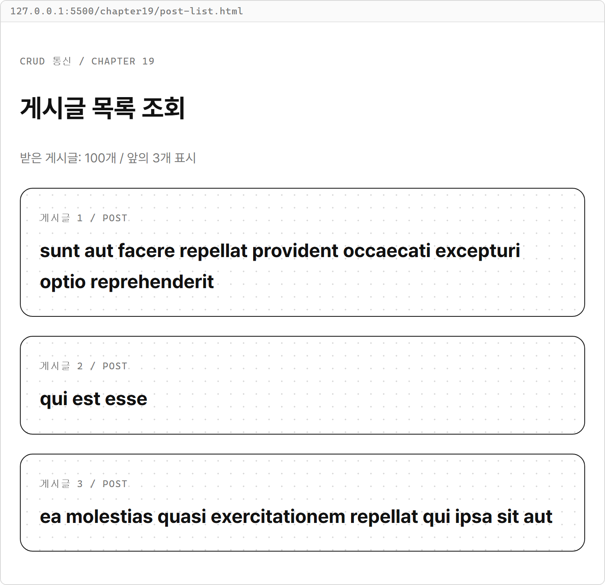

- `response.ok`를 먼저 확인한 뒤 `response.json()`으로 응답 본문을 배열로 바꿉니다.
- `posts.length`는 받은 전체 개수 `100`입니다. `slice(0, 3)`은 화면에 쓸 세 건을 새 배열로 꺼냅니다.
- `map()`과 `join("")`으로 카드 문자열을 만들고 기존 `postList`를 채웁니다.

### 한 건 받기

이번에는 같은 서버의 `/posts/1`로 요청합니다.
조회한 한 건의 `id`, 작성자 번호 `userId`, 제목 `title`, 내용 `body`를 표시합니다.
`body`는 18장에서 본 게시글 내용의 속성 이름입니다.

**예제 19-2** `post-detail.html`

```html
<!DOCTYPE html>
<html lang="ko">
<head>
  <meta charset="UTF-8">
  <title>1번 게시글 조회</title>
  <link rel="stylesheet" href="../css/common.css">
</head>
<body>
  <main class="page">
    <p class="label">CRUD 통신 / CHAPTER 19</p>
    <h1>1번 게시글 조회</h1>
    <p id="message" class="muted"></p>
    <section id="postCard" class="card"></section>
  </main>

  <script>
    const message = document.querySelector("#message");
    const postCard = document.querySelector("#postCard");

    async function main() {
      try {
        const response = await fetch("https://jsonplaceholder.typicode.com/posts/1");
        if (!response.ok) {
          throw new Error(`단건 조회 실패: ${response.status}`);
        }
        const post = await response.json();
        message.innerHTML = `응답 상태: ${response.status}`;
        postCard.innerHTML = `
          <p class="label">게시글 ${post.id} / 작성자 ${post.userId}</p>
          <h2>${post.title}</h2>
          <p>${post.body}</p>
        `;
      } catch (error) {
        message.innerHTML = error.message;
      }
    }

    main();
  </script>
</body>
</html>
```

**실행 결과**

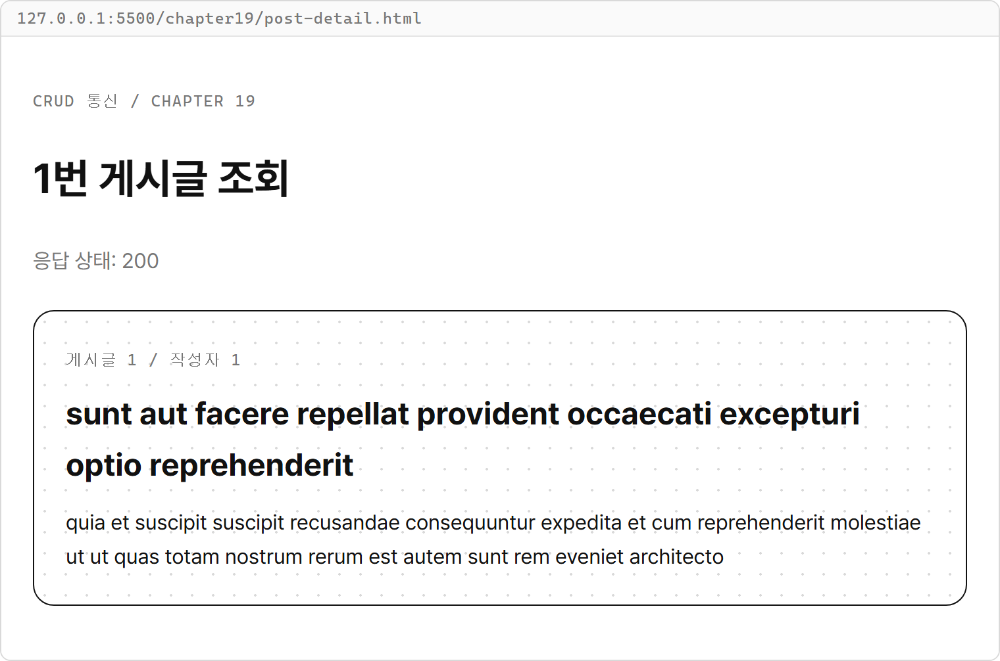

- `/posts/1`의 `1`은 배열 인덱스가 아니라 게시글의 `id`입니다.
- `post`는 배열이 아니므로 `map()` 없이 `post.title`과 `post.body`를 읽습니다.
- `response.status`는 HTTP 응답 상태 코드이며 이 요청에서는 `200`입니다.

## 19-2 POST로 등록

**POST**는 새 데이터를 등록하도록 서버에 요청할 때 쓰는 HTTP 메서드입니다.
목록 주소 `/posts`에 새 게시글 데이터를 함께 보냅니다.
서버는 등록 결과를 나타내는 객체를 응답합니다.

18장에서 본 헤더와 본문은 `fetch()`의 두 번째 인수에 객체로 담습니다.
이 객체를 **요청 옵션**이라고 합니다.
요청 옵션에는 `method`, `headers`, `body` 속성을 씁니다.

| 옵션 | 이 예제의 값 | 역할 |
|---|---|---|
| `method` | `"POST"` | 등록 요청임을 알림 |
| `headers` | `"Content-Type": "application/json; charset=UTF-8"` | 본문 형식과 문자 인코딩을 알림 |
| `body` | `JSON.stringify(newPost)` | 보낼 객체를 JSON 문자열로 변환 |

`headers`의 `Content-Type`은 하이픈이 들어 있는 속성 이름이라 큰따옴표로 감쌉니다.
요청 옵션의 `body`는 전송할 본문이고, 게시글 객체의 `body`는 게시글의 내용입니다.
같은 이름이지만 놓인 객체가 다릅니다.

**특징**

- 등록 요청은 목록 주소 `/posts`로 보냅니다.
- JSON 본문은 JavaScript 객체를 그대로 넣지 않고 `JSON.stringify()`로 바꿔 보냅니다.
- 이 서버의 게시글 등록 응답은 상태 `201`과 새 번호 `101`을 포함합니다.
- JSONPlaceholder는 등록 응답을 만들지만 새 게시글을 실제로 저장하지 않습니다.

공식 안내도 등록·수정·삭제 결과를 서버에 저장하지 않는다고 설명합니다.
이 장의 요청 주소와 가짜 저장 동작은 [JSONPlaceholder 공식 안내](https://jsonplaceholder.typicode.com/)에서 확인할 수 있습니다.
등록을 다시 요청해도 게시글 번호는 `102`로 늘어나지 않고 `101`입니다.

예를 들어 새 게시글을 등록하면 응답 객체에는 `id: 101`이 생깁니다.
하지만 다시 `/posts`를 조회하면 목록은 여전히 100개입니다.
응답 객체와 서버가 제공하는 원래 목록을 구분해 봅니다.

**시각자료 — 등록 응답과 원래 목록**

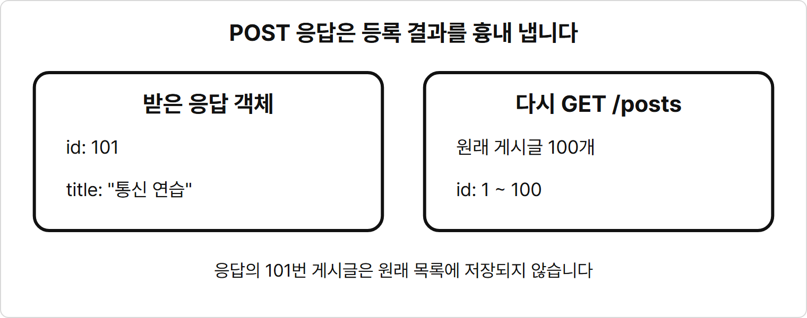

그림의 `101`은 등록 응답에 들어 있는 번호입니다.
다시 조회하는 `/posts` 목록에는 이 번호가 들어 있지 않습니다.

**기본 문법**

```javascript
const 응답 = await fetch("목록 주소", {
  method: "POST",
  headers: { "Content-Type": "application/json; charset=UTF-8" },
  body: JSON.stringify(보낼 객체)
});
const 등록 결과 = await 응답.json();
```

`post-create.html`을 열면 등록 요청을 한 번 보냅니다.
등록 응답을 확인한 뒤에는 새로고침하지 않고 다음 예제로 넘어갑니다.

**예제 19-3** `post-create.html`

```html
<!DOCTYPE html>
<html lang="ko">
<head>
  <meta charset="UTF-8">
  <title>게시글 등록</title>
  <link rel="stylesheet" href="../css/common.css">
</head>
<body>
  <main class="page">
    <p class="label">CRUD 통신 / CHAPTER 19</p>
    <h1>게시글 등록</h1>
    <p id="message" class="muted"></p>
    <section id="postCard" class="card"></section>
  </main>

  <script>
    const message = document.querySelector("#message");
    const postCard = document.querySelector("#postCard");

    async function main() {
      try {
        const newPost = {
          userId: 1,
          title: "통신 연습",
          body: "POST로 보낸 게시글입니다."
        };
        const response = await fetch("https://jsonplaceholder.typicode.com/posts", {
          method: "POST",
          headers: {
            "Content-Type": "application/json; charset=UTF-8"
          },
          body: JSON.stringify(newPost)
        });
        if (!response.ok) {
          throw new Error(`등록 실패: ${response.status}`);
        }
        const post = await response.json();
        message.innerHTML = `응답 상태: ${response.status} / 등록된 번호: ${post.id}`;
        postCard.innerHTML = `
          <p class="label">게시글 ${post.id} / 작성자 ${post.userId}</p>
          <h2>${post.title}</h2>
          <p>${post.body}</p>
        `;
      } catch (error) {
        message.innerHTML = error.message;
      }
    }

    main();
  </script>
</body>
</html>
```

**실행 결과**

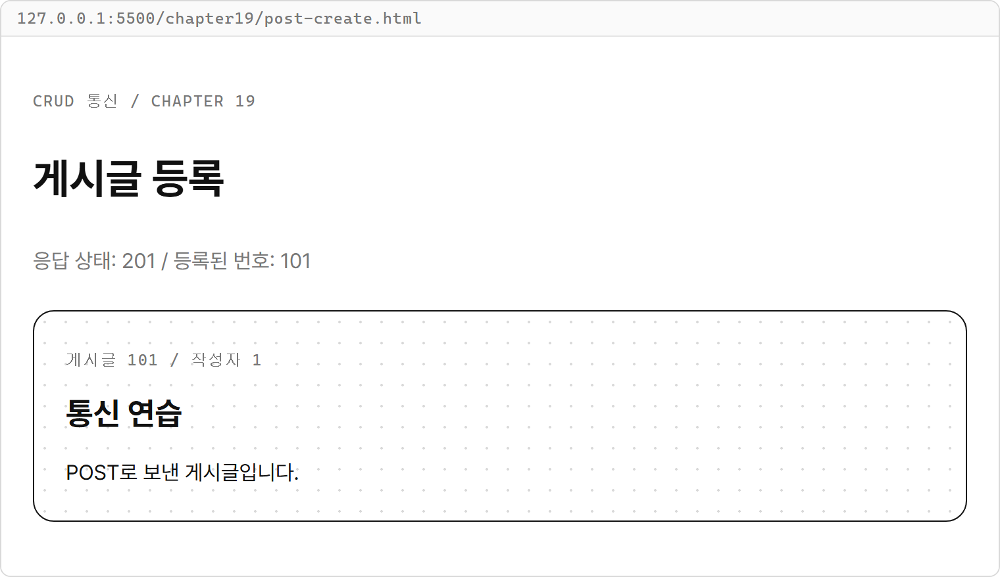

- `newPost`에는 작성자 번호와 제목, 내용을 넣었습니다. 새 `id`는 요청 객체에서 정하지 않습니다.
- `method: "POST"`와 `body: JSON.stringify(newPost)`가 등록할 데이터를 서버에 보냅니다.
- `await response.json()`으로 받은 `post`의 속성을 그대로 카드에 반영합니다.
- 이 요청에서는 `201`이므로 `response.ok`도 `true`입니다. `response.ok`는 상태 코드가 200~299일 때 `true`입니다.

## 19-3 PUT으로 수정

**PUT**은 지정한 자원의 전체 데이터를 바꾸도록 요청할 때 쓰는 HTTP 메서드입니다.
이 예제에서는 `/posts/1`에 1번 게시글의 번호, 작성자, 제목, 내용을 모두 보냅니다.
제목만 바꾸고 싶어도 유지할 나머지 값까지 함께 담습니다.

**특징**

- 수정할 번호는 `/posts/1`처럼 요청 주소에 넣습니다.
- `method`는 `"PUT"`이며 JSON 헤더와 본문을 함께 보냅니다.
- 이 서버는 보낸 값을 반영한 1번 게시글 객체를 응답합니다.
- JSONPlaceholder는 수정 결과도 저장하지 않아 다시 조회하면 원래 값이 나옵니다.

**비교 — POST와 PUT**

| 비교 항목 | POST | PUT |
|---|---|---|
| 이 장에서 하는 일 | 새 게시글 등록 | 기존 게시글 전체 수정 |
| 요청 주소 | `/posts` | `/posts/1` |
| 응답 번호 | 새 번호 `101` | 기존 번호 `1` |
| 이번 응답 상태 | `201` | `200` |

**기본 문법**

```javascript
const 응답 = await fetch("목록 주소/번호", {
  method: "PUT",
  headers: { "Content-Type": "application/json; charset=UTF-8" },
  body: JSON.stringify(전체 항목 객체)
});
const 수정 결과 = await 응답.json();
```

`post-update.html`을 한 번 열어 1번 게시글의 수정 응답을 확인합니다.
앞 예제에서 등록한 `101`번은 실제로 저장되지 않았으므로 수정 대상으로 쓰지 않습니다.

**예제 19-4** `post-update.html`

```html
<!DOCTYPE html>
<html lang="ko">
<head>
  <meta charset="UTF-8">
  <title>1번 게시글 수정</title>
  <link rel="stylesheet" href="../css/common.css">
</head>
<body>
  <main class="page">
    <p class="label">CRUD 통신 / CHAPTER 19</p>
    <h1>1번 게시글 수정</h1>
    <p id="message" class="muted"></p>
    <section id="postCard" class="card"></section>
  </main>

  <script>
    const message = document.querySelector("#message");
    const postCard = document.querySelector("#postCard");

    async function main() {
      try {
        const changedPost = {
          id: 1,
          userId: 1,
          title: "통신 연습 수정",
          body: "PUT으로 바꾼 게시글입니다."
        };
        const response = await fetch("https://jsonplaceholder.typicode.com/posts/1", {
          method: "PUT",
          headers: {
            "Content-Type": "application/json; charset=UTF-8"
          },
          body: JSON.stringify(changedPost)
        });
        if (!response.ok) {
          throw new Error(`수정 실패: ${response.status}`);
        }
        const post = await response.json();
        message.innerHTML = `응답 상태: ${response.status} / 수정된 번호: ${post.id}`;
        postCard.innerHTML = `
          <p class="label">게시글 ${post.id} / 작성자 ${post.userId}</p>
          <h2>${post.title}</h2>
          <p>${post.body}</p>
        `;
      } catch (error) {
        message.innerHTML = error.message;
      }
    }

    main();
  </script>
</body>
</html>
```

**실행 결과**

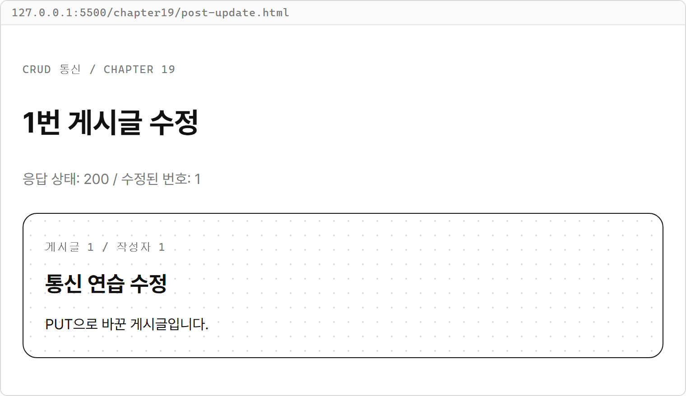

- `/posts/1`로 요청하므로 등록과 달리 수정할 대상이 이미 정해져 있습니다.
- `changedPost`는 수정 후의 전체 게시글입니다. 이 예제는 제목뿐 아니라 내용도 새 값으로 바꿉니다.
- 응답의 `post.id`는 `1`입니다. 화면에는 수정 요청의 본문 대신 서버가 응답한 객체를 표시합니다.

## 19-4 DELETE로 삭제

**DELETE**는 지정한 자원을 삭제하도록 서버에 요청할 때 쓰는 HTTP 메서드입니다.
`/posts/1`에 보내면 삭제 대상은 1번 게시글입니다.
삭제할 대상이 주소에 있으므로 이 예제에는 JSON 헤더와 본문을 넣지 않습니다.

**특징**

- 요청 옵션에 `method: "DELETE"`를 넣습니다.
- JSONPlaceholder의 게시글 삭제 성공 응답은 상태 `200`과 빈 객체 `{}`입니다.
- JSONPlaceholder는 삭제 결과를 저장하지 않아 다시 조회하면 1번 게시글이 나옵니다.

**기본 문법**

```javascript
const 응답 = await fetch("목록 주소/번호", {
  method: "DELETE"
});
```

`post-delete.html`을 한 번 열어 응답 상태와 본문을 확인합니다.
삭제 성공 여부는 `response.ok`로 확인하며, 빈 객체를 보고 실패라고 판단하지 않습니다.

**예제 19-5** `post-delete.html`

```html
<!DOCTYPE html>
<html lang="ko">
<head>
  <meta charset="UTF-8">
  <title>1번 게시글 삭제</title>
  <link rel="stylesheet" href="../css/common.css">
</head>
<body>
  <main class="page">
    <p class="label">CRUD 통신 / CHAPTER 19</p>
    <h1>1번 게시글 삭제</h1>
    <section class="card">
      <p id="message"></p>
      <p id="result" class="muted"></p>
    </section>
  </main>

  <script>
    const message = document.querySelector("#message");
    const result = document.querySelector("#result");

    async function main() {
      try {
        const response = await fetch("https://jsonplaceholder.typicode.com/posts/1", {
          method: "DELETE"
        });
        if (!response.ok) {
          throw new Error(`삭제 실패: ${response.status}`);
        }
        const data = await response.json();
        message.innerHTML = `1번 삭제 요청 성공 / 응답 상태: ${response.status}`;
        result.innerHTML = `응답 본문: ${JSON.stringify(data)}`;
      } catch (error) {
        message.innerHTML = error.message;
      }
    }

    main();
  </script>
</body>
</html>
```

**실행 결과**

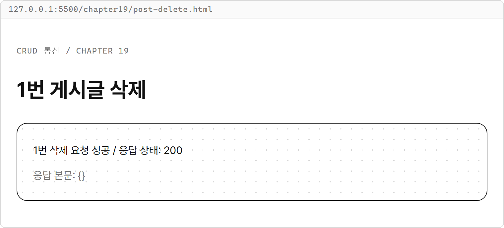

- `response.ok`를 확인한 뒤에만 삭제 요청 성공 안내를 표시합니다.
- `JSON.stringify(data)`로 응답 객체 `{}`를 JSON 문자열로 바꿔 표시합니다.
- 여기서 `response.json()`을 쓸 수 있는 것은 이 서버가 JSON 본문을 돌려주기 때문입니다. 다른 API가 `204`처럼 본문 없는 응답을 주면 JSON 변환 없이 상태만 확인합니다.

## 19-5 오류 메시지 표시

18장에서는 `response.ok`가 `false`일 때 `throw new Error()`로 `catch`에 보냈습니다.
이 장에서도 같은 흐름을 쓰되, `error.message`를 페이지의 `message` 요소에 표시합니다.
오류가 난 뒤에는 성공한 것처럼 상태 배열을 바꾸지 않습니다.

**특징**

- HTTP 실패는 `response.ok`를 검사해 직접 `throw`로 보냅니다.
- 네트워크 오류가 나면 `await fetch()`에서 `catch`로 이동합니다.
- `catch`의 `error.message`를 화면에 표시하면 사용자가 실패를 확인할 수 있습니다.

**시각자료 — 요청 성공 처리**

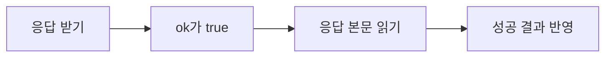

응답을 받았고 `response.ok`가 `true`일 때만 본문을 읽고 성공 결과를 반영합니다.

**시각자료 — HTTP 실패 처리**

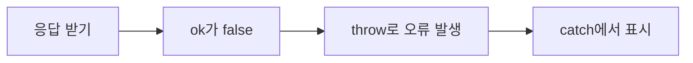

HTTP 실패는 응답을 받은 뒤에 확인합니다.
`throw`에서 `catch`로 가므로 성공 결과를 반영하는 코드를 건너뜁니다.

**시각자료 — 네트워크 오류 처리**

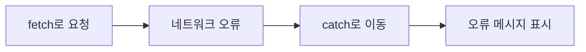

네트워크 오류는 응답을 받지 못한 채 `catch`로 갑니다.
두 실패 경로 모두 메시지를 표시하고, 성공한 것처럼 상태를 바꾸지 않습니다.

**기본 문법**

```javascript
try {
  const 응답 = await fetch("요청 주소");
  if (!응답.ok) {
    throw new Error(`요청 실패: ${응답.status}`);
  }
  // 성공 결과를 반영하는 코드
} catch (error) {
  메시지 요소.innerHTML = error.message;
}
```

다음 예제는 실패 표시를 확인하려고 없는 `/posts/999`를 일부러 요청합니다.
본문에 빈 객체가 와도 성공 결과로 처리하지 않고 상태 `404`에서 오류를 발생시킵니다.

**예제 19-6** `request-error.html`

```html
<!DOCTYPE html>
<html lang="ko">
<head>
  <meta charset="UTF-8">
  <title>오류 메시지 표시</title>
  <link rel="stylesheet" href="../css/common.css">
</head>
<body>
  <main class="page">
    <p class="label">CRUD 통신 / CHAPTER 19</p>
    <h1>오류 메시지 표시</h1>
    <section class="card">
      <p id="message">요청 결과를 확인합니다.</p>
      <p id="result" class="muted">게시글을 표시하지 않았습니다.</p>
    </section>
  </main>

  <script>
    const message = document.querySelector("#message");
    const result = document.querySelector("#result");

    async function main() {
      try {
        const response = await fetch("https://jsonplaceholder.typicode.com/posts/999");
        if (!response.ok) {
          throw new Error(`게시글 조회 실패: ${response.status}`);
        }
        const post = await response.json();
        result.innerHTML = post.title;
      } catch (error) {
        message.innerHTML = error.message;
        console.log(error.name, error.message);
      }
      console.log("요청 처리를 마쳤습니다.");
    }

    main();
  </script>
</body>
</html>
```

**실행 결과**

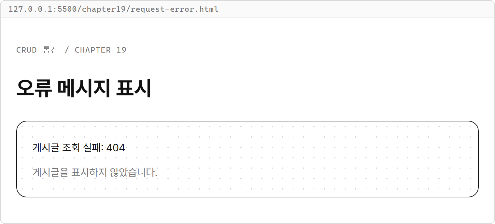

Console 탭에서 `console.log()`가 출력한 두 줄은 다음과 같습니다.

```text
Error 게시글 조회 실패: 404
요청 처리를 마쳤습니다.
```

- `throw new Error(...)`에서 만든 오류의 이름은 `Error`, 메시지는 `게시글 조회 실패: 404`입니다.
- `throw`가 있는 줄에서 `catch`로 이동하므로 `result.innerHTML = post.title;`은 실행되지 않습니다.
- `message.innerHTML = error.message;`는 `catch`가 받은 오류의 메시지를 화면에 표시합니다.
- 오류를 처리했으므로 `try`·`catch` 아래의 `요청 처리를 마쳤습니다.` 출력까지 실행됩니다.

## 따라하기 실습 — 할 일 목록 등록·수정·삭제 통신

**실습 목표**

- GET으로 받은 할 일을 상태 배열 `todos`에 담고 카드로 그립니다.
- 한 폼에서 POST 등록과 PUT 수정을 구분하고 응답을 불변 업데이트로 반영합니다.
- DELETE에 성공한 뒤 해당 항목을 목록에서 빼고 실패하면 메시지를 표시합니다.

이 실습은 14장의 `todos`, `todoForm`, `titleInput`, `editingId`, `render()` 이름을 이어 씁니다.
이번에는 `/todos`의 응답을 그대로 쓰므로 완료 속성 이름이 `isDone`이 아니라 `completed`입니다.
할 일 객체는 `userId`, `id`, `title`, `completed`를 가집니다.
새 번호는 `nextId`로 만들지 않고 POST 응답에서 받습니다.

| 요청 | 성공 뒤 상태 변경 | 화면 갱신 |
|---|---|---|
| GET | `todos = 응답 배열` | 받은 목록 표시 |
| POST | `[...todos, savedTodo]` | 응답 항목 추가 |
| PUT | `map()`으로 응답 항목 교체 | 고른 항목 수정 |
| DELETE | `filter()`로 번호 제외 | 고른 항목 제거 |

수정 버튼은 `editingId`와 입력값을 정할 뿐 서버에 요청하지 않습니다.
수정 저장 버튼을 눌렀을 때 한 항목을 PUT으로 보냅니다.
다른 수정 버튼을 누르면 대상이 그 항목으로 바뀌므로 동시에 편집하는 대상은 하나입니다.

**시각자료 — 응답을 상태 배열에 반영하는 순서**

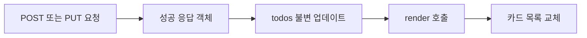

그림은 성공 경로입니다.
실패 경로에서는 19-5처럼 메시지를 표시하며 배열 변경과 `render()`를 건너뜁니다.
DELETE는 응답에 항목 정보가 없으므로 성공 상태를 확인한 뒤 요청한 번호로 목록에서 뺍니다.

**준비**

1. `js-course/chapter19`에 `todo-crud.html`을 만듭니다.
2. 공통 CSS 파일은 `js-course/css/common.css`를 그대로 씁니다.
3. 아래 전체 코드를 저장합니다.

**실습 코드**

`chapter19/todo-crud.html`

```html
<!DOCTYPE html>
<html lang="ko">
<head>
  <meta charset="UTF-8">
  <title>할 일 CRUD 통신</title>
  <link rel="stylesheet" href="../css/common.css">
</head>
<body>
  <main class="page">
    <p class="label">CRUD 통신 / CHAPTER 19</p>
    <h1>할 일 CRUD 통신</h1>
    <form id="todoForm" class="form">
      <label class="label" for="titleInput">제목 / TITLE</label>
      <input id="titleInput" class="title-input" placeholder="할 일을 입력하세요" required>
      <div class="button-group">
        <button id="submitButton" class="btn selected" type="submit">등록</button>
      </div>
    </form>
    <p id="message" class="muted"></p>
    <section id="todoList" class="card-list" style="grid-template-columns: repeat(2, 1fr);"></section>
  </main>

  <script>
    const todoForm = document.querySelector("#todoForm");
    const titleInput = document.querySelector("#titleInput");
    const submitButton = document.querySelector("#submitButton");
    const message = document.querySelector("#message");
    const todoList = document.querySelector("#todoList");
    let todos = [];
    let editingId = null;

    function render() {
      todoList.innerHTML = todos.map((todo) => `
        <article class="card">
          <span class="badge">${todo.completed ? "완료" : "진행"}</span>
          <p class="label">할 일 ${todo.id} / TODO</p>
          <h2>${todo.title}</h2>
          <div class="button-group">
            <button class="btn" data-action="edit" data-id="${todo.id}">수정</button>
            <button class="btn" data-action="delete" data-id="${todo.id}">삭제</button>
          </div>
        </article>
      `).join("");
    }

    async function main() {
      try {
        const response = await fetch("https://jsonplaceholder.typicode.com/todos?_limit=3");
        if (!response.ok) {
          throw new Error(`목록 조회 실패: ${response.status}`);
        }
        todos = await response.json();
        render();
        message.innerHTML = `할 일 ${todos.length}개를 받았습니다.`;
      } catch (error) {
        message.innerHTML = error.message;
      }
    }

    async function handleSubmit(e) {
      e.preventDefault();
      const title = titleInput.value.trim();
      if (title === "") {
        message.innerHTML = "제목을 입력하세요.";
        return;
      }

      try {
        if (editingId === null) {
          const newTodo = { userId: 1, title: title, completed: false };
          const response = await fetch("https://jsonplaceholder.typicode.com/todos", {
            method: "POST",
            headers: { "Content-Type": "application/json; charset=UTF-8" },
            body: JSON.stringify(newTodo)
          });
          if (!response.ok) {
            throw new Error(`등록 실패: ${response.status}`);
          }
          const savedTodo = await response.json();
          todos = [...todos, savedTodo];
          message.innerHTML = `${savedTodo.id}번 등록 요청 성공`;
        } else {
          const selectedTodo = todos.find((todo) => todo.id === editingId);
          const changedTodo = { ...selectedTodo, title: title };
          const response = await fetch(`https://jsonplaceholder.typicode.com/todos/${editingId}`, {
            method: "PUT",
            headers: { "Content-Type": "application/json; charset=UTF-8" },
            body: JSON.stringify(changedTodo)
          });
          if (!response.ok) {
            throw new Error(`수정 실패: ${response.status}`);
          }
          const savedTodo = await response.json();
          todos = todos.map((todo) => todo.id === savedTodo.id ? savedTodo : todo);
          message.innerHTML = `${savedTodo.id}번 수정 요청 성공`;
        }
        editingId = null;
        titleInput.value = "";
        submitButton.innerHTML = "등록";
        render();
      } catch (error) {
        message.innerHTML = error.message;
      }
    }

    async function handleListClick(e) {
      const action = e.target.dataset.action;
      const id = Number(e.target.dataset.id);
      if (action === "edit") {
        const selectedTodo = todos.find((todo) => todo.id === id);
        editingId = id;
        titleInput.value = selectedTodo.title;
        submitButton.innerHTML = "수정 저장";
        message.innerHTML = `${id}번 수정 중`;
      }
      if (action === "delete") {
        try {
          const response = await fetch(`https://jsonplaceholder.typicode.com/todos/${id}`, {
            method: "DELETE"
          });
          if (!response.ok) {
            throw new Error(`삭제 실패: ${response.status}`);
          }
          todos = todos.filter((todo) => todo.id !== id);
          if (editingId === id) {
            editingId = null;
            titleInput.value = "";
            submitButton.innerHTML = "등록";
          }
          render();
          message.innerHTML = `${id}번 삭제 요청 성공 / 응답 상태: ${response.status}`;
        } catch (error) {
          message.innerHTML = error.message;
        }
      }
    }

    todoForm.addEventListener("submit", handleSubmit);
    todoList.addEventListener("click", handleListClick);
    main();
  </script>
</body>
</html>
```

**실행 방법**

1. `todo-crud.html`을 열고 1·2·3번 카드가 나타난 뒤 조작합니다.
2. 1번 카드의 수정 버튼을 누르고 제목을 `JavaScript 복습`으로 바꿉니다.
3. 수정 저장 버튼을 한 번 누르고 `1번 수정 요청 성공`을 확인합니다.
4. 1번 카드의 삭제 버튼을 한 번 누르고 카드가 없어지는지 확인합니다.
5. 입력칸에 `산책하기`를 적고 등록 버튼을 한 번 누릅니다.
6. 201번 카드와 `201번 등록 요청 성공`을 확인합니다.

가짜 서버에서는 새 할 일 번호도 등록할 때마다 `201`입니다.
이 실습에서는 서버에 원래 있는 1번만 수정·삭제하고 등록은 한 번만 합니다.
201번은 실제로 저장되지 않아 다시 조회하거나 수정할 대상으로 쓰지 않습니다.

**실행 결과**

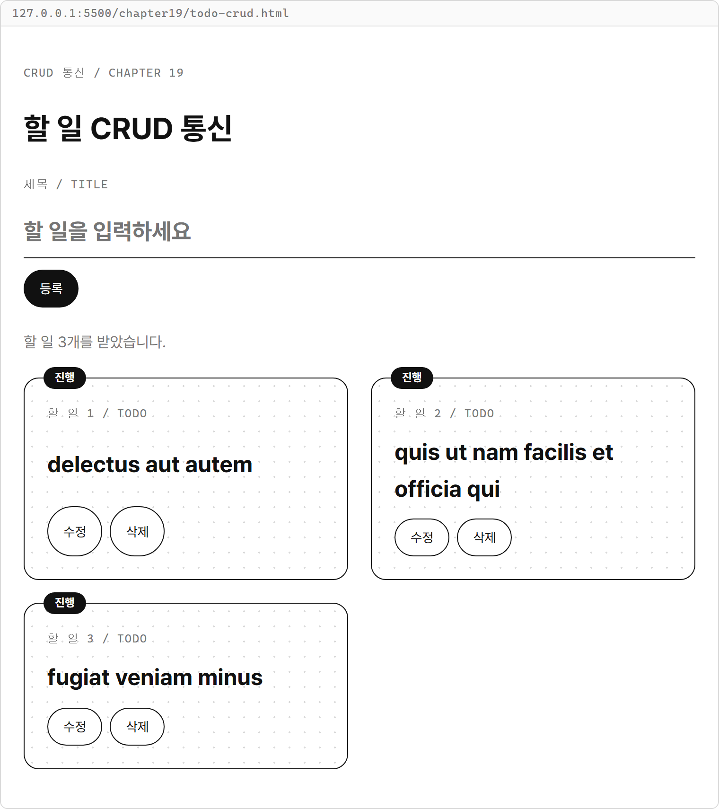

1번을 선택해 제목을 바꾸고 수정 저장을 누릅니다.

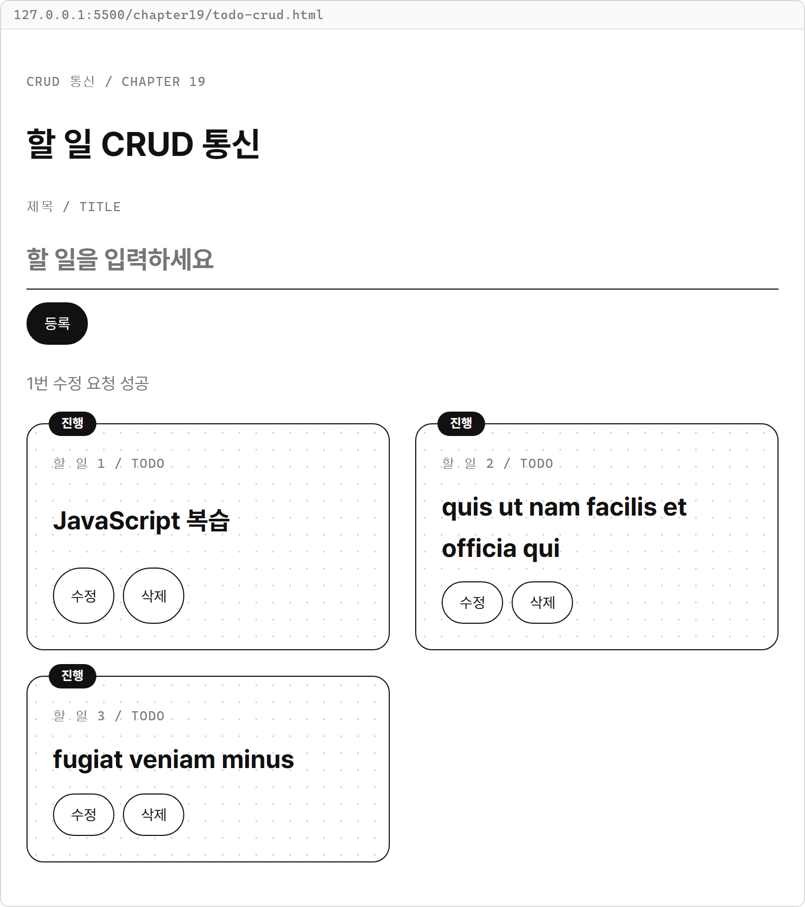

수정된 1번 카드의 삭제 버튼을 누릅니다.

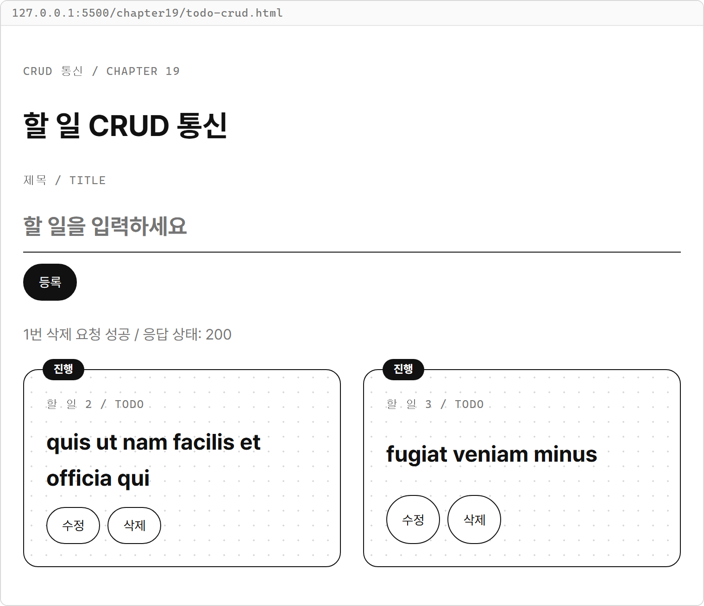

`산책하기`를 한 번 등록합니다.


**코드 설명**

- `main()`은 처음 목록을 받는 코드입니다. `render()`는 목록만 다시 그리므로 입력칸은 그대로 남습니다.
- `editingId === null`이면 POST, 번호가 있으면 그 번호에 PUT을 보냅니다.
- `{ ...selectedTodo, title: title }`은 번호·작성자·완료 여부를 유지한 전체 할 일 객체입니다.
- `todos.map((todo) => todo.id === savedTodo.id ? savedTodo : todo)`는 같은 번호만 응답 객체로 바꿉니다.
- 삭제는 `response.ok`를 확인한 뒤에 `filter()`로 반영합니다. 빈 응답 객체를 목록에 넣지 않습니다.
- `catch`에서는 배열을 바꾸거나 입력칸을 비우지 않습니다. 요청 실패 안내와 입력값을 확인할 수 있습니다.
- 버튼 안에는 글자만 있으므로 `e.target.dataset`으로 버튼의 동작과 번호를 읽습니다.
- `editingId === id`인 카드를 삭제하면 수정 상태도 비웁니다. 다른 카드를 삭제할 때는 현재 수정값을 유지합니다.

화면에 등록·수정·삭제 결과가 남는 것은 브라우저의 `todos`를 바꿨기 때문입니다.
요청 직후 GET으로 다시 받아 오면 가짜 서버의 원래 목록으로 돌아갑니다.
페이지를 새로고침해도 다시 초기 세 건을 받습니다.

**바꿔 보기 1**

등록할 할 일을 완료 상태로 보내 봅니다.
원래 `todo-crud.html`의 `const newTodo = { userId: 1, title: title, completed: false };` 줄을 다음처럼 바꿉니다.

```javascript
const newTodo = { userId: 1, title: title, completed: true };
```

페이지를 다시 열고 실행 방법의 수정·삭제·등록을 한 번씩 반복합니다.
새로 등록한 201번 `산책하기` 카드의 배지가 `완료`가 됩니다.
서버 응답의 `completed` 값을 그대로 썼기 때문에 표시도 함께 바뀝니다.

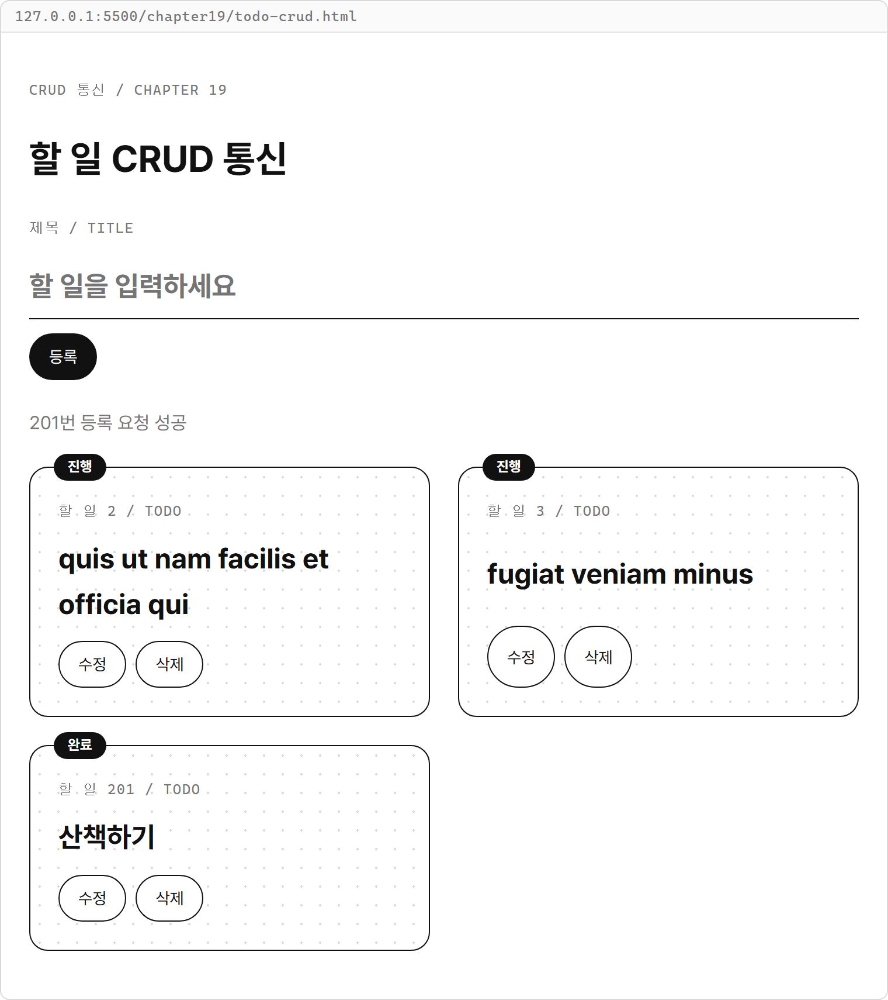

**바꿔 보기 2**

받을 목록의 개수를 두 개로 줄여 봅니다.
원래 실습 코드로 되돌린 뒤, `main()`의 `const response = await fetch("https://jsonplaceholder.typicode.com/todos?_limit=3");` 줄을 다음처럼 바꿉니다.

```javascript
const response = await fetch("https://jsonplaceholder.typicode.com/todos?_limit=2");
```

페이지를 다시 열면 1·2번 카드 두 개가 나옵니다.
같은 순서로 1번을 수정·삭제하고 `산책하기`를 한 번 등록하면 2·201번 카드 두 개가 남습니다.
이번에는 서버가 처음부터 두 건만 보내므로 받은 배열의 길이도 `2`입니다.

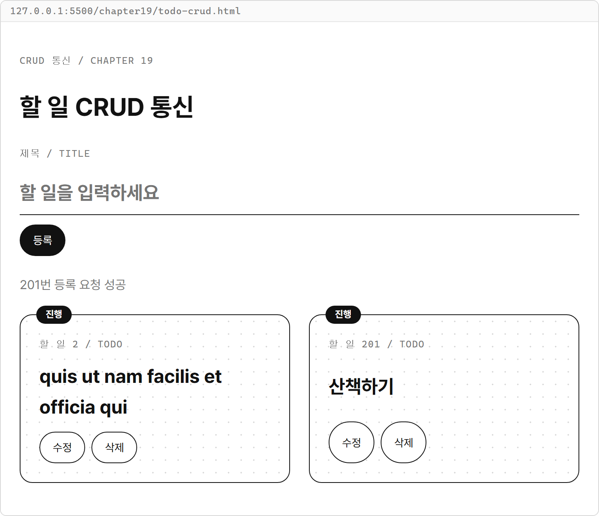

## 연습문제

### 연습문제 1 — 댓글 목록 조회와 등록

**요구사항**

1. `chapter19/comment-crud.html`을 만들고 공통 CSS를 연결합니다.
2. GET `/comments?postId=1`로 1번 게시글의 댓글 목록을 받습니다. `postId=1`은 게시글 번호가 1인 댓글을 고르는 조건입니다.
3. 각 댓글의 번호 `id`, 게시글 번호 `postId`, 이름 `name`, 이메일 `email`, 내용 `body`를 카드에 표시합니다.
4. 이름·이메일·댓글 입력칸과 등록 버튼이 있는 폼을 만듭니다. 공백만 입력한 값은 등록하지 않습니다.
5. POST `/comments`로 `postId: 1`과 입력값을 보내고 응답 객체를 상태 배열 끝에 추가합니다.
6. 등록은 한 번만 합니다. 성공하면 댓글 입력칸만 비우고, 실패하면 메시지를 표시합니다.

**완료 조건**

- 처음에는 1번 게시글의 댓글 다섯 개가 보입니다.
- 이름 `김코딩`, 이메일 `coding@example.com`, 내용 `설명이 도움이 되었습니다.`를 등록하면 501번 댓글이 끝에 붙습니다.
- 성공 안내는 `501번 댓글 등록 요청 성공 / 댓글 6개`입니다.
- 다시 GET으로 덮어쓰지 않고 받은 응답을 상태 배열에 추가합니다.

### 연습문제 2 — 사용자 정보 수정 폼

**요구사항**

1. `chapter19/user-edit.html`을 만들고 공통 CSS를 연결합니다.
2. GET `/users/1`로 받은 사용자 객체를 `user`에 담고 이름·이메일을 폼에 채웁니다.
3. 카드에 이름 `name`, 이메일 `email`, 아이디 `username`, 도시 `address.city`를 표시합니다.
4. 이름과 이메일을 수정해 제출하면 PUT `/users/1`로 사용자 전체 객체를 보냅니다. 수정하지 않은 속성은 객체 전개로 유지합니다.
5. 서버 응답을 `user`에 다시 담고 카드를 그립니다. 이름과 이메일이 공백뿐이면 요청하지 않습니다.
6. 수정은 한 번만 하고 요청 실패 메시지도 화면에 표시합니다.

**완료 조건**

- 처음 조회한 이름과 이메일이 폼과 카드에 같습니다.
- 이름을 `김코딩`, 이메일을 `coding@example.com`으로 수정하면 응답 카드에도 같은 값이 나옵니다.
- 아이디와 도시 값은 원래 값 `Bret`, `Gwenborough`를 유지합니다.
- 성공 안내는 `1번 사용자 수정 요청 성공 / 응답 상태: 200`입니다.

## 정답과 해설

### 연습문제 1 — 댓글 목록 조회와 등록

`comment-crud.html`

```html
<!DOCTYPE html>
<html lang="ko">
<head>
  <meta charset="UTF-8">
  <title>댓글 목록 조회와 등록</title>
  <link rel="stylesheet" href="../css/common.css">
</head>
<body>
  <main class="page">
    <p class="label">CRUD 통신 / CHAPTER 19</p>
    <h1>댓글 목록 조회와 등록</h1>
    <form id="commentForm" class="form">
      <label class="label" for="nameInput">이름 / NAME</label>
      <input id="nameInput" class="input" value="김코딩" required>
      <label class="label" for="emailInput">이메일 / EMAIL</label>
      <input id="emailInput" class="input" type="email" value="coding@example.com" required>
      <label class="label" for="bodyInput">댓글 / BODY</label>
      <input id="bodyInput" class="title-input" placeholder="댓글을 입력하세요" required>
      <div class="button-group">
        <button class="btn selected" type="submit">댓글 등록</button>
      </div>
    </form>
    <p id="message" class="muted"></p>
    <section id="commentList" class="card-list" style="grid-template-columns: 1fr;"></section>
  </main>

  <script>
    const commentForm = document.querySelector("#commentForm");
    const nameInput = document.querySelector("#nameInput");
    const emailInput = document.querySelector("#emailInput");
    const bodyInput = document.querySelector("#bodyInput");
    const message = document.querySelector("#message");
    const commentList = document.querySelector("#commentList");
    let comments = [];

    function render() {
      commentList.innerHTML = comments.map((comment) => `
        <article class="card">
          <p class="label">댓글 ${comment.id} / 게시글 ${comment.postId}</p>
          <h2>${comment.name}</h2>
          <p>${comment.email}</p>
          <p>${comment.body}</p>
        </article>
      `).join("");
    }

    async function main() {
      try {
        const response = await fetch("https://jsonplaceholder.typicode.com/comments?postId=1");
        if (!response.ok) {
          throw new Error(`댓글 조회 실패: ${response.status}`);
        }
        comments = await response.json();
        render();
        message.innerHTML = `1번 게시글의 댓글: ${comments.length}개`;
      } catch (error) {
        message.innerHTML = error.message;
      }
    }

    async function handleSubmit(e) {
      e.preventDefault();
      const name = nameInput.value.trim();
      const email = emailInput.value.trim();
      const body = bodyInput.value.trim();
      if (name === "" || email === "" || body === "") {
        message.innerHTML = "이름, 이메일, 댓글을 입력하세요.";
        return;
      }
      try {
        const newComment = { postId: 1, name: name, email: email, body: body };
        const response = await fetch("https://jsonplaceholder.typicode.com/comments", {
          method: "POST",
          headers: { "Content-Type": "application/json; charset=UTF-8" },
          body: JSON.stringify(newComment)
        });
        if (!response.ok) {
          throw new Error(`댓글 등록 실패: ${response.status}`);
        }
        const savedComment = await response.json();
        comments = [...comments, savedComment];
        render();
        bodyInput.value = "";
        message.innerHTML = `${savedComment.id}번 댓글 등록 요청 성공 / 댓글 ${comments.length}개`;
      } catch (error) {
        message.innerHTML = error.message;
      }
    }

    commentForm.addEventListener("submit", handleSubmit);
    main();
  </script>
</body>
</html>
```

**실행 결과**

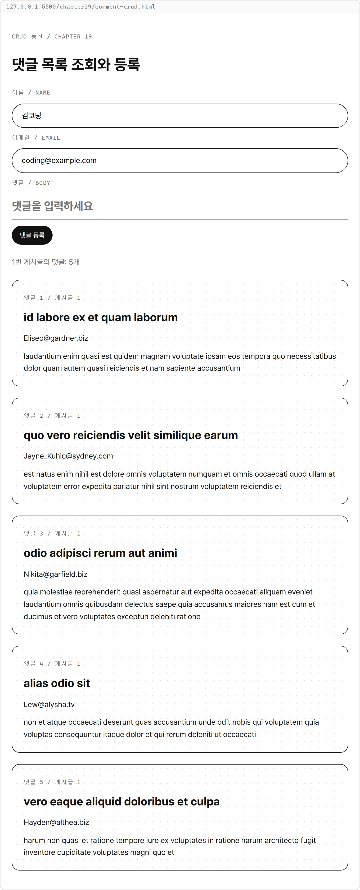

이름 `김코딩`, 이메일 `coding@example.com`을 그대로 두고 `설명이 도움이 되었습니다.`를 한 번 등록합니다.

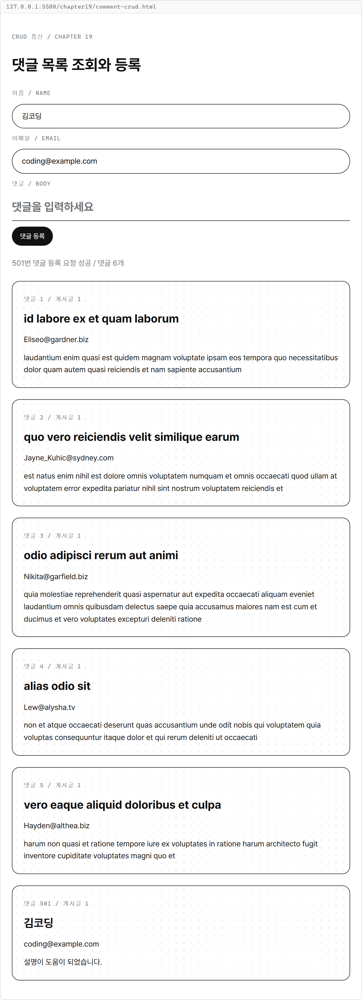

**해설**

- `comments?postId=1`은 전체 댓글 중 게시글 번호가 1인 목록을 조회합니다.
- `newComment`에는 게시글과의 연결을 나타내는 `postId: 1`을 넣고 새 `id`는 응답에서 받습니다.
- `comments = [...comments, savedComment];`로 기존 다섯 건을 유지하고 응답 한 건을 끝에 추가합니다.
- `bodyInput.value = "";`만 실행하므로 이름과 이메일은 입력칸에 남습니다.
- 응답의 501번은 실제 저장된 번호가 아닙니다. 새로고침하면 원래 다섯 건으로 돌아갑니다.

### 연습문제 2 — 사용자 정보 수정 폼

`user-edit.html`

```html
<!DOCTYPE html>
<html lang="ko">
<head>
  <meta charset="UTF-8">
  <title>사용자 정보 수정 폼</title>
  <link rel="stylesheet" href="../css/common.css">
</head>
<body>
  <main class="page">
    <p class="label">CRUD 통신 / CHAPTER 19</p>
    <h1>사용자 정보 수정 폼</h1>
    <form id="userForm" class="form">
      <label class="label" for="nameInput">이름 / NAME</label>
      <input id="nameInput" class="title-input" required>
      <label class="label" for="emailInput">이메일 / EMAIL</label>
      <input id="emailInput" class="input" type="email" required>
      <div class="button-group">
        <button class="btn selected" type="submit">수정 저장</button>
      </div>
    </form>
    <p id="message" class="muted"></p>
    <section id="userCard" class="card"></section>
  </main>

  <script>
    const userForm = document.querySelector("#userForm");
    const nameInput = document.querySelector("#nameInput");
    const emailInput = document.querySelector("#emailInput");
    const message = document.querySelector("#message");
    const userCard = document.querySelector("#userCard");
    let user = null;

    function render() {
      userCard.innerHTML = `
        <p class="label">사용자 ${user.id} / USER</p>
        <h2>${user.name}</h2>
        <p>${user.email}</p>
        <p>아이디: ${user.username} / 도시: ${user.address.city}</p>
      `;
    }

    async function main() {
      try {
        const response = await fetch("https://jsonplaceholder.typicode.com/users/1");
        if (!response.ok) {
          throw new Error(`사용자 조회 실패: ${response.status}`);
        }
        user = await response.json();
        nameInput.value = user.name;
        emailInput.value = user.email;
        render();
        message.innerHTML = "1번 사용자 정보를 받았습니다.";
      } catch (error) {
        message.innerHTML = error.message;
      }
    }

    async function handleSubmit(e) {
      e.preventDefault();
      if (user === null) {
        message.innerHTML = "사용자 조회에 성공한 뒤 수정하세요.";
        return;
      }
      const name = nameInput.value.trim();
      const email = emailInput.value.trim();
      if (name === "" || email === "") {
        message.innerHTML = "이름과 이메일을 입력하세요.";
        return;
      }
      try {
        const changedUser = { ...user, name: name, email: email };
        const response = await fetch("https://jsonplaceholder.typicode.com/users/1", {
          method: "PUT",
          headers: { "Content-Type": "application/json; charset=UTF-8" },
          body: JSON.stringify(changedUser)
        });
        if (!response.ok) {
          throw new Error(`사용자 수정 실패: ${response.status}`);
        }
        user = await response.json();
        render();
        message.innerHTML = `1번 사용자 수정 요청 성공 / 응답 상태: ${response.status}`;
      } catch (error) {
        message.innerHTML = error.message;
      }
    }

    userForm.addEventListener("submit", handleSubmit);
    main();
  </script>
</body>
</html>
```

**실행 결과**

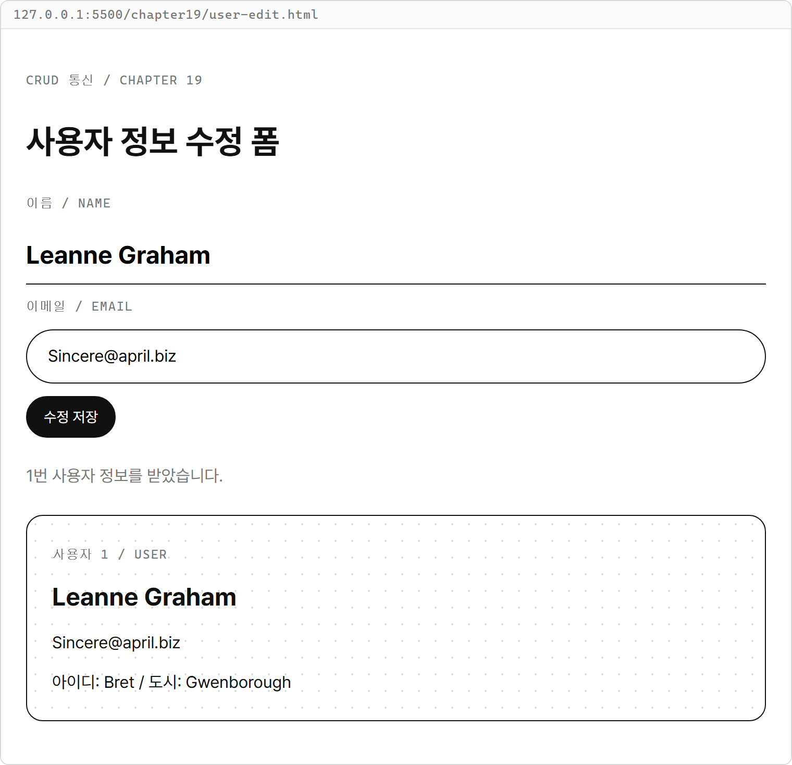

이름을 `김코딩`, 이메일을 `coding@example.com`으로 바꾸고 수정 저장을 한 번 누릅니다.

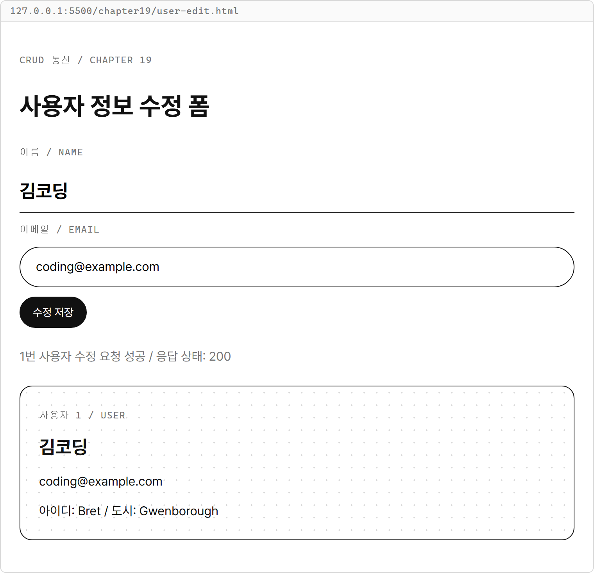

**해설**

- 조회 성공 뒤 `user`를 채우고 입력칸의 `value`를 설정합니다. 조회에 실패해 `user === null`이면 수정 요청을 보내지 않습니다.
- `{ ...user, name: name, email: email }`은 변경하지 않은 아이디·주소·회사 정보까지 담은 전체 사용자 객체입니다.
- `user = await response.json();`으로 응답을 받은 뒤에만 카드를 갱신합니다.
- 주소 객체 자체는 고치지 않으므로 안쪽까지 다시 복사할 필요가 없습니다.
- PUT 응답으로 화면을 바꾼 뒤 다시 GET을 보내지 않습니다. 다시 조회하면 JSONPlaceholder의 원래 사용자 정보가 나옵니다.
