# 20장. [종합 프로젝트] 게시글 관리

**학습목표**

- Grid로 입력 영역, 검색 영역, 게시글 카드 목록을 배치할 수 있습니다.
- GET·POST·DELETE 응답을 상태 배열에 반영하고 목록을 다시 그릴 수 있습니다.
- 제목 검색으로 표시할 목록을 고르면서 전체 상태 배열을 유지할 수 있습니다.
- 요청에 실패하면 안내를 표시하고 기존 목록과 작성 중인 입력값을 유지할 수 있습니다.

**사용하는 장**

6~8장, 13~19장

**이 장에서 만드는 것**

14장의 할 일 보드처럼 입력 폼과 카드 목록을 한 화면에서 관리합니다.
이번에는 코드에 적어 둔 초기 배열 대신 JSONPlaceholder에서 게시글 10개를 받습니다.
등록·삭제 요청이 성공하면 상태 배열을 바꾸고, 검색 버튼을 누르면 제목에 맞는 카드만 표시합니다.

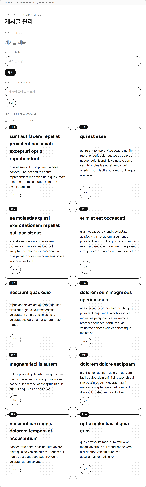

**요구사항**

| 번호 | 기능 | 가져오는 코드·기능 |
|---|---|---|
| 1 | 입력·검색·목록 배치 | 14장 보드의 공통 클래스, 15장의 Grid |
| 2 | 게시글 10개 조회 | 18장 `post-list.html`의 `posts`와 `render()` |
| 3 | 등록·삭제 응답 반영 | 8장의 `addPost()`·`deletePost()`, 19장의 요청 코드 |
| 4 | 제목 검색 | 14장 보드의 전체·표시 목록 구분, `filter()` |
| 5 | 요청 실패 안내 | 18·19장의 `response.ok`·`throw`·`try`·`catch` |

19장에서 확인한 대로 JSONPlaceholder는 등록·삭제 결과를 실제로 저장하지 않습니다. ([JSONPlaceholder 공식 안내](https://jsonplaceholder.typicode.com/))
화면의 변경은 응답을 받은 브라우저의 `posts`에 남습니다.
이 실습은 원래 있는 1번 게시글을 한 번 삭제하고, 새 게시글을 한 번 등록해 101번 응답을 확인합니다.

등록을 반복하면 새 번호가 102로 늘지 않고 다시 101이 됩니다.
101번은 서버에 저장된 게시글이 아니므로 이후 조회·삭제 대상으로 사용하지 않습니다.
각 요청의 결과가 표시된 뒤 다음 동작을 하고, 단계를 바꿀 때는 해당 파일을 새로 엽니다.

**준비**

1. `js-course` 안에 `chapter20` 폴더를 만듭니다.
2. 그 안에 `post-1.html`부터 `post-5.html`까지 파일 다섯 개를 만듭니다.
3. 1장에서 만든 `css/common.css`를 그대로 연결합니다.

각 단계에는 앞 단계의 기능을 포함한 전체 파일을 제공합니다.
파일 여는 방법은 1-3을 따릅니다.
다른 단계의 HTML이나 JavaScript를 연결하지 않으므로 각 파일을 따로 열어 확인할 수 있습니다.

**시작 코드**

20-1의 `post-1.html`이 시작 파일입니다.
14장 `board-5.html`의 입력 폼·카드·배지·버튼 배치를 가져오고, 게시글에 맞춰 이름과 내용을 바꿉니다.
할 일의 완료 토글과 진행률 함수는 이 프로젝트에서 사용하지 않습니다.

## 20-1 화면 배치

**목표**

입력 폼과 검색 영역은 전체 폭으로 펼치고 게시글 카드는 두 열에 놓습니다.
이 단계는 화면 배치만 확인하므로 등록·검색·삭제 버튼에 동작을 연결하지 않습니다.

**힌트**

- 14장 `board-5.html`의 `page`·`form`·`card-list`·`card`·`badge` 클래스를 이어 씁니다.
- 15장 `column-span.html`처럼 부모에 열을 지정하고 자식에 `grid-column: 1 / -1;`을 씁니다.
- 카드 목록은 입력 폼과 검색 영역 밖에 둡니다.

`post-grid`는 페이지의 두 열을 만들고, `entry-form`과 `search-area`는 그 두 열 전체를 차지합니다.
`post-list`는 바깥 Grid의 전체 폭을 차지하면서 내부 카드도 두 열에 배치합니다.
공통 CSS는 고치지 않고 이 HTML의 `<style>`에 배치 규칙을 더합니다.

**시각자료 — 화면에서 각 영역이 차지하는 칸**

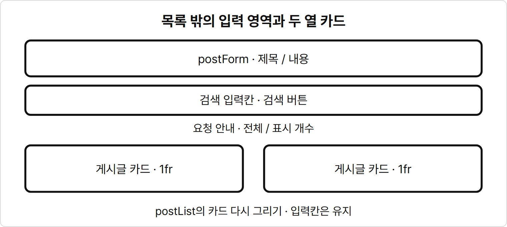

입력칸과 검색칸은 카드 목록 밖에 남습니다.
목록을 다시 그릴 때는 아래 카드 영역만 교체합니다.

**시작 코드**

`chapter20/post-1.html`

```html
<!DOCTYPE html>
<html lang="ko">
<head>
  <meta charset="UTF-8">
  <title>게시글 관리</title>
  <link rel="stylesheet" href="../css/common.css">
  <style>
    .post-grid {
      display: grid;
      grid-template-columns: repeat(2, 1fr);
      gap: 24px;
    }

    .entry-form,
    .search-area,
    .message-area,
    .post-list {
      grid-column: 1 / -1;
    }

    .post-list {
      grid-template-columns: repeat(2, 1fr);
    }
  </style>
</head>
<body>
  <main class="page post-grid">
    <header class="entry-form">
      <p class="label">종합 프로젝트 / CHAPTER 20</p>
      <h1>게시글 관리</h1>
    </header>
    <form id="postForm" class="form entry-form">
      <label class="label" for="titleInput">제목 / TITLE</label>
      <input id="titleInput" name="title" class="title-input" placeholder="게시글 제목">
      <label class="label" for="contentInput">내용 / BODY</label>
      <input id="contentInput" name="body" class="input" placeholder="게시글 내용">
      <div class="button-group">
        <button id="submitButton" class="btn selected" type="button">등록</button>
      </div>
    </form>
    <section class="form search-area">
      <label class="label" for="searchInput">제목 검색 / SEARCH</label>
      <input id="searchInput" class="input" placeholder="제목에 들어 있는 글자">
      <div class="button-group">
        <button id="searchButton" class="btn" type="button">검색</button>
      </div>
    </section>
    <div class="form message-area">
      <p id="message" class="muted">화면 구성을 확인합니다.</p>
      <p id="resultCount" class="label">배치 확인용 카드 2개</p>
    </div>
    <section id="postList" class="card-list post-list">
      <article class="card">
        <span class="badge">글 1</span>
        <h2>게시글 프로젝트</h2>
        <p>화면 배치를 확인하는 예시 글입니다.</p>
        <div class="button-group">
          <button class="btn" type="button">삭제</button>
        </div>
      </article>
      <article class="card">
        <span class="badge">글 2</span>
        <h2>배열 공부</h2>
        <p>상태 배열로 카드 목록을 그립니다.</p>
        <div class="button-group">
          <button class="btn" type="button">삭제</button>
        </div>
      </article>
    </section>
  </main>

  <script>
    // 화면 배치를 확인한 뒤 동작을 연결합니다.
  </script>
</body>
</html>
```

**확인 방법**

1. `post-1.html`을 엽니다.
2. 제목·내용 입력칸, 검색 입력칸, 예시 카드 두 개를 확인합니다.
3. 등록·검색·삭제 버튼을 눌러도 카드가 바뀌지 않는지 확인합니다.

**실행 결과**

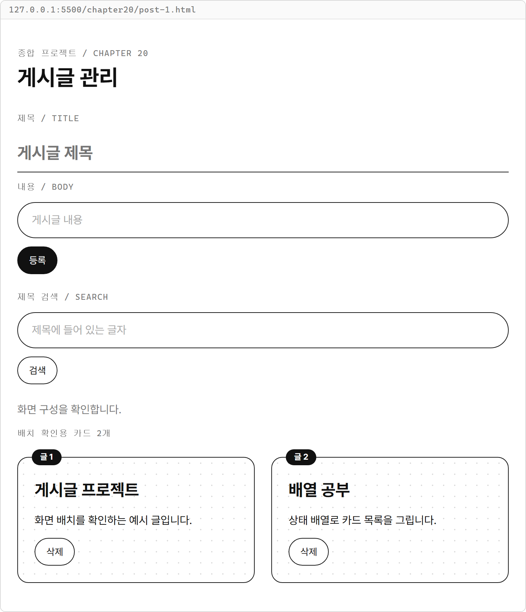

**코드 설명**

- `.post-grid`의 `repeat(2, 1fr)`은 같은 너비의 두 열을 만듭니다.
- `grid-column: 1 / -1;`은 첫 선부터 마지막 선까지 차지하게 합니다.
- `.post-list`는 공통 `.card-list`의 세 열을 이 페이지에서 두 열로 바꿉니다.
- `contentInput` 이름은 13장 폼에서 이어 쓰고, `name="body"`는 서버 게시글의 내용 속성 이름과 맞춥니다.
- 입력 요소를 다 읽은 뒤 실행하도록 `<script>`는 `</body>` 바로 앞에 둡니다.

## 20-2 목록 불러오기

**목표**

페이지를 열면 `/posts?_limit=10`으로 GET 요청을 보내고 받은 배열을 카드로 그립니다.
이 단계의 등록·검색 버튼은 화면 자리를 유지하며 아직 동작하지 않습니다.

**힌트**

- 18장 `post-list.html`의 `posts`·`postList`·`message`·`render()`를 가져옵니다.
- 19장 `post-list.html`처럼 시작 요청은 `main()`에서 실행합니다.
- `response.ok`를 확인하고 `await response.json()`으로 받은 배열을 `posts`에 넣습니다.

기존 확인용 카드를 비우고 `render()`가 현재 배열로 그리게 바꿉니다.
`?_limit=10`은 서버에 요청하는 조회 개수이며, 받은 목록에서 처음 번호는 1입니다.
서버 예제의 영문 제목과 내용을 그대로 표시합니다.

**시각자료 — 조회한 목록을 화면에 반영하기**

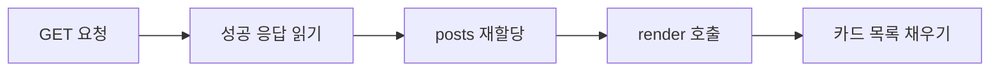

그림은 조회에 성공한 흐름입니다.
상태 배열을 받은 다음에 목록을 다시 그립니다.

**실습 코드**

`post-1.html`의 배치에 상태 배열, `render()`, 초기 GET 요청을 더한 전체 파일입니다.

`chapter20/post-2.html`

```html
<!DOCTYPE html>
<html lang="ko">
<head>
  <meta charset="UTF-8">
  <title>게시글 관리</title>
  <link rel="stylesheet" href="../css/common.css">
  <style>
    .post-grid {
      display: grid;
      grid-template-columns: repeat(2, 1fr);
      gap: 24px;
    }

    .entry-form,
    .search-area,
    .message-area,
    .post-list {
      grid-column: 1 / -1;
    }

    .post-list {
      grid-template-columns: repeat(2, 1fr);
    }
  </style>
</head>
<body>
  <main class="page post-grid">
    <header class="entry-form">
      <p class="label">종합 프로젝트 / CHAPTER 20</p>
      <h1>게시글 관리</h1>
    </header>
    <form id="postForm" class="form entry-form">
      <label class="label" for="titleInput">제목 / TITLE</label>
      <input id="titleInput" name="title" class="title-input" placeholder="게시글 제목">
      <label class="label" for="contentInput">내용 / BODY</label>
      <input id="contentInput" name="body" class="input" placeholder="게시글 내용">
      <div class="button-group">
        <button id="submitButton" class="btn selected" type="button">등록</button>
      </div>
    </form>
    <section class="form search-area">
      <label class="label" for="searchInput">제목 검색 / SEARCH</label>
      <input id="searchInput" class="input" placeholder="제목에 들어 있는 글자">
      <div class="button-group">
        <button id="searchButton" class="btn" type="button">검색</button>
      </div>
    </section>
    <div class="form message-area">
      <p id="message" class="muted"></p>
      <p id="resultCount" class="label"></p>
    </div>
    <section id="postList" class="card-list post-list"></section>
  </main>

  <script>
    let posts = [];

    const postList = document.querySelector("#postList");
    const message = document.querySelector("#message");
    const resultCount = document.querySelector("#resultCount");

    function render() {
      postList.innerHTML = posts.map((post) => `
        <article class="card">
          <span class="badge">글 ${post.id}</span>
          <h2>${post.title}</h2>
          <p>${post.body}</p>
        </article>
      `).join("") || `<p class="muted">표시할 게시글이 없습니다.</p>`;
      resultCount.innerHTML = `게시글 ${posts.length}개`;
    }

    async function main() {
      try {
        const response = await fetch("https://jsonplaceholder.typicode.com/posts?_limit=10");
        if (!response.ok) {
          throw new Error(`목록 조회 실패: ${response.status}`);
        }
        posts = await response.json();
        render();
        message.innerHTML = `게시글 ${posts.length}개를 받았습니다.`;
      } catch (error) {
        message.innerHTML = error.message;
      }
    }

    render();
    main();
  </script>
</body>
</html>
```

**확인 방법**

1. `post-2.html`을 열고 `게시글 10개를 받았습니다.` 안내를 확인합니다.
2. 1~10번 카드가 두 열로 배치되고 마지막 행에 9·10번이 있는지 확인합니다.
3. 제목 입력칸에 글을 적어도 목록의 제목이 바뀌지 않는지 확인합니다.

**실행 결과**

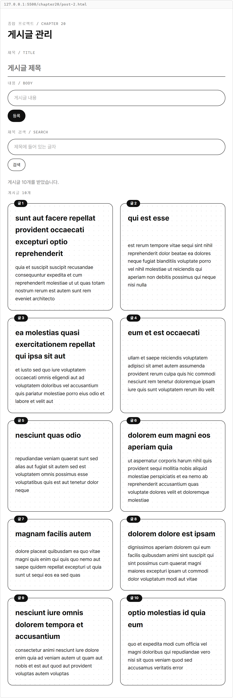

**코드 설명**

- `let posts = [];`로 시작하고 조회 성공 뒤 받은 배열로 교체합니다.
- `main()`의 `fetch()`와 `response.json()`에는 각각 `await`를 씁니다.
- `if (!response.ok)`에서 실패하면 `throw new Error()`로 `catch`에 보냅니다. 18·19장의 요청 형태와 같습니다.
- `map()`·`join("")`·`innerHTML`은 현재 배열의 카드만 그립니다.
- 빈 배열이면 `||` 오른쪽의 빈 목록 안내를 표시합니다. `render()`는 입력칸을 다시 만들지 않습니다.

## 20-3 등록·삭제

**목표**

제목과 내용을 POST로 보내 응답 게시글을 추가하고, 카드의 DELETE 요청이 성공하면 그 게시글을 제외합니다.
새 번호는 19장처럼 등록 응답에서 받습니다.

**힌트**

- 8장 `post-crud.js`의 `addPost(posts, newPost)`와 `deletePost(posts, id)`를 그대로 복사합니다.
- 14장 `board-5.html`의 `handleInput()`·`resetForm()`·`handleSubmit()`·`handleListClick()` 역할을 이어 씁니다.
- 13장 `note-list.html`의 두 입력칸 처리 방식을 가져와 `post`에 `title`·`body`를 저장합니다.
- 19장 `todo-crud.html`의 POST·DELETE 요청을 `/posts` 자원에 맞춰 사용합니다.

등록은 응답 객체 `savedPost`를 그대로 목록에 넣습니다.
삭제 응답에는 삭제한 게시글 객체가 없으므로 성공 상태를 확인한 뒤 요청한 `id`로 목록을 거릅니다.
성공 직후 GET으로 다시 조회하면 가짜 서버의 원래 목록으로 돌아가므로 변경한 상태로 다시 그립니다.

| 동작 | 요청 대상 | 성공 뒤 상태 변경 |
|---|---|---|
| 등록 | POST `/posts` | `posts = addPost(posts, savedPost)` |
| 삭제 | DELETE `/posts/번호` | `posts = deletePost(posts, id)` |

**실습 코드**

`post-2.html`에 두 데이터 함수, 입력 처리, 등록 폼 제출과 목록의 클릭 처리를 더한 전체 파일입니다.
검색 버튼은 아직 연결하지 않습니다.

`chapter20/post-3.html`

```html
<!DOCTYPE html>
<html lang="ko">
<head>
  <meta charset="UTF-8">
  <title>게시글 관리</title>
  <link rel="stylesheet" href="../css/common.css">
  <style>
    .post-grid {
      display: grid;
      grid-template-columns: repeat(2, 1fr);
      gap: 24px;
    }

    .entry-form,
    .search-area,
    .message-area,
    .post-list {
      grid-column: 1 / -1;
    }

    .post-list {
      grid-template-columns: repeat(2, 1fr);
    }
  </style>
</head>
<body>
  <main class="page post-grid">
    <header class="entry-form">
      <p class="label">종합 프로젝트 / CHAPTER 20</p>
      <h1>게시글 관리</h1>
    </header>
    <form id="postForm" class="form entry-form">
      <label class="label" for="titleInput">제목 / TITLE</label>
      <input id="titleInput" name="title" class="title-input" placeholder="게시글 제목">
      <label class="label" for="contentInput">내용 / BODY</label>
      <input id="contentInput" name="body" class="input" placeholder="게시글 내용">
      <div class="button-group">
        <button id="submitButton" class="btn selected" type="submit">등록</button>
      </div>
    </form>
    <section class="form search-area">
      <label class="label" for="searchInput">제목 검색 / SEARCH</label>
      <input id="searchInput" class="input" placeholder="제목에 들어 있는 글자">
      <div class="button-group">
        <button id="searchButton" class="btn" type="button">검색</button>
      </div>
    </section>
    <div class="form message-area">
      <p id="message" class="muted"></p>
      <p id="resultCount" class="label"></p>
    </div>
    <section id="postList" class="card-list post-list"></section>
  </main>

  <script>
    function addPost(posts, newPost) {
      return [...posts, newPost];
    }

    function deletePost(posts, id) {
      return posts.filter((post) => post.id !== id);
    }

    let posts = [];
    let post = { title: "", body: "" };

    const postList = document.querySelector("#postList");
    const message = document.querySelector("#message");
    const resultCount = document.querySelector("#resultCount");
    const postForm = document.querySelector("#postForm");
    const titleInput = document.querySelector("#titleInput");
    const contentInput = document.querySelector("#contentInput");

    function render() {
      postList.innerHTML = posts.map((post) => `
        <article class="card">
          <span class="badge">글 ${post.id}</span>
          <h2>${post.title}</h2>
          <p>${post.body}</p>
          <div class="button-group">
            <button class="btn" type="button" data-action="delete" data-id="${post.id}">삭제</button>
          </div>
        </article>
      `).join("") || `<p class="muted">표시할 게시글이 없습니다.</p>`;
      resultCount.innerHTML = `게시글 ${posts.length}개`;
    }

    async function main() {
      try {
        const response = await fetch("https://jsonplaceholder.typicode.com/posts?_limit=10");
        if (!response.ok) {
          throw new Error(`목록 조회 실패: ${response.status}`);
        }
        posts = await response.json();
        render();
        message.innerHTML = `게시글 ${posts.length}개를 받았습니다.`;
      } catch (error) {
        message.innerHTML = error.message;
      }
    }

    function handleInput(e) {
      post = { ...post, [e.target.name]: e.target.value };
      render();
    }

    function resetForm() {
      post = { title: "", body: "" };
      titleInput.value = "";
      contentInput.value = "";
    }

    async function handleSubmit(e) {
      e.preventDefault();
      const { title, body } = post;
      const newPost = { userId: 1, title: title.trim(), body: body.trim() };
      if (newPost.title === "" || newPost.body === "") {
        message.innerHTML = "제목과 내용을 모두 입력해 주세요.";
        return;
      }

      try {
        const response = await fetch("https://jsonplaceholder.typicode.com/posts", {
          method: "POST",
          headers: { "Content-Type": "application/json; charset=UTF-8" },
          body: JSON.stringify(newPost)
        });
        if (!response.ok) {
          throw new Error(`등록 실패: ${response.status}`);
        }
        const savedPost = await response.json();
        posts = addPost(posts, savedPost);
        resetForm();
        render();
        message.innerHTML = `${savedPost.id}번 등록 요청 성공 / 응답 상태: ${response.status}`;
      } catch (error) {
        message.innerHTML = error.message;
      }
    }

    async function handleListClick(e) {
      if (e.target.dataset.action !== "delete") {
        return;
      }
      const id = Number(e.target.dataset.id);

      try {
        const response = await fetch(`https://jsonplaceholder.typicode.com/posts/${id}`, {
          method: "DELETE"
        });
        if (!response.ok) {
          throw new Error(`삭제 실패: ${response.status}`);
        }
        posts = deletePost(posts, id);
        render();
        message.innerHTML = `${id}번 삭제 요청 성공 / 응답 상태: ${response.status}`;
      } catch (error) {
        message.innerHTML = error.message;
      }
    }

    titleInput.addEventListener("input", handleInput);
    contentInput.addEventListener("input", handleInput);
    postForm.addEventListener("submit", handleSubmit);
    postList.addEventListener("click", handleListClick);
    render();
    main();
  </script>
</body>
</html>
```

**확인 방법**

1. `post-3.html`을 열고 처음 카드가 10개인지 확인합니다.
2. 제목에 `게시글 프로젝트`, 내용에 `상태 배열과 fetch를 연결합니다.`를 앞뒤에 공백을 두 칸씩 넣어 적어 둡니다.
3. 1번 카드의 삭제를 한 번 누릅니다. 카드가 9개가 되어도 입력값이 남는지 확인합니다.
4. 등록을 한 번 누릅니다. 101번 카드가 끝에 붙고 카드가 다시 10개인지 확인합니다.
5. 두 입력칸이 비워졌는지 확인한 뒤, 제목에 공백 세 칸과 내용에 `내용 있음`을 적고 등록을 누릅니다.

**실행 결과**

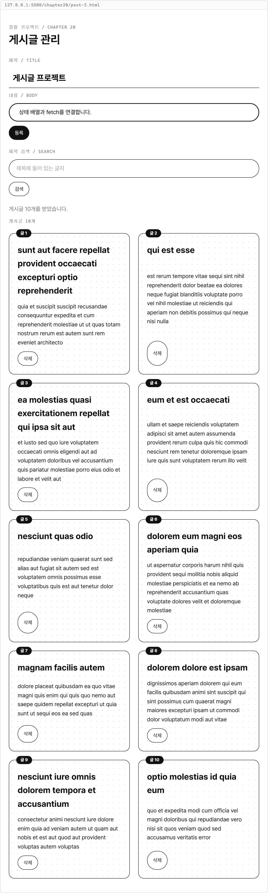

1번 삭제 요청에 성공하면 1번 카드가 빠지고 작성 중인 값은 남습니다.

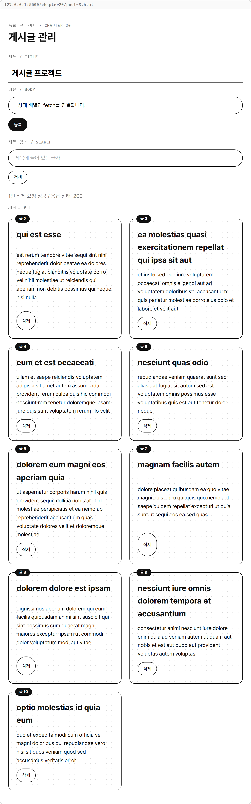

등록 요청에 성공하면 양끝 공백을 제거한 제목·내용의 101번 카드가 생깁니다.


공백 제목으로 제출하면 요청을 보내지 않고 입력 안내를 표시합니다.


**코드 설명**

- `post = { ...post, [e.target.name]: e.target.value };`는 입력한 칸의 값만 바꾼 새 객체입니다.
- `const { title, body } = post;`는 작성 중인 두 값을 구조분해로 꺼냅니다. `newPost`에는 `title: title.trim()`·`body: body.trim()`처럼 속성 이름과 값을 모두 씁니다.
- `userId: 1`은 서버 게시글의 작성자 번호입니다. `id`는 직접 만들지 않습니다.
- `JSON.stringify(newPost)`를 요청 옵션의 `body`에 넣고 JSON 헤더를 붙입니다.
- `posts = addPost(posts, savedPost);`는 성공 응답을 추가한 새 배열로 상태를 바꿉니다. 성공한 뒤에만 `resetForm()`을 호출합니다.
- 삭제 버튼에는 글자만 넣었으므로 `e.target.dataset.action`·`id`를 직접 읽습니다. 카드 제목이나 빈 곳을 누르면 `return`으로 끝냅니다.
- `deletePost()`는 번호가 다른 게시글만 남기고 `render()`는 남은 목록을 그립니다. 다른 카드의 번호는 바뀌지 않습니다.

## 20-4 검색

**목표**

검색칸에 글자를 적고 검색 버튼을 누르면, 현재 `posts` 중 제목에 그 글자가 들어 있는 카드만 표시합니다.
서버에 새 검색 요청을 보내지 않습니다.

**힌트**

- 14장 `board-5.html`에서 `todos`와 `visibleTodos`를 구분한 방식을 가져옵니다.
- 여기서는 전체 게시글을 `posts`, 검색 결과를 `visiblePosts`라고 합니다.
- 검색 버튼의 `handleSearchClick()`에서 `keyword`를 정하고 `render()`를 호출합니다.

### includes로 제목 확인하기

`includes()`는 문자열 안에 지정한 문자열이 들어 있는지 확인하는 메서드입니다.
포함되어 있으면 `true`, 없으면 `false`를 반환합니다.
`post.title.includes(keyword)`가 참인 게시글만 `filter()`로 남깁니다.

**특징**

- 제목 전체가 같지 않아도 일부 문자열이 들어 있으면 참입니다.
- 영문 대문자와 소문자를 구분합니다.
- 빈 문자열 `""`은 모든 문자열에 포함되므로 검색어를 비우면 전체 게시글을 표시합니다.

**기본 문법**

```javascript
문자열.includes(찾을 문자열);
```

| 제목 | 검색어 | 결과 |
|---|---|---|
| `"게시글 프로젝트"` | `"게시글"` | `true` |
| `"게시글 프로젝트"` | `"산책"` | `false` |
| `"JavaScript 복습"` | `"javascript"` | `false` |
| `"게시글 프로젝트"` | `""` | `true` |

대소문자 구분과 빈 문자열의 동작은 [MDN의 includes 안내](https://developer.mozilla.org/en-US/docs/Web/JavaScript/Reference/Global_Objects/String/includes)에서도 확인할 수 있습니다.
이 프로젝트의 검색 범위는 처음 받은 10개에 현재 화면의 등록·삭제를 반영한 `posts`입니다.
서버에 있는 나머지 90개를 검색하는 기능은 만들지 않습니다.

**시각자료 — 전체 목록과 검색 결과**

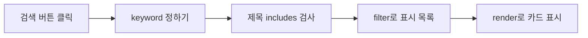

`posts`에는 전체 목록을 남겨 두고 `visiblePosts`만 새로 만듭니다.
검색어를 비우면 같은 전체 목록에서 다시 모든 게시글을 고를 수 있습니다.

**실습 코드**

`post-3.html`에 `keyword`와 `handleSearchClick()`을 더하고 `render()`에서 검색 결과를 그리는 전체 파일입니다.

`chapter20/post-4.html`

```html
<!DOCTYPE html>
<html lang="ko">
<head>
  <meta charset="UTF-8">
  <title>게시글 관리</title>
  <link rel="stylesheet" href="../css/common.css">
  <style>
    .post-grid {
      display: grid;
      grid-template-columns: repeat(2, 1fr);
      gap: 24px;
    }

    .entry-form,
    .search-area,
    .message-area,
    .post-list {
      grid-column: 1 / -1;
    }

    .post-list {
      grid-template-columns: repeat(2, 1fr);
    }
  </style>
</head>
<body>
  <main class="page post-grid">
    <header class="entry-form">
      <p class="label">종합 프로젝트 / CHAPTER 20</p>
      <h1>게시글 관리</h1>
    </header>
    <form id="postForm" class="form entry-form">
      <label class="label" for="titleInput">제목 / TITLE</label>
      <input id="titleInput" name="title" class="title-input" placeholder="게시글 제목">
      <label class="label" for="contentInput">내용 / BODY</label>
      <input id="contentInput" name="body" class="input" placeholder="게시글 내용">
      <div class="button-group">
        <button id="submitButton" class="btn selected" type="submit">등록</button>
      </div>
    </form>
    <section class="form search-area">
      <label class="label" for="searchInput">제목 검색 / SEARCH</label>
      <input id="searchInput" class="input" placeholder="제목에 들어 있는 글자">
      <div class="button-group">
        <button id="searchButton" class="btn" type="button">검색</button>
      </div>
    </section>
    <div class="form message-area">
      <p id="message" class="muted"></p>
      <p id="resultCount" class="label"></p>
    </div>
    <section id="postList" class="card-list post-list"></section>
  </main>

  <script>
    function addPost(posts, newPost) {
      return [...posts, newPost];
    }

    function deletePost(posts, id) {
      return posts.filter((post) => post.id !== id);
    }

    let posts = [];
    let post = { title: "", body: "" };
    let keyword = "";

    const postList = document.querySelector("#postList");
    const message = document.querySelector("#message");
    const resultCount = document.querySelector("#resultCount");
    const postForm = document.querySelector("#postForm");
    const titleInput = document.querySelector("#titleInput");
    const contentInput = document.querySelector("#contentInput");
    const searchInput = document.querySelector("#searchInput");
    const searchButton = document.querySelector("#searchButton");

    function render() {
      const visiblePosts = posts.filter((post) => post.title.includes(keyword));
      postList.innerHTML = visiblePosts.map((post) => `
        <article class="card">
          <span class="badge">글 ${post.id}</span>
          <h2>${post.title}</h2>
          <p>${post.body}</p>
          <div class="button-group">
            <button class="btn" type="button" data-action="delete" data-id="${post.id}">삭제</button>
          </div>
        </article>
      `).join("") || `<p class="muted">표시할 게시글이 없습니다.</p>`;
      resultCount.innerHTML = `전체 ${posts.length}개 / 표시 ${visiblePosts.length}개`;
    }

    async function main() {
      try {
        const response = await fetch("https://jsonplaceholder.typicode.com/posts?_limit=10");
        if (!response.ok) {
          throw new Error(`목록 조회 실패: ${response.status}`);
        }
        posts = await response.json();
        render();
        message.innerHTML = `게시글 ${posts.length}개를 받았습니다.`;
      } catch (error) {
        message.innerHTML = error.message;
      }
    }

    function handleInput(e) {
      post = { ...post, [e.target.name]: e.target.value };
      render();
    }

    function resetForm() {
      post = { title: "", body: "" };
      titleInput.value = "";
      contentInput.value = "";
    }

    async function handleSubmit(e) {
      e.preventDefault();
      const { title, body } = post;
      const newPost = { userId: 1, title: title.trim(), body: body.trim() };
      if (newPost.title === "" || newPost.body === "") {
        message.innerHTML = "제목과 내용을 모두 입력해 주세요.";
        return;
      }

      try {
        const response = await fetch("https://jsonplaceholder.typicode.com/posts", {
          method: "POST",
          headers: { "Content-Type": "application/json; charset=UTF-8" },
          body: JSON.stringify(newPost)
        });
        if (!response.ok) {
          throw new Error(`등록 실패: ${response.status}`);
        }
        const savedPost = await response.json();
        posts = addPost(posts, savedPost);
        resetForm();
        render();
        message.innerHTML = `${savedPost.id}번 등록 요청 성공 / 응답 상태: ${response.status}`;
      } catch (error) {
        message.innerHTML = error.message;
      }
    }

    async function handleListClick(e) {
      if (e.target.dataset.action !== "delete") {
        return;
      }
      const id = Number(e.target.dataset.id);

      try {
        const response = await fetch(`https://jsonplaceholder.typicode.com/posts/${id}`, {
          method: "DELETE"
        });
        if (!response.ok) {
          throw new Error(`삭제 실패: ${response.status}`);
        }
        posts = deletePost(posts, id);
        render();
        message.innerHTML = `${id}번 삭제 요청 성공 / 응답 상태: ${response.status}`;
      } catch (error) {
        message.innerHTML = error.message;
      }
    }

    function handleSearchClick() {
      keyword = searchInput.value.trim();
      render();
    }

    titleInput.addEventListener("input", handleInput);
    contentInput.addEventListener("input", handleInput);
    postForm.addEventListener("submit", handleSubmit);
    postList.addEventListener("click", handleListClick);
    searchButton.addEventListener("click", handleSearchClick);
    render();
    main();
  </script>
</body>
</html>
```

**확인 방법**

1. `post-4.html`을 열고 검색칸에 `qui est esse`를 앞뒤에 공백을 두 칸씩 넣어 적습니다.
2. 입력만 했을 때 카드 10개가 유지되는지 확인한 뒤 검색 버튼을 누릅니다.
3. 2번 카드만 표시되고 `전체 10개 / 표시 1개`가 되는지 확인합니다.
4. 검색어를 `없는제목`으로 바꾸고 검색을 누릅니다.
5. 검색어를 모두 지우고 검색을 누릅니다. 10개 카드가 돌아오는지 확인합니다.

**실행 결과**


검색 버튼을 눌러 `qui est esse`를 적용하면 2번 카드만 표시됩니다.

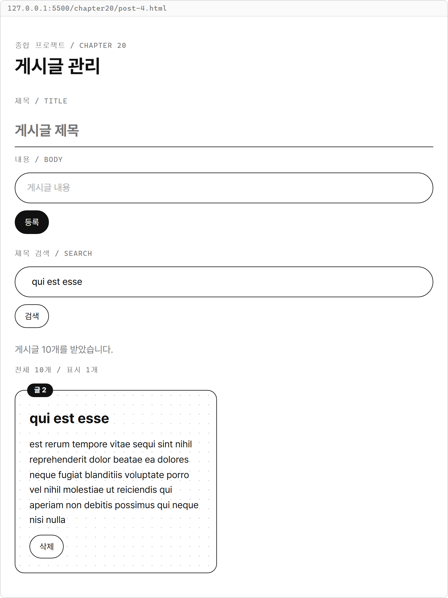

일치하는 제목이 없으면 전체 개수는 유지하고 빈 결과 안내를 표시합니다.

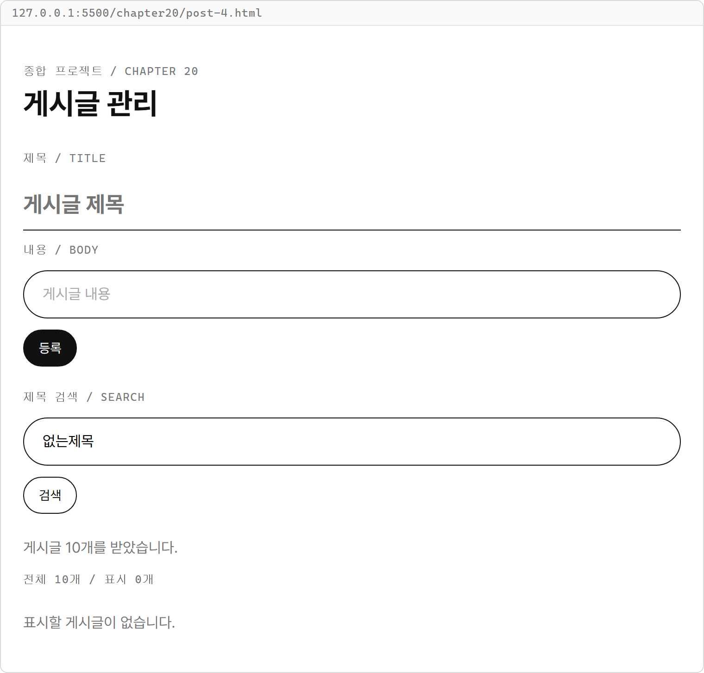

검색칸을 비우고 검색을 누르면 원래 목록이 다시 나타납니다.


**코드 설명**

- `searchInput.value`는 지금 적고 있는 글자이고 `keyword`는 마지막으로 검색 버튼을 눌러 적용한 값입니다. 입력만으로 검색 결과를 바꾸지 않습니다.
- `posts.filter((post) => post.title.includes(keyword))`는 조건에 맞는 게시글을 새 배열에 담습니다. `posts`에 이 결과를 재할당하지 않습니다.
- `render()`는 `visiblePosts`를 카드로 만들고 전체·표시 개수를 따로 보여 줍니다.
- 등록·삭제 뒤에도 같은 `keyword`로 다시 그립니다. 등록한 제목이 검색어와 맞지 않으면 상태에 추가되지만 검색 화면에는 나오지 않습니다.
- 검색칸과 작성 폼은 다시 만들지 않으므로 검색이나 삭제를 해도 입력값이 유지됩니다.

## 20-5 오류 처리

**목표**

모든 요청에서 HTTP 실패와 네트워크 오류를 처리하고, 실패한 동작에 맞는 한국어 안내를 표시합니다.
주소 오타로 요청을 실패시켜 목록과 입력칸이 유지되는지 확인합니다.

**힌트**

- 18장 `request-error.html`처럼 사용자에게는 안내를, Console에는 실제 원인을 남깁니다.
- 19장 `request-error.html`의 `console.log(error.name, error.message)`를 이어 씁니다.
- `main()`·`handleSubmit()`·`handleListClick()`의 각 요청에 `try`·`catch`와 `response.ok` 검사를 둡니다.

앞 단계에서도 `try`·`catch`로 요청 실패를 받아 `error.message`를 표시했습니다.
완성 파일에서는 목록 조회·등록·삭제의 안내를 구분하고 실제 오류 이름과 메시지를 Console에 출력합니다.
`catch`에서 상태 배열을 바꾸거나 폼을 비우지 않으므로 실패한 요청을 성공한 것처럼 반영하지 않습니다.

**시각자료 — 요청 성공과 실패의 처리 순서**

응답 상태와 본문 읽기에 모두 성공한 경우입니다.

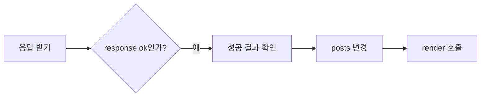

서버가 404처럼 실패 상태로 응답한 경우입니다.

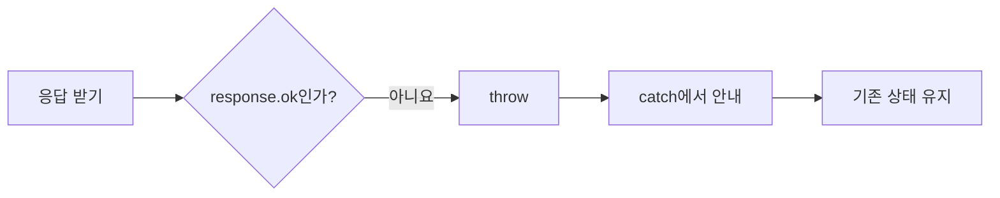

주소 오타로 연결 자체에 실패하면 응답 검사를 거치지 않습니다.

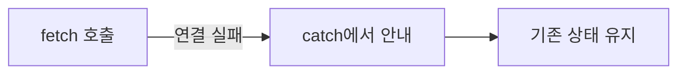

GET·POST의 응답 상태는 성공했지만 본문 읽기에 실패한 경우입니다.

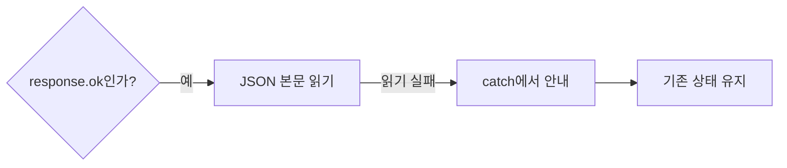

GET·POST는 응답 본문까지 읽은 뒤 상태에 반영합니다.
본문을 읽는 데 실패해도 같은 `catch`에서 처리합니다.
DELETE는 성공 상태만 확인하면 됩니다.

**완성 코드**

`post-4.html`의 세 `catch`를 동작별 안내와 실제 오류 출력으로 바꾼 전체 파일입니다.
이 파일이 프로젝트의 완성 코드이며 각 `fetch()`는 해당 동작의 함수 안에 그대로 둡니다.

`chapter20/post-5.html`

```html
<!DOCTYPE html>
<html lang="ko">
<head>
  <meta charset="UTF-8">
  <title>게시글 관리</title>
  <link rel="stylesheet" href="../css/common.css">
  <style>
    .post-grid {
      display: grid;
      grid-template-columns: repeat(2, 1fr);
      gap: 24px;
    }

    .entry-form,
    .search-area,
    .message-area,
    .post-list {
      grid-column: 1 / -1;
    }

    .post-list {
      grid-template-columns: repeat(2, 1fr);
    }
  </style>
</head>
<body>
  <main class="page post-grid">
    <header class="entry-form">
      <p class="label">종합 프로젝트 / CHAPTER 20</p>
      <h1>게시글 관리</h1>
    </header>
    <form id="postForm" class="form entry-form">
      <label class="label" for="titleInput">제목 / TITLE</label>
      <input id="titleInput" name="title" class="title-input" placeholder="게시글 제목">
      <label class="label" for="contentInput">내용 / BODY</label>
      <input id="contentInput" name="body" class="input" placeholder="게시글 내용">
      <div class="button-group">
        <button id="submitButton" class="btn selected" type="submit">등록</button>
      </div>
    </form>
    <section class="form search-area">
      <label class="label" for="searchInput">제목 검색 / SEARCH</label>
      <input id="searchInput" class="input" placeholder="제목에 들어 있는 글자">
      <div class="button-group">
        <button id="searchButton" class="btn" type="button">검색</button>
      </div>
    </section>
    <div class="form message-area">
      <p id="message" class="muted"></p>
      <p id="resultCount" class="label"></p>
    </div>
    <section id="postList" class="card-list post-list"></section>
  </main>

  <script>
    function addPost(posts, newPost) {
      return [...posts, newPost];
    }

    function deletePost(posts, id) {
      return posts.filter((post) => post.id !== id);
    }

    let posts = [];
    let post = { title: "", body: "" };
    let keyword = "";

    const postList = document.querySelector("#postList");
    const message = document.querySelector("#message");
    const resultCount = document.querySelector("#resultCount");
    const postForm = document.querySelector("#postForm");
    const titleInput = document.querySelector("#titleInput");
    const contentInput = document.querySelector("#contentInput");
    const searchInput = document.querySelector("#searchInput");
    const searchButton = document.querySelector("#searchButton");

    function render() {
      const visiblePosts = posts.filter((post) => post.title.includes(keyword));
      postList.innerHTML = visiblePosts.map((post) => `
        <article class="card">
          <span class="badge">글 ${post.id}</span>
          <h2>${post.title}</h2>
          <p>${post.body}</p>
          <div class="button-group">
            <button class="btn" type="button" data-action="delete" data-id="${post.id}">삭제</button>
          </div>
        </article>
      `).join("") || `<p class="muted">표시할 게시글이 없습니다.</p>`;
      resultCount.innerHTML = `전체 ${posts.length}개 / 표시 ${visiblePosts.length}개`;
    }

    async function main() {
      try {
        const response = await fetch("https://jsonplaceholder.typicode.com/posts?_limit=10");
        if (!response.ok) {
          throw new Error(`목록 조회 실패: ${response.status}`);
        }
        posts = await response.json();
        render();
        message.innerHTML = `게시글 ${posts.length}개를 받았습니다.`;
      } catch (error) {
        message.innerHTML = "목록을 불러오지 못했습니다. 주소와 연결을 확인해 주세요.";
        console.log(error.name, error.message);
      }
    }

    function handleInput(e) {
      post = { ...post, [e.target.name]: e.target.value };
      render();
    }

    function resetForm() {
      post = { title: "", body: "" };
      titleInput.value = "";
      contentInput.value = "";
    }

    async function handleSubmit(e) {
      e.preventDefault();
      const { title, body } = post;
      const newPost = { userId: 1, title: title.trim(), body: body.trim() };
      if (newPost.title === "" || newPost.body === "") {
        message.innerHTML = "제목과 내용을 모두 입력해 주세요.";
        return;
      }

      try {
        const response = await fetch("https://jsonplaceholder.typicode.com/posts", {
          method: "POST",
          headers: { "Content-Type": "application/json; charset=UTF-8" },
          body: JSON.stringify(newPost)
        });
        if (!response.ok) {
          throw new Error(`등록 실패: ${response.status}`);
        }
        const savedPost = await response.json();
        posts = addPost(posts, savedPost);
        resetForm();
        render();
        message.innerHTML = `${savedPost.id}번 등록 요청 성공 / 응답 상태: ${response.status}`;
      } catch (error) {
        message.innerHTML = "등록하지 못했습니다. 주소와 연결을 확인해 주세요.";
        console.log(error.name, error.message);
      }
    }

    async function handleListClick(e) {
      if (e.target.dataset.action !== "delete") {
        return;
      }
      const id = Number(e.target.dataset.id);

      try {
        const response = await fetch(`https://jsonplaceholder.typicode.com/posts/${id}`, {
          method: "DELETE"
        });
        if (!response.ok) {
          throw new Error(`삭제 실패: ${response.status}`);
        }
        posts = deletePost(posts, id);
        render();
        message.innerHTML = `${id}번 삭제 요청 성공 / 응답 상태: ${response.status}`;
      } catch (error) {
        message.innerHTML = "삭제하지 못했습니다. 주소와 연결을 확인해 주세요.";
        console.log(error.name, error.message);
      }
    }

    function handleSearchClick() {
      keyword = searchInput.value.trim();
      render();
    }

    titleInput.addEventListener("input", handleInput);
    contentInput.addEventListener("input", handleInput);
    postForm.addEventListener("submit", handleSubmit);
    postList.addEventListener("click", handleListClick);
    searchButton.addEventListener("click", handleSearchClick);
    render();
    main();
  </script>
</body>
</html>
```

**실행 방법**

1. `post-5.html`을 열고 게시글 10개를 받은 뒤 조작합니다.
2. 1번 카드의 삭제를 한 번 누릅니다.
3. 제목 `게시글 프로젝트`, 내용 `상태 배열과 fetch를 연결합니다.`를 적고 등록을 한 번 누릅니다.
4. 검색칸에 `게시글`을 적고 검색을 누릅니다. 101번 카드 하나가 표시되는지 확인합니다.
5. 검색칸을 비우고 검색을 눌러 전체 10개를 확인합니다.

**실행 결과**


1번 삭제 후 새 게시글을 등록하면 2~10번과 101번이 남습니다.

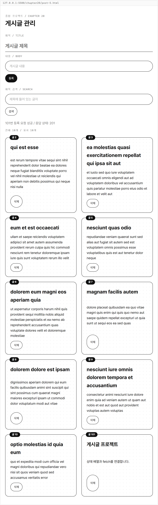

`게시글`로 검색하면 새로 등록한 응답 게시글만 표시됩니다.

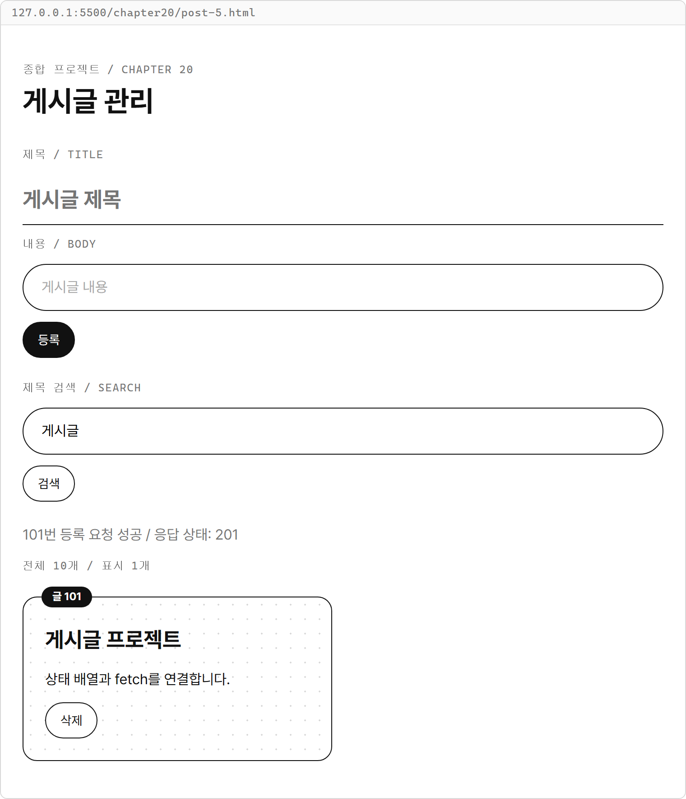

### 주소 오타로 실패 확인하기

다음 조작은 오류 처리를 확인하려고 일부러 주소를 바꿉니다.
완성 파일을 정상 주소로 복원한 뒤에는 다시 정상 조회를 확인합니다.

1. `main()`의 `const response = await fetch("https://jsonplaceholder.typicode.com/posts?_limit=10");`에서 `posts`를 `postss`로 바꿉니다.
2. 파일을 저장해 다시 엽니다. 서버가 응답한 404에서 `throw`를 거쳐 목록 조회 안내가 표시되는지 확인합니다.
3. 조회 주소를 원래대로 복원하고 파일을 다시 열어 카드 10개를 확인합니다.

**실행 결과**

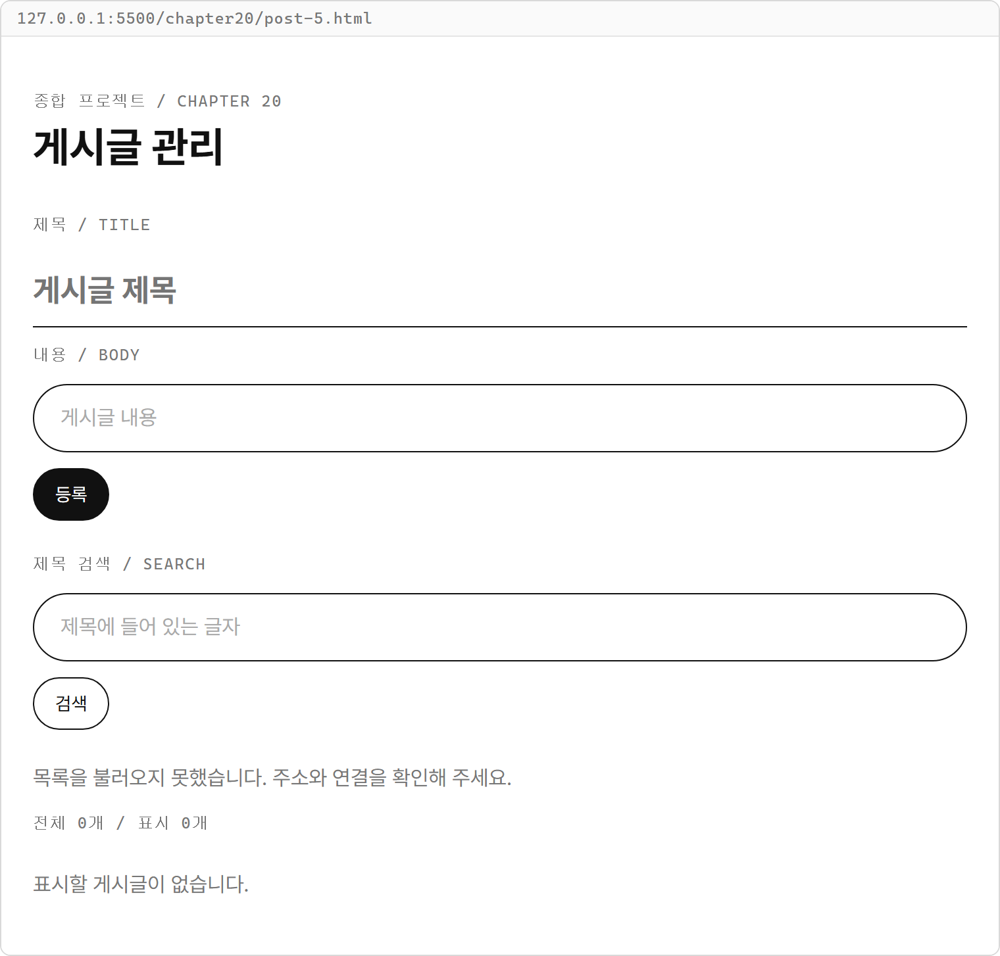

Console 탭에서 `console.log()`가 출력한 줄은 다음과 같습니다.

```text
Error 목록 조회 실패: 404
```

에러를 발생시킨 위치는 `main()`에서 `목록 조회 실패` 메시지를 만드는 `throw new Error()` 구문입니다.
오류를 처리했으므로 제목·내용·검색 영역은 그대로 남고, 카드 영역에는 빈 목록 안내가 표시됩니다.

등록 실패는 이미 조회한 목록을 남겨 두고 확인합니다.
`handleSubmit()`의 POST 주소 `https://jsonplaceholder.typicode.com/posts`에서 `.com`만 `.cmo`로 바꿉니다.
파일을 다시 열어 정상 목록이 나타난 뒤 제목 `다시 등록할 글`, 내용 `실패해도 입력값을 유지합니다.`를 적고 등록을 한 번 누릅니다.

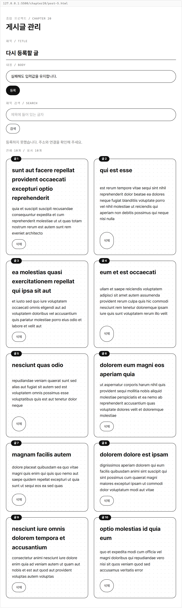

Console 탭에서 `console.log()`가 출력한 줄은 다음과 같습니다.

```text
TypeError Failed to fetch
```

이 실패는 `handleSubmit()`의 `await fetch(...)`에서 발생합니다.
응답을 받지 못했으므로 `response.ok` 검사까지 가지 않습니다.
브라우저의 네트워크 진단은 이 출력과 별도로 나올 수 있습니다.
실제 메시지는 환경에 따라 달라질 수 있습니다.

POST 주소를 복원하고 이번에는 `handleListClick()`의 DELETE 주소에서 `.com`만 `.cmo`로 바꿉니다.
파일을 다시 열어 목록을 받은 뒤 1번 카드의 삭제를 한 번 누릅니다.
`삭제하지 못했습니다. 주소와 연결을 확인해 주세요.`가 표시되고 1번 카드가 남습니다.


Console에는 같은 `TypeError Failed to fetch`가 나오며 발생 위치는 `handleListClick()`의 `await fetch(...)`입니다.
마지막으로 DELETE 주소도 복원하고 저장해 정상 목록을 확인합니다.
새로고침하면 가짜 서버의 원래 1~10번을 다시 받으므로 성공 직후의 목록과 달라질 수 있습니다.

**해설**

- `response.ok`가 거짓이면 성공 처리 전에 `throw`로 빠집니다. POST의 응답 읽기도 끝난 뒤에야 `addPost()`를 호출합니다.
- `catch`의 `message.innerHTML`은 실패한 동작에 맞는 안내를 표시합니다. 실제 오류의 `name`과 `message`는 Console에 남깁니다.
- GET 실패는 기존 `posts`를 교체하지 않고, POST 실패는 새 게시글을 넣거나 입력칸을 비우지 않습니다.
- DELETE 실패는 `deletePost()`를 호출하지 않으므로 클릭한 게시글이 목록에 남습니다.
- 검색은 요청을 보내지 않고 이미 받은 상태를 읽습니다. 실패 안내가 표시된 뒤에도 검색 버튼과 입력칸을 사용할 수 있습니다.

## 완성 코드와 해설

완성 파일은 20-5에 전체를 실은 `post-5.html`입니다.
14장의 보드에서 사용한 입력·상태·그리기·이벤트 위임에 19장의 통신 코드를 연결했습니다.

| 역할 | 값·함수 | 맡는 일 |
|---|---|---|
| 전체 상태 | `posts` | 조회·등록·삭제 결과를 기억 |
| 작성 상태 | `post` | 제출 전 제목과 내용 기억 |
| 검색 상태 | `keyword` | 마지막으로 검색한 값 기억 |
| 데이터 변경 | `addPost()`·`deletePost()` | 8장의 새 배열 반환 |
| 표시 | `render()` | 검색 결과와 개수 표시 |
| 초기 요청 | `main()` | 서버에서 10개 받기 |
| 이벤트 | `handleInput()`·`handleSubmit()` | 입력 저장과 POST 등록 |
| 이벤트 | `handleListClick()`·`handleSearchClick()` | DELETE 삭제와 제목 검색 |

- `posts`는 서버에서 받은 게시글 형태를 유지하므로 내용 속성은 `content`가 아니라 `body`입니다.
- `addPost()`와 `deletePost()`는 DOM과 통신을 다루지 않습니다. 요청한 쪽이 성공을 확인하고 새 배열을 현재 상태로 정합니다.
- `render()`는 전체 상태에서 표시할 목록을 고릅니다. 검색으로 전체 상태를 지우지 않으므로 검색어를 비워 목록을 복원할 수 있습니다.
- 폼, 검색칸, 목록 부모는 그대로 남고 카드만 교체합니다. 다시 만든 카드의 삭제도 부모에 연결한 이벤트가 처리합니다.

**바꿔 보기 1**

카드 배치를 한 열로 바꿔 봅니다.
원래 `post-5.html`에서 `.post-list`의 `grid-template-columns: repeat(2, 1fr);`만 다음처럼 바꿉니다.
`.post-grid`의 열 지정은 그대로 둡니다.

```css
grid-template-columns: 1fr;
```

파일을 다시 열면 10개 카드가 한 열로 놓입니다.
입력·검색 영역의 폭과 상태 배열의 내용은 같습니다.
`qui est esse`로 검색해도 같은 2번 게시글이 표시됩니다.

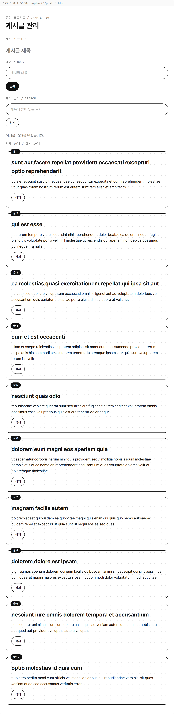

**바꿔 보기 2**

원래 완성 파일로 돌아와 새 게시글을 맨 앞에 표시해 봅니다.
`addPost()`의 `return [...posts, newPost];` 줄을 다음처럼 바꿉니다.

```javascript
return [newPost, ...posts];
```

파일을 다시 열고 1번을 한 번 삭제한 뒤 제목 `게시글 프로젝트`, 내용 `상태 배열과 fetch를 연결합니다.`로 한 번 등록합니다.
101번 응답 카드가 2번 카드보다 앞에 놓입니다.
검색은 그대로 동작하고 기존 게시글의 삭제 대상도 카드 위치가 아닌 `id`로 구분합니다.

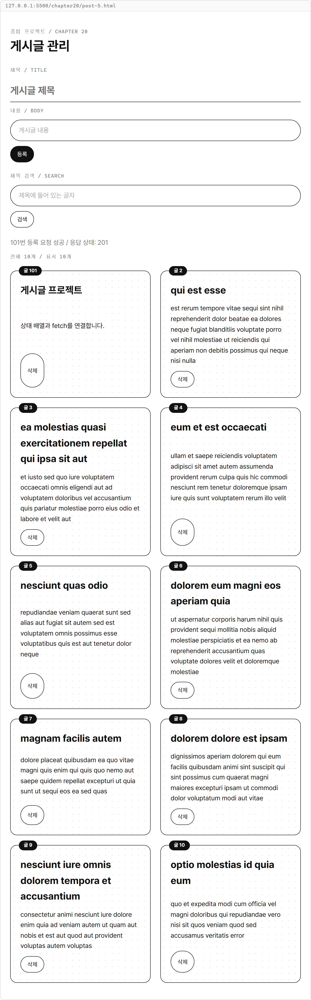

**완료 조건**

- 처음 GET으로 받은 1~10번 카드가 표시됩니다.
- 공백뿐인 제목·내용은 등록 요청을 보내지 않습니다.
- POST 성공 뒤 응답 게시글을 추가하고 폼을 비웁니다.
- DELETE 성공 뒤 요청한 번호만 제외하며 남은 번호를 유지합니다.
- 검색 버튼을 누를 때만 검색어를 적용하고 전체·표시 개수를 구분합니다.
- 일치하는 제목이 없으면 빈 결과를 알리고 빈 검색어로 전체 목록을 복원합니다.
- 요청 실패는 안내와 실제 원인을 남기고 기존 목록·입력값을 유지합니다.
